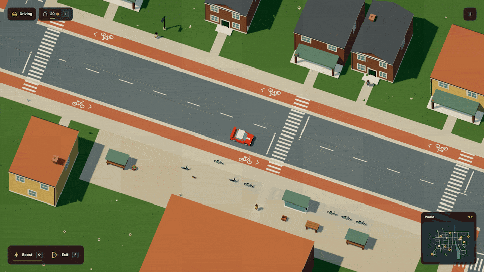
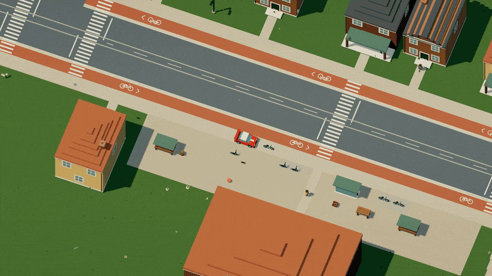
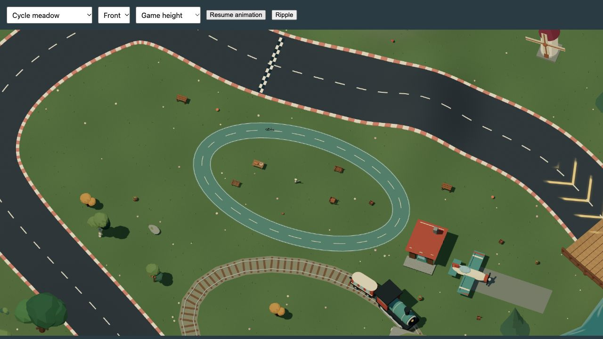
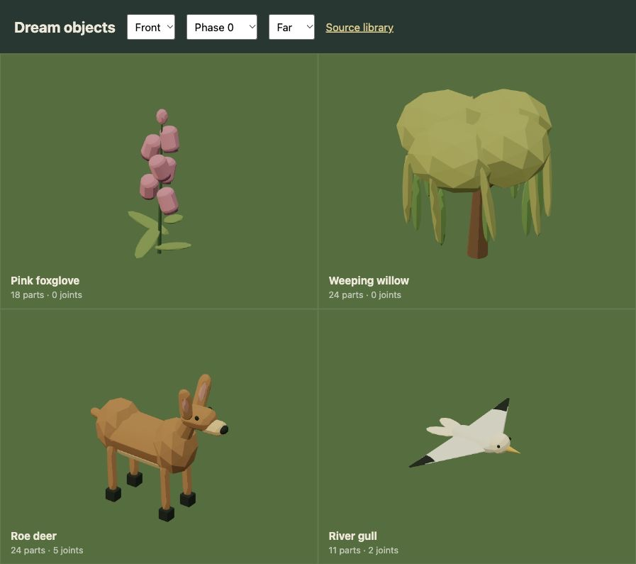
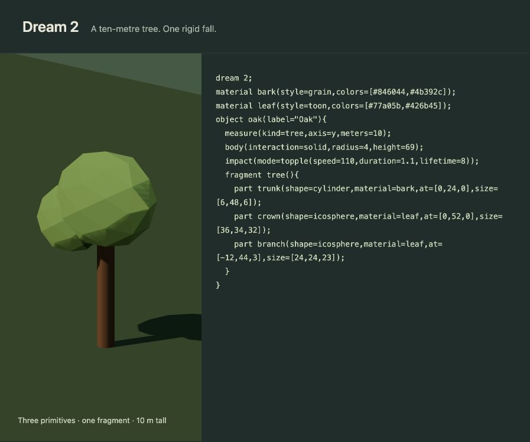
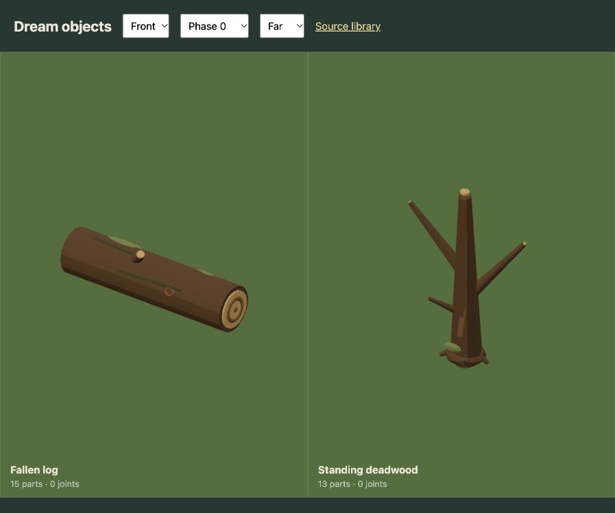
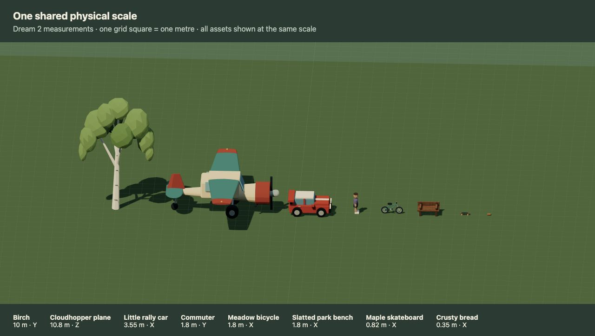

# Muse Dream

I want to sketch a world on paper and then explore it. Draw a road through the hills, put a castle next to it, add a car and see what happens when you drive into things. Muse would interpret the drawing and describe the whole world in Dream, including the objects and how they behave.

Racing is where this started. The idea is to make whatever someone draws playable.

[Play the prototype](https://musedream.vercel.app/) · [Explore Dream 2](https://minimumeffort-dev.github.io/muse.dream/) · [Start with an example](docs/dream/quickstart.md)


**The playable world is a handmade mock today.** The renderer, driving simulation and Dream 2 compiler work. Photo upload and Muse interpretation are still to come. There are no model calls or API keys to configure.

## You can leave the road

Follow the circuit or head into the hills. Climbing slows the car down, descending gives it speed, and a fast crest can launch it into the air. The camera follows you through the world, with a slightly closer view so the smaller objects are easier to see. Wooden bridges carry the track across water, and the train keeps running while you explore. Sunlight keeps the same direction as you move, with shadows covering the full view through hills, camera turns and flight.

Release the throttle and the car coasts to a complete stop on dry, flat ground. Tires hold across ordinary dry slopes instead of slowly creeping sideways. Steeper hills can still roll the car downhill, and ice keeps its lower grip.



[Watch in HD](docs/media/driving.mp4)

The whole world stays in memory while you explore. The renderer batches differently colored parts into fewer draws and reuses fixed world transforms, keeping the same assets, shadows, particles and post-processing. The [rendering notes](docs/rendering.md) include before/after measurements and a local profiler for checking changes.

Press **F** to get out of the car, walk over to another vehicle and press **F** again. You control the bicycle, skateboard, boat or plane yourself. Leave the lane, steer across the pond or take off from the runway. A vehicle stays where you park it, including the car you left behind.



[Watch the vehicle switch in HD](docs/media/switching.mp4)

WASD walks or drives. In the plane, Space climbs and Shift descends. Land before getting out; bring the boat close enough to dry shore to disembark. The camera moves closer for walking and smaller vehicles, then eases back out for the car. The objects keep their physical proportions.

Paths need room too. The meadow now has a four-metre-wide cycle circuit around its picnic area, and the riverside has a larger paved skating circuit. Both are over a hundred metres long. Their width is part of Dream 2, so the compiler can catch a road covering a lane or a tree planted on it. The bicycle starts beside the lane. Step out and walk over when you want to ride.



Some things move when you hit them. Others break. A ball bounces away, a bench comes apart in splinters, a tree falls as a whole, and a building can lose a section while its main structure stays solid. Those differences are declared in Dream 2.


The landscape has wildlife now: gulls and red kites fly overhead, deer and a fox move through clearings, and hares idle in the meadow. Ferns, broad leaves, foxgloves, lavender, reeds, daisies, hazel and weeping willows give the ground and riverbanks more variety. All of them are Dream 2 assemblies.



Wildlife follows bounded ambient routes without drawing roads or runways. Plants stay instanced, and animals use the existing animation budget. These are authored mock habitats; animal perception and avoidance are still to come. [See the assets](docs/asset-library.md), or [write a pair of flying birds](docs/examples/ambient-wildlife.dream).

## The world is made from small descriptions

Dream 2 is a compact text language for composing objects and worlds. It has named fields, reusable components and bounded repetition. A model can describe a new object without writing JavaScript or a shader. The engine builds its geometry and runs the supported behavior.



A complete tree looks like this:

```dream
dream 2;
material bark(style=grain,colors=[#846044,#4b392c]);
material leaf(style=toon,colors=[#77a05b,#426b45]);
object oak(label="Oak"){
  measure(kind=tree,axis=y,meters=10);
  body(interaction=solid,radius=4,height=69);
  impact(mode=topple(speed=110,duration=1.1,lifetime=8));
  fragment tree(){
    part trunk(shape=cylinder,material=bark,at=[0,24,0],size=[6,48,6]);
    part crown(shape=icosphere,material=leaf,at=[0,52,0],size=[36,34,32]);
    part branch(shape=icosphere,material=leaf,at=[-12,44,3],size=[24,24,23]);
  }
}
```

The [checked examples](docs/dream/examples.md) also include a bouncing ball, breakable bench and swinging sign. The documentation site highlights Dream commands, fields, references, colors and expressions, with copy buttons for complete examples.

[Copy this tree](docs/examples/toppling-tree.dream), [build a breakable bench](docs/examples/breakable-bench.dream), or [open the complete world](src/scene/world/open-world.dream). The live mock has 66 assemblies and 534 placements, all authored in Dream 2.

Objects share physical units. The car is 3.55 metres long, the plane has a 10.8-metre wingspan, and the skateboard is 0.82 metres long. A size declaration scales the geometry, collision body, seats and broken pieces together. The compiler checks proportions too, so a skateboard can't quietly become larger than the car.

The [asset library](docs/asset-library.md) covers all 66 world assemblies. Cars have window pillars and wheel hubs, bikes have chains and pedals, and buildings have framed windows, timber details and connected canopies. Trees have connected forks and bark markings, with seeded variation in their crowns. Deadwood uses tapered trunks and branches; fallen logs have cut ends, moss and varied headings on the ground. These details are Dream parts too, including the pieces released when something breaks.



Cylinder `part` and `beam` commands accept a bounded `taper` ratio, so a trunk can narrow without stacking separate tubes. [Try the complete wood example](docs/examples/tapered-wood.dream).



## Run it

```sh
git clone https://github.com/minimumeffort-dev/muse.dream.git
cd muse.dream
npm ci
npm run dev
```

Open [localhost:5173](http://127.0.0.1:5173/). A browser with WebGL is required.

| Control | Action |
| --- | --- |
| WASD / arrows | Walk or drive the current vehicle |
| Q / E | Rotate the view |
| F | Exit a vehicle, or enter one nearby while on foot |
| Space / Shift | Climb / descend in the plane |
| P / Escape | Pause |
| R | Return to the start, keeping changes to the world |
| Start over, in the pause menu | Reset the race and restore destroyed objects |

## Work with Dream 2

Check a standalone example:

```sh
node scripts/dream.mjs check docs/examples/toppling-tree.dream
```

Check the full world, including its module libraries and road/route validation:

```sh
node scripts/dream.mjs check src/scene/world/open-world.dream --modules src/scene --modules src/scene/world
```

[The docs](docs/README.md) cover composition, physical size, terrain, water, routes and destruction. For model integration, start with the [authoring instructions](docs/dream-v2-model.txt) and [generated command contract](docs/dream-v2-contract.json). Dream 2 source compiles to validated scene data; generated code never runs.

```sh
npm run docs:build # Highlighted static docs in dist-docs/
npm test       # Compiler, scene, simulation and rendering behavior
npm run build  # TypeScript + production build
```

The engine is split between [`src/scene`](src/scene), [`src/sim`](src/sim) and [`src/game`](src/game). [Current limits](docs/dream/reference.md#runtime-boundaries) include one driving height per XY, cylinder-based contacts and cosmetic debris. Water has surface waves and currents, rather than a volumetric fluid solver.

This is a pre-hackathon prototype. Pre-start code eligibility still needs checking against the official rules before a submission. [Provenance and verification notes](docs/agent-workflow.md) stay with the project.
