# Muse Dream

I want to sketch a world on paper and then explore it. Draw a road through the hills, put a castle next to it, add a car and see what happens when you drive into things. Muse would interpret the drawing and describe the whole world in Dream, including the objects and how they behave.

Racing is where this started. The idea is to make whatever someone draws playable.

[Play the prototype](https://musedream.vercel.app/) · [Explore Dream 2](https://minimumeffort-dev.github.io/muse.dream/) · [Start with an example](docs/dream/quickstart.md)


**The playable world is a handmade mock today.** The renderer, driving simulation and Dream 2 compiler work. Photo upload and Muse interpretation are still to come. There are no model calls or API keys to configure.

## Dreams Lab

The hackathon direction is a small research workspace: describe an environment
and a task, let Muse propose Dream source, run an agent and compare what changes
when you adjust a parameter. The engine owns the rules and measures the outcome.

The fresh [dreams-lab/ workspace](dreams-lab/README.md) uses the selected
[Workspace A layout](docs/dreams-lab.md): a brief beside the world, parameters
and agent activity, with source available when needed. It opens directly,
without the design chooser or repeated explanatory notices. It is a static
interface with illustrative data, shared gutters and aligned controls. Porting the compiler and runner, connecting
Muse and binding agents to a physical environment are the next steps.

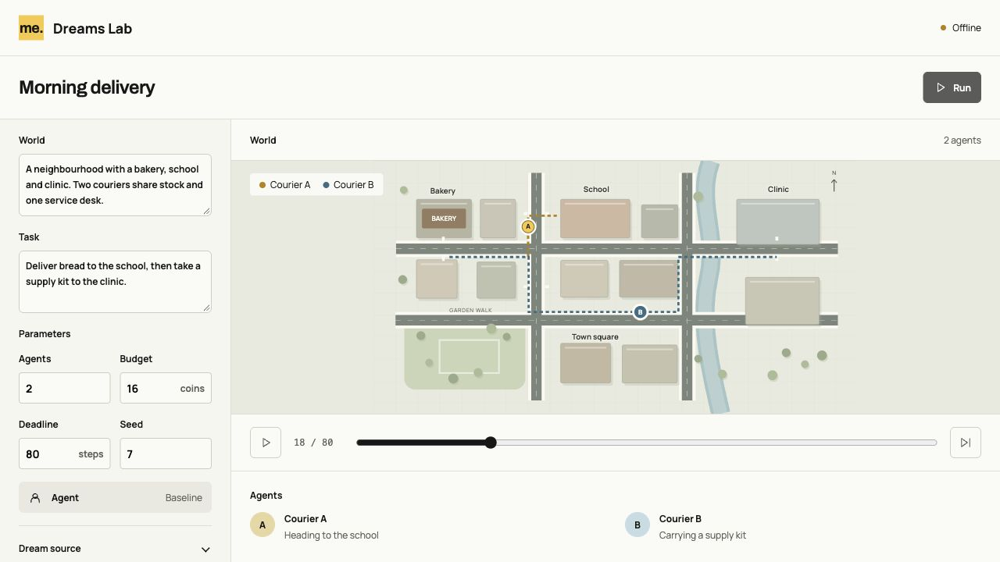

## Come home, go upstairs

Copper Court now has a connected first-floor lounge, with cushioned settees,
a table, plants and a bookcase. You can climb, sit and walk back out. The clerk
uses it for rest and meals bought with earned wages. Damaged furnishings join
the existing caretaker's finite repair work.

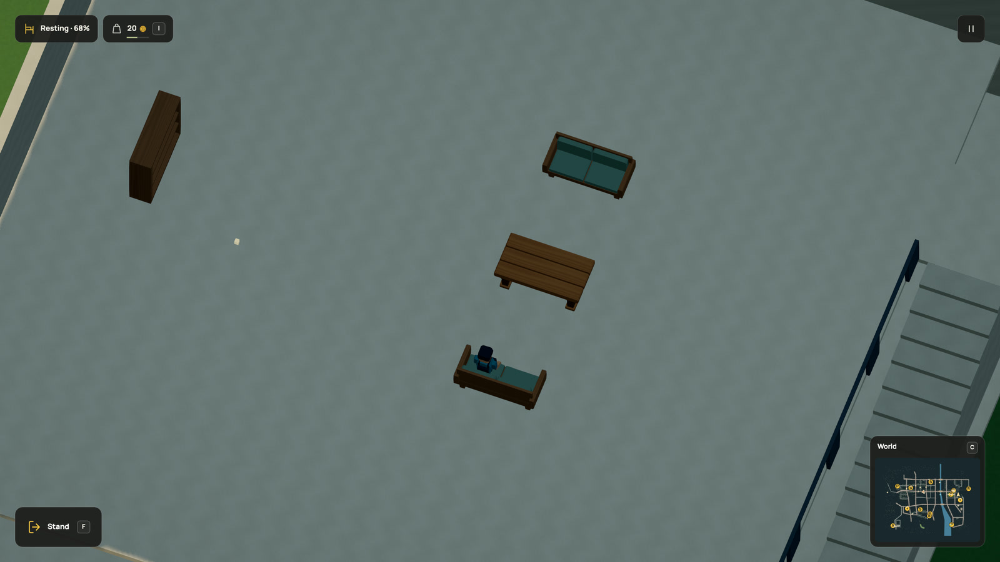

[Walk upstairs and back in HD](docs/media/homelounge.mp4) ·
[GIF](docs/media/homelounge.gif) · [Build it in Dream](docs/dream/residential-lounge.md)

## Paid work without extra goods

The bakery now has stocktaking alongside its recipes. Walk to the preparation
table, choose the task and finish it for a wage. You and the commuter share
three checks, the same workstation and the same finite business money. A check
creates no goods. Cancelling frees the task; finishing pays once, and progress
survives reload. Bakery checks retain a lifetime quota; other services can declare recurring windows.

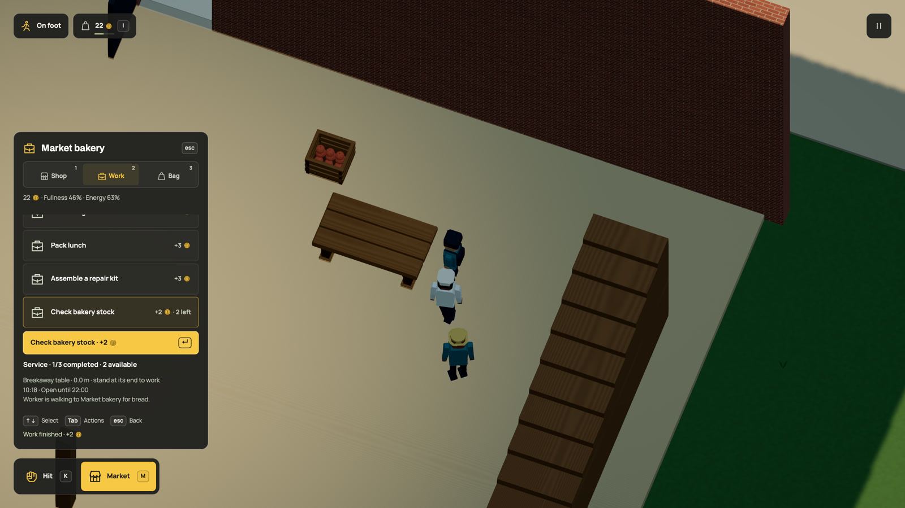

[Watch in HD](docs/media/servicework.mp4) · [GIF](docs/media/servicework.gif) ·
[Author a service in Dream](docs/dream/service-work.md)

## An office with actual work upstairs

The clerk lives in Copper Court, takes a break on its bench and walks across the
promenade to Lantern Exchange. You can take the same stairs and work at the
same records desk. A customer now sits on the waiting bench and requests a
check for eight coins. You or the clerk earn four for finishing it. Six checks
fit each 600-second window, and new work requires an actual paid request. Break the table and work stops until it is
repaired. Lifetime work history stays intact when the quota renews.

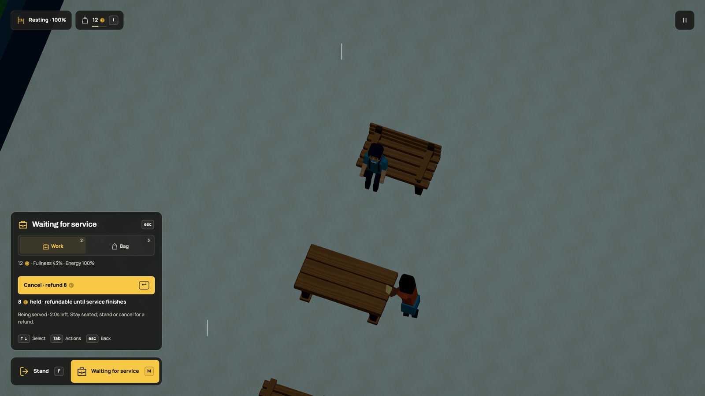

[Watch in HD](docs/media/servicevisit.mp4) · [GIF](docs/media/servicevisit.gif) ·
[Build the office in Dream](docs/dream/office-work.md) · [Customer visits](docs/dream/service-work.md#customers-make-the-work)

The doctor and commuter can make the same visit, using real pedestrian routes,
doors and stairs. Fees stay refundable until completion. Stand up, cancel or
lose the bench and the fee returns; break the desk and reserved wages return
too. Completed visits and cooldowns survive reload. There is one waiting
request per job for now.

## Earn lunch, then bring more bread

Station supplies now sells bread. The office clerk spends earned wages there,
walks back to Copper Court and eats on the same bench you can use. A courier
brings replacement loaves from the bakery, paid from the shop's actual takings.
There is no free meal or automatic stock refill.

The food recording below is from r117. Its route, purchase and seated meal
remain the same; current office wages depend on paying customers.


[Watch in HD](docs/media/stationfood.mp4) · [GIF](docs/media/stationfood.gif) ·
[Build the food routine in Dream](docs/dream/office-food.md)

## A station quarter with some height

The station side of town now has a 55-metre brick residential tower and a
75-metre office tower. Walk into either lobby, sit on a bench, or take one of the
four parked taxis and vans. Their entrances, promenade and parking connect to
Workshop Street; eight residents walk through the same pedestrian network.
Lantern Exchange now has a stair-connected mezzanine with two usable benches
and a table. The higher storeys and lifts are still to come. The taxis use the
existing car controls, without passengers or fares.

The quarter also shares the city's maintenance system. Break a bench or knock
over a light and the caretaker can walk over, spend a real repair kit and fix
it. Felled rowans need a sapling and grow back over time. The two lobby benches
use the same rule, reached through their doorways. Upstairs furniture also
connects to that service; the caretaker climbs before working and gets paid once.

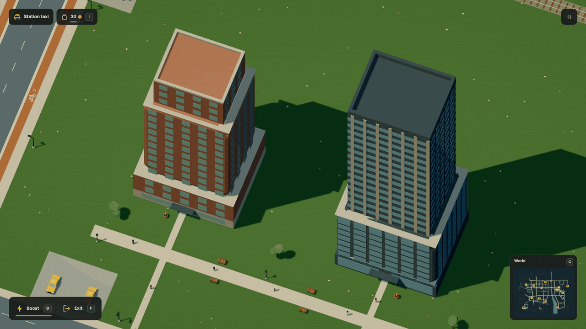

[Watch in HD](docs/media/stationquarter.mp4) ·
[Explore the district and its Dream source](docs/dream/station-quarter.md)

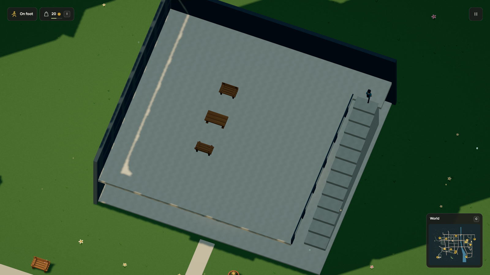

[Walk upstairs in HD](docs/media/towerroom.mp4) · [GIF](docs/media/towerroom.gif) ·
[Build the same floor connections in Dream](docs/examples/tower-mezzanine.dream)

Four missing crossings join the medical interchange, Copper Street, Weavers
Lane and South Terrace. Work journeys now also use short, supported links around
clear pavement corners. The caretaker's station-bench route is now 7,409 world units,
about 741 m. It was 7,479 after the first corner fixes, 9,546 after the crossings
and 20,983 before them. Saved
jobs keep their original paths; new plans use the shorter connections.
[Connected crossings and route checks](docs/urban-world.md#short-journeys-around-clear-corners).

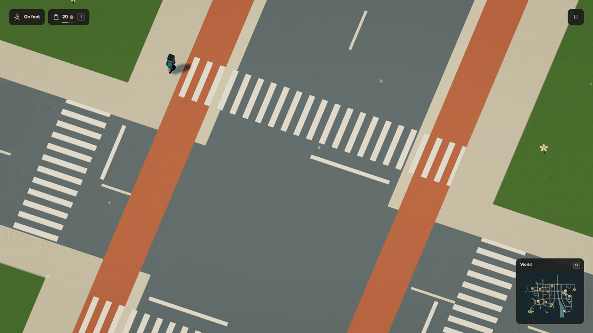

[Crossing walk in HD](docs/media/crossingwalk.mp4) ·
[The caretaker taking the corner](docs/media/workerwalk.mp4)

## Give each other room

People now clear the shared path portals around the station. They use their
body size to finish a turn and take a safe yielding step when another person
needs room. Restoring an old save keeps their positions and clocks; the group
then gets moving through the same Dream walking rules.

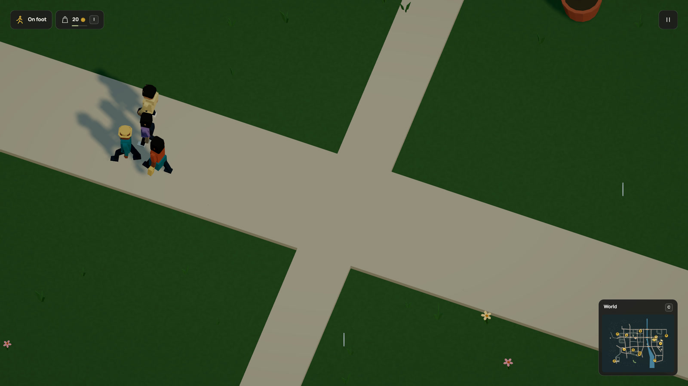

[Watch in HD](docs/media/crowdflow.mp4) · [GIF](docs/media/crowdflow.gif) ·
[Walking rules and limits](docs/dream/populations.md#give-residents-and-ground-wildlife-a-place)

## Come home and rest

The resident can now buy lunch, come home, recover on the settee and return to
paid work. Sit beside them with **F**. Energy recovers while seated; food still
comes from your bag, and wages still come from completed work. Broken or occupied
furniture follows the same rules for both of you. [Rest in Dream](docs/dream/resting.md).

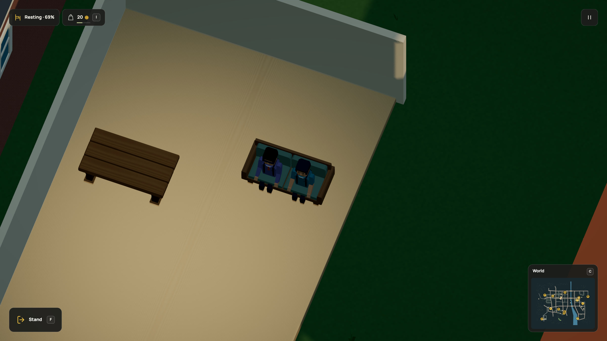

[Watch the rest flow](docs/media/rest.mp4) · [GIF](docs/media/rest.gif)


## Take a walk in Garden park

The old circuit is gone from the live city. Its western strip now has a park with
two sidewalk entrances, a walking loop, six benches, three bicycles and three
scooters. Eight visitors move through it, giving each other room on the paths. Sit with **F**, take a ride, or drive
somewhere else and come back. Damaged benches and lamps join the existing
caretaker's finite repair work.

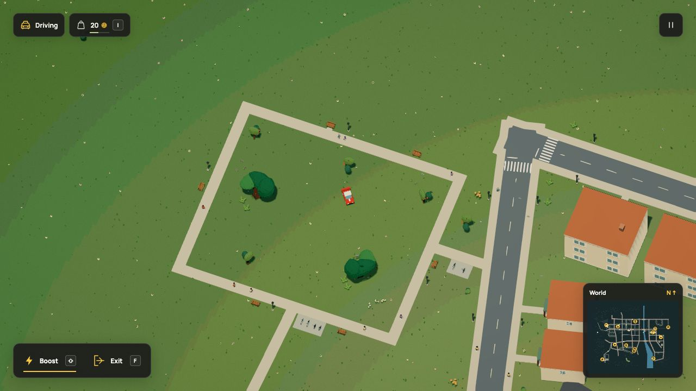

[Watch the park](docs/media/park.mp4) · [GIF](docs/media/park.gif) ·
[Build connected paths in Dream](docs/dream/paths.md)

Cycle tracks now carry their orange surface through declared junctions. A side
street can join both sides of an existing cycle route; an ending lane no longer
leaves an isolated orange cap across the road. Centerlines and stop bars leave
these connections clear. The minimap and city plan use the same outlines.

Click the minimap image or its header, or press **C**, to open the full map. Zoom with a trackpad,
pan, and set a waypoint. Ground vehicles now follow a route along the connected
Dream streets; the map and HUD share its next direction and remaining distance.
You can clear it from either view. With no personal waypoint, the same guide
points to your delivery or repair. **T** in the map finds the current work site.
[Map controls and route limits](docs/context-actions.md).
[Junction example and checks](docs/urban-world.md#cycle-connections).

## The whole world is made of voxels

The ground, roads, river, buildings, vehicles, people and plants now go through voxel construction. Dream describes the shapes and connections; the engine fills their cells and merges the visible faces. Wheels still turn, boats still pass under bridges, and breakable objects keep their authored pieces. A voxel doesn't need its own mesh or physics body.

The world loads around you as you drive, walk or fly. Terrain, streets, river surfaces and static objects are built in nearby chunks, with more prepared ahead of movement. Distant geometry is released. NPCs, collisions, water simulation and destruction keep their state when a district leaves view.

Diagonal roads and painted lines keep their actual outline. Curved object stamps use continuous voxel contours. Undeformed prism and hip-roof stamps retain their exact planar boundaries, so thin roof panels stay closed and flat slopes don't turn into stripes. Bridge ramps and their paint share a continuous surface, and water tiles share wave samples. Explicit fill/cut volumes keep their carved cells and fracture chunks.

The opening loader waits for the first neighbourhood. Validated pedestrian paths and collision cylinders are reused from the worker; road/transit and interactive-asset preparation yield between build steps. Camera rotation, manual zoom and offscreen shadow casters are included in streaming coverage. [How loading and memory work](docs/rendering.md#loading-and-memory).

Workplace connections reuse the existing nearest-node index, keeping the same paths while avoiding a full graph sort for each entrance. [Measured lookup cost and limits](docs/evidence/work-network-build/verification.md).

Ground fitting now reuses temporary vectors while keeping every support sample unchanged. [The allocation check](docs/evidence/support-sampling/verification.md) separates that measured change from browser frame rate.

Driving still uses the smooth heightfield and explicit contacts, so visual steps don't shake the car. Editable terrain and per-cell destruction are still further work.


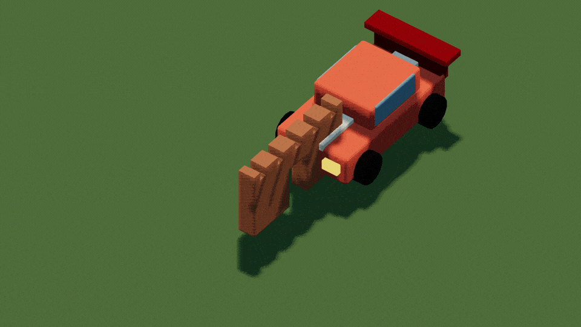

[How voxel construction works](docs/dream/voxels.md) · [Complete voxel world](docs/examples/voxel-world.dream)

## Brick, wood and stone

Brick walls now have staggered courses, thin mortar and small differences between bricks. Timber keeps its grain along the piece, and stone has mineral variation. The same finishes survive instancing and breaking apart. They're surface detail on the existing voxels, so a wall doesn't need hundreds of extra brick meshes.

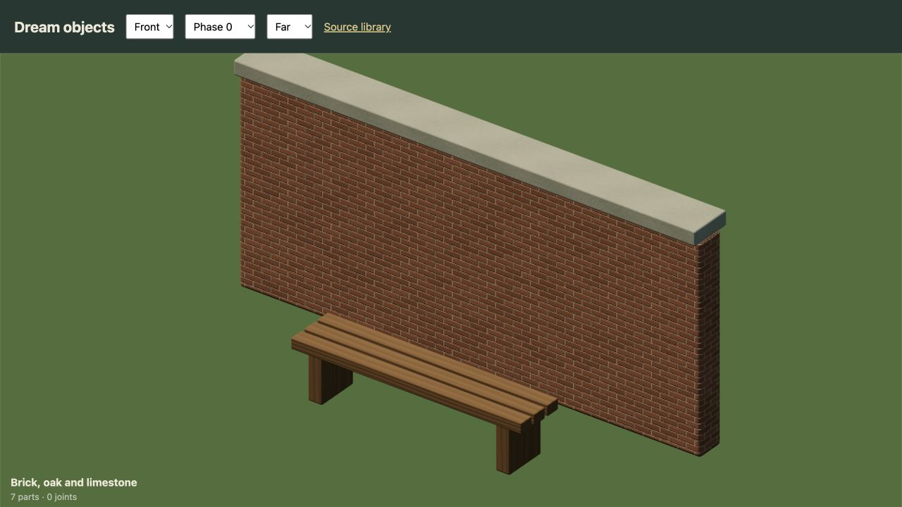

[Use the materials in Dream](docs/dream/objects.md#parts-and-materials) · [Complete wall and bench](docs/examples/material-finishes.dream)

## Build things the way they fit together

Houses now have framed glazing, readable floor heights, supported porches, roof edges and connected gutters. Buses have wheel openings and passenger doors. The tram and train run on two supported bogies. The launch has a pointed hull, a planked deck, an outboard and a cabin that fits its rider.


Roof panels now stay continuous across the gabled and hip-roof buildings. [See the roof check](docs/evidence/roof-surfaces/verification.md). The construction library includes 15 rebuilt assembly types used by 197 objects in the mock city. Dream 2 permits fine visual dimensions, so a pipe or window frame can keep its proportions when it becomes a voxel stamp. Bodies, contacts, world scale and part budgets stay bounded. [See how they're constructed](docs/asset-construction.md), or build the [house](docs/examples/terraced-house.dream), [bus](docs/examples/city-bus.dream) and [boat](docs/examples/cabin-launch.dream).

## Give the world a task

Before drawing becomes an input, a prompt needs a route into Dream. [Dream Lab](https://musedream.vercel.app/lab/) is the first working slice: write a brief, review its proposed Dream rules and run mock agents through the scenario. The local interpreter uses a town template and extracts a few parameters; it doesn't yet interpret arbitrary intent.

Two couriers can buy bread, deliver breakfast to a school and share a clinic's limited service capacity. The dashboard shows stock, spending, tasks, blocked requests and violations as they happen. Export every step as JSONL and replay it against the same source. Garden/habitat and class-preparation examples use the same resource and service rules.


This lab is a logical task network, separate from the 3D city's movement and collisions. The policies are mocks, not trained models. [Try the complete scenarios](docs/dream/scenarios.md), or read [what the language still needs for economics, ecology, education and healthcare operations](docs/world-systems.md).

## You can leave the road

Drive through the city or head out into the hills. Climbing slows the car down, descending gives it speed, and a fast crest can launch it into the air. The camera follows you through the world. The sun moves with the day clock, independently of driving and camera turns.

The world now covers 1.4 × 1.1 kilometres. It has been rebuilt around places people need: homes, markets, schools, a hospital, workplaces, a library and stations. The center has tighter frontages; garden streets and the southern neighborhood have more space around the houses. Streets, entrance paths, crossings and platforms actually connect. Street and cycle-track bends now share a continuous ribbon, crossing paint stays clear, and paved paths reach the courts, pitch and school yards.

The city now runs on its connected street network. The old racing circuit, checkpoints and track effects have been removed from the live world. Sidewalks and cycle tracks continue through the released space. Overlapping parallel crossings share one zebra pattern, and road lines stop before crossings. [See the street checks](docs/evidence/city-streets/verification.md).


The airport approach and hospital street now meet the avenue at separate T-junctions, with a clear block between them. The shuttle follows those streets; its lamps and crossings come from the same layout. [See the junction](docs/urban-world.md#buses-tram-and-regional-train).

Five buses serve the neighborhoods, schools, both medical centers, station and airport across four routes. A tram shares the main avenue, and a regional train stops at the stations. F boards those services as a passenger. Three scooters are available to drive near the market, medical center and airport. Schools, hospitals, airport and railway stations have symbols on the map. [Explore the city](docs/urban-world.md).

The regional airport has a glazed terminal, control tower, maintenance hangar and a continuous runway, with a separate apron and service road. Its bus stop, entrance paths and bicycle parking connect to town. The eastbank has its own medical center beside the station bus route. These are explorable mock places; interiors, clinical services and airport operations are still to come.


The map uses the game's actual geometry. Shared junctions keep the street centerlines aligned, and entrances move with their buildings. Dream now describes sites, crossings, route stops and the connections between them. [Read the design and sources](docs/city-design.md), or [compile a complete connected neighborhood](docs/examples/connected-city.dream).

The HUD keeps the map, vehicle prompts and pause control. There is no lap counter or checkpoint target to follow; explore at your own pace.

Release the throttle and the car coasts to a complete stop on dry, flat ground. Tires hold across ordinary dry slopes instead of slowly creeping sideways. Steeper hills can still roll the car downhill, and ice keeps its lower grip.


[Watch in HD](docs/media/driving.mp4)

Press **Shift** or click **Boost** for a one-second car burst, then give it five seconds to recharge. The button shows when it's ready again. Braking cuts the burst; the same hills, collisions and boost pads still apply.

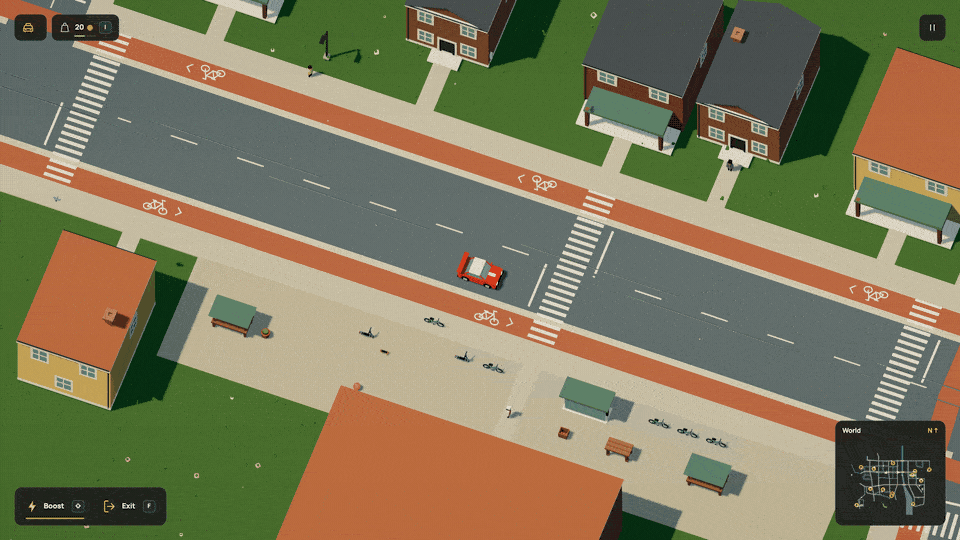

[Watch the boost in HD](docs/media/boost.mp4)

Static districts load as you approach and leave render memory behind you. Physics, NPCs and damage keep their state across the whole world. The renderer batches differently colored parts into fewer draws and reuses fixed transforms, keeping the same assets, shadows, particles and post-processing. The [rendering notes](docs/rendering.md) include before/after measurements and a local profiler for checking changes.

Player movement, live vehicles and rolling balls now share a render pose between fixed
simulation ticks. A football stays with its visible carrier, including NPCs,
and rolls as it travels. Sun and camera zoom changes resize the shadow view
continuously instead of stepping its bounds. [Motion checks](docs/evidence/animation-continuity/verification.md).
[Scooter ride and jump in HD](docs/media/scooter.mp4) · [GIF](docs/media/scooter.gif).

Foreground roofs and hills now open a clean view around the player instead of
drawing a speckled layer over them. The rest of the building stays visible;
its shadows and collisions remain. [Cutaway checks](docs/evidence/clean-cutaways/verification.md).

World preparation avoids repeated terrain and outline work, and now reuses unchanged object data while checking historical save fingerprints. [Startup measurements](docs/evidence/startup-fingerprints/verification.md) compare the complete accepted world, paths, collisions and save contracts against the preceding release. Detail and visual settings stay the same.

Historical save preparation also reuses fitted foundations when the object and
terrain are identical. It keeps the complete bootstrap packet unchanged.
[Current worker and browser measurements](docs/evidence/foundation-reuse/verification.md).

Work-route checks also discard distant collision geometry before testing its exact
shape. The city, navigation and saved journeys retain the same results.
[Measurements and comparisons](docs/evidence/route-contact-bounds/verification.md).

Tram tracks sit in the street and follow the actual road and bridge triangles. Crossings leave room for their narrow grooves. The tracks load and unload with the surrounding streets; the tram keeps its route and passenger controls. [Track construction and checks](docs/evidence/tram-tracks/verification.md).

Press **F** beside a bus, tram or train to board as a passenger, then F to leave. Long vehicles now place you beside their actual collision body instead of several metres away. The route keeps moving; your parked car stays where you left it. [Controls and limits](docs/dream/behavior.md#leave-a-vehicle).


Walk up to the market vendor, teacher, health worker or commuter on foot and press **T** to talk. Dream defines their replies, return greetings and transitions. People remember meeting you. Conversations pause a commuter's route and let it resume from the same point. [Author an NPC conversation](docs/dream/npcs.md#talk-to-a-person).

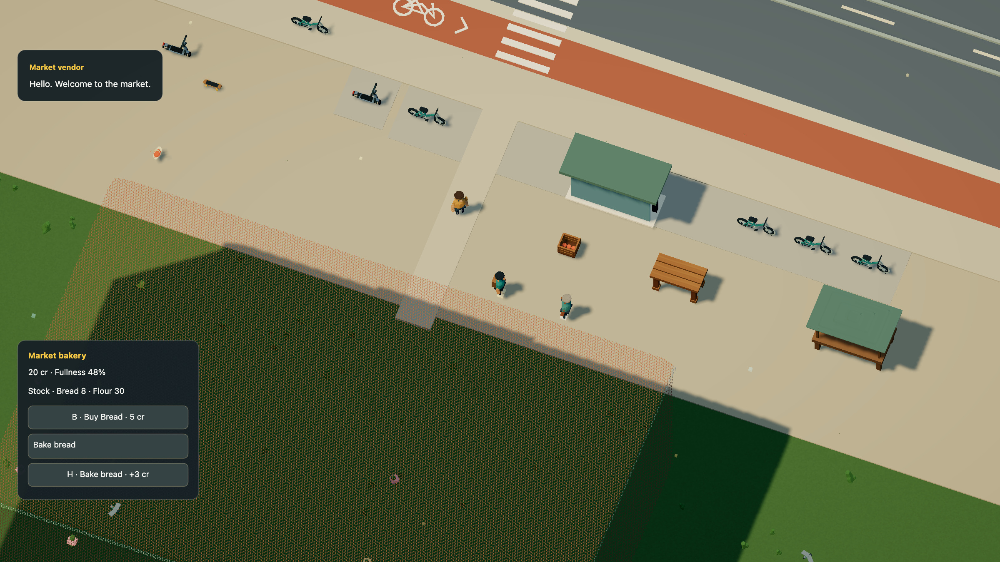

Nearby actions now use icons and short labels. The market stays closed until you
open it; Shop, Work, Bag and Business have their own views. **M** opens activities,
**I** opens your bag, and **Escape** closes a panel before pausing.
Arrow keys select item slots, Enter acts, 1–4 switch sections and Tab reaches
secondary actions. There are no gameplay dropdowns or number fields.
The Work view gives the complete recipe its own line, keeps status below it and shows a blocked-action reason once.
[How the contextual controls work](docs/context-actions.md).
The food icon is a fork and knife. Cycle lanes and the riding prompt share one
bicycle outline, with joined frame tubes and evenly sized wheels.
[View the symbols](docs/evidence/symbols/verification.md).

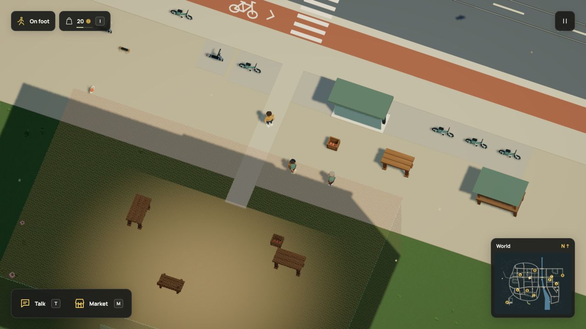

At the market, **B** buys bread, **G** eats it and **V** sells an item back. **H** starts paid work: six seconds, one bag of flour, two loaves on the shelf and three credits for you. The baker replenishes stock and the commuter buys food through the same finite supplies and accounts. [The working market and its Dream source](docs/dream/commerce.md).

The market also pays for packing lunches from bread and vegetables, or assembling
repair kits from boards and fasteners. Both inputs reserve together. Finished
lunches can be bought and eaten; finished kits feed the neighborhood's existing
repair work. Supplies and business money stay finite. [Recipes in Dream](docs/dream/commerce.md#recipes-with-several-ingredients).

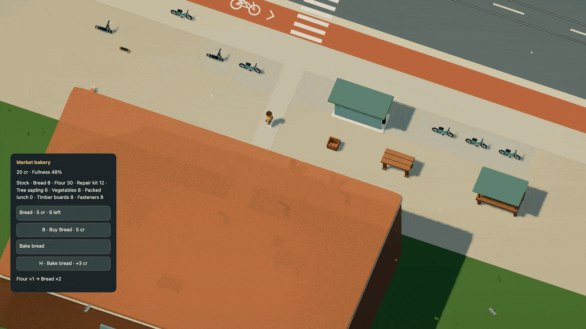

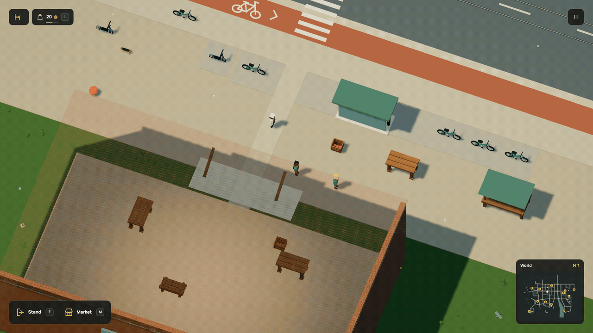

[Watch the market in HD](docs/media/commerce.mp4)

Work now remembers who did it. Bake three batches to unlock a larger batch with
more bread and better pay. The baker earns that practice separately, and the vendor
recognizes your contribution when you talk. Deliver bread to the school and the
teacher can thank you for it. These conditions are authored in Dream.
[Personal work and recognition](docs/dream/commerce.md#personal-work-and-recognition).

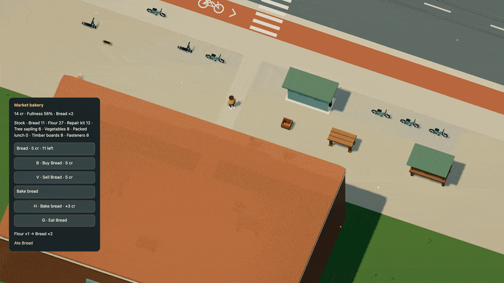

The bakery now works while you explore. The vendor packs lunches and bakes when
bread runs low. The commuter comes to buy and eat; the market helper can fetch
flour from the station. You can cook, buy and take the same delivery jobs. Stock,
money and journeys stay real and finite, and survive leaving or reloading.
[How the business works](docs/dream/businesses.md).

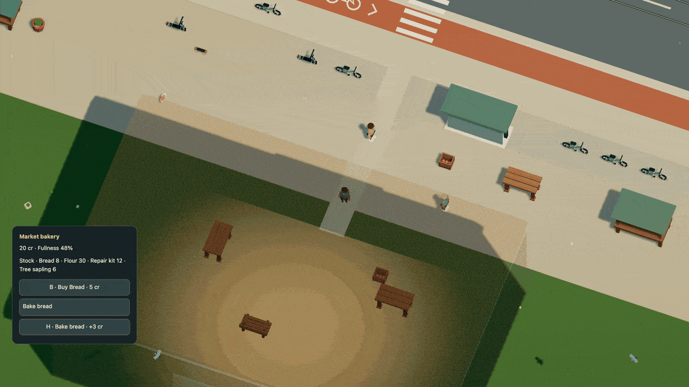

[Indoor counter walkthrough](docs/media/interior.mp4). Earlier outdoor-counter recordings below document the same controls before the r82 relocation.

The bakery and depot open from **06:00 to 22:00**; the school canteen serves
**08:00 to 17:00**. After closing, the counter shows when to return. Finish a
committed batch, eat your own food or keep a delivery safe until its receiver
opens. NPCs use the same hours. [Opening hours in Dream](docs/dream/hours.md).

The baker and school staff now physically leave and return. The baker rests in
the market hall; the teacher uses the school yard. If returning staff are late,
customers and couriers wait. You can still talk to someone off duty. Journeys
and remembered meetings survive saving. [Staff shifts in Dream](docs/dream/shifts.md).
Their walking stays smooth when a purchase or meal advances the business clock
between its regular updates. Contacts and transactions still use the fixed-step
simulation. [Motion checks](docs/evidence/worker-continuity/verification.md).

[Earlier shift recording, before the counter moved indoors](docs/media/shifts.mp4). Staff still walk to rest and return before service.

You can also take delivery work. Bring flour from the station depot to the bakery,
or carry bread to the school canteen. Pick up with **H**, follow the marked
location, then hand over on foot to get paid. Cargo, stock and money survive
travel and reload. The school staff can buy the bread you delivered. One school resident now takes
the same bread runs and brings missing fasteners to the workshop. They walk the
actual routes, earn the same wages and can spend their own pay on food.
[How deliveries work](docs/dream/commerce.md#deliveries).

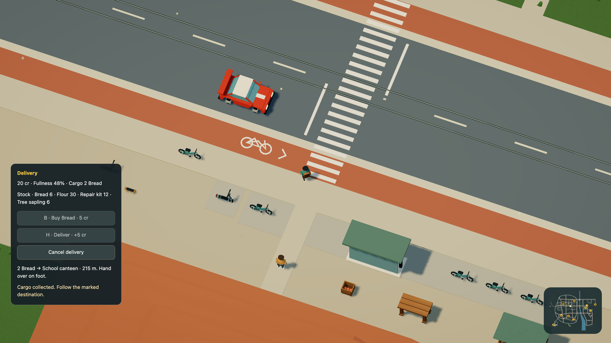

[Animated pickup](docs/media/delivery.gif) · [Watch in HD](docs/media/delivery.mp4)

Break furniture in the market square, civic park or station seating area and the caretaker can put it back together. They collect
a kit from the bakery, walk to the damage, work for eight seconds and return.
The kit is used up and the bakery pays four credits. Leave a car in the way and
they wait. You can choose **Repair neighborhood furniture** at the vendor and take the
same job before the caretaker sets off. Walk beside the damage and stop to work.
For farther jobs, the caretaker uses connected sidewalks and crossings. Their
journey keeps going while you drive away or unload that part of the world.
[How repair jobs work in Dream](docs/dream/commerce.md#repair-work).

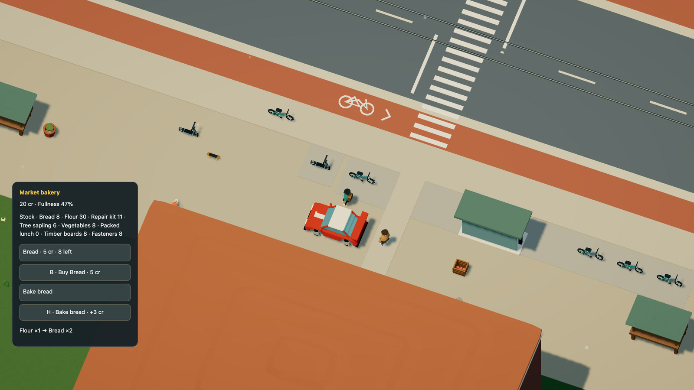

[Watch the repair in HD](docs/media/repair.mp4) · [Animated repair](docs/media/repair.gif)

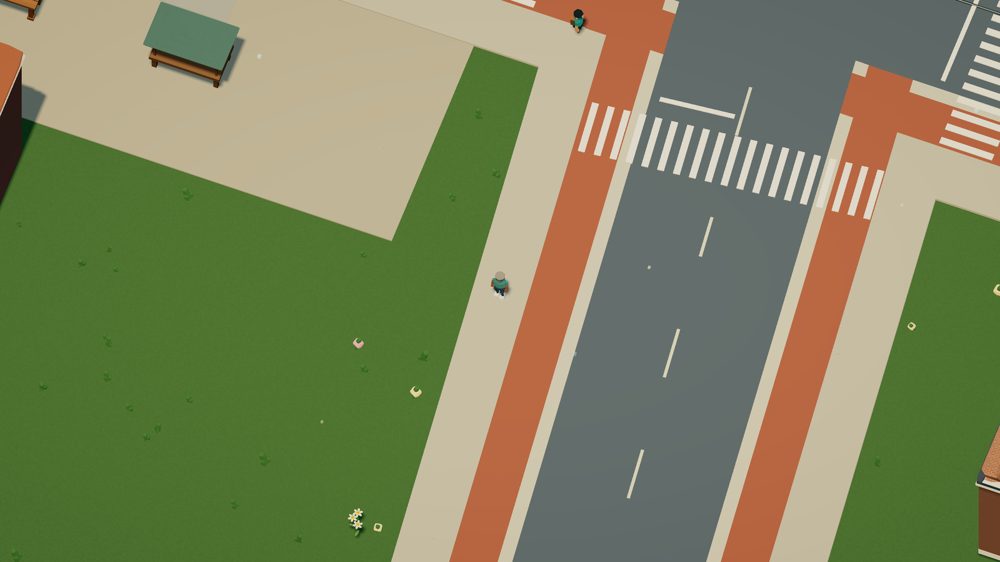

[Watch the journey in HD](docs/media/maintenance.mp4) · [Animated journey](docs/media/maintenance.gif)

Repairs use finite supplies. When the bakery has room for two finished kits after
pending assembly, you can bring them from **Station supplies**. The bakery pays the depot six credits and pays you four
for the delivery. These are transfers between actual balances. The depot starts
with 32 kits and cannot generate more. The service covers 449 targets: the existing furniture at the market, park, station and school,
the sixteen planted street tubs and two produce stalls, plus all 413 lamps across the city’s 32 streets. Tubs and stalls topple when hit hard and are restored by the same paid repair work. The caretaker steps off the sidewalk for nearby repairs, using
crossings between streets. Distant jobs take several simulation minutes.

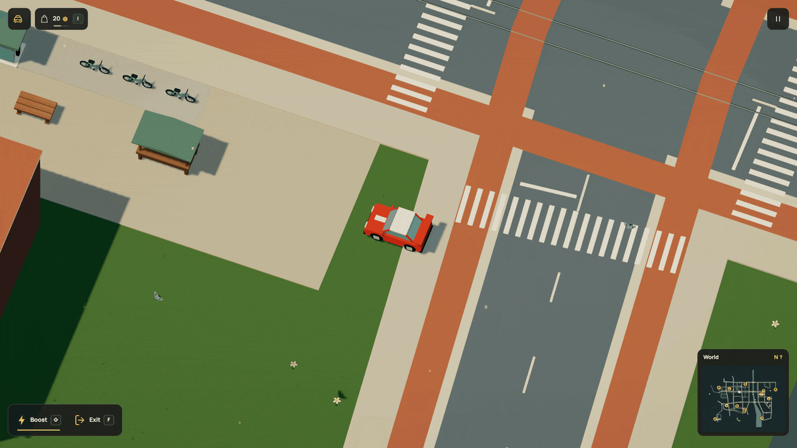

[Impact in HD](docs/media/fixturefall.mp4) · [The caretaker restoring a planted tub](docs/media/fixturerepair.mp4) · [Dream rules and verification](docs/evidence/street-furniture/verification.md)

The school-yard bench now comes back after damage too. The caretaker uses the
existing pavements and school access path, waits if something blocks the repair,
then restores the same two usable seats. You can take this job from the bakery
before dispatch, using the same kit and pay.

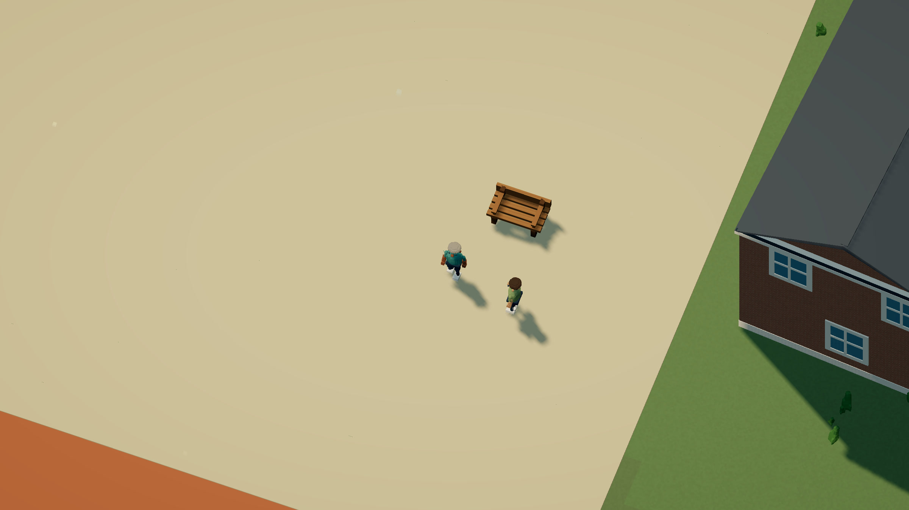

[Watch in HD](docs/media/schoolrepair.mp4) · [Author connected repairs](docs/dream/commerce.md#school-yard-repairs)

The caretaker can now bring supplies back too. When a whole shipment fits, they
walk to the station, collect two kits or saplings, carry them back and return
home. Repairs come first. The same delivery ledger pays the depot and worker;
no stock appears just because the camera moved away.

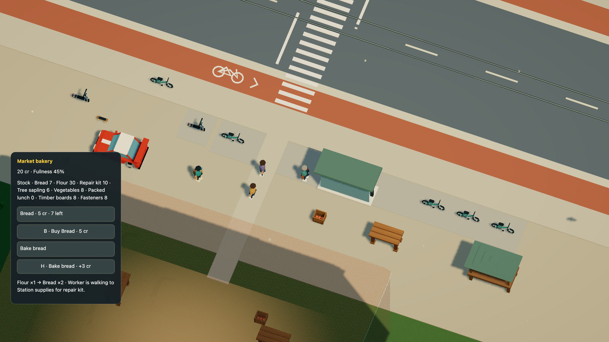

[Watch the supply trip in HD](docs/media/courier.mp4) · [Watch the handoff](docs/media/handoff.mp4) · [Author a courier in Dream](docs/dream/commerce.md#npc-supply-trips)

The caretaker can now replant 106 trees, including all 93 furnished street trees, the orchard and the park. They collect a
sapling, walk there on connected sidewalks and local work approaches, and plant a replacement. It starts
small and grows over three simulation minutes, with its shadow and collision body.
Stand in the way and growth waits. You can take the same paid planting job, or
bring more saplings from the station depot. Supplies, wages and growth survive
travel and reload. The orchard now keeps its natural ground and grass; its work
area does not paint a rectangle over the landscape. The connected garden path
stays visible. [Planting and growth in Dream](docs/dream/growth.md).

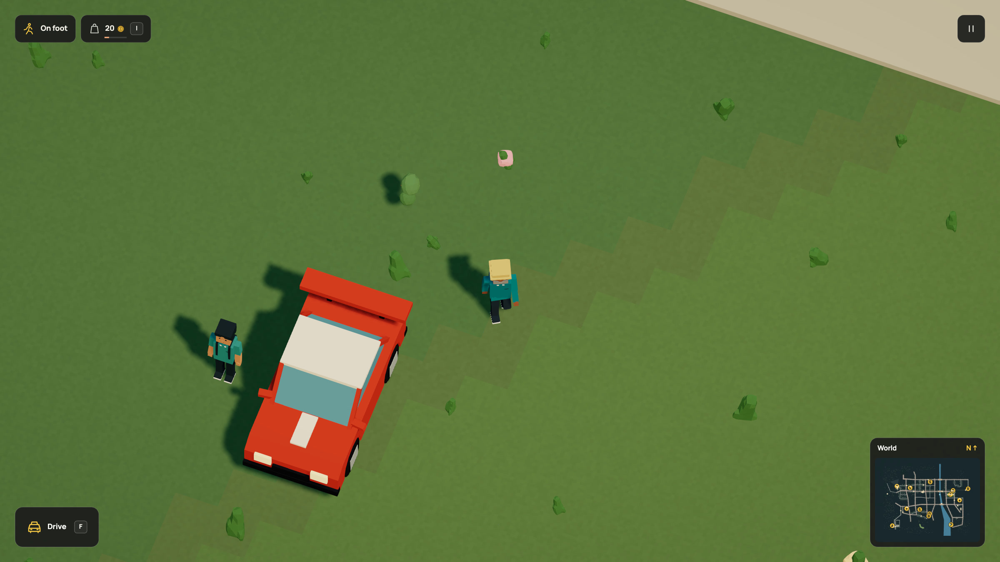

[Planting in HD](docs/media/planting.mp4) · [Watch it grow](docs/media/growth.mp4)

Your world saves on this device. Reload to return to your position, parked vehicles, moved props, damage, NPC memory, market stock, accounts, work, repair journeys, planted trees and day/night phase. Pause for **Save now**, or open **Backups** to download and restore a world. Comments and dialogue edits can carry progress forward; changes to world rules or geometry keep a separate save. **Start over** resets the saved world. [What is saved and how compatibility works](docs/persistence.md).

Press **F** to get out of the car, walk over to another vehicle and press **F** again. You control the bicycle, skateboard, boat or plane yourself. Leave the lane, steer across the pond or take off from the runway. A vehicle stays where you park it, including the car you left behind.

Two pickups and two parcel trucks now wait at connected station, workshop and
airport loading bays. Walk up, press **F** and drive. They use the same boost,
parking and save rules as the other cars, and keep your delivery cargo with you.
[Their construction and complete Dream source](docs/asset-library.md#pickups-and-parcel-trucks).

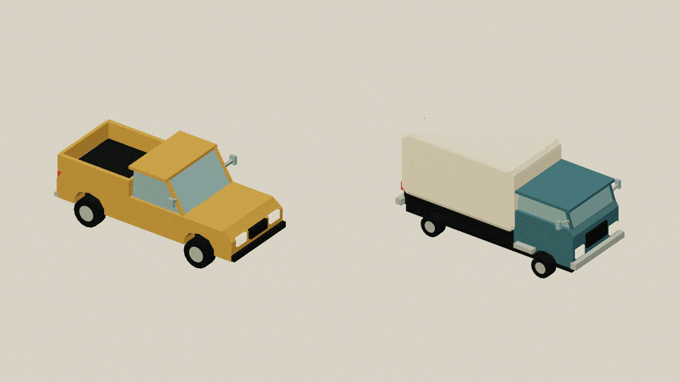


[Watch the vehicle switch in HD](docs/media/switching.mp4)

Fourteen exported person templates and the standing/seated player now share one Dream library: different hair, facial hair, glasses, uniforms, coats, aprons, skirts, hoodies and carried items. They share a body and reusable parts through Dream, with clothing attached to the bones that move it. [Build people in Dream](docs/dream/people.md).

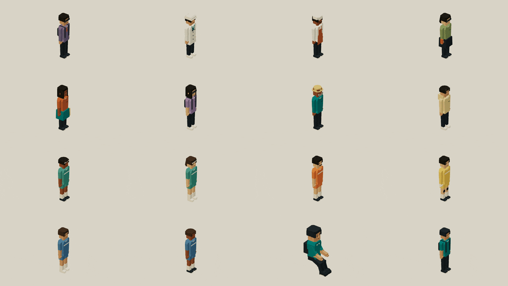

[Wardrobe in HD](docs/media/wardrobe.mp4) · [All sixteen constructions](docs/media/people-wardrobe.png) · [Complete Dream source](docs/examples/city-person.dream)

Walking and running tie their stride to distance travelled and character scale, with bent knees and articulated elbows. Walkers take longer steps, and sharp reversals keep a planted shoe in place instead of resetting it. Grounded feet keep their position and facing through turns and stops, including the instanced sidewalk crowds. Shoes now follow hills, visible pavement and low contact steps, with the pelvis adjusting so the legs keep their length. Returning feet move through a sharp turn instead of snapping to a new position, and take a recovery step before a leg overextends. Swimming alternates a crawl with upright treading when you stop. The same Dream bone bindings animate the city pedestrians. [Character rig and motion](docs/dream/behavior.md#humanoid-motion).

Route walkers stay upright on hills too. Their feet fit the slope independently;
the vehicle tilt no longer moves planted shoes through the ground.

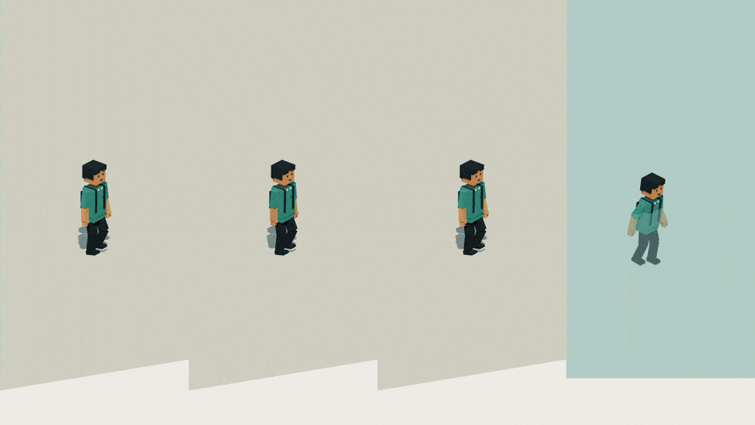

WASD walks, swims or drives. Space jumps on foot, a bicycle or skateboard, and gives the boat a small hop. Shift runs or swims faster. Walk up low steps, jump a small obstacle, or leave a boat and swim back to shore. Exits prefer dry ground when there is room. Land the plane before getting out; Space climbs and Shift descends while flying.


[Watch jumping in HD](docs/media/locomotion.mp4)

## Walk into the market

The market now has an actual doorway, walls and a supported floor. Walk in and the roof and near walls cut away, leaving the furniture and people visible. The baker serves from inside, behind the existing table. Walk around it to bake for wages, buy bread and eat. Customers and supply workers use the same doorway and finite stock. The caretaker starts inside and can still reach the same damaged furniture and trees outside.

You can sit on the market, park and station benches with **F**, then stand or
move away when the exit is clear. **G** eats food you carry. The commuter buys a
lunch, walks inside, takes a free seat and returns to their routine afterward.
Broken benches release their occupants; repaired ones work again.
[Shared seats in Dream](docs/dream/seating.md).

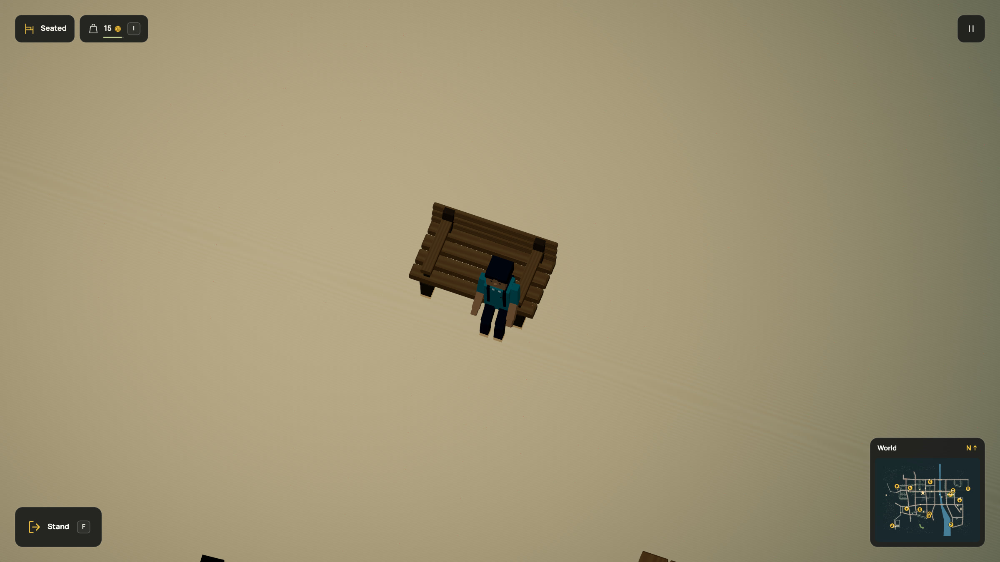

[Watch seating in HD](docs/media/seating.mp4)

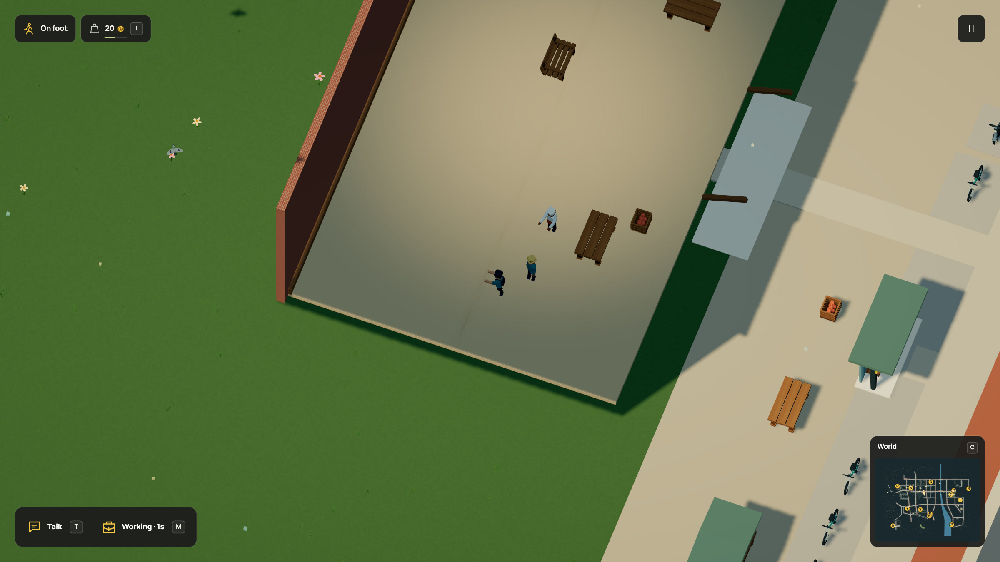

[Walkthrough](docs/media/interior.mp4) · [Earlier night view, before indoor service](docs/media/interiornight.mp4) · [Author an interior in Dream](docs/dream/interiors.md)

Baking now depends on the table. Damage interrupts both your batch and the baker's,
returning reserved ingredients and wages once. The caretaker repairs it from the
same finite stock, then work resumes. The market worker now replenishes used repair kits from boards and fasteners, with the same paid recipe available to you. Paid station deliveries replenish both materials; the caretaker can fetch boards too. Dream uses the same `equipment` rule for
food preparation and workshop jobs. [How to author it](docs/dream/commerce.md#work-needs-equipment).

Felled mature trees can now supply a board while being replanted, when the bag
and workshop have room. Carry it back and press **H** at the counter. The board
only enters stock after handoff; the planting wage is paid once. Saplings need
to finish growing before they can supply timber again. Players and caretakers
share the same rule. [Write it in Dream](docs/dream/growth.md#timber-recovery).

Fixture repairs can also return a fastener. It stays in the worker's bag until
handoff, then goes into another repair kit. All 449 existing fixture targets use
the same Dream policy; full storage still permits an ordinary repair.
[Reuse hardware](docs/dream/businesses.md#reuse-fixture-hardware).

You can now propagate a sapling into two at the market, earning two coins after
twelve seconds. The original seed and wage reserve first. The vendor takes the
same job when stock drops below five, then returns to food work. Larger baking
batches stay available to you. [Nursery work in Dream](docs/dream/businesses.md#nursery-work).

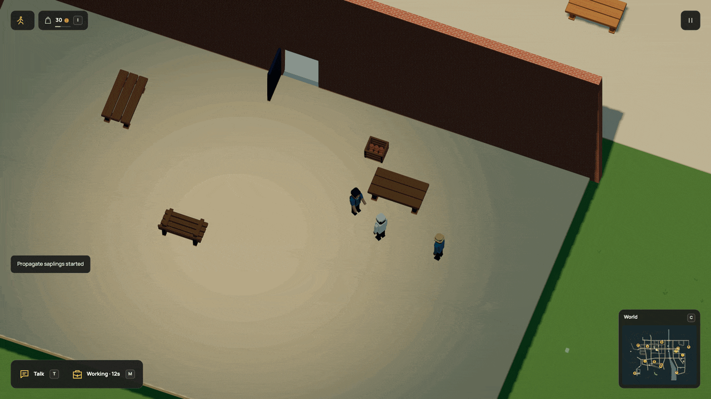

[Nursery work in HD](docs/media/nursery.mp4). The seed and wage reserve first;
completion replaces the input with two saplings and pays once.


[Timber handoff in HD](docs/media/recovery.mp4). This short recording shows the
return action; its review setup uses a real impact and planting, then R and a
walk through the market doorway.

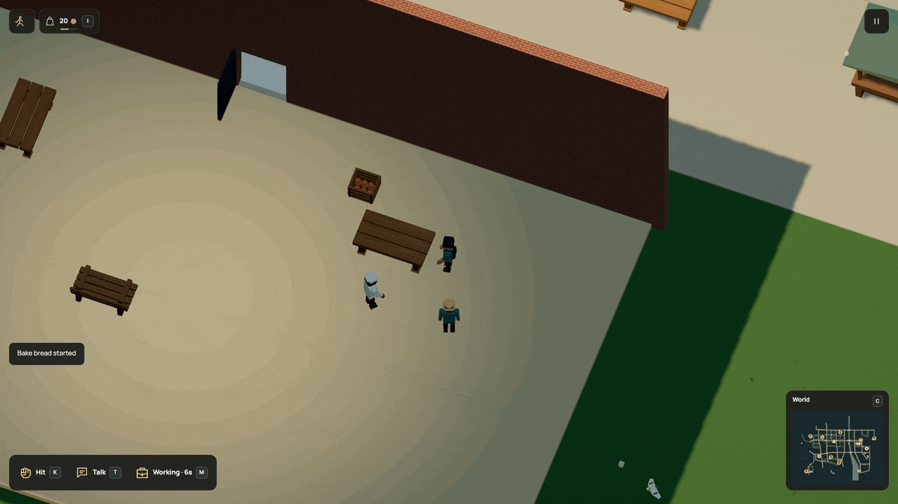

You can now hit reachable props on foot with **K**. Break the table, choose its
repair from **M → Work**, then go back to baking. Balls use their existing bounce
rules. Walls, reach and cooldown still matter; K keeps its sports controls on the
pitch. [Watch the sequence in HD](docs/media/hand.mp4) ·
[Author the interaction in Dream](docs/dream/behavior.md#on-foot-strikes).

This is the first usable ground floor. The home now has a usable upper floor and stairs. Lifts, handheld tools and furniture pickup are still to come. Existing saves have an explicit upgrade; business state survives visiting and unloading the hall.

## Get out and play

The football pitch and basketball court now work. Get out of the car, walk up
to the ball and start dribbling. Hold J or the shot button, then release to kick
or shoot. Click the ground to aim. Basketball has a gold power band; football
lets you sprint, dribble and loft a kick while jumping.

The camera moves closer on the ground and widens around a travelling ball.
Goals and baskets count, and an out-of-bounds ball comes back instead of getting lost
somewhere in the city. Find the grounds at F and B on the map.

Press N to join six-a-side, with five teammates and six opponents. K passes,
calls for a pass or tackles a nearby ball carrier. Goalkeepers defend both ends;
the side and back nets keep a scored ball in the goal. The scoreboard tracks
both sides and match time, and your progress survives saving. The city shares
one squad between its two grounds. Teams, kits, tactics and net dimensions
live in Dream's `sport` and `team` data. [Controls and Dream source](docs/dream/sports.md).

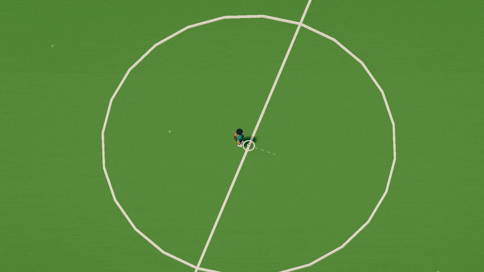

[Watch football in HD](docs/media/football.mp4)

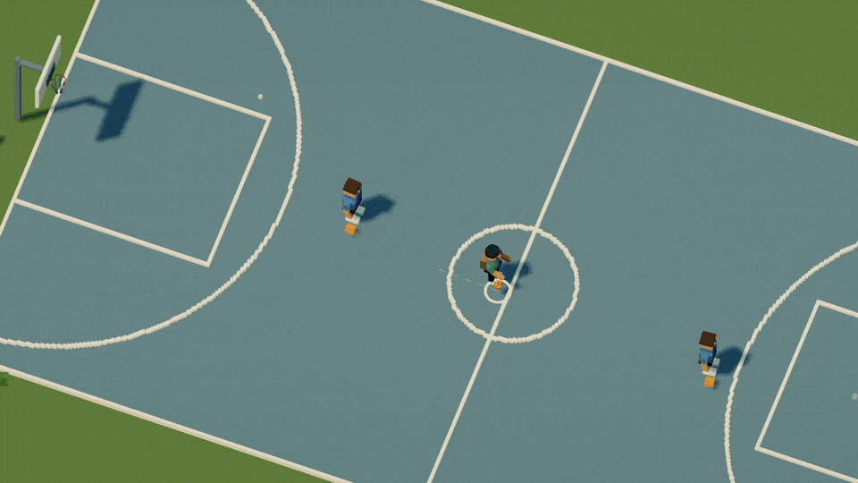

[Watch basketball in HD](docs/media/basketball.mp4)

Bicycles lean into turns and turn less sharply at speed. Boats keep momentum as you steer and fit underneath bridges when the hull has clearance. Swimming has a surface pose, strokes and a wake. The plane builds its climb gradually, holds altitude at flying speed and sinks when it gets too slow. These are arcade mechanics, with the same terrain and object contacts as the rest of the world. [See the controls and movement rules](docs/dream/behavior.md).

The ground vehicles have been rebuilt around their structure. Cars have shaped shells, wheel openings, sloped glass and framed roofs. Each axle turns its tires, hubs and shaft together. The bicycle has paired forks and stays, a supported crank and connected pedals; the scooter has a low deck and mounted fenders. They use the same Dream language as the rest of the world. [Read the car source](docs/examples/city-car.dream) or [build the bicycle](docs/examples/city-bicycle.dream).


The plane is now a braced, high-wing light aircraft, with a tapered fuselage, cabin windows and a tail wheel. Its red tips replace the ends of the wings, so the colors stay solid when you fly and turn the view. Terrain contact checks its nose, wheels and wings as it pitches and banks, keeping the assembly above hills. Hold S after stopping to taxi backward on land. The whole assembly is still Dream 2. [Build the aircraft](docs/examples/light-aircraft.dream).

At the map edge, the airborne plane keeps its airspeed and steering while its
collision body stays inside the world. Hold A or D to turn back into the city.
[See the boundary fix](docs/evidence/aircraft-boundary/verification.md).


[Watch the flight in HD](docs/media/flight.mp4)


[Watch swimming in HD](docs/media/swimming.mp4)

The camera moves closer for walking and smaller vehicles, then eases back out for the car. The objects keep their physical proportions.

Bicycle lanes run alongside streets, across the bridges and between the town, suburbs, sports park and waterfront. Each side has its own painted track, separated from the carriageway. Get on a bicycle and choose where to go. The skateboard is freely controlled too.


The river enters at the north edge, passes under three bridges and widens into a lake that continues beyond the southern boundary. The bridges carry roads, bicycle lanes and sidewalks. Boats can pass underneath when they have enough clearance. [See the larger transport layout](docs/urban-world.md).


Some things move when you hit them. Others break. A ball bounces away, a bench comes apart in splinters, a tree falls as a whole, and a building can lose a section while its main structure stays solid. Those differences are declared in Dream 2.

Objects can share a rule too. Declare how tables break once, and every table in
that category follows it, including imported models and different shapes. Each
table still breaks independently. The live world uses shared table, bench, lamp and tree
rules; supported benches can lose their boards while their base stays put.
[How shared rules work](docs/dream/rules.md).

All 416 streetlights can fall too. Their ground light pools turn off, and the
damage stays after the district unloads or you reload the game. The caretaker
can restore all 416 lamps using real kits and paid work, including the three
promenade lamps in the station quarter. Their models, collisions
and light pools return together. They use connected sidewalks and crossings to reach distant jobs.
Intact lamps stay instanced; active debris and cached meshes have fixed limits.
[How pooled destruction works in Dream](docs/dream/rules.md#streetlights-and-streamed-destruction).

All 348 measured trees follow the same falling rule. Their crowns keep moving in
the wind as the whole tree falls, and their materials and shadows stay attached.
Intact trees remain instances. Falling copies reuse prepared geometry, within
the existing destruction limits. The 239 trees outside declared work coverage
remain broken until that coverage is extended.
[Tree rules, recovery and checks](docs/evidence/city-trees/verification.md).

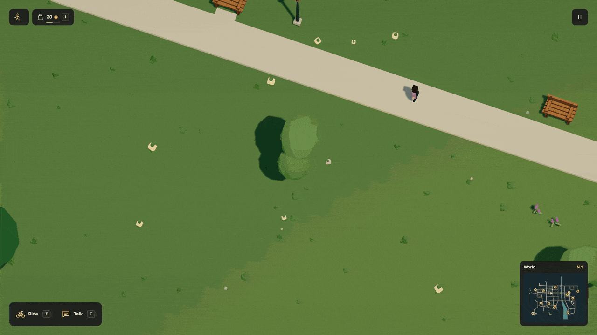

[Tree impact in HD](docs/media/treefall.mp4) · [Author a complete planting world](docs/examples/city-tree-replanting.dream)

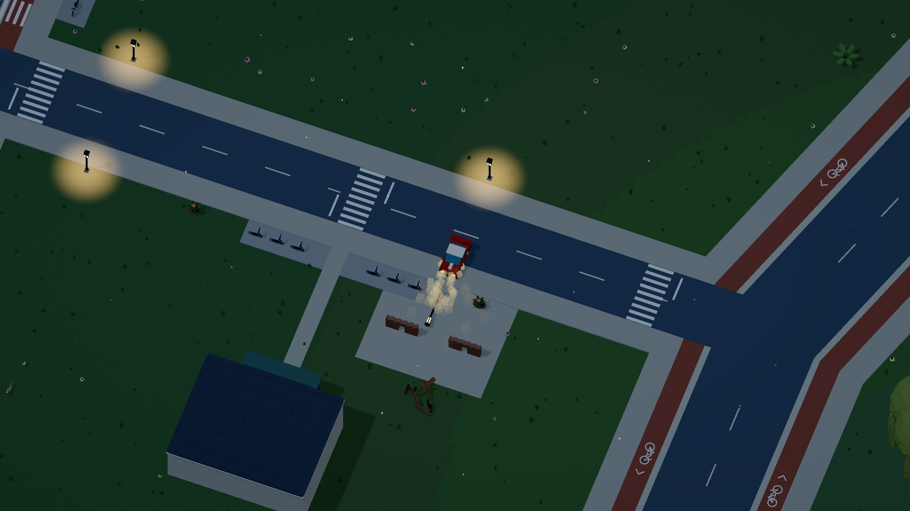

[Watch the impact in HD](docs/media/lamps.mp4) · [Watch the paid repair](docs/media/lamprepair.mp4)

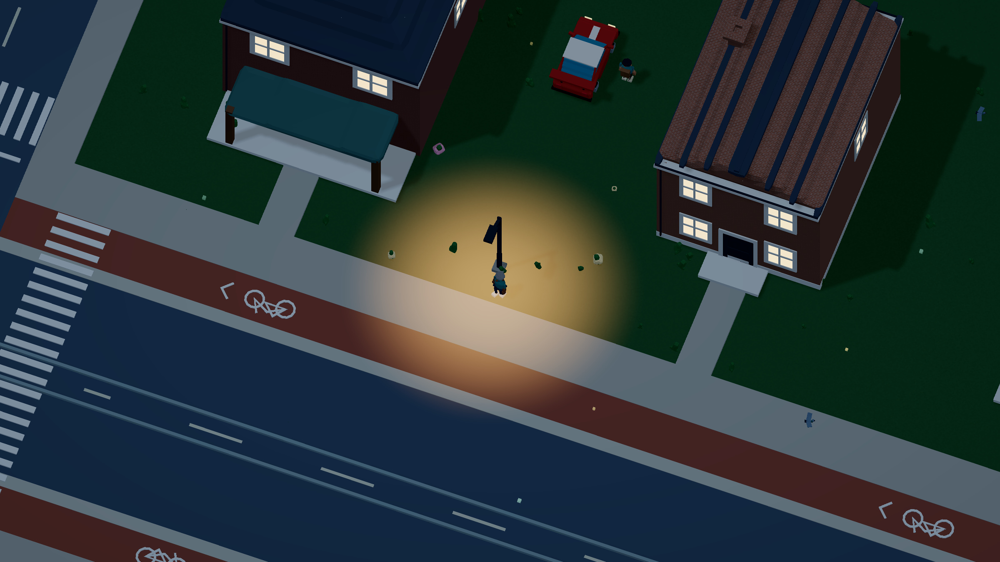

[Street repair in HD](docs/media/streetrepair.mp4) · [Animated repair](docs/media/streetrepair.gif) · [Declare service streets in Dream](docs/dream/commerce.md#street-verges)

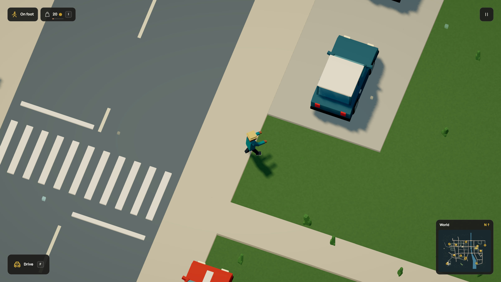

[Airport repair in HD](docs/media/airportrepair.mp4) · [What the coverage and save checks prove](docs/evidence/city-repairs/verification.md)


The asset library includes gulls, red kites, deer, foxes and hares. The live city uses a deer habitat and gulls over the river. Ferns, broad leaves, foxgloves, lavender, reeds, daisies, hazel and weeping willows give the ground and riverbanks more variety. All of them are Dream 2 assemblies.


Ground wildlife roams bounded habitats and moves away when you approach. Pedestrians follow connected sidewalks and crossings, wait for approaching vehicles and give other ambient walkers room to pass. Full models share GPU instances, while movement runs at 20 Hz. Plants stay instanced, and flying flocks retain their shared flight shaders. These are authored mock behaviors, without crowd physics or an ecosystem simulation. [See the assets](docs/asset-library.md), or [write a pair of flying birds](docs/examples/ambient-wildlife.dream).

## Stay until night

The world has a ten-minute day. Shadows move with the sun, dusk warms the scene, windows light up and streetlights come on. Moonlight and soft sky/ground fill keep roads, people and dark vehicles visible beyond streetlights. Dream describes the clock and the light: `daylight(cycle_s=600,start_hour=10)` sets the cycle, while materials and lamp assemblies declare their night appearance.


[Watch in HD](docs/media/daynight.mp4) · [Write daylight and lamps in Dream](docs/dream/day-night.md)

## The world is made from small descriptions

Dream 2 is a compact text language for composing objects and worlds. It has named fields, reusable components and bounded repetition. A model can describe a new object without writing JavaScript or a shader. The engine builds its geometry and runs the supported behavior.


A complete tree looks like this. Place it as a static prop in a pooled world to keep the crown swaying through its fall:

```dream
dream 2;
material bark(style=grain,colors=[#846044,#4b392c]);
material leaf(style=toon,colors=[#77a05b,#426b45]);
object oak(label="Oak"){
  measure(kind=tree,axis=y,meters=10);
  body(interaction=solid,radius=4,height=69);
  impact(mode=topple(speed=110,duration=1.1,lifetime=8));
  fragment tree(){
    part trunk(shape=cylinder,material=bark,at=[0,24,0],size=[6,48,6]);
    part crown(shape=icosphere,material=leaf,at=[0,52,0],size=[36,34,32],motion=sway(deg=2,hz=.2));
    part branch(shape=icosphere,material=leaf,at=[-12,44,3],size=[24,24,23],motion=sway(deg=1.5,hz=.17));
  }
}
```

Agents can ask for just the language they need: `node scripts/dream.mjs context --features objects,voxels` returns scoped instructions and compiler metadata. Components also accept material parameters, so one rig can dress several people and one table can have several finishes. Civic characters and athletes share one rig instead of repeating it. [Authoring and repair](docs/dream/model-authoring.md) · [Two finishes, one assembly](docs/examples/material-components.dream).

The [checked examples](docs/dream/examples.md) also include a bouncing ball, breakable bench and swinging sign. The documentation uses Minimum Effort's Manrope and Archivo fonts, warm white, charcoal and yellow, with the same page gutters and spacing. Dream commands, fields, references, colors and expressions are highlighted, with copy buttons for complete examples.

[Copy this tree](docs/examples/toppling-tree.dream), [build a breakable bench](docs/examples/breakable-bench.dream), or [open the complete world](src/scene/world/open-world.dream). The live mock has 1,784 placements, all authored in Dream 2. [Build the terminal](docs/examples/airport-terminal.dream) or [connect an airport and medical center to a bus service](docs/examples/airport-stop.dream).

Streetlights now follow streets, bicycle and scooter parking sits beside destinations, and birds fly across sixteen habitats. Dream’s `furnish` and `flock` commands describe those populations with bounded rules.

There are 141 residents, 60 additional ground animals and birds, 348 trees, 48 parked bicycles, 25 parked scooters and 22 parked cars/utility rides alongside four road cars, five buses and boardable tram and rail services. 129 residents walk on the pedestrian network and 60 ground animals and birds roam and react nearby. Twelve people retain their individual NPC routines. The new populations share complete instanced models; the existing NPC and CPU rig limits stay the same. [See how populations work](docs/dream/populations.md). The movement checks reuse exact body radii, enclosing contact queries and numeric spatial cells. The [matched replay](docs/evidence/movement-queries/verification.md) checks every step against the same paths and saved results.

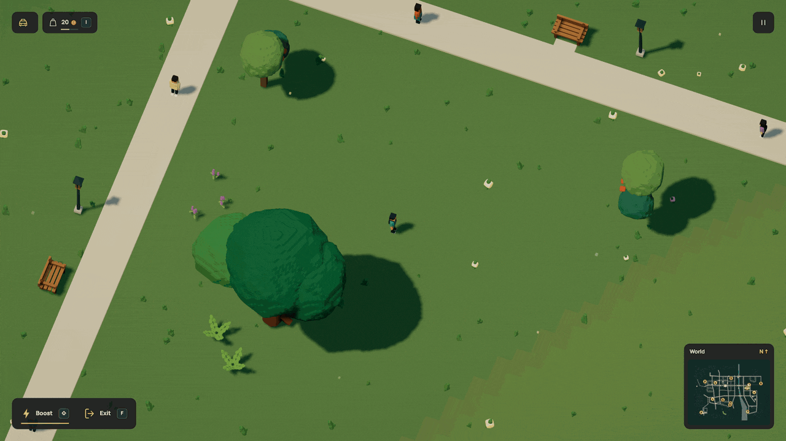

[Watch the wildlife react](docs/media/wildlife.mp4) · [Write the movement in Dream](docs/examples/moving-population.dream).

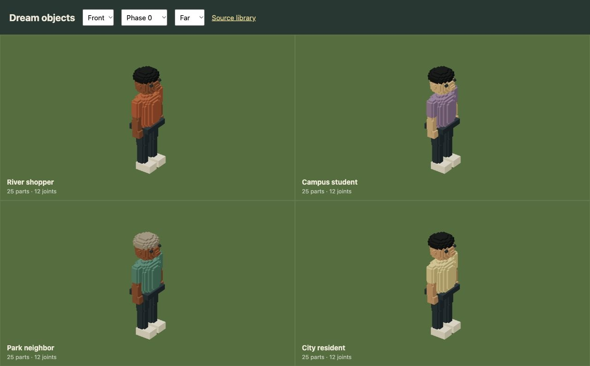


Objects share physical units. The car is 3.55 metres long, the plane has a 10.8-metre wingspan, and the skateboard is 0.82 metres long. A size declaration scales the geometry, collision body, seats and broken pieces together. The compiler checks proportions too, so a skateboard can't quietly become larger than the car.

The [asset library](docs/asset-library.md) covers the live world assemblies. Cars have window pillars and wheel hubs, bikes have chains and pedals, and the new buildings have attached roofs, embedded façade details and supported canopies. Birches have pale tapered stems, visible forks, hanging twigs and smaller leaf clusters, with bark marks on both sides. The destructible birch falls as one connected tree. Deadwood uses tapered trunks and branches; fallen logs have cut ends, moss and varied headings on the ground. These details are Dream parts too, including the pieces released when something breaks.

The construction pass takes inspiration from [Kenney's kits](https://kenney.nl/starter-kits)
across the whole library: buildings, transport, people, animals, plants and props.
The [construction guide](docs/asset-construction.md#the-next-pass-covers-the-whole-library)
tracks the scope and review rules. Trees, landscape plants, the first five furniture/container templates and all nine
animal templates have completed this pass; the other families remain pending.

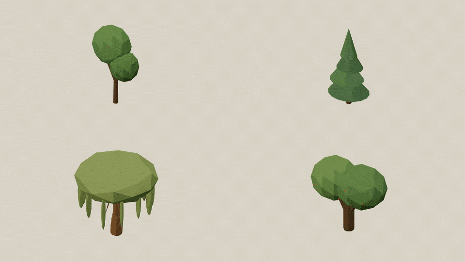

All 345 live trees now use the refined models. Firs have connected branch
supports, the willow has a continuous crown and paired hanging boughs, and fruit
is small enough to belong on the tree. Dream's explicit `faceted=true` keeps
these faces clean inside the voxel world. Toppling, replanting and saved progress
keep working. Fruit is visual; harvesting is still separate work.


The thirteen landscape and street-plant templates cover 460 placements. Leaves
join their stems, daisies have rounded petals, foxglove bells have open throats,
and the planted tub has a continuous rim above visible soil. These are reusable
Dream profiles and panels. Their measured sizes, collision bodies and street
reservations stay in place. [Complete plant constructions](docs/examples/plant-construction.dream).

The small background flowers now have attached stems, leaves, petals and solid
centers. Grass blades stay below the blooms instead of poking through them.
These details use [Dream components too](docs/examples/ground-cover.dream),
compacted into two instanced plant types. Their roots follow the visible ground.
The scatter pattern remains engine-owned; these are passable details, not new
interactive plants.

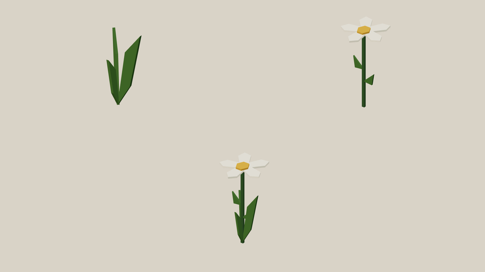

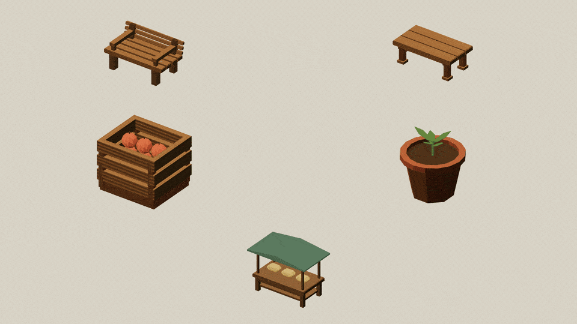

All ten slatted benches, three breakaway tables, two produce crates, the clay
planter and both produce stalls use the rebuilt constructions. Tables now stand
about 78 cm high. Seats still work, furniture still breaks and repairs, and old
saves retain their progress. [Five complete Dream objects](docs/examples/furniture-construction.dream).

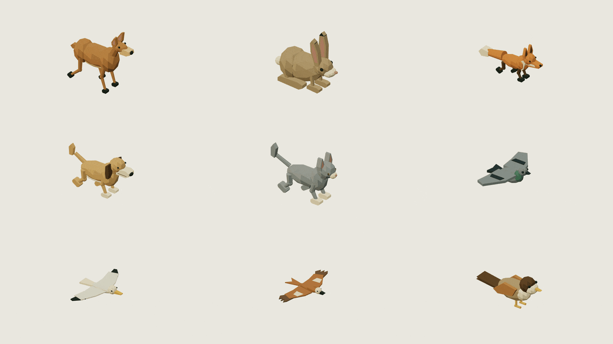

The deer, hare, fox, dog and cat have connected two-segment legs and clearer
faces. Birds have tapered wings, tails and visible eyes. All 60 roamers, the
route deer and gull, and 256 flock birds use these constructions. Dream's new
`stride` joint follows distance travelled, so a fleeing animal steps faster.
These are rigid stylized strides, without animal foot-contact IK or new animal
interactions. [Nine complete animal definitions](docs/examples/wildlife-construction.dream).


Cylinder `part` and `beam` commands accept a bounded `taper` ratio, so a trunk can narrow without stacking separate tubes. [Try the complete wood example](docs/examples/tapered-wood.dream).


## When it rains

The city also has an [authored rain cycle](docs/dream/weather.md). Roads get wet,
braking and tire grip change, and outdoor maintenance can wait for dry weather.
Committed jobs finish with their supplies and wages intact. Indoor school
repairs stay available. It is still a bounded mock, without general shelter
search, puddles or seasons. A configured resident can now [wait out a shower
upstairs](docs/dream/shelter.md), using the same seats and stairs as you.

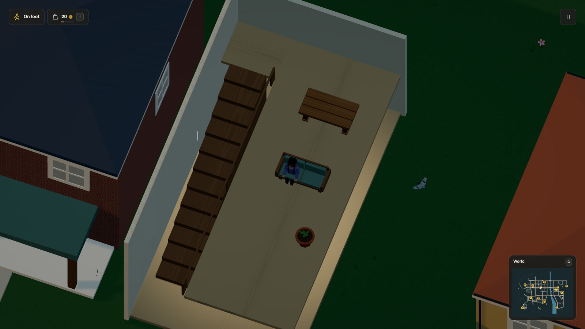

[Watch the shelter trip](docs/media/shelter.mp4) · [GIF](docs/media/shelter.gif) · [Write it in Dream](docs/examples/rain-shelter.dream)

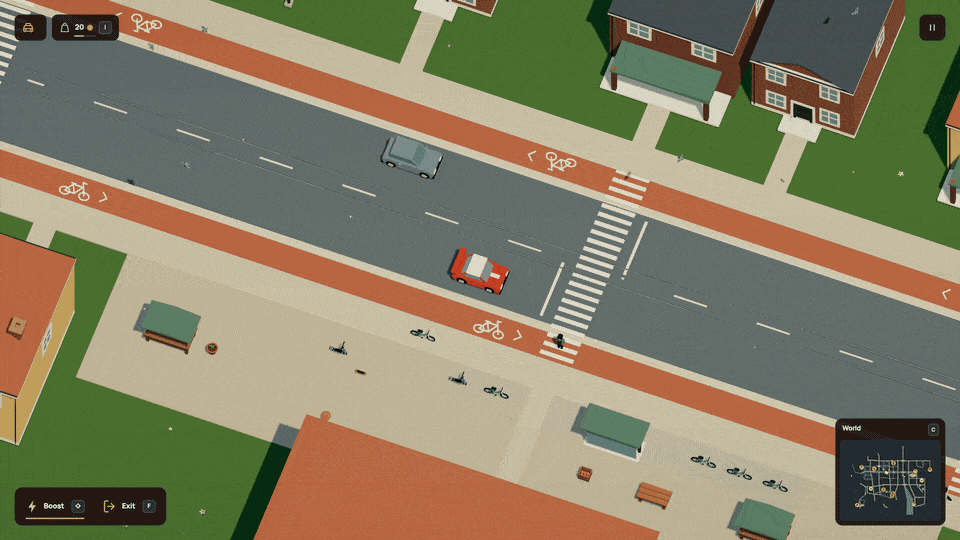

## Food for a long job

The caretaker and school courier can now pack a portion before leaving, using
their own wages and real counter stock. They eat from their own bag when hungry
without dropping a job or opening sealed delivery cargo. You can also press G
to eat carried food during work or a repair, keeping the task and its reserved
supplies. [The Dream policy and runnable example](docs/dream/commerce.md#worker-provisions).

## Take a break at school

The Garden school's ground floor now opens onto its existing entrance path.
Walk inside, take a bench and share the bread you brought with the teacher after
school closes at 17:00. They walk indoors for their break, eat through the same
food rules and remember the meal. Damaged benches and tables use the existing
kits, caretaker and paid repair system.

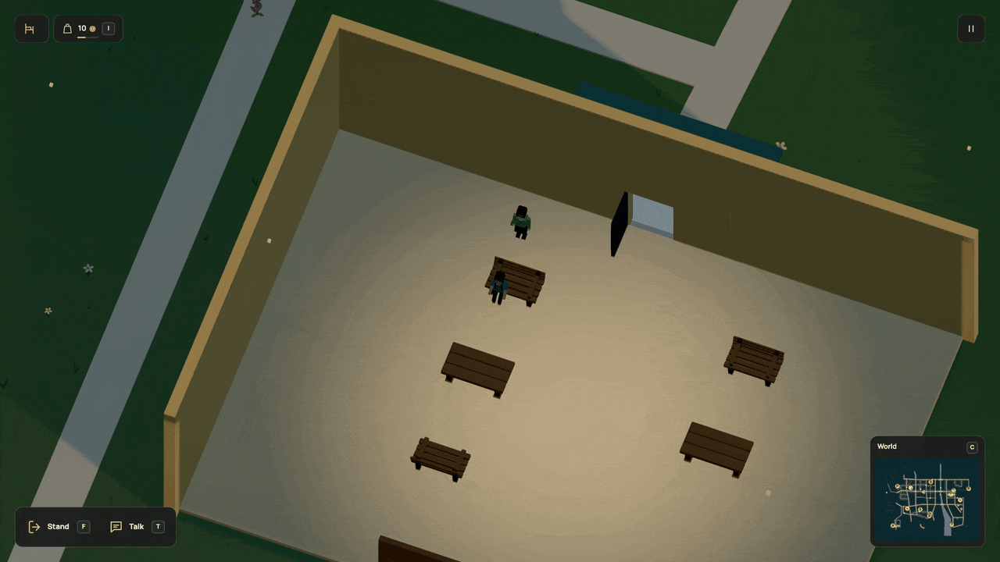

[Watch the common room](docs/media/schoolroom.mp4) · [Build the school](docs/examples/enterable-school.dream) · [Interiors](docs/dream/interiors.md#the-school-common-room)

## Come home from the market

The commuter now has a workday. After food and rest, they walk to the bakery,
wait when there is nothing to make, and take a real job when demand appears.
Finished batches earn wages and practice. Waiting earns nothing. At 20:00 they
finish any committed batch and walk home; hunger and low energy can bring them
home earlier.

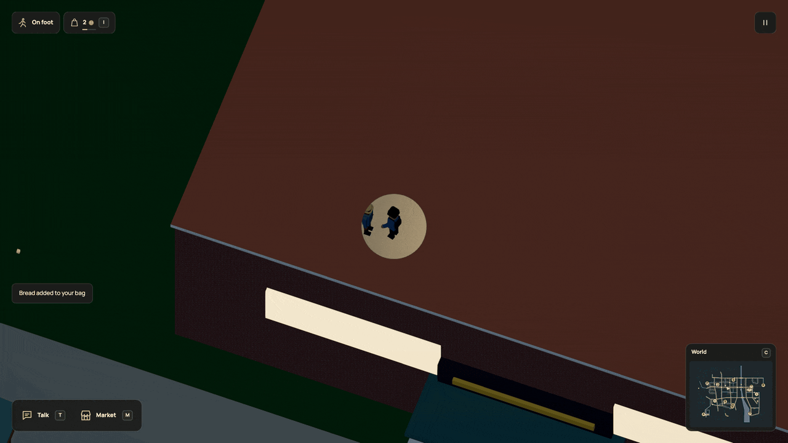

Recorded on r100. Current shorter journeys change the timing; the attendance and
after-closing payment rules remain the same.

[Watch the workday](docs/media/attendance.mp4) · [Write a schedule in Dream](docs/dream/attendance.md) · [Runnable world](docs/examples/scheduled-workday.dream)

The commuter now buys a packed lunch and brings it home to the settee. Sit on
one cushion and they can take the other. Dream lists preferred furniture first;
if the home settee is unavailable, they try the hall bench, then eat standing.
Food and money stay finite, and saved meals keep their progress.
[Author seat preferences](docs/examples/seat-preferences.dream).

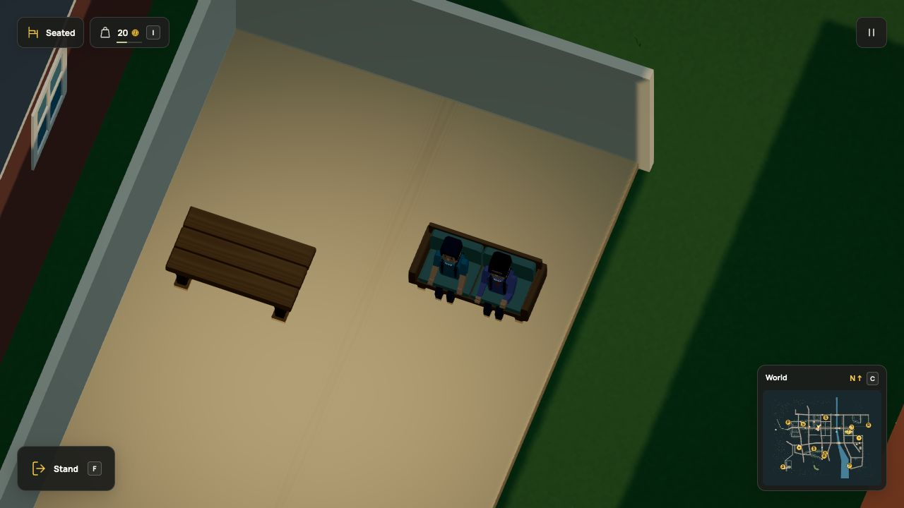

[Checks and saved-state evidence](docs/evidence/home-meals/verification.md).

The market commuter now walks through a real doorway at the end of the existing
route. You can enter the same ground floor, sit on either side of the timber
settee and break its frame, table or planter. The caretaker uses the same paid
repair kits and recovered hardware as the rest of the neighborhood.


[Walkthrough](docs/media/home.mp4) · [Build the home](docs/examples/enterable-home.dream) · [Interior rules](docs/dream/interiors.md#the-commuters-home)

The upstairs room now has a purpose. The commuter walks up the actual stairs,
claims a cushion and rests. You can join them on the other cushion. Break the
furniture and the caretaker carries supplies upstairs to repair it, earning a
wage through the same finite ledger used downstairs. Reload during the trip and
it carries on from the saved floor and step.


[Walkthrough](docs/media/upstairs.mp4) · [Runnable Dream world](docs/examples/upstairs-rest.dream) · [Named floors](docs/dream/floors.md)

Dream names existing slabs, binds props to them and lets rest/repair plans use
those floors. It does not invent routes through the ceiling. Lifts, bedrooms,
sleeping, upstairs businesses and property permissions remain work to do.

## Run it

World acceptance now reuses checked edges of immutable work-route graphs.
A local three-run Node comparison reduced median complete-world compilation
from 7.18 to 5.45 seconds on an M3 Ultra. Gameplay still checks current vehicles,
damage and actors; world data and save fingerprints match exactly. These are
compiler timings, without a measured browser or full-test-suite speedup.
[Samples and boundaries](docs/evidence/route-edge-cache/verification.md).


```sh
git clone https://github.com/minimumeffort-dev/muse.dream.git
cd muse.dream
npm ci
npm run dev
```

For local development, open `http://127.0.0.1:5173/` on your machine. You can also [play the hosted prototype](https://musedream.vercel.app/). A browser with WebGL is required.

| Control | Action |
| --- | --- |
| WASD / arrows | Walk, swim or drive the current vehicle |
| Q / E | Rotate the view |
| Trackpad pinch / two-finger scroll, or mouse wheel | Zoom in / out over the world |
| F | Exit a vehicle, or enter one nearby while on foot |
| Space | Jump on foot/bicycle/skateboard/scooter, hop a boat, swim faster, or climb in the plane |
| Shift / Boost button | Boost a car; Shift also runs, swims faster, or descends in the plane |
| P / Escape | Pause |
| R | Return to the start, keeping changes to the world |
| Start over, in the pause menu | Reset progress and restore destroyed objects |

Pause and open **Controls** for a visual key guide. It starts with what you're
doing: walking, swimming, riding, flying or playing a sport. Arrow keys switch
between its five sections; Tab reaches the next control and Escape resumes.
Gameplay keys stay inactive while paused.


Manual zoom keeps your framing as you move and switch vehicles. Smaller rides still bring the camera closer automatically. R keeps your zoom; Start over restores it.

## Take the parked bike

The 48 parked bicycles, 25 scooters and 14 cars/vans beside destinations are now available rides. Walk up, press F, drive somewhere and leave it there. Its position and rolling phase return after reloading; the renderer keeps unoccupied vehicles instanced and activates one full rig when you board.


[Watch the ride](docs/media/parking.mp4) · [GIF](docs/media/parking.gif) · [Author parking in Dream](docs/dream/populations.md#make-the-parked-vehicles-usable)

## Work with Dream 2

Check a standalone example:

```sh
node scripts/dream.mjs check docs/examples/toppling-tree.dream
```

Check the full world, including its module libraries and road/route validation:

```sh
npm test -- tests/world-layout.test.ts --maxWorkers=2 --testTimeout=60000
```

[The docs](docs/README.md) cover composition, physical size, terrain, water, routes and destruction. For model integration, start with the [authoring instructions](docs/dream-v2-model.txt) and [generated command contract](docs/dream-v2-contract.json). Dream 2 source compiles to validated scene data; generated code never runs.

```sh
npm test -- tests/propagation.test.ts --maxWorkers=2 --testTimeout=60000
npm run test:watch -- tests/propagation.test.ts # Keep selected checks running
npm run build      # TypeScript + production build, including typecheck
npm run docs:build # Highlighted static docs in dist-docs/
```

Use the test files for the behavior you're changing, including its neighboring
regressions. Behavior suites can reuse one validated, immutable world per
file while creating fresh simulation state and storage for each case. The
[equipment/repair-kit checks](docs/evidence/test-world-setup/verification.md)
kept all 13 cases and fell from 16.21 to 10.85 seconds in one local paired run.
Compiler determinism checks still rebuild the world. Watch mode keeps the test process running between edits. Run the
complete suite before a merge/release or after broad compiler, physics or save
changes: `npm test -- --maxWorkers=2 --testTimeout=60000`. Reuse passing checks
until their code changes. Documentation-only edits need documentation checks;
they do not need a game build or gameplay run when those inputs are unchanged.
The published-site test already builds the docs, so that build counts too.
[Choose checks by change](docs/agent-workflow.md#check-selection).

The engine is split between [`src/scene`](src/scene), [`src/sim`](src/sim) and [`src/game`](src/game). [Current limits](docs/dream/reference.md#runtime-boundaries) include one driving height per XY, cylinder-based contacts and cosmetic debris. Water has surface waves and currents, rather than a volumetric fluid solver.

This is a pre-hackathon prototype. Pre-start code eligibility still needs checking against the official rules before a submission. [Provenance and verification notes](docs/agent-workflow.md) stay with the project.

## Stay for a meal

Meet someone and take a seat. You can bring two portions and invite them with
Y, or accept when they offer to host. Their food comes from their own money and
finite counter stock. Y accepts, X declines, and pause gives you time to decide.
Stay through the meal and they remember spending that time with you.


[Watch in HD](docs/media/hosted.mp4) · [Shared meals in Dream](docs/dream/social.md) · [Build the example](docs/examples/hosted-meal.dream)

The baker and school staff use the same capability on their own grounds and
schedules. An offer needs food, a free adjacent seat and time before work.
Leaving early returns unfinished portions to their owner while the other person
walks home. History, purchases and invitations survive travel, streaming and
saves. Residents can also [share meals with authored companions](docs/dream/companions.md),
using finite food, free seats and their existing off-duty time. Dating and a
general relationship system remain to be built.

## Work at the workbench

The hall now has a [workshop loft](docs/dream/upstairs-work.md). Kit assembly and
sapling work happen upstairs; food stays below. You and the baker use the actual
stairs and the same finite stock, wages and bench claims. Break the workbench
and the existing indoor repair service can restore it.

Walk to the bakery's marked preparation table and start a batch. Your character
faces the surface and works with planted feet. Baking kneads, lunch packing folds,
kit assembly fastens and planting tends. Those motions are bounded Dream data,
shared by the player and workers. The baker walks to the same
station. Different recipes share its capacity, so changing jobs cannot put two
people in one place. Leaving early or breaking the table refunds the batch.


[Watch the climb and work](docs/media/loft.mp4) · [GIF](docs/media/loft.gif)

The earlier flat-hall recording below still shows the work gestures.


[Watch the work](docs/media/workstations.mp4) · [GIF](docs/media/workstations.gif) · [Author a workstation](docs/dream/workstations.md) · [Author work motions](docs/dream/work-gestures.md)

## Make time for company

The baker and commuter now have a reason to share a break beyond hunger. Company
falls with simulation time and recovers when two people finish a real meal.
They prepare paid food before the shop closes when needed, keep their duties and
use ordinary free seats. You use the same need; open **I** to see it in Bag.


[Watch](docs/media/company.mp4) · [GIF](docs/media/company.gif) · [Write the rule in Dream](docs/dream/company.md)

## Learn a recipe over lunch

Share a real meal with the baker and you can take the larger bread batch, even
with no baking history. Completing three ordinary batches still works too.
The meal uses paid food; the job uses real flour and pays only when finished.


[Watch the job](docs/media/sharedrecipe.mp4) · [GIF](docs/media/sharedrecipe.gif) · [Write the rule in Dream](docs/dream/relationships.md)

This earlier recording shows recipe access. The workshop loft recording above shows the current hall layout.

## Own a business

You can buy Station supplies in the railway quarter. Its stock, existing delivery
contracts and cash come with it. The seller gets paid; later kit and sapling
invoices go into the company. Deposit money, withdraw available cash and keep the
business through save/reload. Wages, invoices and refunds remain protected.

The same Dream fields can describe an ownable bakery with real paid production
and customers. There is no idle owner income, resale, hiring or business
creation yet. [Play and author ownership](docs/dream/businesses.md#own-the-station-depot)
or [run the complete bakery example](docs/examples/business-ownership.dream).


[Ownership in HD](docs/media/business.mp4). This 20-second recording buys the
depot before a courier hands over two repair kits, then shows its cash after a
deposit and withdrawal. The supplier receives six credits only at handoff.


## A break with a neighbor

The baker can share food with the commuter or caretaker. They pay from their own
accounts, walk to a pair of free seats, eat and return to their routines. Busy
residents finish their existing commitments. Meals stay in their saved history. A completed break between the baker and
commuter now qualifies both for the larger bread recipe, while your own progress
keeps its existing meaning. They return to work and use actual flour and wages;
the memory itself pays nothing. [Author the consequence in Dream](docs/dream/companion-recipes.md).

Sitting and standing now ease the body and take short steps, with the same motion
for you and the residents. [Watch the current seat transitions](docs/dream/seating-motion.md).


[Watch](docs/media/companions.mp4) · [GIF](docs/media/companions.gif) · [Author companions](docs/dream/companions.md)


### A meal can also be a rest

Energy-enabled residents now recover while actually seated for a solo or shared
meal, using the same rule as the player. Walking to a reserved seat still costs
energy; broken furniture stops recovery. Food, Company and remembered meals keep
their existing completion rules. Old saves retain every value and pending trip.
[Rest rules and runnable example](docs/dream/resting.md#a-meal-is-also-a-seated-break).

### Less repeated work before the first view

Startup reuses unchanged static prop fits while preparing older save worlds.
Props near a changed interior floor still recompute. The earlier r109 pass
reached the complete view in 16.2–16.5 seconds locally; the world has grown since
that measurement. [Earlier measurements](docs/evidence/startup-preparation/verification.md).

Navigation checks now give the browser time between batches, and identifying
indoor routes no longer repeats the worker's repair survey. Every graph and
coverage check still runs before installation. World detail, saved progress and
controls stay the same. [Current measurements and remaining stalls](docs/evidence/cooperative-navigation/verification.md).

### A shared break upstairs

The baker and commuter now use the home's upper settee for a real shared meal.
They walk the stairs, claim separate seats, eat their paid food and return.
Old saved meals keep their original seats. [Watch it and build the same activity in Dream](docs/dream/upstairs-social.md).
