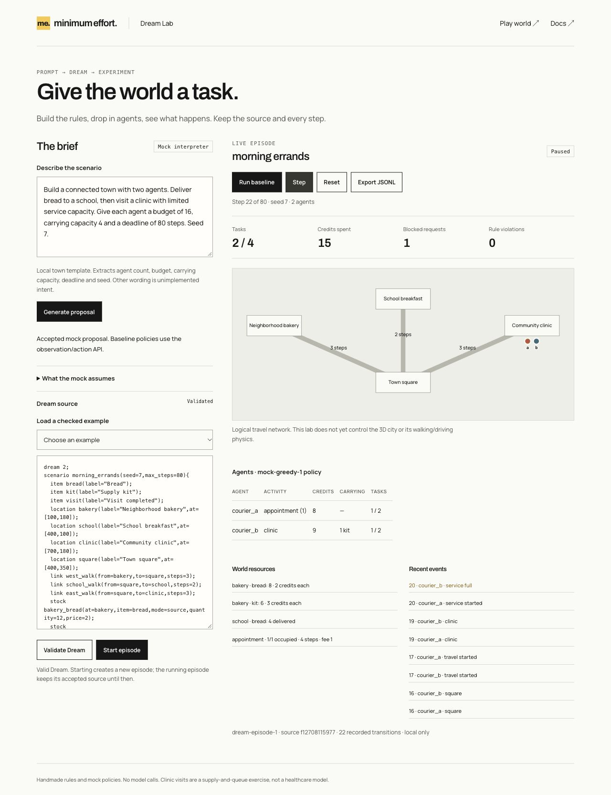
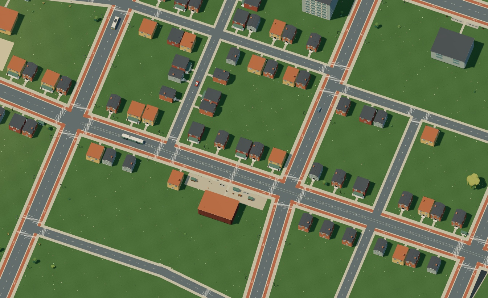
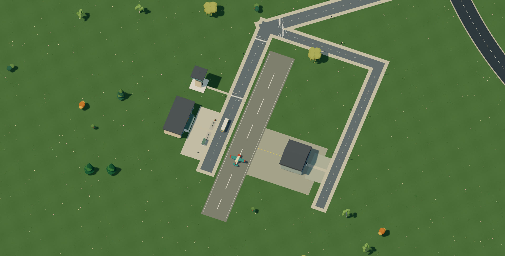
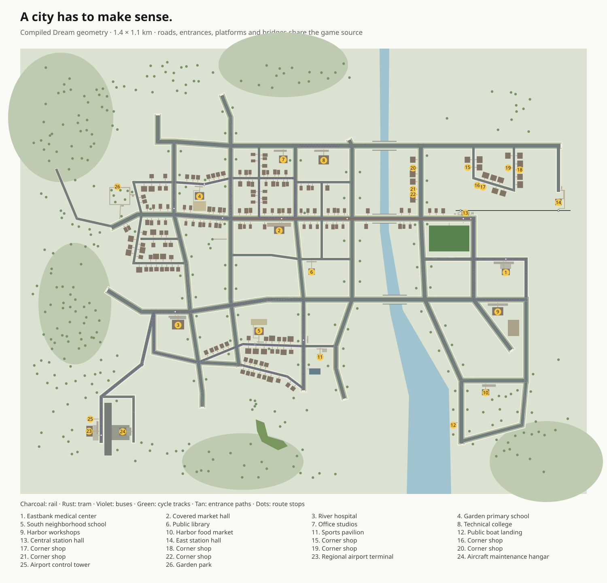
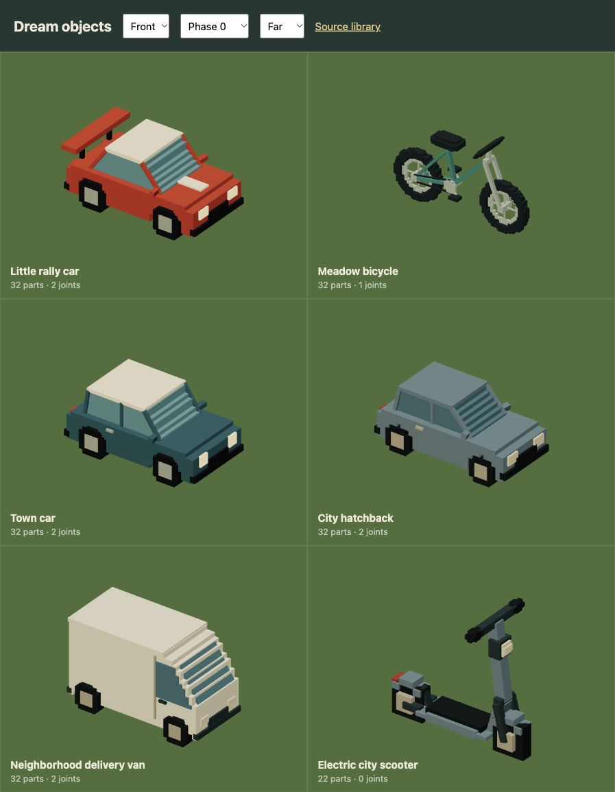
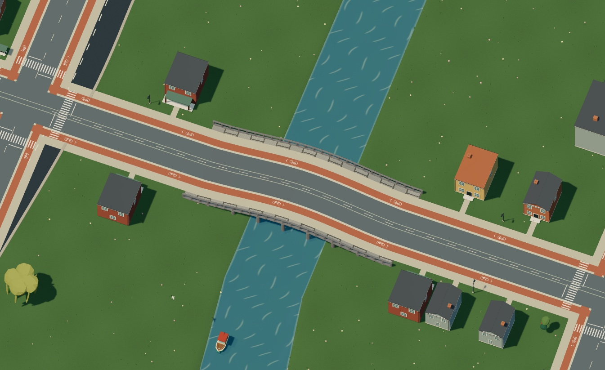
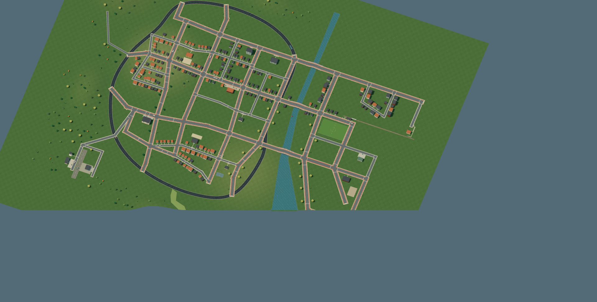
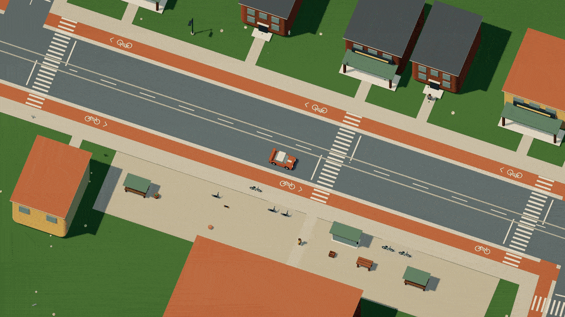
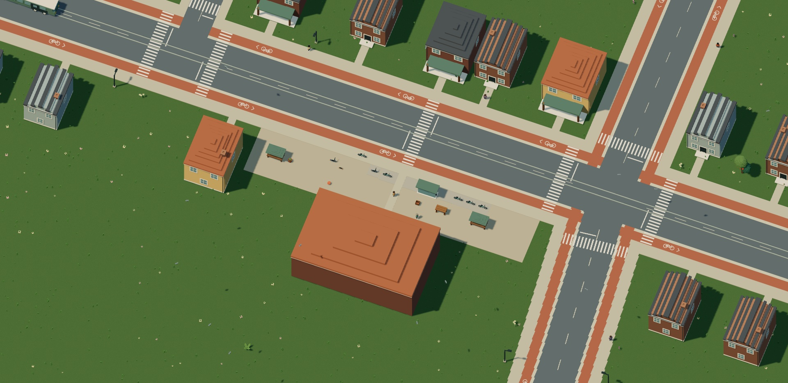

# Muse Dream

I want to sketch a world on paper and then explore it. Draw a road through the hills, put a castle next to it, add a car and see what happens when you drive into things. Muse would interpret the drawing and describe the whole world in Dream, including the objects and how they behave.

Racing is where this started. The idea is to make whatever someone draws playable.

[Play the prototype](https://musedream.vercel.app/) · [Explore Dream 2](https://minimumeffort-dev.github.io/muse.dream/) · [Start with an example](docs/dream/quickstart.md)


**The playable world is a handmade mock today.** The renderer, driving simulation and Dream 2 compiler work. Photo upload and Muse interpretation are still to come. There are no model calls or API keys to configure.

## Give the world a task

Before drawing becomes an input, a prompt needs a route into Dream. [Dream Lab](https://musedream.vercel.app/lab/) is the first working slice: write a brief, review its proposed Dream rules and run mock agents through the scenario. The local interpreter uses a town template and extracts a few parameters; it doesn't yet interpret arbitrary intent.

Two couriers can buy bread, deliver breakfast to a school and share a clinic's limited service capacity. The dashboard shows stock, spending, tasks, blocked requests and violations as they happen. Export every step as JSONL and replay it against the same source. Garden/habitat and class-preparation examples use the same resource and service rules.



This lab is a logical task network, separate from the 3D city's movement and collisions. The policies are mocks, not trained models. [Try the complete scenarios](docs/dream/scenarios.md), or read [what the language still needs for economics, ecology, education and healthcare operations](docs/world-systems.md).

## You can leave the road

Drive through the city or head out into the hills. Climbing slows the car down, descending gives it speed, and a fast crest can launch it into the air. The camera follows you through the world. The sun moves with the day clock, independently of driving and camera turns.

The world now covers 1.4 × 1.1 kilometres. It has been rebuilt around places people need: homes, markets, schools, a hospital, workplaces, a library and stations. The center has tighter frontages; garden streets and the southern neighborhood have more space around the houses. Streets, entrance paths, crossings and platforms actually connect.



Five buses serve the neighborhoods, schools, both medical centers, station and airport across four routes. A tram shares the main avenue, and a regional train stops at the stations. F boards those services as a passenger. Three scooters are available to drive near the market, medical center and airport. Schools, hospitals, airport and railway stations have symbols on the map. [Explore the city](docs/urban-world.md).

The regional airport has a glazed terminal, control tower, maintenance hangar and a continuous runway, with a separate apron and service road. Its bus stop, entrance paths and bicycle parking connect to town. The eastbank has its own medical center beside the station bus route. These are explorable mock places; interiors, clinical services and airport operations are still to come.





The map uses the game's actual geometry. Shared junctions keep the street centerlines aligned, and entrances move with their buildings. Dream now describes sites, crossings, route stops and the connections between them. [Read the design and sources](docs/city-design.md), or [compile a complete connected neighborhood](docs/examples/connected-city.dream).

The HUD keeps the map, vehicle prompts and pause control. There is no lap counter or checkpoint target to follow; explore at your own pace.

Release the throttle and the car coasts to a complete stop on dry, flat ground. Tires hold across ordinary dry slopes instead of slowly creeping sideways. Steeper hills can still roll the car downhill, and ice keeps its lower grip.


[Watch in HD](docs/media/driving.mp4)

The whole world stays in memory while you explore. The renderer batches differently colored parts into fewer draws and reuses fixed world transforms, keeping the same assets, shadows, particles and post-processing. The [rendering notes](docs/rendering.md) include before/after measurements and a local profiler for checking changes.

Press **F** to get out of the car, walk over to another vehicle and press **F** again. You control the bicycle, skateboard, boat or plane yourself. Leave the lane, steer across the pond or take off from the runway. A vehicle stays where you park it, including the car you left behind.


[Watch the vehicle switch in HD](docs/media/switching.mp4)

WASD walks, swims or drives. Space jumps on foot, a bicycle or skateboard, and gives the boat a small hop. Shift runs or swims faster. Walk up low steps, jump a small obstacle, or leave a boat and swim back to shore. Exits prefer dry ground when there is room. Land the plane before getting out; Space climbs and Shift descends while flying.


[Watch jumping in HD](docs/media/locomotion.mp4)

Bicycles lean into turns and turn less sharply at speed. Boats keep momentum as you steer and fit underneath bridges when the hull has clearance. Swimming has a surface pose, strokes and a wake. The plane builds its climb gradually, holds altitude at flying speed and sinks when it gets too slow. These are arcade mechanics, with the same terrain and object contacts as the rest of the world. [See the controls and movement rules](docs/dream/behavior.md).

The ground vehicles have been rebuilt around their structure. Cars have shaped shells, wheel openings, sloped glass and framed roofs. Each axle turns its tires, hubs and shaft together. The bicycle has paired forks and stays, a supported crank and connected pedals; the scooter has a low deck and mounted fenders. They use the same Dream language as the rest of the world. [Read the car source](docs/examples/city-car.dream) or [build the bicycle](docs/examples/city-bicycle.dream).



The plane is now a braced, high-wing light aircraft, with a tapered fuselage, cabin windows and a tail wheel. Its red tips replace the ends of the wings, so the colors stay solid when you fly and turn the view. Terrain contact checks its nose, wheels and wings as it pitches and banks, keeping the assembly above hills. Hold S after stopping to taxi backward on land. The whole assembly is still Dream 2. [Build the aircraft](docs/examples/light-aircraft.dream).


[Watch the flight in HD](docs/media/flight.mp4)


[Watch swimming in HD](docs/media/swimming.mp4)

The camera moves closer for walking and smaller vehicles, then eases back out for the car. The objects keep their physical proportions.

Bicycle lanes run alongside streets, across the bridges and between the town, suburbs, sports park and waterfront. Each side has its own painted track, separated from the carriageway. Get on a bicycle and choose where to go. The skateboard is freely controlled too.



The river enters at the north edge, passes under three bridges and widens into a lake that continues beyond the southern boundary. The bridges carry roads, bicycle lanes and sidewalks. Boats can pass underneath when they have enough clearance. [See the larger transport layout](docs/urban-world.md).



Some things move when you hit them. Others break. A ball bounces away, a bench comes apart in splinters, a tree falls as a whole, and a building can lose a section while its main structure stays solid. Those differences are declared in Dream 2.


The asset library includes gulls, red kites, deer, foxes and hares. The live city uses a deer habitat and gulls over the river. Ferns, broad leaves, foxgloves, lavender, reeds, daisies, hazel and weeping willows give the ground and riverbanks more variety. All of them are Dream 2 assemblies.


Wildlife follows bounded ambient routes without drawing roads or runways. Plants stay instanced, and animals use the existing animation budget. These are authored mock habitats; animal perception and avoidance are still to come. [See the assets](docs/asset-library.md), or [write a pair of flying birds](docs/examples/ambient-wildlife.dream).

## Stay until night

The world has a ten-minute day. Shadows move with the sun, dusk warms the scene, windows light up and streetlights come on. Moonlight keeps the road readable after dark. Dream describes the clock and the light: `daylight(cycle_s=600,start_hour=10)` sets the cycle, while materials and lamp assemblies declare their night appearance.



[Watch in HD](docs/media/daynight.mp4) · [Write daylight and lamps in Dream](docs/dream/day-night.md)

## The world is made from small descriptions

Dream 2 is a compact text language for composing objects and worlds. It has named fields, reusable components and bounded repetition. A model can describe a new object without writing JavaScript or a shader. The engine builds its geometry and runs the supported behavior.


A complete tree looks like this:

```dream
dream 2;
material bark(style=grain,colors=[#846044,#4b392c]);
material leaf(style=toon,colors=[#77a05b,#426b45]);
object oak(label="Oak"){
  measure(kind=tree,axis=y,meters=10);
  body(interaction=solid,radius=4,height=69);
  impact(mode=topple(speed=110,duration=1.1,lifetime=8));
  fragment tree(){
    part trunk(shape=cylinder,material=bark,at=[0,24,0],size=[6,48,6]);
    part crown(shape=icosphere,material=leaf,at=[0,52,0],size=[36,34,32]);
    part branch(shape=icosphere,material=leaf,at=[-12,44,3],size=[24,24,23]);
  }
}
```

The [checked examples](docs/dream/examples.md) also include a bouncing ball, breakable bench and swinging sign. The documentation uses Minimum Effort's Manrope and Archivo fonts, warm white, charcoal and yellow, with the same page gutters and spacing. Dream commands, fields, references, colors and expressions are highlighted, with copy buttons for complete examples.

[Copy this tree](docs/examples/toppling-tree.dream), [build a breakable bench](docs/examples/breakable-bench.dream), or [open the complete world](src/scene/world/open-world.dream). The live mock has 82 assemblies and 1,362 placements, all authored in Dream 2. [Build the terminal](docs/examples/airport-terminal.dream) or [connect an airport and medical center to a bus service](docs/examples/airport-stop.dream).

Streetlights now follow streets, bicycle and scooter parking sits beside destinations, and birds fly across sixteen habitats. Dream’s `furnish` and `flock` commands describe those populations with bounded rules. There are four road cars, five buses and boardable tram and rail services. The actor and animation limits stay the same. [See how populations work](docs/dream/populations.md).



Objects share physical units. The car is 3.55 metres long, the plane has a 10.8-metre wingspan, and the skateboard is 0.82 metres long. A size declaration scales the geometry, collision body, seats and broken pieces together. The compiler checks proportions too, so a skateboard can't quietly become larger than the car.

The [asset library](docs/asset-library.md) covers the live world assemblies. Cars have window pillars and wheel hubs, bikes have chains and pedals, and the new buildings have attached roofs, embedded façade details and supported canopies. Birches have pale tapered stems, visible forks, hanging twigs and smaller leaf clusters, with bark marks on both sides. The destructible birch falls as one connected tree. Deadwood uses tapered trunks and branches; fallen logs have cut ends, moss and varied headings on the ground. These details are Dream parts too, including the pieces released when something breaks.


Cylinder `part` and `beam` commands accept a bounded `taper` ratio, so a trunk can narrow without stacking separate tubes. [Try the complete wood example](docs/examples/tapered-wood.dream).


## Run it

```sh
git clone https://github.com/minimumeffort-dev/muse.dream.git
cd muse.dream
npm ci
npm run dev
```

For local development, open `http://127.0.0.1:5173/` on your machine. You can also [play the hosted prototype](https://musedream.vercel.app/). A browser with WebGL is required.

| Control | Action |
| --- | --- |
| WASD / arrows | Walk, swim or drive the current vehicle |
| Q / E | Rotate the view |
| F | Exit a vehicle, or enter one nearby while on foot |
| Space | Jump on foot/bike/skateboard, hop a boat, swim faster, or climb in the plane |
| Shift | Run, swim faster, or descend in the plane |
| P / Escape | Pause |
| R | Return to the start, keeping changes to the world |
| Start over, in the pause menu | Reset the race and restore destroyed objects |

## Work with Dream 2

Check a standalone example:

```sh
node scripts/dream.mjs check docs/examples/toppling-tree.dream
```

Check the full world, including its module libraries and road/route validation:

```sh
node scripts/dream.mjs check src/scene/world/open-world.dream --modules src/scene --modules src/scene/world
```

[The docs](docs/README.md) cover composition, physical size, terrain, water, routes and destruction. For model integration, start with the [authoring instructions](docs/dream-v2-model.txt) and [generated command contract](docs/dream-v2-contract.json). Dream 2 source compiles to validated scene data; generated code never runs.

```sh
npm run docs:build # Highlighted static docs in dist-docs/
npm test       # Compiler, scene, simulation and rendering behavior
npm run build  # TypeScript + production build
```

The engine is split between [`src/scene`](src/scene), [`src/sim`](src/sim) and [`src/game`](src/game). [Current limits](docs/dream/reference.md#runtime-boundaries) include one driving height per XY, cylinder-based contacts and cosmetic debris. Water has surface waves and currents, rather than a volumetric fluid solver.

This is a pre-hackathon prototype. Pre-start code eligibility still needs checking against the official rules before a submission. [Provenance and verification notes](docs/agent-workflow.md) stay with the project.
