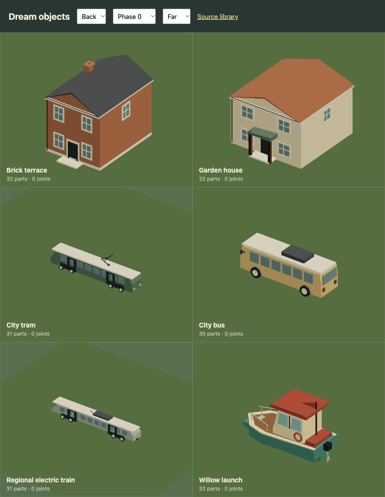
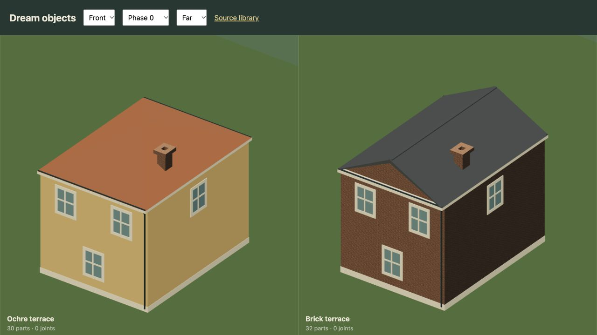
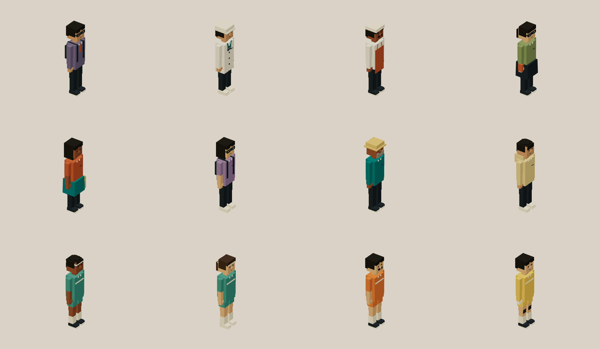
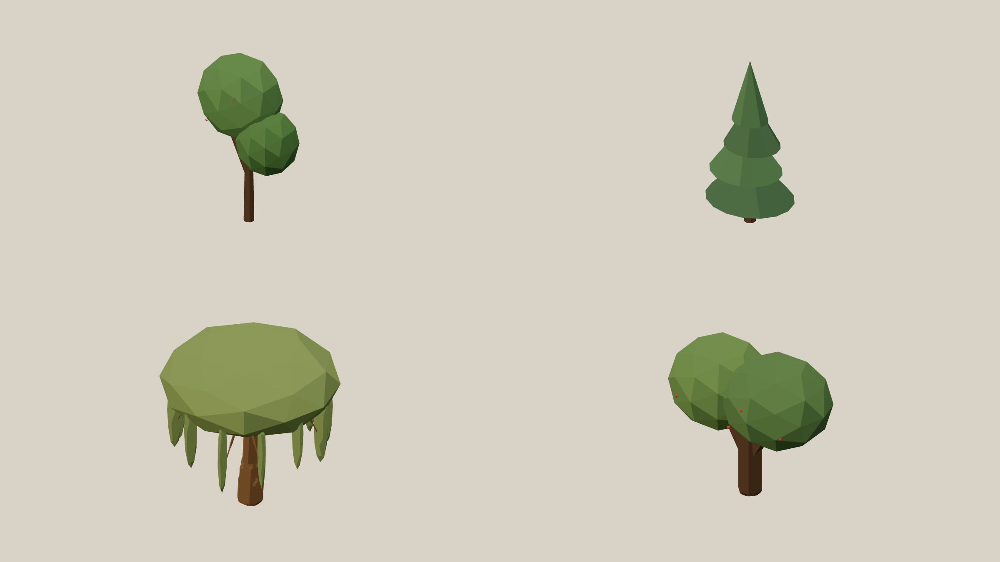

# Build the object, then add the detail

A bus needs to read as a bus before it needs another material. Its wheels belong under the chassis, its doors reach the passenger floor and its windshield follows the cab. A house needs floor heights, openings, a roof edge and somewhere for its porch posts to land.

The current pass rebuilds eleven housing, shop and office templates plus the bus, tram, railcar and cabin launch. Those fifteen templates appear in 197 live placements. These are stylized handmade mocks, not imported meshes or a claim of architectural or vehicle engineering accuracy.

## The next pass covers the whole library

Kenney's [starter kits](https://kenney.nl/starter-kits) are the user's reference
for the whole library. The [Car Kit](https://kenney.nl/assets/car-kit),
[industrial city kit](https://kenney.nl/assets/city-kit-industrial) and
[Mini Forest](https://kenney.nl/assets/mini-forest) previews were inspected on
2026-10-19. The construction rules below are our interpretation of those visual
references. Trees are the first completed family. The rest of the catalogue
still needs this pass.

The [r75 catalogue](evidence/asset-direction/catalogue.json) lists all 109 loaded
assembly exports at the start of this pass. The [r76 catalogue](evidence/asset-direction/r76-catalogue.json)
records eleven refined live tree templates and the reviewed, retained deadwood.
The other 97 exports remain pending, including 28 buildings and 14 person
exports. Repeated exports remain listed. The
engine-provided player rigs, infrastructure and optional example catalogue also
belong in the pass; the loaded-library list does not certify those separately.

Start with a silhouette that reads at the ordinary game camera. Use a few
coherent masses, deliberate edge shapes, recessed openings and a small palette
with distinct body, glass, rubber, foliage and trim. Add details where they
explain construction or use. A larger part count alone does not meet the goal.

| Family | What the pass must resolve |
| --- | --- |
| Every vehicle, including rail, boats, aircraft and bicycles | Recognizable body profile, wheel or hull fit, attached mechanisms, passenger clearance and useful detail from the driving camera |
| Every building | Legible floors and openings, roofs and eaves that meet walls, entrances at ground level and attached façade equipment |
| Every person and animal | Distinct silhouettes and proportions, clothing or species cues, connected limbs and motion that stays planted |
| Every tree and plant | Species-specific trunk, branching and crown structure, grounded stems and varied massing instead of repeated scaled clumps |
| Every furnishing, food item and loose prop | Recognizable construction, believable thickness and supports, clear scale and interaction affordances |
| Roads, crossings, signs and sports equipment | Continuous joins, clean markings, mounted signs and readable shapes without overlapping paint |

Review each template from four angles and at the real game zoom. Preserve its
measured size, support, collision, destruction and interaction behavior unless a
separate verified change needs to alter those. Keep variants related without
making them scaled copies. Reuse Dream components for coherent construction;
extend Dream only when an actual asset exposes a missing capability. Refresh
affected example files and native media with each completed family. The product
HUD and documentation retain Minimum Effort's identity.

## Start with the envelope

Declare `measure` first. Keep the physical body and ground level distinct from the visual parts. The current house and transport replacements retain their previous measured scales, contact cylinders and foundations, so improvements to appearance don't quietly change driving clearance.

Then spend the part budget on structure:

| Asset | Construction |
| --- | --- |
| Homes | Two usable floor bands, framed glazing, panel door, gable or hip roof, eaves and drainage |
| Apartments | Three or four floor bands, balcony slab and thin guard, roof and drain connections |
| Office | Six repeated floor bands, framed curtain glazing and roof plant |
| Field pickup | Wheel-arched shell, open bed, joined cab and mirrors, independent passenger fit and two coaxial axles |
| Parcel truck | Supported box body, cab steps, joined glazing, rear doors and a shared disc/axle construction |
| Bus | Profiled shell with wheel openings, two axles, passenger doors, glazing, mirrors and cooling unit |
| Tram and railcar | Sloped cab ends, window bays, doors and two supported four-wheel bogies |
| Launch | Keel and pointed hull, planked deck, wheelhouse, guard rail, outboard and helm seat |

A voxel frame is one part. Fill its surround, cut its aperture and restore the mullion and transom. Put glazing behind it, slightly ahead of the wall surface. Reuse that component at each floor and façade. The engine still checks the expanded 32-part limit.

Dream 2 permits `.1` local-unit visual dimensions so glazing, rails and pipes can be thin. This isn't a new physics tolerance. V1 retains its `.5` minimum; endpoint beams retain a `.5` minimum length. Shape, voxel, contact and actor budgets are unchanged.

## Complete live sources

- [Terraced house](examples/terraced-house.dream), including its shared window and entrance components.
- [City bus](examples/city-bus.dream), including rigid rolling axles and dual-leaf doors.
- [Cabin launch](examples/cabin-launch.dream), including the hull profiles, outboard and seat.

The examples compile to the exact live assemblies. The rest of the family is in [architecture](../src/scene/world/architecture.dream), [transit](../src/scene/world/transit_assets.dream) and [interactive assets](../src/scene/interactive-world.dream).

## Continuous roofs

Thin gable shells used to disappear between voxel sample rays, exposing the attic in stripes. Hip roofs also picked up false contour bands from the sampled surface normals. Undeformed prisms and pyramids now keep their exact planar boundaries inside the bounded stamp grid. There are no extra per-cell meshes, thicker roof caps or changed building contacts. [Before/after checks and four-angle review](evidence/roof-surfaces/verification.md).

## Check the joins

Inspect front, right, back and left. A schema can accept a pipe that floats next to its gutter. Ray checks verify that glass remains visible through the carved frames; transformed bounds verify bogie support. Transit hub end faces sit proud of tire faces to avoid coplanar color flicker, and passenger seats keep independently scaled heads below their cabin roofs. The launch's rider is measured independently: feet rest above its deck and the head clears the wheelhouse roof. The bakery keeps its breakable porch, while its structural contacts survive damage.

Static scenery still uses shared instancing. Rigid moving parts compact within their motion frame. This pass adds about six percent to the static scenery's submitted triangle count, with six fewer batches in the same mock world. That is a geometry comparison, not a frame-rate measurement. See the [verification record](evidence/asset-construction/verification.md).

## Reference cues

Volvo's [7900 Electric](https://www.volvobuses.com/wca-en/buses-coaches/all-models/volvo-7900-electric.html) and [specifications](https://www.volvobuses.com/wca-en/buses-coaches/all-models/volvo-7900-electric/specifications.html) informed bus door, axle and cab relationships. Stadler's [FLIRT reference](https://www.stadlerrail.com/solutions/references/flirt-db-arriva-nl-limburg) and [technical drawing](https://stadlerrail.com/api/docs/x/dda445987e/flirt-160_neutral_en.pdf) informed cab, window-band and bogie relationships. The game assets are independent simplified designs, not branded replicas.

The remaining civic and organic families retain their existing models. Boat buoyancy and rail suspension are still arcade abstractions; the seated rider's hands and legs don't articulate to each vehicle. The task lab and future prompt/sketch interpretation are unchanged.

The neighborhood dog and garden cat now have four attached hip joints and a standing rest pose for roaming. The population renderer shares those rigid parts across instances; contacts and full NPC limits remain separate. [Movement and reactions](dream/populations.md).

## An enterable civic building

The covered market now uses an attached wall shell around a supported floor, a real front opening and an overhead contact beneath its roof. The porch uses wall brackets instead of freestanding decorative posts. Two tables, a bench and a produce crate stand on the same floor. [Live Dream assembly and room contract](dream/interiors.md). Other civic buildings remain exterior models.

## Team kits

The six-a-side templates share the civic twelve-bone anatomy with
separate shorts on each thigh, attached socks, goalkeeper gloves, skin/hair
materials and a chest stripe. Home kits are
teal, away kits orange and football keepers yellow, with measured height variants.
Their materials use rigid toon shading. Dream's current `cloth` finish supplies
flag-like wind, so it does not belong on these fitted uniforms. The gallery's
Save PNG button exports the whole actual render buffer, including lower rows;
four-angle evidence is retained with the match verification.

## Shared character construction

Twelve civic and sports templates now share a connected voxel body, face and
articulated hands and feet. Clothing, hair, facial hair, glasses, hats and carried
items use reusable components mounted on semantic bones. The standing Explorer
and static seated passenger use the same face construction at their own measured
size. Sleeve, elbow, knee and shoe joins stay connected in the seated pose.

These replace 133 person placements and the two sports grounds’ team templates
without moving their identities or changing their physical dimensions. Existing
CPU rigs and instanced populations retain their limits. The [complete source](examples/city-person.dream)
matches the live city library; the [people guide](dream/people.md) explains the
construction and its rigid-clothing limits. [Native views and saved-state checks](evidence/character-wardrobe/verification.md).

The [utility library](examples/utility-vehicles.dream) is shared verbatim with the
street asset module. Check the independent passenger against the inside of the
cab roof, not just its outer bounds. The pickup keeps over 4 cm of headroom;
its parked role never replaces the authored car control capability.

## Tree family, r76

The twelve tree exports have been reviewed from four angles. Eleven live
templates now cover all 345 city and woodland trees; the unused standing deadwood
retains its geometry. The review replaces noisy crowns with explicit flat faces,
connects conifer boughs to continuous trunks, gives the willow attached paired
branches and makes fruit smaller with connected stalks. The source uses the
bounded `faceted` option on existing primitives rather than a denser voxel grid.

[Complete live fir construction](examples/faceted-canopy.dream). The world entry
file supplies its shared toppling rule. Attachment tests check actual transformed
primitive surfaces, including each willow branch and fruit stalk. Body dimensions
and measured scales stay exact. The remaining asset families are still pending.
