# The asset library

[Dream 2 docs](README.md) / Assets

The mock world contains 103 reusable assemblies, all written in Dream 2. The assemblies include vehicles, buildings, wildlife and several layers of vegetation, with window frames, wheel hubs, bark markings and irregular foliage. Footballs and basketballs are measured bounce props, connected to playable grounds through [sports data](dream/sports.md).

The live world's `voxel_world` policy converts all of these to occupied-cell geometry after linking. Profiles and beams remain compact shape stamps in Dream, with materials, measured envelopes, joints and destruction ownership preserved. [How the whole world is constructed](whole-world-voxels.md). Standalone examples without a world policy retain their original shaped rendering.

[Shared interaction rules](dream/rules.md) keep table and bench variants on one
policy per category. The older Wayside bench now has detachable boards and
armrests, with its foundation and supports retained. Its intact dimensions,
materials and joins stay the same.

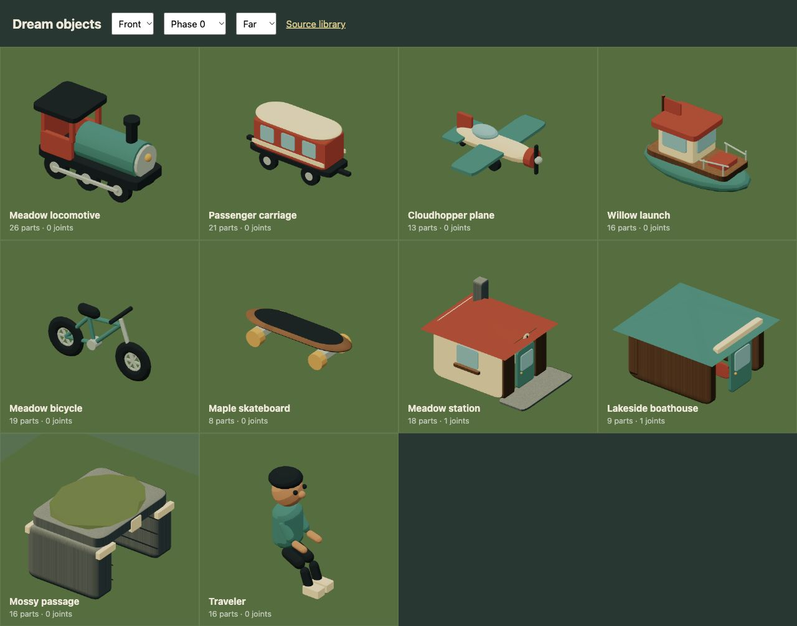

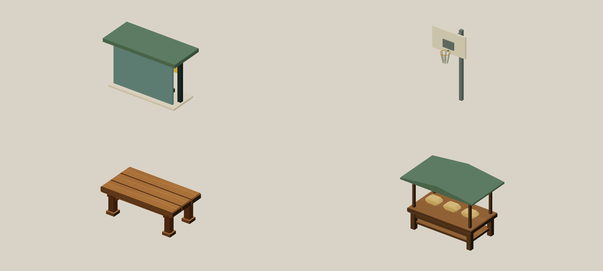

Shelter seats stand on two supports. Table planks rest on crossrails that stay attached to their leg fragments when the table breaks. The produce stall's sign reaches its posts, and apples in the breakable crate sit on its floor. The [world audit](evidence/world-audit/verification.md) records the construction and path checks.

## What's in the world

| Family | Assemblies | Source |
| --- | --- | --- |
| Transport | Rally car, town car, hatchback, delivery van, scooter, city bus, tram, regional train, plane, launch, bicycle, skateboard | [Street assets](../src/scene/world/street_assets.dream), [Transit](../src/scene/world/transit_assets.dream), [landmarks](../src/scene/world/landmarks.dream), [activities](../src/scene/interactive-world.dream) |
| Housing and shops | Three terraces, garden and courtyard homes, three apartment types, corner shop, bakery | [Architecture](../src/scene/world/architecture.dream) |
| Civic and work | Enterable market hall, hospital, two schools, college, offices, library, workshops, stations, boathouse and pavilion | [Market interior](../src/scene/world/market_interior.dream), [civic assets](../src/scene/world/civic_assets.dream), [architecture](../src/scene/world/architecture.dream) |
| Airport and eastbank care | Glazed terminal, gabled hangar, control tower and medical center | [Airport assets](../src/scene/world/transit_assets.dream), [Civic assets](../src/scene/world/civic_assets.dream) |
| People | Commuter, vendor, teacher, health worker, shopper, student, neighbor, resident, football and basketball players | [City people](../src/scene/world/city_people.dream), [sports](../src/scene/world/sports_assets.dream) |
| Wildlife | Pigeon and gull flocks, live deer and route gull, roaming deer, hares, foxes, dogs, cats and sparrows; the library also defines kites | [Fauna](../src/scene/world/fauna.dream), [habitats](../src/scene/world/life.dream) |
| Vegetation | Oak, pine, amber tree, birch, fir, rowan, apple, willow, ferns, flowers and shrubs | [Nature](../src/scene/world/nature.dream), [flora](../src/scene/world/flora.dream), [landmarks](../src/scene/world/landmarks.dream) |
| Props and destruction | Produce stalls, table, crate, planter, ball, slatted benches, toppling trees and breakable shop porches | [Civic assets](../src/scene/world/civic_assets.dream), [impact props](../src/scene/impact-creations.dream), [destructible furniture](../src/scene/world/destructible.dream) |

The seated traveler and standing Explorer are separate engine-provided Dream assemblies. The Explorer and eight civic pedestrian models use twelve bound joints for articulated walking and running. The Explorer also crawls and treads in water, and keeps its own physical size when switching to a seated vehicle pose. Bread and a harvest bowl remain standalone authoring examples. [Open the full atlas](media/assets-all.jpg), or follow the [local gallery setup](README.md#try-it-locally) for interactive inspection. Front, right, back and left views share the same geometry. The phase selector exposes wheel and joint motion.

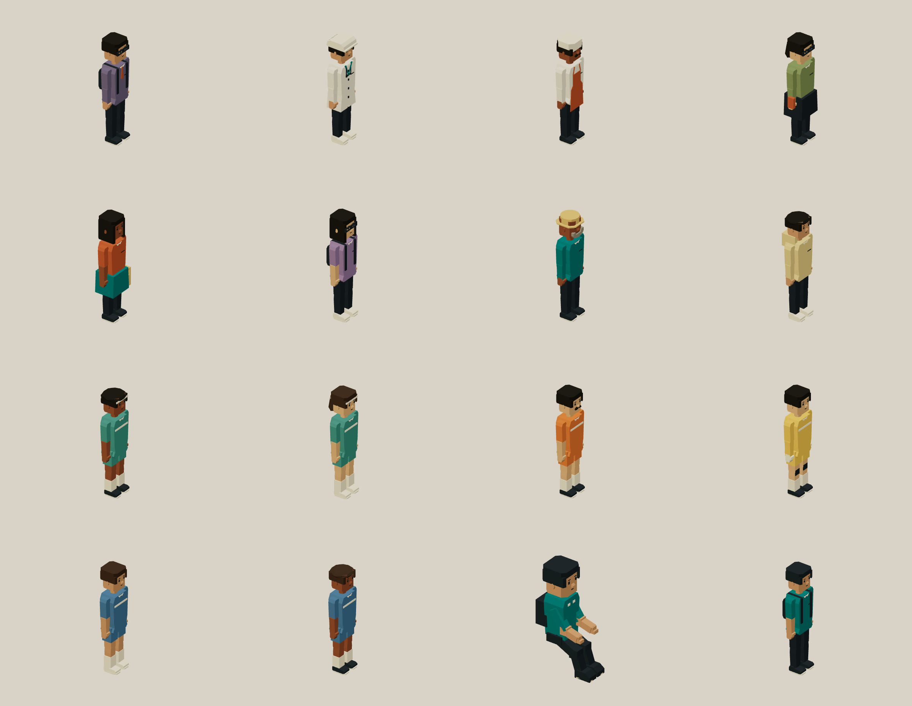

[Character motion, bone bindings and complete source](dream/behavior.md#humanoid-motion).

## Buildings and transport with recognizable construction

The eleven housing, shop and office templates use shared carved window frames, inset glazing and panel doors. Gabled roofs close over attic walls; gutters lead into bent downpipes. Apartment guards have slender posts, and porch supports meet their slab and canopy. Offices have six floor bands rather than a few oversized windows. Brick uses a masonry-colored surface instead of wood grain.

The bus shell has wheel openings, a sloped cab, two passenger doors, repeated window bays and a rooftop cooling unit. The tram and regional railcar have separate cab ends and two four-wheel bogies; the tram's folded collector sits on an insulator. The launch has a keel, pointed upper hull, deck, wheelhouse, guard rail, mounted outboard and fitted helm seat. It remains a six-metre arcade boat.

Fifteen templates cover 197 live placements. Their measured scales and existing physical bodies are preserved, and the bakery's porch remains a separate break zone. Dream 2's visual size minimum is now `.1` local units; the v1 minimum remains `.5`. Finer trim doesn't add physical contacts or raise the 32-part cap.

[Construction guide and reference cues](asset-construction.md) · [Complete house](examples/terraced-house.dream) · [Complete bus](examples/city-bus.dream) · [Complete launch](examples/cabin-launch.dream) · [Checks and media audit](evidence/asset-construction/verification.md).

## Ground vehicles built around their mechanics

The rally coupe, cream-roof town car, compact hatchback and panel van now have different silhouettes. Extruded Dream profiles form sloped cabins and wheel openings. Pillars meet their roofs and shells; lenses sit on their panels. Axles, hubs and tires share rigid bearing frames, with suspension crossmembers connecting them to the body. The racer's visual body travel is limited to five centimetres so its tires stay clear of the openings during a landing.

The bicycle is a step-through city frame with paired rear stays, fork blades, mounted axles and a chain line between its rear cog and chainring. Crank arms and pedals turn together around the bottom bracket as it travels. The scooter has a lower deck, paired fork and rear supports, shaped fenders, a brake mount and a headlight housing. The existing collision cylinders and measured vehicle lengths are preserved; neither model adds mesh-shaped physics.

[Complete car](examples/city-car.dream) · [Complete bicycle](examples/city-bicycle.dream) · [Prisms and rolling joints](dream/objects.md) · [Verification and media audit](evidence/ground-vehicles/verification.md). Unoccupied bicycle cranks keep their saved phase in instanced poses, then animate by distance when boarded. The cars batch into three or four meshes each, and the bicycle into four. The shared seated rider remains a placeholder; its legs do not yet follow the pedals.

## A light aircraft that holds together

Cloudhopper has a continuous tapered fuselage, a glazed cabin, braced high wings, rounded tailplane, rudder, main landing gear and a supported tail wheel. Its 10.8-metre wingspan and collision cylinder retain their existing size. The seat sits inside the cabin. Wheels roll around their axles and the propeller turns around the nose shaft.

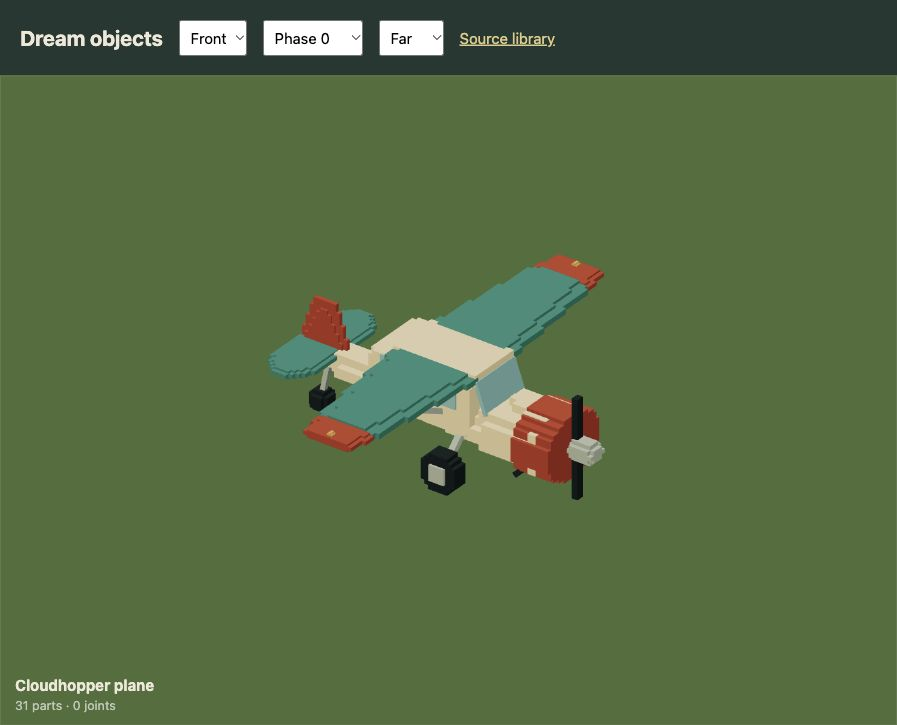

The wings use flattened, tapered cylinders. Each colored tip continues the inner section's end diameter and replaces its outer span. It doesn't cover another wing face. The old red boxes occupied the same top and bottom planes as the teal wing, which made the colors flicker as the view changed. Geometry fixes that overlap; the renderer keeps its existing depth, shadows and antialiasing settings.

[Download the complete checked aircraft](examples/light-aircraft.dream). Its 31 parts use existing Dream commands and compact into six render meshes with independent wheel and propeller pivots. [The verification record](evidence/aircraft/verification.md) includes four viewing angles, surface checks, boarding and a real simulation flight replay.

## Adding useful detail

The new airport buildings use different structures: a long glazed terminal with a supported canopy, a gabled hangar with sliding-door panels, and a narrow tower carrying an observation cabin. Eastbank medical center has a separate entrance block and two floors of windows. Each uses static Dream parts with attached roofs, glazing and supports. [Compose the exact terminal](examples/airport-terminal.dream), or [build a connected terminal, medical center and bus stop](examples/airport-stop.dream).

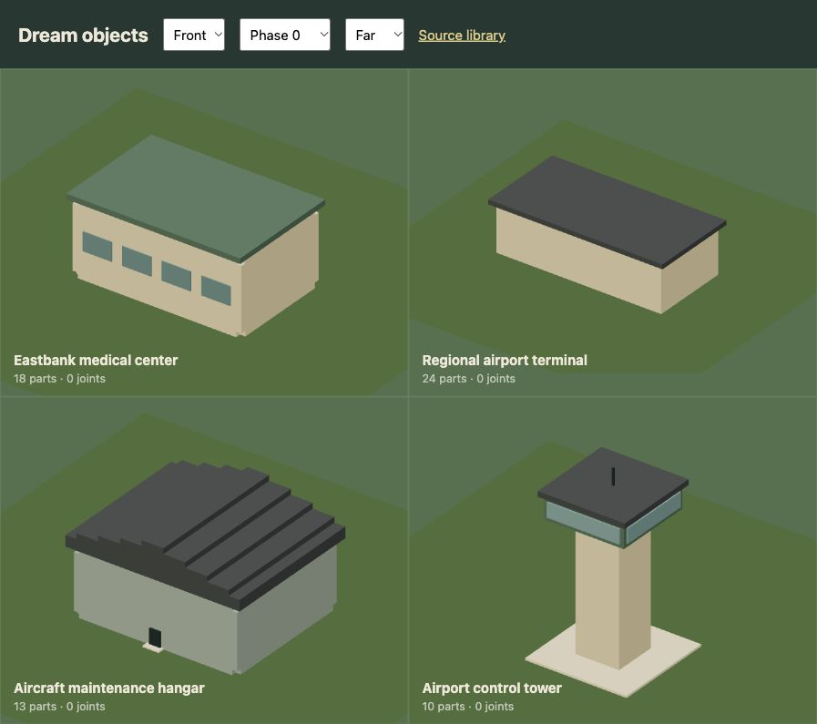

Start with the silhouette and [physical size](proportions.md). Use endpoint beams for forks, braces and steering stems so the connections are explicit. Keep glass inside its frame, roof edges over their walls and canopies connected to a supporting building. Seeded deformation gives stone and foliage an irregular surface without adding a new shape or generating geometry every frame.

Deadwood uses a continuous tapered trunk, rising forks and smaller cut faces at the snapped ends. Fallen logs have bark scars, end grain and a short embedded branch stub. Their placements use varied headings while keeping the existing terrain support. Birch, oak and amber forks also start inside their trunks. The [tapered wood example](examples/tapered-wood.dream) shows the underlying Dream 2 feature.

Both birches use pale tapered stems, rising forks and fine hanging twigs. Smaller leaf clusters leave the white branch structure visible; thin bark scars appear on the front and back. Each fork joins an existing stem, and each leaf cluster surrounds a branch tip. Their ten-metre height and authored collision bodies are preserved. The ordinary birch's foliage sways; the leaning birch keeps its whole assembly together during a fall.

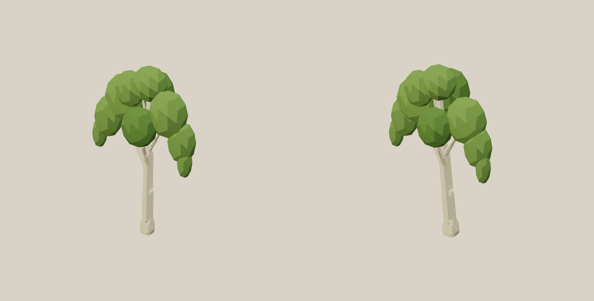

The [birch verification record](evidence/birch-assets/verification.md) includes four viewing angles, terrain placement, destruction checks and the documentation media audit.

Details belong to their supporting coordinate frame. The baker's ears, straps and pocket follow its torso joint. A bench's armrests leave with its frame; the new bakery's canopy and posts leave in its porch zone. Adding a bolt must not create an extra independent fragment. The usual limits still apply: 32 parts per object, eight release groups per breakable assembly, and the existing scene-wide animation and debris budgets.

Rigid parts sharing a material are batched inside each joint frame. Wheels and propellers keep their own pivots. Repeated scenery remains instanced, including its foliage motion and occlusion fade. Added visual detail doesn't add mesh colliders: roads, clearance, driving and impacts still use the engine's existing masks, heightfield and bounded bodies.

The art stays stylized and uses procedural geometry. This pass doesn't add imported meshes, image textures, skeletal skinning or a photorealistic material pipeline. The world and all model interpretation remain mocked.

## Different layers of landscape

The flora library has ten distinct forms, including meadow grass and blue hydrangeas, mixed into the live woodland and meadow planting. Ferns and hazel sit around woodland, lavender grows through the drier east, and reeds and willows follow dry banks. Daisies, dock and foxgloves fill selected edges and clearings. Plant roots stay off the circuit, bridge decks and water surfaces. Small scale changes supplement different silhouettes.

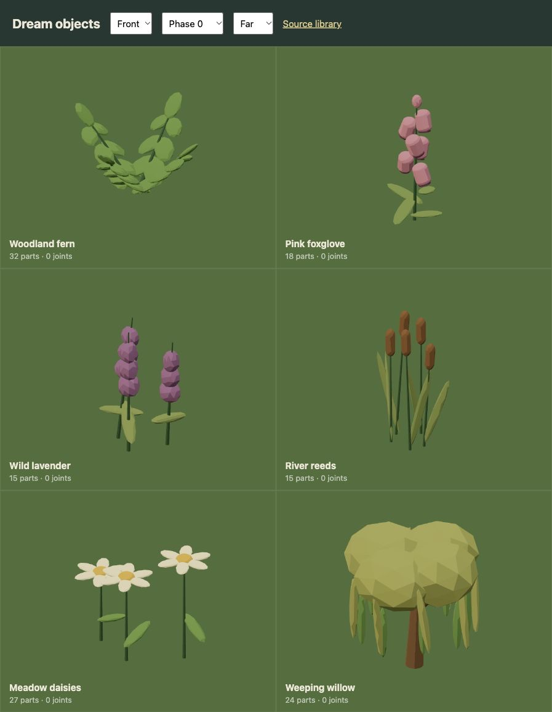

The live city uses a walking deer habitat and gulls above the river; the library also retains fox, hare and kite forms. Birds use continuous airborne ambient routes; walking animals follow clear, dry habitats. Individual route actors stay inside the existing actor and joint budgets. The 111 added pedestrians and 60 ground animals now use bounded ambient movement with shared GPU rigs: walkers stay on connected pavement and ground wildlife flees nearby players. Dogs and cats have four connected walking legs. Plants retain static instancing and shader wind. The [behavior guide](dream/behavior.md#wildlife-and-habitats) explains the ambient route contract and its current limits.

## A planned town and sports park

The replacement adds terraces, apartments, neighborhood shops and civic buildings with different dimensions and uses. Apartments and offices have several floors; shops and homes stay lower. The blocks have street frontage, courtyards and sidewalks. Suburban driveways run toward their street instead of ending in random grass.

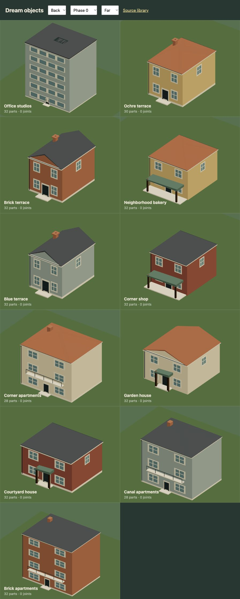

Football goals have connected posts and net threads. Basketball hoops have a supported backboard, a bracket that mounts the rim, and a hanging net. Four animated players practise kicks and dribbles; a commuter visits the market, and the vendor, teacher and health worker react near their buildings. The golf area has an authored fairway and flag. It is an explorable landscape rather than a golf simulation.

[Buildings and furniture](../src/scene/world/architecture.dream), [sports and people](../src/scene/world/sports_assets.dream), [district layout](urban-world.md). The full world stays within the existing 24 live jointed-assembly slots, including the standing character. People use compacted NPC meshes so they can face nearby players. [Dream roles and programs](dream/npcs.md) choose patrol, activity, rest and proximity reactions; body dimensions and animation budgets stay the same.

## Attached architecture

The new houses and civic buildings share dimensions across walls, roofs, doors, glass and supported porch parts. Roof bases meet wall tops. Thin façade details overlap their supporting wall. Porch posts meet a slab and canopy, including the bakery's breakable section. The tests check the actual transformed primitive bounds and roof support; the gallery exposes four views. This is an asset check, not a claim that arbitrary model-generated geometry is structurally sound. Entrance paths receive separate full-scene clearance and reachability checks.

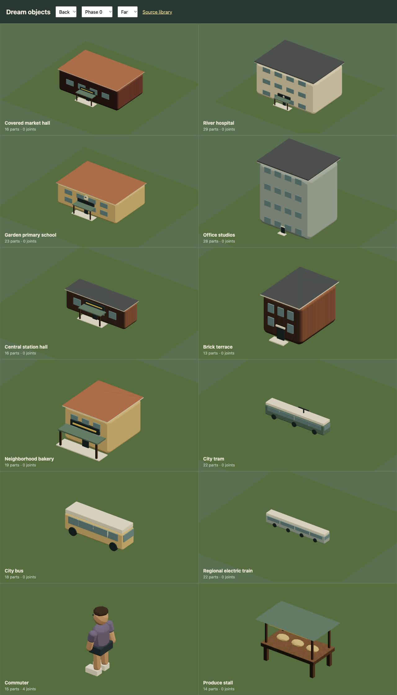

## A street kit with context

The eight new assemblies are an avenue streetlight, neighborhood lantern, planted tub, mixed verge flowers, electric city scooter, pigeon, hatchback and delivery van. Each declares a measured size. Lamp contacts stay narrow; the scooter has wheels, a deck, steering stem and handlebar; the two traffic bodies have different windows and cargo proportions.

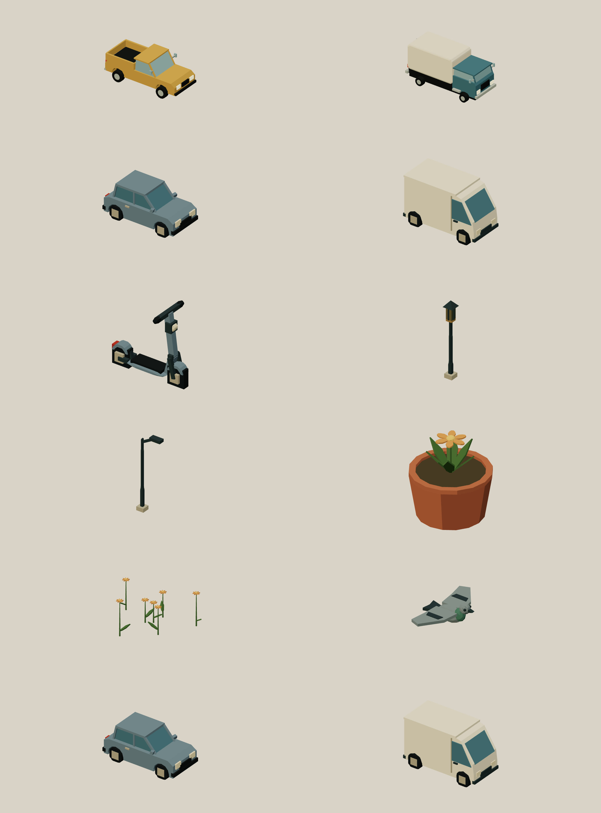

[Population rules](dream/populations.md) choose the streets and destinations these assets belong to. Decorative vehicle props bake joint rest poses. Controllable destination parking retains its mechanisms, with instanced unoccupied poses and one occupied fleet rig. Bird flocks use the same authored shape with instanced shader flight rather than allocating a joint controller per bird.

## After dark

Architecture and civic window materials declare a warm `night` color. The two streetlight assemblies declare local lamp sources and measured light-pool radii. Their geometry, contacts and placement rules are unchanged. These are explicit Dream capabilities, independent of asset labels. [Day/night authoring](dream/day-night.md).

## Voxel geometry

Dream 2 now supports bounded filled/carved voxel parts, greedy surface meshing and optional fracture chunks. The city uses voxel building shells, bench boards and two carved park walls; the bakehouse example adds chunked masonry; measured proportions and explicit contacts remain unchanged. See the [voxel guide](dream/voxels.md) for syntax, limits, a complete example and current boundaries.

## A fuller city and its habitats

The live city now contains 123 people, 336 trees and 60 additional roaming ground animals and birds. Shoppers, students and neighbors have varied clothing, hair and complexions; dogs, cats and sparrows join the woodland deer, hares and foxes. Meadow grass and hydrangeas add two more planting forms.

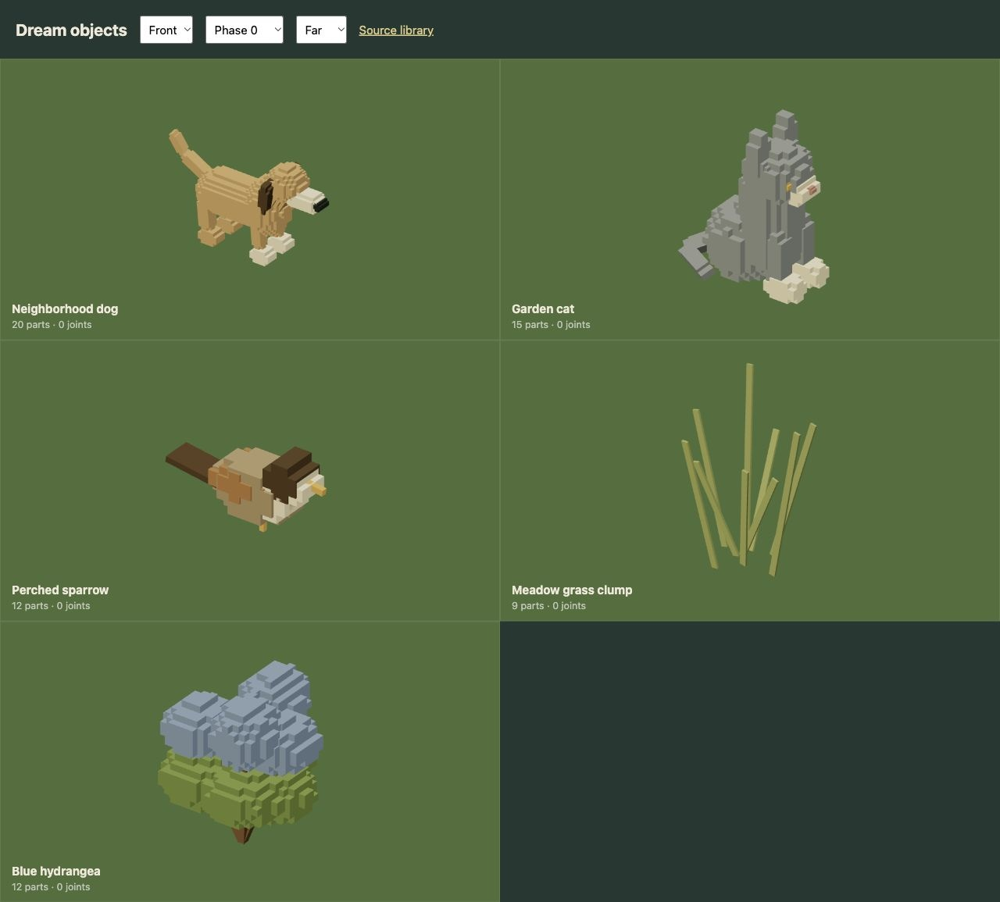

The added residents and wildlife share complete instanced geometry at explicit rest poses. Four new neighbors use live greeting programs. Fourteen usable parked cars/vans have solid bodies on connected parking aprons; the four moving road cars retain their routes. [Rest poses, sidewalk placement and population bounds](dream/populations.md).
