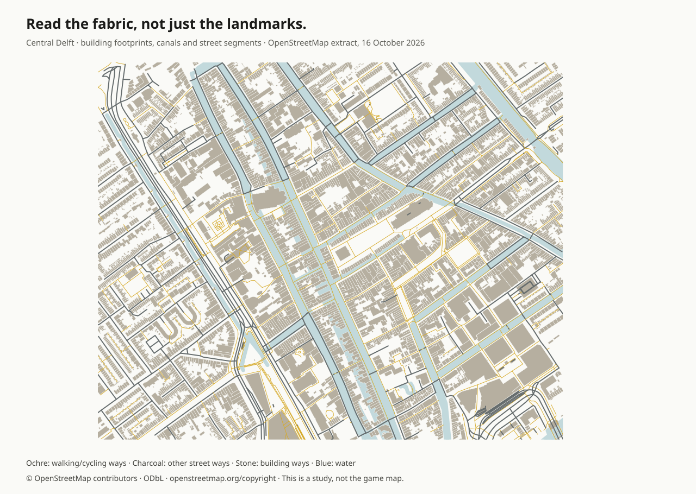

# A city has to make sense.

A hospital needs an entrance. That entrance needs a pavement. The pavement needs to reach the bus stop, and the bus needs to go somewhere people actually need to go.

That is the starting point for this replacement world. The previous layout has been replaced. The new ring road, neighborhoods and river share one authored network.

This map is generated from the compiled Dream world. It uses the actual roads, building footprints, entrance paths, transit routes and bridges. The plan covers 1.4 × 1.1 kilometres. Streets have different jobs: a main street with shops and a tram, quieter residential streets, service access around workplaces, and roads out to the airfield and countryside.

## Places, and why they are there

| Place | Neighbors and connections | Activity |
| --- | --- | --- |
| Market hall and square | Old-town shops, homes, tram interchange, deliveries from the service street | A vendor, produce stalls and a commuter visiting the market |
| Hospital | Main bus route, a public entrance, a separate service apron and nearby housing | A health worker outside, with a clear public approach |
| Eastbank medical center | Workshop street, station bus, entrance apron and bicycle parking | A second medical destination with its own building type |
| Regional airport | Public terminal and bus stop, hospital link, runway-side apron, separate hangar service road and control tower | Rideable aircraft and scooter; boardable bus |
| Schools | Homes, pavements, crossings, playing space and neighborhood bus stops | Teachers, visitors and people walking to school |
| Offices, studios and technical college | North avenue, the tram/bus interchange and mixed housing | Workers and commuters |
| Workshops and harbor | Service streets, railway station, loading yards and the waterfront | A service yard, boats and nearby rail access |
| Station | Tram terminus, bus access, platform and a continuous walk to nearby workplaces | A regional train that stops at the two platforms |
| Garden neighborhood | Houses and duplexes with front paths, gardens, local shops and school access | Walking, cycling and a local bus loop |
| South neighborhood | Mixed homes, hospital, school, sports park and river access | Another bus loop, people practising sport and local traffic |
| River and lake | Connected water, explicit bridges and public access along both developed banks | Boats, swimming, planted banks and gulls |

The hospital, schools and workplaces are destinations in the world. This pass is not a hospital simulator, an economy or a job-market model. Their entrances, access and visible routines still have to be real parts of the scene.

## Connections belong in Dream

Dream now declares the connections explicitly:

- A site's use, its building, its entrance and its connection to a named street. The entrance must move with its building. The connecting path must be visible and clear.
- Street vehicle routes that use existing roads. Adding a bus route must not draw another strip of asphalt over the road.
- Named stops with a wait and a connection to an actual platform or waiting area. A stop in the middle of a lawn is invalid.
- Pedestrian routes that follow pavements, paths and crossings between destinations. People need a reason for their journeys.

The same accepted geometry drives rendering, masks and validation. Street junctions must have one surface. Bridges must carry the complete cross-section, and the water route must remain clear underneath. The model describes these connections as bounded data; the engine validates them.

## Buildings need construction rules too

A collection of valid boxes can still make a broken building. Doors, windows, awnings, roofs and supports need shared dimensions and attachment points. The new architectural types have attachment checks on their actual transformed primitive bounds, including supported roofs and porch posts.

The checks cover an awning that misses its wall, a roof with a gap above its supporting walls, misplaced facade details and an entrance that ends inside another object. Close and wide browser views are part of that check. A passing schema is not enough.

## What I could actually read

| Source | Material examined | What it contributes |
| --- | --- | --- |
| [How to Build a City, Isabel Otter and Harry Woodgate](https://www.bookxcess.com/products/how-to-build-a-city-hardback-picture-book) | The supplied listing and available descriptions. A readable full book was not available. | A prompt to think about the systems supporting buildings. No claims here rely on unseen pages. |
| [How to Build a City: Journeys into the Urban Future, Gabriella Bennett](https://www.hachette.co.uk/titles/gabriella-bennett/how-to-build-a-city/9781035421978/) | Publisher description. The advertised excerpt did not expose readable pages in the available browser. | Context about adapting places to people's needs and environmental constraints. This is not represented as a full reading. |
| [The Color of Law, Richard Rothstein](https://wwnorton.com/books/the-color-of-law/) | Publisher-authorized [employment excerpts, pp. 153–161](https://www.learningforjustice.org/sites/default/files/2019-10/COL%20Lesson%202%20Winners%20and%20Losers%20Book%20Excerpts%20Handout_vF%20PDF.pdf), [housing and transport excerpts, including pp. 188–189](https://www.learningforjustice.org/sites/default/files/2019-10/Color%20of%20Law%20Lesson%203%20White%20Middle%20Class%20Book%20Excerpts%20Handout.pdf), and [Rothstein's public testimony](https://www.epi.org/blog/powerful-government-policy-segregated-us-the-same-can-desegregate-us-says-color-of-law-author-richard-rothstein/). | His account of racial exclusion in housing, employment and transport shows why a city's layout cannot be treated as socially neutral. For this fictional world, the design response is connected public access to services, work and waterfronts across housing types. It is not an attempt to simulate that history. |
| [A Street Through Time, DK / Steve Noon](https://dk.com/products/9780241411544-a-street-through-time) | The publisher's illustrated 1700s spread. | Attached frontages, shops under homes, working waterfronts, a bridge and civic buildings sharing one inhabited street. |
| [NACTO Urban Street Design Guide](https://nacto.org/publication/urban-street-design-guide/) | [Neighborhood main streets](https://nacto.org/publication/urban-street-design-guide/streets/neighborhood-main-street/), [bus stops](https://nacto.org/publication/urban-street-design-guide/street-design-elements/transit-streets/bus-stops/) and [crossings](https://nacto.org/publication/urban-street-design-guide/intersection-design-elements/crosswalks-and-crossings/crosswalks/). | Different street functions, direct pedestrian access and stops connected to destinations and crossings. These are design references for a game, not a claim of engineering compliance. |
| [Singapore's Central Urban Loop](https://pcn.nparks.gov.sg/the-pcn-experience/cul/) | NParks' public route description. | Parks and cycle connections as a continuous network through neighborhoods. |

## Reading a real map

The Delft study uses an actual [OpenStreetMap API extract](https://www.openstreetmap.org/api/0.6/map?bbox=4.3500,52.0075,4.3660,52.0155), retrieved on 16 October 2026. In this sample, buildings form narrow parcels along streets, blocks vary in length and shape, and walking connections cut through the larger fabric. Public squares interrupt that fabric where people gather.

The filtered sample contains 4,620 building ways. Their median shorter axis-aligned bounding-box dimension is 10.5 metres. That is a reproducible geometric measurement, not an estimate of true frontage width. The extract also contains tagged schools, marketplaces, a library and workplaces among the surrounding buildings; it is not a complete service inventory.

The [method, counts and source checksum](evidence/city-research/delft-summary.json) are retained with the research. Map data and the derived study illustration are © OpenStreetMap contributors, under the [Open Database Licence](https://www.openstreetmap.org/copyright). The game city is fictional and does not import Delft's coordinates.

## Acceptance before calling it done

The replacement passes checks for the street network, entrance paths, transit stops, bridge continuity and vehicle clearances. People must walk on the authored network. Every new building type needs an attachment check and an inspected render. Walking, swimming, vehicle switching, racing mechanics and destruction keep their regression coverage.

The full world stays resident. The existing quality settings, render distance, shadow resolution and asset detail stay intact. Browser measurements must cover the dense center as well as the outskirts. Screenshots, recordings, the README and Dream's model contract must describe the world that actually ships.
