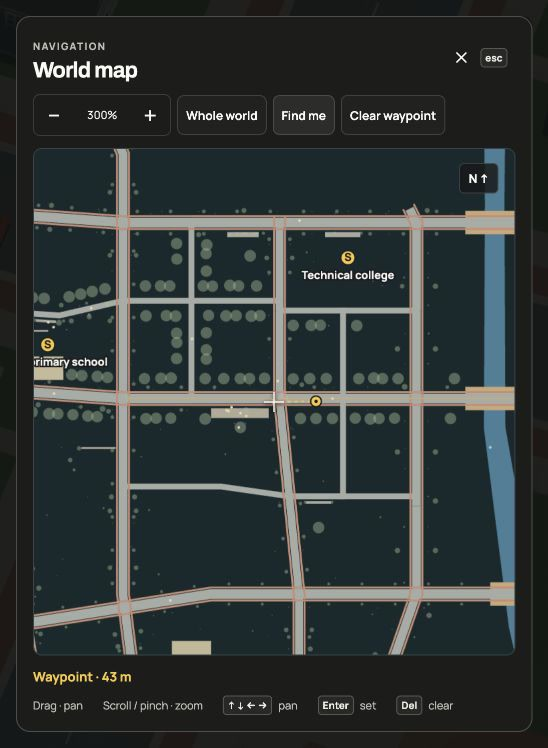
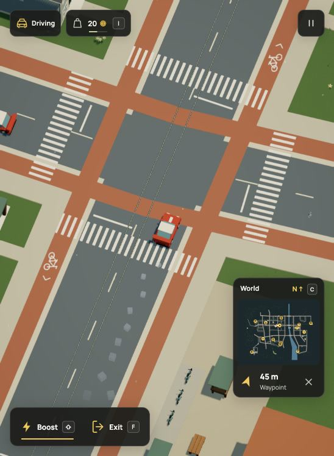
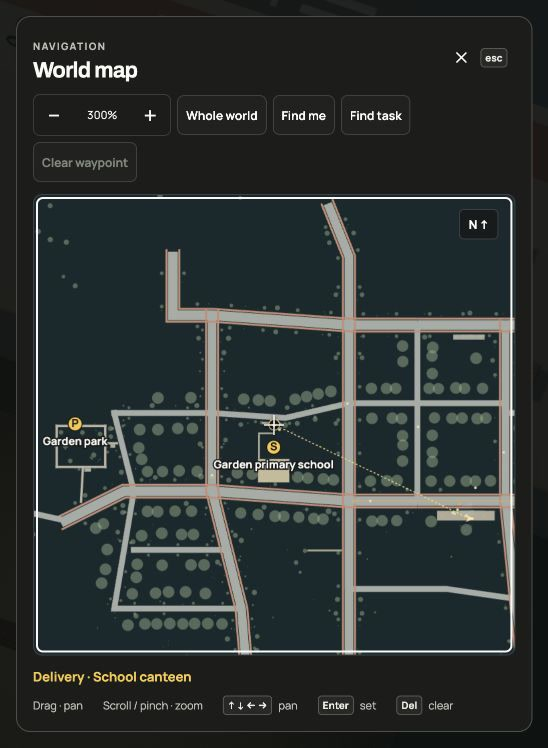
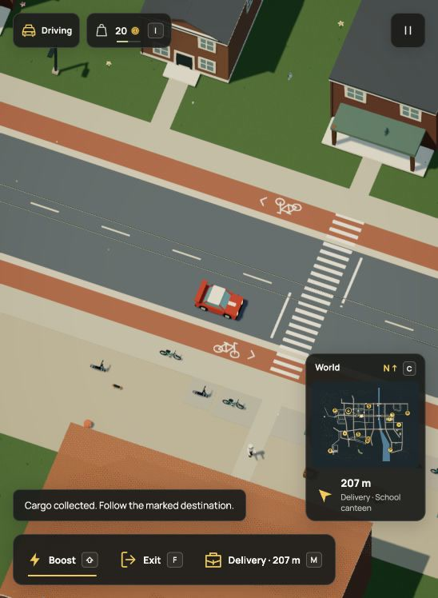
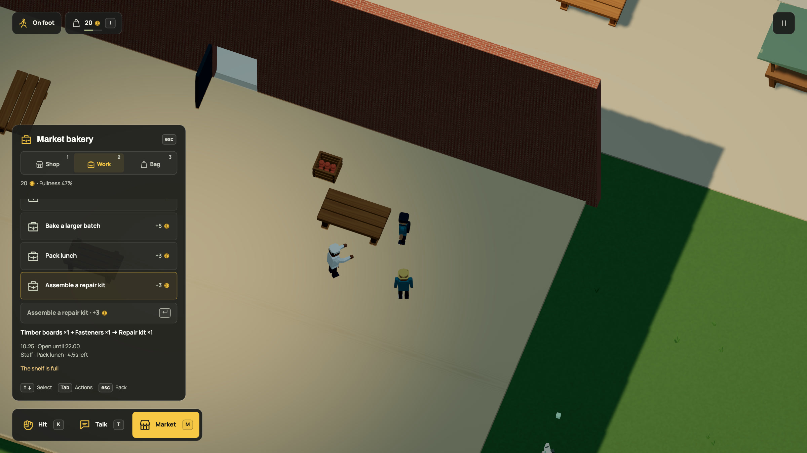
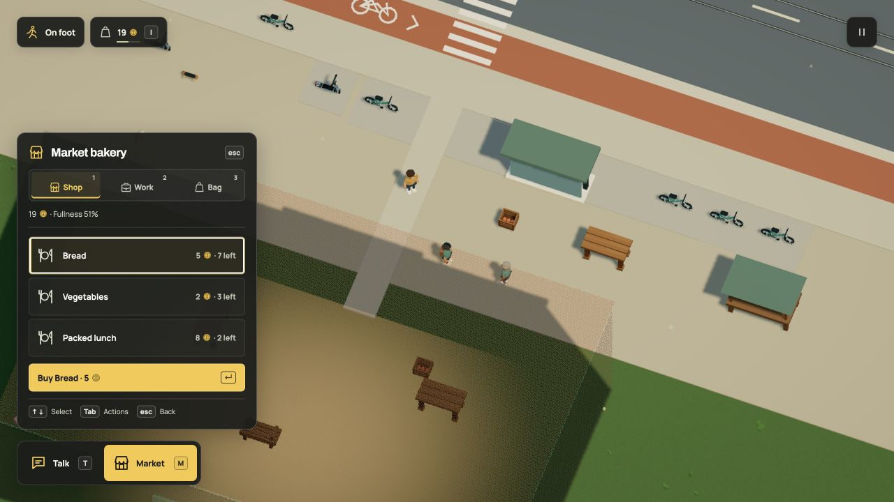
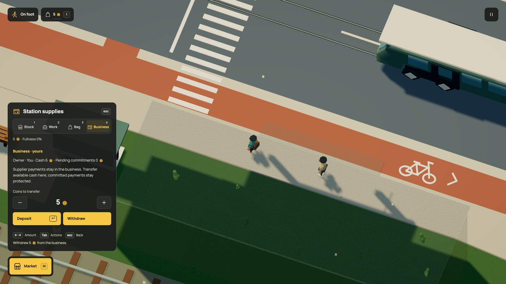

# A little less HUD, a little more world

Walk up to something. The actions you can use appear beside an icon: drive,
sit, talk or open the market. Drive away and those prompts go away. A delivery
replaces the market prompt with its destination distance; a repair points you
towards the work. Boost belongs to the car. On a court, N joins or rests a match, J charges a shot,
and K changes between passing, calling for the ball and tackling. A compact
score/time panel replaces the minimap there.

The bag button keeps your wallet visible. The coin icon means game currency;
the same unit is called `credits` in Dream source. **I** opens it. **M** opens nearby
activities or the current task. **Escape** closes that panel before pausing the
game. Existing transaction shortcuts still work with the panel closed. **+ / −** zoom
the camera and **0** resets manual framing; pinch and scroll still work.

## Open the part you need

| View | When it appears | What you can do |
| --- | --- | --- |
| Shop / Stock | Beside a counter on foot | Inspect stock; buy or sell when it has retail offers |
| Work | Beside a workplace, or during a task | Choose work, collect cargo, hand it over or inspect progress |
| Bag | While playing | Inspect carried items; eat or share food when the ordinary rules allow it |
| Business | Beside a counter with an authored owner | Inspect the sale, buy it or transfer company cash |

Only one view is visible. A committed task hides new shopping and business
transfers until it finishes; a shared meal shows its meal controls. Moving out of range, changing control modes or pausing
closes it. Opening a panel releases held movement and shot controls. Item slots replace dropdowns. Use **arrow keys or WASD** to select, then
**Enter** to buy, eat or start the selected activity. **1–4** select the available
sections; **Q/E** cycle between them. **Tab / Shift+Tab** reach secondary actions,
such as selling, cancelling or closing. Business transfers use **left/right**
to change the coin amount (**Shift** changes ten at a time), with **Tab** to choose Deposit or Withdraw.
There is no number field to type into. Tab stays within the open activity panel,
and keyboard focus follows a selection when a job starts or an item is used.

Menu keys cannot steer the car, jump or rotate the camera. Browser shortcuts
using Command, Control or Alt remain available. The world continues while
you browse, so staff, opening hours and supply trips keep moving.

The HUD uses one left alignment, a compact charcoal action dock and activity
rows, Manrope labels and Archivo headings. A quiet fill and yellow text mark
the current selection, with no bottom stripe;
a separate light outline shows keyboard focus. The framed map stays north-up. The wallet includes a small fullness
gauge; its coin icon replaces the old currency abbreviation.

Click the minimap or press **C** to open the world map. Scroll or pinch over
either map to zoom it independently of the game camera. In the expanded map,
drag to pan and click to set a waypoint. Arrow keys/WASD pan, **+ / −** zoom,
**Home** finds you, **0** fits the world and **Enter** places a waypoint at the
crosshair. **Delete**, Clear waypoint or the HUD’s × removes it. **Escape / C**
returns to play. The map pauses the world and releases held controls.

A waypoint adds a map marker, direct bearing and distance in metres beside the
minimap. The arrow follows the screen direction after camera rotation; it does
not steer for you or calculate a turn-by-turn street route. It says Arrived
within 2.5 metres, keeping the marker until you clear it. The point is remembered
on this device for the same world and dimensions. It is a separate UI preference,
not part of exported world backups. Start over clears it; R keeps it. Review
captures use isolated preferences or disable storage. Closing the map releases
its large canvas buffers; static geography is cached until the view changes.

Delivery, repair and planting jobs also use this guide. With no personal
waypoint, it points to the delivery counter or the repair approach and names
the destination. **Find task / T** centers the expanded map there. A personal
waypoint takes priority; clearing it brings the task guide back without
cancelling the job. Finishing or cancelling work removes its marker.

Nearby means you are within 2.5 metres of the target, not that the task is
complete. Hand deliveries over on foot through the ordinary activity controls;
repairs still need a clear work area and time. The guide stays available when
you change vehicles or use R. It reads the saved task rather than storing a
second copy of it.

The food icon uses a fork and knife with a clear gap between them. The bicycle
icon shares its wheels, frame, saddle and fork with the cycle-lane stencil.
Both remain legible at their small HUD sizes. [Four rendered paint angles](evidence/symbols/verification.md).

Icons have short visible labels, accessible names and keyboard hints. Disabled
choices retain the engine's reason. None of this changes Dream's interaction
ranges, ownership, money, inventories or physics. The UI reads the accepted
world and asks the same fixed-step simulation to act.

The Work view keeps the complete recipe separate from opening hours and current
activity. Long ingredient names wrap instead of disappearing after two lines.
A disabled action has one warning, and active-task directions stay readable.
Keyboard selection and focus trapping use the same controls described above.

[Current panel in motion](media/actions.mp4) · [GIF](media/actions.gif) ·
[Browser and focused checks](evidence/work-panel/verification.md).
Earlier market-control and commerce recordings retain their recorded panel layout;
they still show the same transactions, not this current text arrangement.

This is a keyboard-and-pointer game. These prompts do not add touch steering or
a controller binding system. Full movement controls remain under Pause → Controls. **P** opens Pause; its
actions, controls and backup tools also work with Tab and Enter. The [contextual
key guide](dream/behavior.md#pause-and-find-the-controls) starts with the current
movement or sport, then uses arrow-key sections instead of one long text list.
