# Give things behavior

[Docs](../README.md) / Behavior

Appearance and interaction are separate. The same assembled shape can be solid, knockable or decorative. Behavior is explicit data that selects a bounded engine mechanic; object labels and materials don't decide it.

[NPCs and control](npcs.md) adds placement roles and bounded programs for patrol, activity, rest and player proximity. The same assembly can be player-controllable or owned by an NPC.

## View controls

[Sports grounds](sports.md) add on-foot football and basketball controls, with
automatic close framing, dribbling and scored shots. Existing walking, vehicle
and camera controls remain available outside the grounds.

Pinch the trackpad or scroll vertically over the world to zoom in and out. Mouse wheels work too. Framing eases smoothly, keeps the same view angle and remains relative to the current vehicle, so boarding a bicycle still brings it closer. Reduced motion applies zoom immediately. Manual framing survives R; Start over restores the default. Gestures over the pause menu retain normal browser behavior.

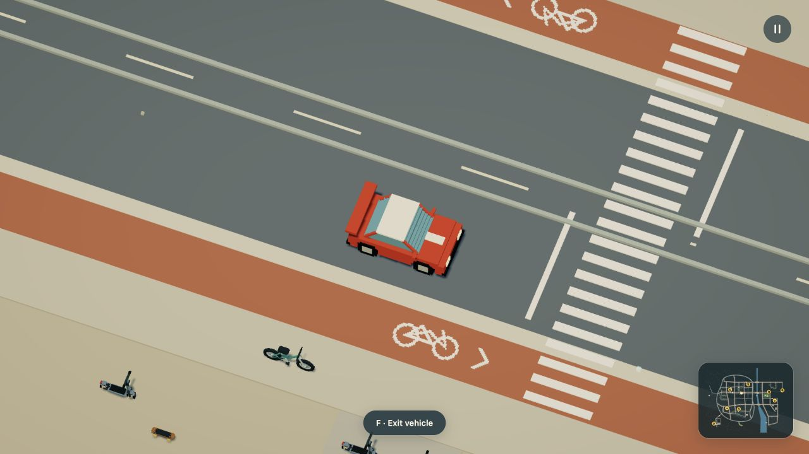

[Wider overview of the same position](../media/zoom-overview.jpg) · [Input and camera checks](../evidence/trackpad-zoom/verification.md)

## Sit on furniture

**F** also sits on an available furniture seat when you reach its approach.
Move, jump or press F to request a clear exit; **G** eats owned food. Work,
trade, sports and boarding require standing. The same named slots can be claimed
by meal customers. [Seating, damage and saved ownership](seating.md).

## Bodies, contacts and boarding

Every object declares a body with a radius and height. A static upright solid can replace its default footprint with named `contact` cylinders or upright rectangles. Separate wall, floor and ceiling contacts leave a real doorway with headroom. Dream 2 rectangles use `size=[width,depth]` and optional `heading_deg`; moving vehicles retain cylinders. See [enterable buildings](interiors.md) for a complete assembly.

`rideable(at=[x,y,z],control=bicycle)` supplies a local seat and selects an engine control profile. The profiles are `car`, `bicycle`, `skateboard`, `scooter`, `boat` and `plane`. A placement with `role=controllable` starts parked and takes WASD input when occupied. It can have a fixed XY placement or use a route's initial pose; the route does not constrain its movement.

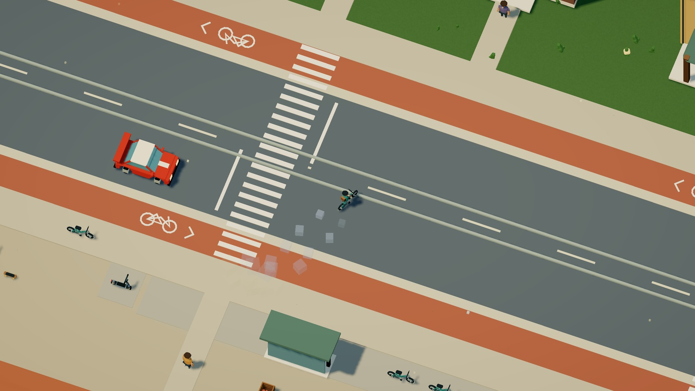

[HD recording](../media/parking.mp4) · [GIF](../media/parking.gif)

The destination parking now uses these same controls: 45 bicycles, 22 scooters and 14 cars/vans. Use `furnish(...,role=controllable)` or `place(...,role=controllable,parked=true)` to declare dormant available rides. [Parking rules and complete source](populations.md#make-the-parked-vehicles-usable).

**F** gets you out of the current vehicle. Walk to another one, then press **F** to enter it. Boarding uses distance from the body's edge, up to 60 canonical units, and an elevation difference below 28 units. The car and other vehicles remain where you leave them. You can return on foot and take them over again. **R** returns to the starting car while keeping parked vehicles and world damage; Start over restores everything. Resetting during flight or after a water landing returns the abandoned aircraft to its authored start.

| Mode | WASD / arrows | Space | Shift |
| --- | --- | --- | --- |
| Car | Throttle, brake/reverse, steering | No extra action | One-second boost |
| On foot | Screen-relative walking | Jump | Run |
| Swimming | Screen-relative swimming | Faster stroke | Faster stroke |
| Bicycle / skateboard / scooter | Throttle, brake/reverse, steering | Bunny hop / ollie | No extra action |
| Boat | Throttle, brake/reverse, rudder | Small water hop | No extra action |
| Plane | Throttle/brake, steering | Climb | Descend |

Walking accelerates toward the chosen direction, turns the character smoothly and brakes when released. Diagonals have the same speed as straight movement. Camera rotation changes the screen-relative direction. Jumping preserves momentum in the air and accepts a press up to 0.12 seconds before landing or 0.1 seconds after leaving a ledge. Holding Space doesn't trigger repeated jumps.

Cars also have a **Boost** button. Click it or press Shift once for one second of forward thrust, followed by five seconds of recharge. Holding Shift never repeats a burst; release and press again when ready. The button shows the remaining time and hides while on foot or using another control profile. A burst starts on dry ground while stopped or moving forward. Braking cancels thrust, airborne wheels add no thrust, and water cancels the burst. Boost pads retain their own cooldown; combined boost is capped at 520 units per second during the grounded burst. Pause freezes recharge. R cancels the burst while keeping recharge; Start over refills it. Leaving the car cancels its burst and keeps the shared recharge clock.

This capability belongs to the existing `car` engine profile, including Dream objects with `rideable(at=...,control=car)` and `role=controllable`. No extra Dream command or model-generated controller is needed. Bikes, scooters, boards, boats, aircraft and NPC passenger rides keep their own controls.

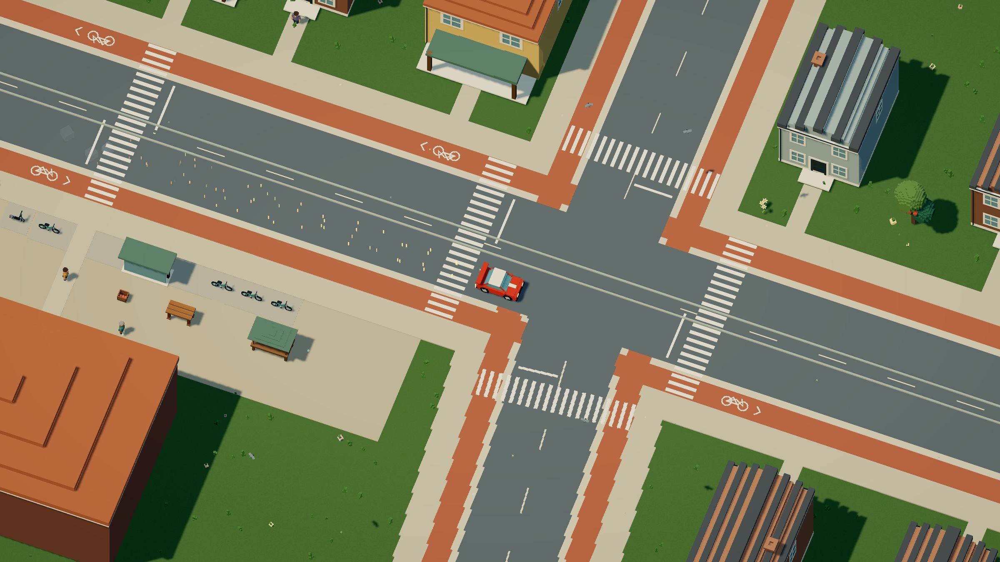

[Boost recording](../media/boost.gif) · [HD video](../media/boost.mp4) · [Checks and capture details](../evidence/car-boost/verification.md)

The walking body automatically climbs contact steps up to **4 units, or 40 cm**, with enough headroom. Taller faces need a jump or another way around. A ceiling stops a jump. Steps come from the object's declared contact heights, not its visual triangles. [Compile these three garden terraces](../examples/walkable-steps.dream). Their round treads match the engine's cylinder contacts. Ladders, wall climbing and arbitrary mesh stairs are not implemented.

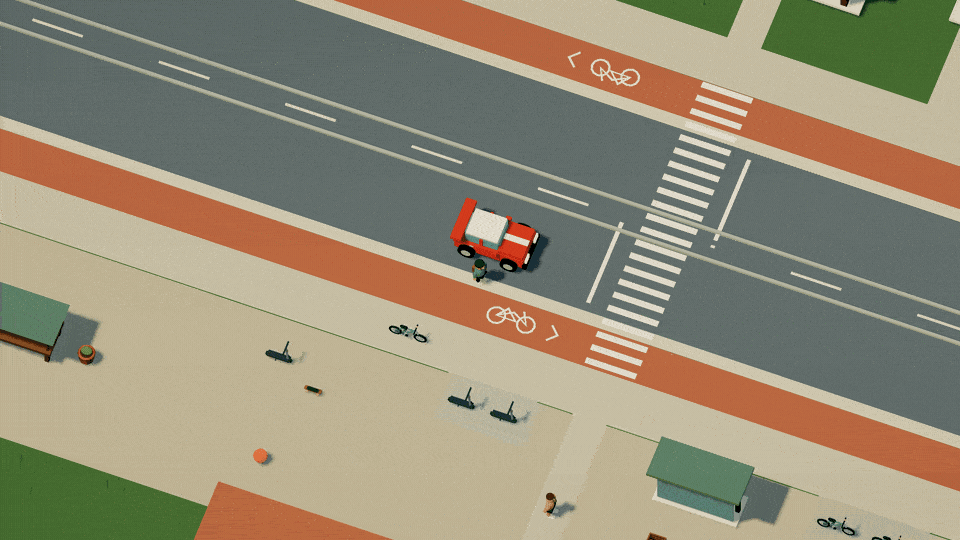

Bicycles use speed-dependent steering and lean into turns. Higher speed opens the turning radius. Bicycles, skateboards and scooters keep their own acceleration, grip and speed limits, share terrain/collisions with the racing car, and can jump under player input. The original car keeps its existing crest and ramp jumps.

Rolling joints keep tires and hubs on a shared axle, or crank arms and pedals on one bearing. Their visual phase follows traveled distance; idle and parked mechanisms stay still. This does not add suspension physics, a drivetrain solver or rider leg tracking. [Vehicle construction and source](../asset-library.md#ground-vehicles-built-around-their-mechanics).

Boats retain sideways momentum through a rudder turn, settle it through hull resistance and drift with currents. Their complete visible hull must stay over navigable water. Bridge undersides and finite rail bottoms provide real headroom; a boat stays on the water while a car drives on the deck above it. A hop is limited by the underside, then gravity brings the hull back to the surface. Low crossings and banks stop a hull that doesn't fit.

Aircraft need forward speed to take off. Climb and descent build gradually rather than snapping vertical speed. Release the climb control at flying speed to level out; insufficient airspeed produces a sink. A wall impact stops horizontal travel while gravity continues. Land before exiting. A water landing stalls the aircraft at the surface; leave it to wade/swim or press R to recover it. These are bounded arcade controls, not a flight or sailing simulator.

An airborne plane reaching a world edge keeps its airspeed and turn authority.
Its collision body stays inside the finite map and can slide along the edge;
hold **A** or **D** to turn back. This also works at corners. Braking can still
produce a stall, and terrain, building, vehicle and travel-mask contacts remain
active. Grounded aircraft retain their taxi and reverse controls. The boundary
uses the authored collision cylinder; it does not clip every visible wing tip.
The [boundary verification](../evidence/aircraft-boundary/verification.md)
shows native flight into the edge and back into the world.

Aircraft terrain contact surveys a cached underside profile from the Dream assembly, including the wheels, nose and wing span. It uses the current heading, pitch and bank against the terrain heightfield and the engine's ground triangulation. Voxel construction approximates the same field with stepped columns; the driving controller keeps the smooth contact model. A landing keeps the aircraft above the hillside; a solid's top remains supporting until the body leaves its edge, then airborne control and stall rules resume. Hold **S** after braking to taxi backward on dry ground and back away from an obstruction. Reverse is disabled in flight and after a water landing. Buildings use their authored contacts against the aircraft cylinder; this does not add mesh-level wing collisions.

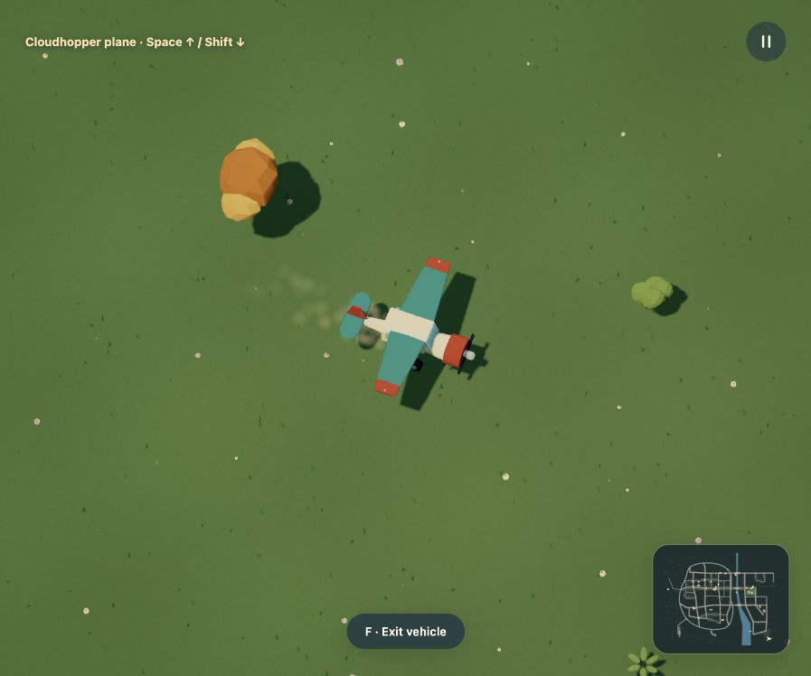

The [terrain-contact verification](../evidence/aircraft-terrain/verification.md) separates geometry checks, native controls and retained media.

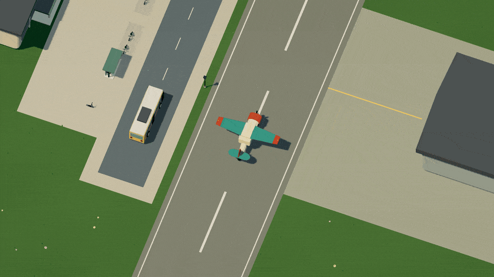

[Watch in HD](../media/flight.mp4) · [Compose the complete light aircraft](../examples/light-aircraft.dream). Its wing tips are separate, continuous sections; the 10.8-metre wingspan and collision body keep their existing size. The model uses existing Dream shapes, taper, endpoint braces and rigid animation.

Releasing the ground vehicle's throttle lets it coast to a complete stop on dry, flat ground. Bounded rolling resistance and lateral tire friction are resolved after slope gravity, so tiny velocities cannot keep the body creeping indefinitely. The tires can hold across ordinary dry slopes and settle an existing side slip. A sufficiently steep slope can still overcome grip or roll the vehicle along its wheels; ice has much less resistance. Uphill slowdown, downhill acceleration, normal throttle power, crest jumps and water currents remain active. Tire resistance applies only during ground contact, with the coasting part applied at neutral throttle. Walking, boats and aircraft keep their own control rules.

These are engine-owned contact rules, with no extra Dream syntax. For local inspection after `npm run dev`, use `http://127.0.0.1:5173/?test-driving=sidehill` for a cross-slope pose or `http://127.0.0.1:5173/?test-driving=coast` for neutral coasting. These development helpers are excluded from production. The [verification record](../evidence/tire-grip/verification.md) separates fixture tests from browser observations.

Exits prefer accessible dry ground, then allow water disembarking when the character fits. You cannot step out during flight. Under a bridge, leaving a boat puts you in the water, never through the deck. Swim back to a boat and press F to board again. Parked vehicles retain their positions and do not acquire a second controller.

### Leave a vehicle

For a compound passenger body, the engine finds clear ground beside its authored
`contact` cylinders. Making a bus, tram or train longer no longer forces a large
sideways exit. Blocking one side makes the engine try another point; a fully
blocked exit leaves you aboard. [The city bus](../examples/city-bus.dream) uses
this existing contact vocabulary. Driver-controlled vehicles retain their single
cylinder; boats and aircraft keep their wider visible-hull clearance.

This is a bounded clearance search, not an authored door animation or a guarantee
of stepping onto a particular platform. F can reboard a nearby passenger vehicle;
WASD does not take over its route. Your original parked car, checkpoints and the
world's changes remain owned by the same simulation.

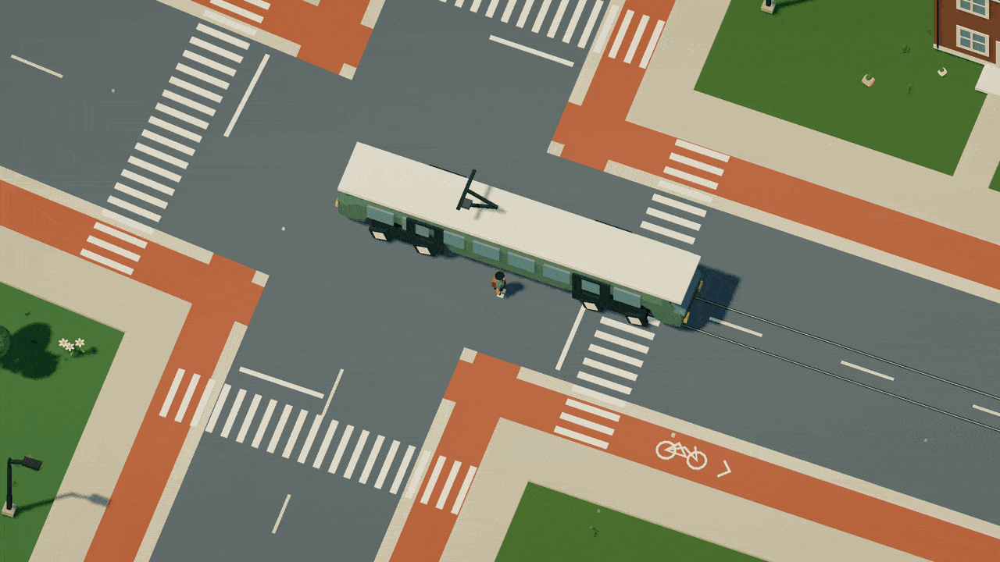

Shallow water supports wading on the bed. Deeper water supports the character at chest depth, with a forward crawl, alternating arm pulls, bent-elbow recovery, flutter kicks and a small wake. Releasing the controls eases into an upright tread; current velocity does not count as stroke effort. Shift or Space increases swimming effort. Water currents still carry you when you stop. Swimming follows the terrain onto a bank and switches back to walking. There is no diving, breath meter or drowning mechanic.

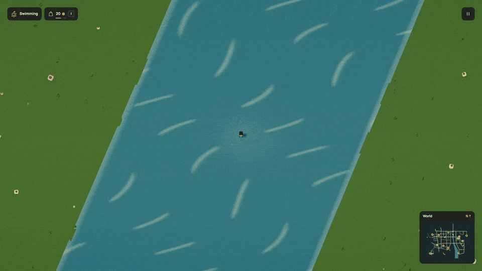

One character is active at a time: a standing, walking or swimming Dream assembly on foot and a seated assembly on a vehicle. The skateboard and scooter use the standing Explorer. Their physical sizes are independent of the vehicle's scale. Original-car racing progress is preserved while walking or using another vehicle. Movement stays in the existing engine profiles; the character's joint anatomy is explicit Dream data.

The camera moves closer for walking and small vehicles, using their resolved dimensions, and eases back for larger ones. Reduced motion snaps the camera change and holds a supported character pose without gait, strokes or breathing motion. The occupied vehicle stays opaque when scenery fades around it.

The exploration HUD shows vehicle and surface status, car boost with its recharge, boarding prompts and pause. The map shows your position, parked car and moving actors, with no checkpoint target. Lap and checkpoint counters are hidden; the legacy racing simulation and Dream checkpoint data remain compatible.

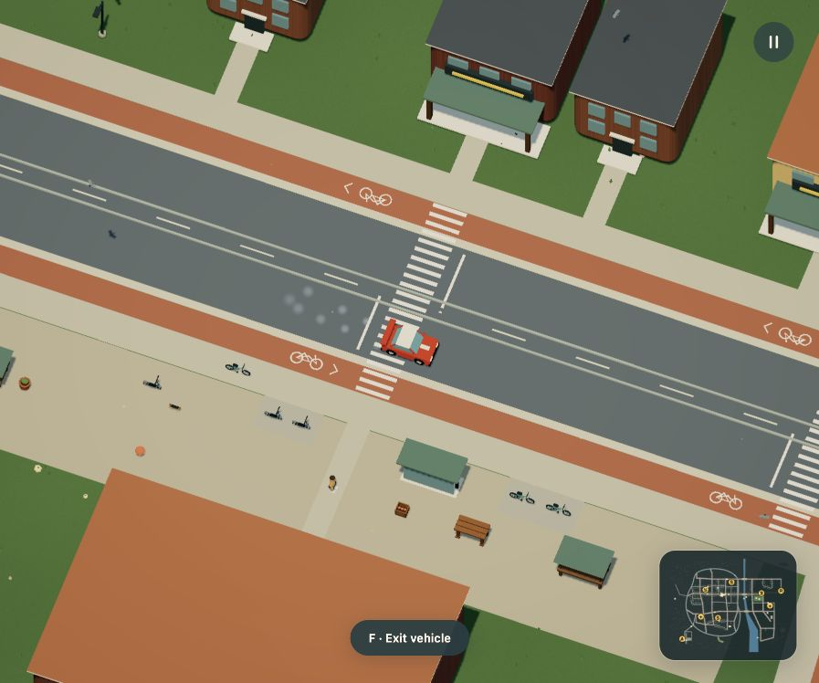

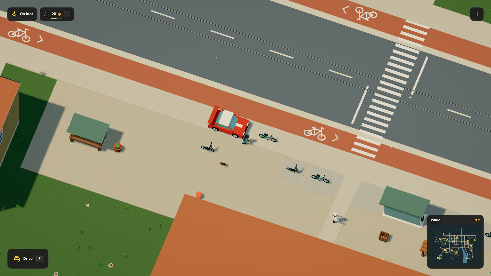

[Compile the complete controllable bicycle](../examples/controllable-bicycle.dream). Omitting `control` keeps the legacy passenger-only seat on a route, as used by the autonomous mock train. Those rides still follow their declared path.

A joint can use `open(axis=y,deg=105,radius=100)` for a proximity door. Its declared wall contacts provide the opening. The animated panel doesn't push the car through rotating mesh collision.

## Wildlife and habitats

Birds can circle above the terrain while deer and a fox move through their clearings. Hares idle in the meadow. Their bodies, wings, ears and legs are Dream parts. The current world adds five animal forms and eight plant forms, including ferns, reeds, foxgloves, lavender and weeping willows.

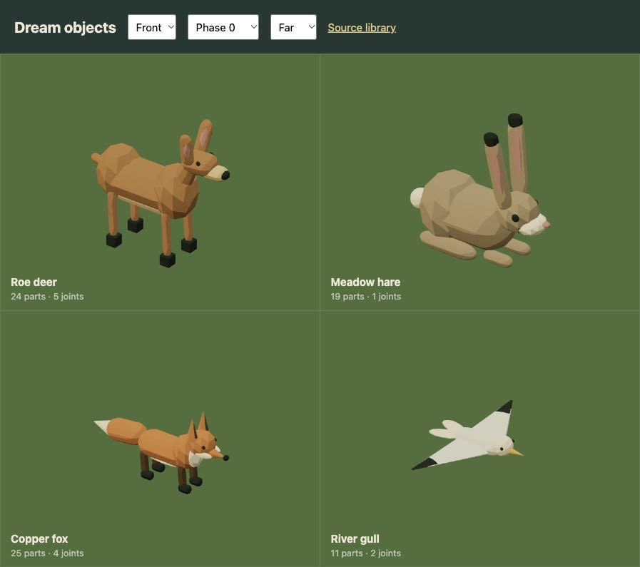

An `ambient` route creates no road or runway. It accepts only a `decor` body and leaves racing collisions to the existing physical objects. Ground movement follows terrain; optional `altitude` keeps a bird airborne through the whole loop. Routes alone provide authored travel. The route deer adds a nearby-player attention program; the 60 added ground animals use Dream `roam` motion to flee and recover inside safe habitats. Ambient `walk` populations follow the accepted pedestrian network. [Population motion](populations.md) is separate from general NPC programs and hunting is not implemented. Wing and leg joints respect reduced motion and return to rest during route waits.

[Download this complete two-bird example](../examples/ambient-wildlife.dream):

```dream
dream 2;
material feather(style=toon,colors=[#d7ddcf,#a1b4ad]);
material tip(style=toon,colors=[#465a55,#30423d]);
material gold(style=toon,colors=[#d5aa54,#a67b3c]);
object gull(label="River gull"){
  measure(kind=custom,axis=z,meters=1.8);
  body(interaction=decor,radius=4,height=24);
  part body(shape=capsule,material=feather,at=[0,7,0],size=[7,22,8],rot_deg=[0,0,-90]);
  part head(shape=sphere,material=feather,at=[11,9,0],size=[8,8,8]);
  part beak(shape=cone,material=gold,at=[17,8,0],size=[3,8,3],rot_deg=[0,0,-90]);
  repeat sides(index=s,count=2){
    let side(value=s*2-1);
    joint wing(at=[0,7,side*3],rot_deg=[0,-side*16,0],motion=swing(axis=x,deg=24,hz=.5,phase_deg=s*180)){
      beam inner(shape=cylinder,material=feather,from=[0,0,0],to=[0,0,side*24],width=17,depth=2.4,taper=.25);
      beam outer(shape=cylinder,material=tip,from=[0,0,side*20],to=[0,0,side*30],width=6,depth=1.5,taper=.15);
    }
  }
}
route over_meadow(kind=ambient,mode=loop,speed=45,altitude=120){
  point(at=[300,300]);
  point(at=[650,300]);
  point(at=[650,500]);
  point(at=[300,500]);
}
place gull_one(object=gull,route=over_meadow,scale=1);
place gull_two(object=gull,route=over_meadow,offset=60,scale=.93);
```

The [reference](reference.md#ambient-wildlife) gives the speed, height and scene bounds. Plants remain instanced scenery. Habitat placements keep their roots away from water surfaces, bridge decks and the racing circuit.

## Bounce, break or fall

| Declaration inside an object | Result |
| --- | --- |
| `impact(mode=bounce(restitution=.74,lift=.24));` | A knockable body rebounds and can leave the ground |
| `impact(mode=break(speed=95,scatter=65,lift=65,spin=4,lifetime=6,pattern=splinter));` | A solid releases authored fragments after a hard impact |
| `impact(mode=topple(speed=110,duration=1.1,lifetime=8));` | One connected fragment falls about a hinge |

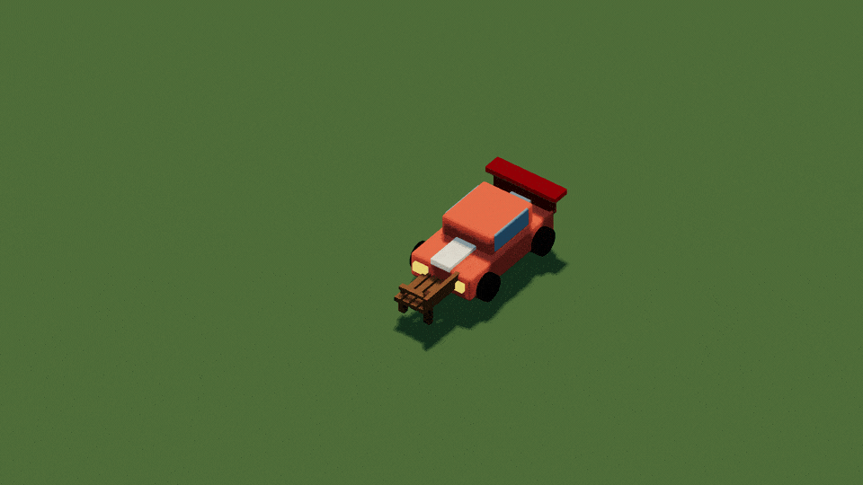

`fragment id(){...}` keeps several parts connected during release. A table can separate into its top and legs; bread and a bowl can stay in their own groups. Each breakable assembly has at most eight static fragments. The [complete bench](../examples/breakable-bench.dream) is runnable, and the [tree example](../examples/toppling-tree.dream) keeps its entire shape connected for a fall.

`pattern=splinter` carries pieces forward and spreads them laterally. `crumble` releases masonry close to where it stood, with less inherited motion and rebound. Omit `pattern` for the existing scatter behavior. `topple` follows terrain-aware support until the falling assembly reaches the ground.

## Break part of a building

A named `zone` declares a separate contact and fracture rule around a set of parts. The building keeps its core contacts and retained geometry while that section disappears. See the [workshop and bakehouse definitions](../../src/scene/world/destructible.dream). A zone must own parts, retain some structure outside it and respect the same fragment budget.

Whole-object impacts cannot also carry a foundation, compound contacts, a seat or an emitter. Partial building zones can retain a foundation and core contacts. Resident impacts retain 24 reactive objects and 128 potential fragments, including zones. Static whole-object break/topple props may use the explicit [pooled destruction policy](rules.md#streetlights-and-streamed-destruction).

## State and limits

A gentle bump or glancing pass doesn't trigger a fracture. Once broken, an intact collider is removed exactly once. The changed world persists after cosmetic pieces expire. R resets the car while keeping damage; Start over restores the world. Pause freezes destruction and lifetime. Reduced motion applies damage without flying fragments or impact puffs.

Debris collides with terrain only. It doesn't strike cars or trigger another building's collapse. There is no arbitrary mesh cutting or accumulated structural damage. Selected furniture, lamps and orchard trees use the finite [repair and planting jobs](commerce.md#repair-work). The [impact engine contract](../impact-dsl.md) contains detailed bounds and compatibility notes.

[Model generation and repair](model-authoring.md) · [Reference](reference.md)

Passenger-only seats may use compound contacts on solid transit vehicles. The mock bus, tram and regional railcar keep their schedules when boarded. The scooter uses direct standing ground controls and the same buffered jump contract as a bicycle. [Population and ownership details](populations.md).

## Humanoid motion

Walking, running and swimming use one connected voxel rig, with twelve semantic bone bindings. Elbows and knees bend around their own pivots; shoes stay attached to ankle frames. Walking has a grounded stance and lifted return. Running adds knee lift, stronger arm drive, a forward torso lean and a flight beat. Jumping tucks the legs, and a landing briefly compresses the pose. Starting, stopping and entering water blend the movement weights instead of freezing halfway through a step.

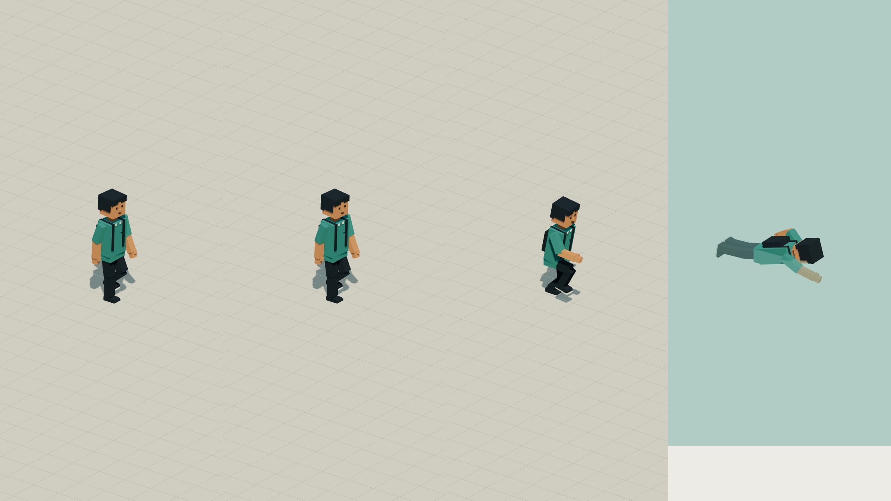

[Close-up motion recording](../media/character.gif) · [HD video](../media/character.mp4) · [Complete compilable rig](../examples/humanoid.dream)

Inside the pelvis (`bone=root`) of a complete measured `person` object, bind an articulated leg like this:

```dream
joint leg(bone=left_hip,at=[0,0,4]){
  part thigh(shape=capsule,material=trousers,at=[0,-5.5,0],size=[5.7,12,5.7]);
  joint shin(bone=left_knee,at=[0,-11.5,0]){
    part knee(shape=sphere,material=trousers,at=[0,0,0],size=[5,5,5]);
    part calf(shape=capsule,material=trousers,at=[0,-5.2,0],size=[5,11,5]);
    joint foot(bone=left_ankle,at=[0,-10.5,0]){
      part shoe(shape=box,material=shoes,at=[2.3,-1,0],size=[9,4,6.2]);
    }
  }
}
```

This is a fragment; the [complete example](../examples/humanoid.dream) supplies the materials, root, spine, arms and other leg. Bone bindings survive generated IDs, imports and voxel construction. They do not depend on a character's name. The Explorer and twelve civic and sports templates share this connected construction. Hair, coats and carried items bind to the appropriate frame with `mount`; the seated passenger reuses the face in a static driving pose. [People and clothing](people.md). Football kicks and basketball shots override the player's relevant limbs while locomotion continues.

Walking people now use the same small ground lift as the player, including static street residents and instanced walkers. This removes the inherited vehicle-sized hover gap without changing their physical support or movement.

The renderer caches bone references and solves a small two-segment leg pose. It does not rebuild geometry each frame, add animated-assembly slots, or change walking speed, jumps, water support, collisions or vehicle ownership. This is rigid articulation, not skinned animation or a terrain-aware foot-placement solver. Stride phase follows distance travelled and the resolved character scale. A flat stance sole and a reachable ankle target keep the planted foot still during steady forward travel; upper-body sway no longer rotates both planted feet. Shoe support is measured once from the authored ankle parts, including their size and rotation. The instanced pedestrian and sports shaders use the same support and reach rules in color and shadow passes. Starting, stopping, turning and uneven terrain still blend an arcade pose rather than solve independent world-space foot anchors. [Stride checks and current recordings](../evidence/walking-strides/verification.md). [Verification and media audit](../evidence/character-animation/verification.md).

Existing complete humanoid rigs also support a renderer-owned planted work gesture
while a [commerce job](commerce.md) is active. Cached shoulder/elbow bindings animate
without changing segment lengths, contacts or rig budgets. Walking away cancels
the job through simulation rules; reduced motion rests the gesture.

NPC [meal trips](commerce.md#customers-with-somewhere-to-go) add a renderer-owned
hand-to-mouth gesture using the existing humanoid bones. Feet stay planted during
the eating timer, segment lengths remain rigid, and reduced motion uses the idle
pose. Food ownership, consumption and timing belong to the fixed-step economy.


[Shared meals](social.md) use existing seated humanoids and body-sized pedestrian travel. F, movement, jumping or R ends an unfinished meal and refunds both reserved portions before returning the companion to their routine.
