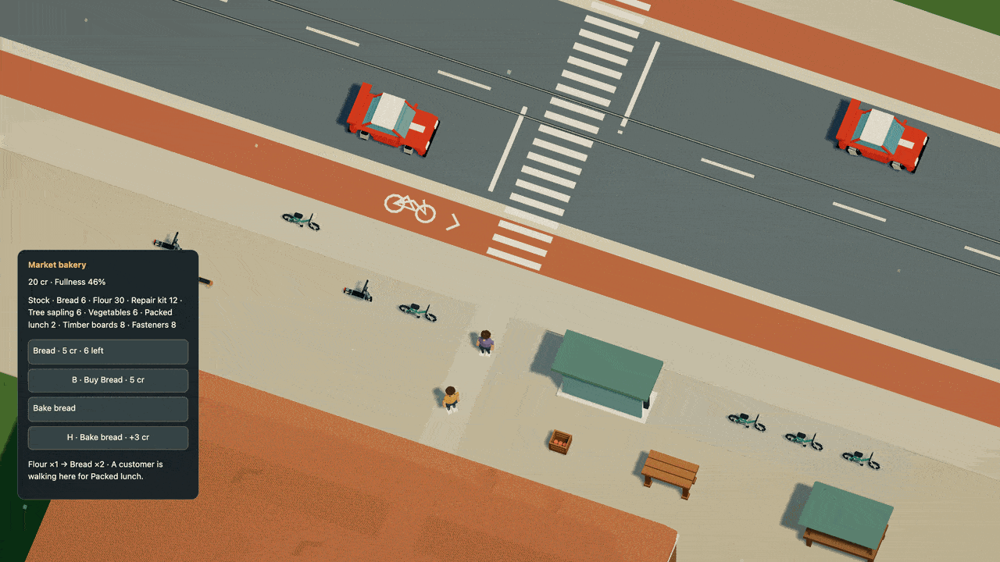

# A bakery that keeps itself working

The vendor now packs lunches and bakes bread when stock runs low. A hungry
commuter walks over, buys a meal, eats and returns to their routine. When the
bakery has room for more flour, the market helper can walk to the station,
collect two units and bring them back. You can buy, cook and take the same
transport work. Staff do not get their own free supplies or wages.



[Watch in HD](../media/kitchen.mp4). The recording shows a player purchase and
meal, a customer purchase, and the vendor replacing the sold food. Flour transport
takes several simulation minutes and is checked separately; this sixteen-second
clip does not show that complete journey. These are 30 rendered frames per
simulation second, not a live performance measurement.

## What moves through the business

| Activity | Input | Result |
| --- | --- | --- |
| Basic bread batch | 1 flour, reserved from the bakery | 2 bread after 6 seconds; worker earns 3 credits |
| Pack lunch | 1 bread and 1 vegetable, reserved together | 1 lunch after 5 seconds; worker earns 3 credits |
| Buy lunch | 8 credits from the customer's wallet | One owned lunch; the bakery receives the credits |
| Flour delivery | 2 flour from the finite station stock | The bakery receives flour and pays the courier 4 credits |

The larger bread batch still requires three personally completed basic batches.
The vendor earns that practice independently of you. Both use the same recipe,
capacity, effort, treasury and refund checks. A busy lunch job can make you wait;
you can still take another available job. The panel names the staff's current
work and remaining time.

The business starts with finite bread, flour, vegetables and money. It can stop
for missing ingredients, a full shelf, a hungry worker or insufficient wages.
The helper can spend earned pay on food after returning. Kit and sapling supply
and available repair work retain their existing priorities before flour trips.
This is a working counter and supply loop, without restaurant seating, table
service, shifts, upstream farming or business ownership yet.

## Compose the existing Dream rules

`works` chooses eligible jobs below their stock targets in order. Lunch comes
first; if it needs bread, baking can supply the missing ingredient. `meal`
provides a customer's food destination. `deliveries` connects finite source and
destination shelves. No special restaurant command or generated controller is
needed. Public pedestrian routing works in a standalone business scene, without
adding a repair service or a cosmetic population to make it initialize.

This [complete example](../examples/market-production.dream) uses shorter jobs
and a small connected neighborhood so the full loop is easy to inspect:

```dream
dream 2;
material blue(style=toon,colors=[#537eaa,#3c5f87]);
material skin(style=toon,colors=[#c59774,#a97655]);
object pedestrian(label="Pedestrian"){
  measure(kind=person,axis=y,meters=1.8);
  body(interaction=decor,radius=4,height=18);
  part torso(shape=capsule,material=blue,at=[0,11,0],size=[5,6,4]);
  part head(shape=sphere,material=skin,at=[0,16,0],size=[4,4,4]);
  part nose(shape=sphere,material=skin,at=[2,16,0],size=[1,1,1]);
  repeat legs(index=i,count=2){
    joint leg(at=[0,8,i*3-1.5],motion=swing(axis=z,deg=18,hz=.6,phase_deg=i*180)){
      part shin(shape=capsule,material=blue,at=[0,-4,0],size=[2,8,2]);
    }
  }
}
behavior welcome(start=waiting){
  state waiting(action=idle){on talk(event=interact,to=hello,radius=55,familiar=false);on again(event=interact,to=returning,radius=55,familiar=true);}
  state hello(action=idle,face=player,say="Hello. Welcome to the neighborhood."){
    on ask(event=interact,to=about,radius=55);
    on finish(event=after,to=waiting,seconds=6);
  }
  state returning(action=idle,face=player,say="Good to see you again."){
    on finish(event=after,to=waiting,seconds=6);
  }
  state about(action=idle,face=player,say="I like walking by the river. See you around."){
    on finish(event=after,to=waiting,seconds=6);
  }
}
place neighbor(object=pedestrian,at=[580,710],role=npc,behavior=welcome);
world(size=[4000,2400],spawn=[525,609],heading_deg=0);
road circuit(width=118,points=[[300,590],[660,590],[810,500],[810,220],[660,130],[300,130],[150,220],[150,500]]);

checkpoint start(at=[480,612.5],dir=[1,0],width=100);
checkpoint east(at=[828.75,360],dir=[0,-1],width=100);
checkpoint north(at=[480,107.5],dir=[-1,0],width=100);
checkpoint west(at=[131.25,360],dir=[0,1],width=100);

place customer(object=pedestrian,at=[760,730],role=npc,behavior=welcome);
place depot_keeper(object=pedestrian,at=[1120,970],role=npc,behavior=welcome);
place helper(object=pedestrian,at=[620,730],role=npc,behavior=welcome);
street access(width=60,sidewalk=24,points=[[400,590],[400,850]]);
street main(width=60,sidewalk=24,points=[[400,850],[1400,850]]);
crossing main_cross(street=main,at=[900,850],width=20);
surface depot_yard(color=#b2aa96,points=[[1080,884],[1260,884],[1260,1020],[1080,1020]]);
surface plaza(color=#b2aa96,points=[[530,680],[820,680],[820,816],[530,816]]);
economy(){
 good bread(label="Bread",food=45);
 good flour(label="Flour");
 good vegetables(label="Vegetables",food=20);
 good lunch(label="Packed lunch",food=65);
 account pocket(actor=player,credits=20,capacity=8,satiety=65,drain_s=.05);
 account baker(actor=neighbor,credits=0,capacity=4,satiety=65,drain_s=.05,shop=true,works=[pack_lunch,bake]);
 meal bakery_break(good=lunch,markets=[corner],on=plaza,eat_s=4);
 account regular(actor=customer,credits=20,capacity=4,satiety=25,drain_s=.05,meal=bakery_break);
 account supply_helper(actor=helper,credits=0,capacity=4,satiety=65,drain_s=.05,deliveries=[flour_run]);
 market corner(label="Corner bakery",actor=neighbor,credits=100,radius=70){
  lot bread_shelf(good=bread,quantity=0,limit=16,price=5);
  lot flour_sack(good=flour,quantity=6,limit=6);
  lot vegetables_box(good=vegetables,quantity=4,limit=8,price=2);
  lot lunch_counter(good=lunch,quantity=0,limit=4,price=8);
 }
 market depot(label="Station supplies",actor=depot_keeper,credits=0,radius=70){lot flour_store(good=flour,quantity=12,limit=12);}
 delivery flour_run(label="Bring flour",from=depot,to=corner,good=flour,quantity=2,pay=4,capacity=1,on=plaza,grounds=[depot_yard]);
 work bake(label="Bake bread",market=corner,input=flour,take=1,output=bread,make=2,seconds=2,pay=3,effort=6,capacity=1,target=4);
 work pack_lunch(label="Pack lunch",market=corner,output=lunch,make=1,seconds=2,pay=3,effort=6,capacity=1,target=2){
  ingredient(good=bread,take=1);
  ingredient(good=vegetables,take=1);
 }
}
```

Run `npm run -s dream -- check docs/examples/market-production.dream`. The example
includes no repair service or ambient walkers. Its courier and customer still
use validated walking grounds, sidewalks and a crossing. Removing the connection
fails complete-world acceptance. Bodies, actor/rig limits, graph bounds and
shared transaction rules remain unchanged.

## Leaving and coming back

Business stock, wages, cooking reservations, food, delivery cargo and both walking
journeys live in resident simulation state. Unloading a district does not reset
them. Pause freezes the work; R preserves it; Start over resets the world.
Reloading performs no offline work and cannot finish or pay an activity twice.

Simulation version 17 registers the staff-policy and standalone-navigation
update. Save format 11 is unchanged. The previous city is validated before any
state is accepted; all existing records, active jobs, paths, balances, materials
and world time are kept. Its geometry and prepared navigation graphs are equal,
so there is no population or floor rebasing for this update. The original slot is
kept, and corrupt or concurrently changed newer saves still block replacement.
[Persistence details](../persistence.md).
