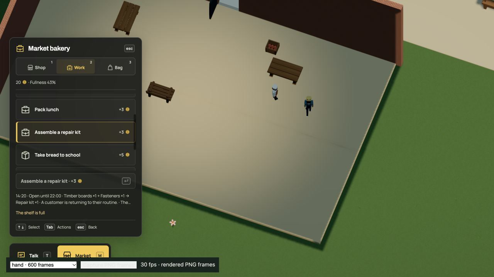
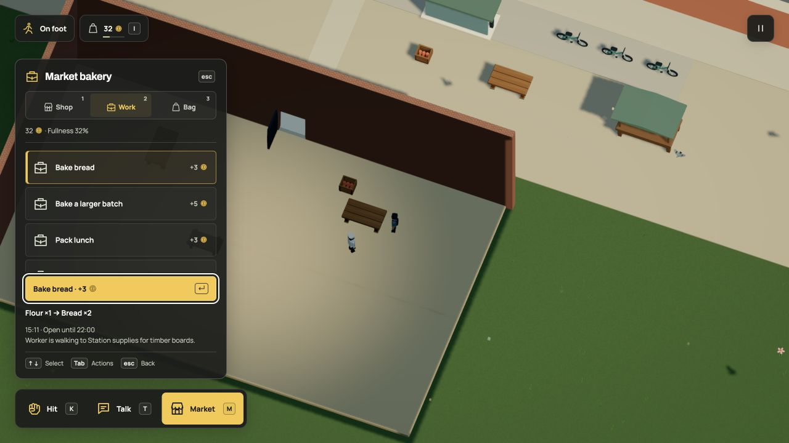
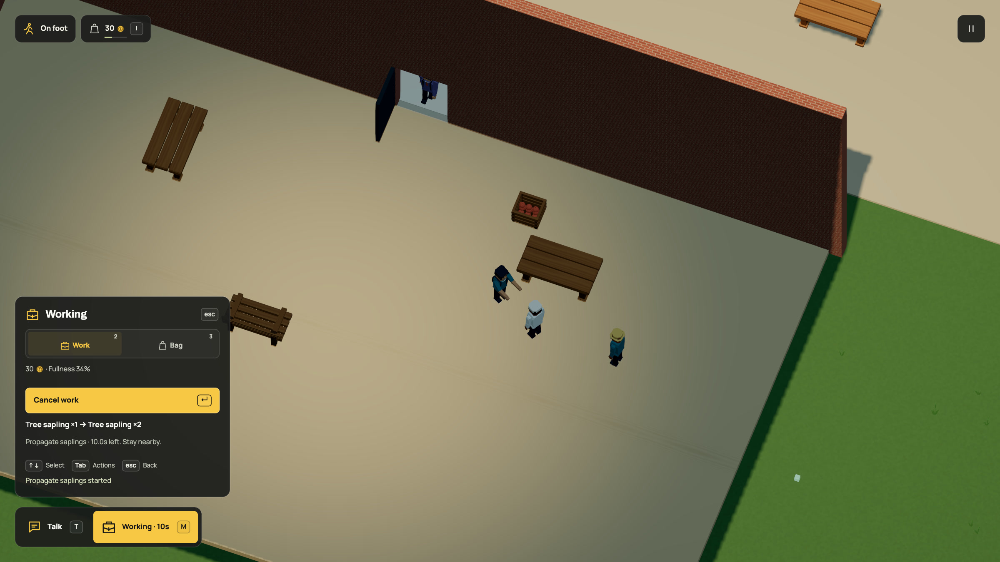

# A bakery that keeps itself working

The vendor now packs lunches and bakes bread when stock runs low. A hungry
commuter walks over, buys a meal, eats and returns to their routine. When the
bakery has room for more flour, the market helper can walk to the station,
collect two units and bring them back. You can buy, cook and take the same
transport work. Used repair kits now trigger paid assembly from boards and fasteners. Staff do not get their own free supplies or wages.


[Watch in HD](../media/kitchen.mp4). This historical outdoor-counter recording shows a player purchase and
meal, a customer purchase, and the vendor replacing the sold food. Flour transport
takes several simulation minutes and is checked separately; this sixteen-second
clip does not show that complete journey. These are 30 rendered frames per
simulation second, not a live performance measurement.

## What moves through the business

| Activity | Input | Result |
| --- | --- | --- |
| Repair-kit assembly | 1 board and 1 fastener, reserved together | 1 kit after 7 seconds; worker earns 3 credits |
| Basic bread batch | 1 flour, reserved from the bakery | 2 bread after 6 seconds; worker earns 3 credits |
| Pack lunch | 1 bread and 1 vegetable, reserved together | 1 lunch after 5 seconds; worker earns 3 credits |
| Buy lunch | 8 credits from the customer's wallet | One owned lunch; the bakery receives the credits |
| Flour delivery | 2 flour from the finite station stock | The bakery receives flour and pays the courier 4 credits |

The larger bread batch still requires three personally completed basic batches.
The vendor earns that practice independently of you. Both use the same recipe,
capacity, effort, treasury and refund checks. A busy lunch job can make you wait;
you can still take another available job. The panel names the staff's current
work and remaining time.

The business starts with finite bread, flour, vegetables and money. It can stop
for missing ingredients, a full shelf, a hungry worker or insufficient wages.
The helper can spend earned pay on food after returning. Kit and sapling supply
and available repair work retain their existing priorities before flour trips.
The counter now follows [daily service hours](hours.md), shared by player and
NPC transactions. This is a working counter and supply loop, with shared bench seating, without table
service or upstream farming. Ownership is now available at the station depot.

## Compose the existing Dream rules

`works` chooses eligible jobs below their stock targets in order. The live worker
first replaces consumed repair kits, then prepares lunch and bread. The small
food-only example below puts lunch first; baking supplies its missing bread. `meal`
provides a customer's food destination. `deliveries` connects finite source and
destination shelves. No special restaurant command or generated controller is
needed. Public pedestrian routing works in a standalone business scene, without
adding a repair service or a cosmetic population to make it initialize.

This [complete example](../examples/market-production.dream) uses shorter jobs
and a small connected neighborhood so the full loop is easy to inspect:

```dream
dream 2;
material blue(style=toon,colors=[#537eaa,#3c5f87]);
material skin(style=toon,colors=[#c59774,#a97655]);
object pedestrian(label="Pedestrian"){
  measure(kind=person,axis=y,meters=1.8);
  body(interaction=decor,radius=4,height=18);
  part torso(shape=capsule,material=blue,at=[0,11,0],size=[5,6,4]);
  part head(shape=sphere,material=skin,at=[0,16,0],size=[4,4,4]);
  part nose(shape=sphere,material=skin,at=[2,16,0],size=[1,1,1]);
  repeat legs(index=i,count=2){
    joint leg(at=[0,8,i*3-1.5],motion=swing(axis=z,deg=18,hz=.6,phase_deg=i*180)){
      part shin(shape=capsule,material=blue,at=[0,-4,0],size=[2,8,2]);
    }
  }
}
behavior welcome(start=waiting){
  state waiting(action=idle){on talk(event=interact,to=hello,radius=55,familiar=false);on again(event=interact,to=returning,radius=55,familiar=true);}
  state hello(action=idle,face=player,say="Hello. Welcome to the neighborhood."){
    on ask(event=interact,to=about,radius=55);
    on finish(event=after,to=waiting,seconds=6);
  }
  state returning(action=idle,face=player,say="Good to see you again."){
    on finish(event=after,to=waiting,seconds=6);
  }
  state about(action=idle,face=player,say="I like walking by the river. See you around."){
    on finish(event=after,to=waiting,seconds=6);
  }
}
place neighbor(object=pedestrian,at=[580,710],role=npc,behavior=welcome);
world(size=[4000,2400],spawn=[525,609],heading_deg=0);
road circuit(width=118,points=[[300,590],[660,590],[810,500],[810,220],[660,130],[300,130],[150,220],[150,500]]);

checkpoint start(at=[480,612.5],dir=[1,0],width=100);
checkpoint east(at=[828.75,360],dir=[0,-1],width=100);
checkpoint north(at=[480,107.5],dir=[-1,0],width=100);
checkpoint west(at=[131.25,360],dir=[0,1],width=100);

place customer(object=pedestrian,at=[760,730],role=npc,behavior=welcome);
place depot_keeper(object=pedestrian,at=[1120,970],role=npc,behavior=welcome);
place helper(object=pedestrian,at=[620,730],role=npc,behavior=welcome);
street access(width=60,sidewalk=24,points=[[400,590],[400,850]]);
street main(width=60,sidewalk=24,points=[[400,850],[1400,850]]);
crossing main_cross(street=main,at=[900,850],width=20);
surface depot_yard(color=#b2aa96,points=[[1080,884],[1260,884],[1260,1020],[1080,1020]]);
surface plaza(color=#b2aa96,points=[[530,680],[820,680],[820,816],[530,816]]);
economy(){
 good bread(label="Bread",food=45);
 good flour(label="Flour");
 good vegetables(label="Vegetables",food=20);
 good lunch(label="Packed lunch",food=65);
 account pocket(actor=player,credits=20,capacity=8,satiety=65,drain_s=.05);
 account baker(actor=neighbor,credits=0,capacity=4,satiety=65,drain_s=.05,shop=true,works=[pack_lunch,bake]);
 meal bakery_break(good=lunch,markets=[corner],on=plaza,eat_s=4);
 account regular(actor=customer,credits=20,capacity=4,satiety=25,drain_s=.05,meal=bakery_break);
 account supply_helper(actor=helper,credits=0,capacity=4,satiety=65,drain_s=.05,deliveries=[flour_run]);
 market corner(label="Corner bakery",actor=neighbor,credits=100,radius=70){
  lot bread_shelf(good=bread,quantity=0,limit=16,price=5);
  lot flour_sack(good=flour,quantity=6,limit=6);
  lot vegetables_box(good=vegetables,quantity=4,limit=8,price=2);
  lot lunch_counter(good=lunch,quantity=0,limit=4,price=8);
 }
 market depot(label="Station supplies",actor=depot_keeper,credits=0,radius=70){lot flour_store(good=flour,quantity=12,limit=12);}
 delivery flour_run(label="Bring flour",from=depot,to=corner,good=flour,quantity=2,pay=4,capacity=1,on=plaza,grounds=[depot_yard]);
 work bake(label="Bake bread",market=corner,input=flour,take=1,output=bread,make=2,seconds=2,pay=3,effort=6,capacity=1,target=4);
 work pack_lunch(label="Pack lunch",market=corner,output=lunch,make=1,seconds=2,pay=3,effort=6,capacity=1,target=2){
  ingredient(good=bread,take=1);
  ingredient(good=vegetables,take=1);
 }
}
```

Run `npm run -s dream -- check docs/examples/market-production.dream`. The example
includes no repair service or ambient walkers. Its courier and customer still
use validated walking grounds, sidewalks and a crossing. Removing the connection
fails complete-world acceptance. Bodies, actor/rig limits, graph bounds and
shared transaction rules remain unchanged.

## Leaving and coming back

Business stock, wages, cooking reservations, food, delivery cargo and both walking
journeys live in resident simulation state. Unloading a district does not reset
them. Pause freezes the work; R preserves it; Start over resets the world.
Reloading performs no offline work and cannot finish or pay an activity twice.

Simulation version 17 registers the staff-policy and standalone-navigation
update. Save format 11 is unchanged. The previous city is validated before any
state is accepted; all existing records, active jobs, paths, balances, materials
and world time are kept. Its geometry and prepared navigation graphs are equal,
so there is no population or floor rebasing for this update. The original slot is
kept, and corrupt or concurrently changed newer saves still block replacement.
[Persistence details](../persistence.md).


The commuter can now take their purchased lunch to a free slot on the indoor
bench. Player and customer claims use the same furniture metadata; standing is
the fallback when seats are busy or broken. [Shared seating](seating.md) adds no
restaurant staff, queue or table service.

The baker now has a [physical daily shift](shifts.md): finish committed work,
walk into the hall after closing and return before morning service. Counter
attendance gates the same transactions for the player, shoppers and couriers.


## Own the station depot

Walk to Station supplies in the railway quarter and open the market with **M**, then choose **Business**. The depot
has finite flour, repair kits and saplings. Buy it for the listed base price of
15 credits plus its available cash. The seller receives that payment in their
personal account; it does not become cash you can immediately withdraw from
your new company. These are mock prices, not a business valuation model.

Ownership includes the existing stock and delivery commitments. If the caretaker
or player carries two repair kits to the bakery, the bakery pays the depot six
credits and the courier four after handoff. Two delivered saplings pay the depot
four credits. Picking up cargo does not create supplier income. Flour remains a
zero-invoice supply contract. No money appears because time passed or a player
owns a counter.

At your counter, choose a whole-coin amount with left/right and **Deposit** or **Withdraw**.
You can transfer available cash while the counter is closed, but buying the
business needs open, staffed service. Wage, cargo, invoice and refund commitments
remain protected. Existing jobs keep their staff, supplies and pay after a sale.
The pause menu lists the businesses you own and their available cash; transfers
still require standing at the counter. Car, seated, airborne and swimming controls
cannot make these transactions.


[Watch in HD](../media/business.mp4). Purchase, deposit, an actual two-kit handoff
and withdrawal use 600 rendered frames at 30 frames per simulation second.
The pre-roll drives the damage and supply journey through the ordinary engine;
it does not give the player money or create cargo. This is an offline recording,
not a performance benchmark.

### Describe another ownable business

The [complete runnable bakery](../examples/business-ownership.dream) uses the
same capability with paid production and hungry customers. Here is its market
block, unchanged from the file:

```dream
 market corner(label="Corner bakery",actor=neighbor,credits=10,radius=70,owner=baker,sale=15){
  lot bread_shelf(good=bread,quantity=8,limit=16,price=5);
  lot flour_sack(good=flour,quantity=12,limit=12);
 }
```

`owner` references a personal `account`; `actor` continues to operate the counter.
The account's initial balance, inventory and policies remain distinct from the
company's treasury and shelves. Omit `sale` for an owned business that is not for
sale. `owner=pocket` can give the player an initial business without a purchase.
A sale needs a non-player initial owner and a positive integer base price of at
most 1,000,000. The final quote and all balances must fit that same money bound.
Existing limits remain eight markets and sixteen accounts, with no additional
NPC, body or rig slots.

The current capability supports one acquisition per business. It does not add
resale, hiring, price setting, loans, property deeds, idle owner income or a way
to start a new business. Station stock can run out; upstream production remains
unfinished. The bakery example proves that depositing capital can restart paid
production without free ingredients or wages.

### Keep what you bought

Ownership, purchase time, stock, available cash and active commitments live in
resident simulation state. Chunk unloading, R, pause and save/reload retain them;
Start over restores the authored owner and balances. Format 15 / simulation 23
validates the exact r65 world before adding only its zero-funded depot seller and
initial owner reference. Every older field and original save slot stays intact.
[Save rules and migration](../persistence.md#business-ownership-r66).


## Repair-kit production



The live market worker now uses this ordered Dream policy:

```dream
account baker(actor=vendor,credits=0,capacity=4,satiety=65,drain_s=.05,shop=true,social=hall_break,shift=bakery_day,works=[assemble_kit,propagate_saplings,pack_lunch,bake]);
```

`assemble_kit` uses the existing boards-and-fasteners recipe, with `target=12`
matching the repair-kit shelf limit. The worker first considers assembly, then
nursery demand and food. Both player and worker need actual ingredients, wages, shelf space, effort
and the job's shared capacity. The existing daily shift controls availability.
No special NPC production transaction is introduced.

A reserved repair kit still needs room if the repair is cancelled. Production
counts that reservation toward its target and starts after the kit is actually
consumed. With one completed repair, the worker spends one board and one fastener
and earns three coins to replace the kit. Food equipment can be broken while
assembly remains available, avoiding a dependency on the table being repaired.
Food preparation resumes after repair and restocking.

[Try the complete example](../examples/repair-production.dream): its workshop
starts without kits, produces them from finite inputs, repairs the food table
and resumes lunch preparation. Its separate kit bench remains required equipment;
breaking both benches can still stop this particular example's production.
The live hand-assembly recipe needs no table. These are authored dependencies,
not exemptions from a shared damage category.

Existing format-18 saves have an exact registered r84 upgrade. It preserves every
ledger, task, body, cooldown and clock and retains the original slot.
[In-game evidence and focused checks](../evidence/kit-production/verification.md).
Raw material generation, dedicated tools and manufacturing machinery remain
separate capabilities.


## Workshop material deliveries

The station depot now keeps sixteen boards and sixteen fasteners. Both have
paid, two-unit delivery contracts to the market workshop. The receiving business
reserves four coins for the courier and two coins for the supplier, plus shelf
space. Handoff transfers real cargo, pays once and records the courier's work.
Cancellation returns cargo and reserved money. Kits still need actual ingredients
and wages; a delivery does not manufacture either material.

The caretaker adds `boards_run` after its existing kit, sapling and flour runs,
within the unchanged four-contract policy limit. The player can collect either
raw material. A school resident now takes fastener and school-bread runs through
a separate two-contract policy. Existing repair, food and finished-kit procurement
keep their authored priority.



[Download the complete supply-chain example](../examples/workshop-supplies.dream).
It uses two-unit receiving buffers for boards and fasteners: an ordered courier
fills the first eligible shelf before choosing the next, so a small buffer lets
both inputs arrive before assembly. Its worker then makes two kits using the
same conserved recipe. This is ordinary Dream `lot`, `delivery`, `works` and
`deliveries` composition, with no new command or script.

Old saves receive only the two new supplier lots and zeroed delivery counters
after exact prior-world validation. Existing bodies, money, stock, tasks, damage
and clocks stay intact. [Native checks and save evidence](../evidence/workshop-supplies/verification.md).
Finite depot stock, business cash and carry capacity still limit the chain.
Forestry, mining and fabrication remain further work.


## A resident who supplies two destinations

The existing school resident now has a paid courier account. Hardware deliveries
come first when two fasteners fit the workshop shelf; otherwise they can carry
bread from the bakery to the school. Their school-frontage home connects to the
public walking network. No extra person, vehicle, rig or decorative object is
added. The worker buys food with earned money through the same counter rules.

```dream
account porter(actor=school_student,credits=0,capacity=4,satiety=65,drain_s=.05,shop=true,deliveries=[fasteners_run,school_run]);
```

A courier no longer needs to live beside each receiving counter. Declared convex
work grounds and existing sidewalks/crossings must connect home, pickup, handoff
and return. The complete-world compiler checks those paths, including safe
approaches, support and vertical clearance. Vendors stay at their counters.

[Run the remote-home courier example](../examples/neighborhood-courier.dream).
It puts the helper at the depot and feeds both inputs into kit assembly. The
live city uses the same rule for two different receiving businesses. Pickup
intent reserves a slot; collection alone commits real cargo and money. Closed
counters can cause waits, busy contracts remain exclusive, and insufficient
stock, wages or receiving space can stop dispatch. These are finite supplies and
walking jobs, without vehicle delivery AI or an unlimited production chain.

The registered r86 upgrade creates only the new zero-credit account at saved
simulation time. Existing accounts, commitments, ledgers, personal records and
clocks stay intact, and the original slot is retained. No offline travel or pay.
[Checks and runtime evidence](../evidence/resident-supplies/verification.md).


## Timber from a physical source

Replanting can now recover a board from a felled mature tree when the worker and
workshop have room. It stays in the worker's sealed cargo until returned. That
board can feed the same paid kit assembly as a delivered depot board. The tree
service pays its original planting wage and supplies the declared board; full
storage still permits ordinary replanting. [Describe recovery in Dream](growth.md#timber-recovery).

The live city has 109 connected replanting sources, including the three
station-quarter rowans, served by the existing worker.
Young trees must finish growing before supplying more wood. This connects a
physical source to the repair chain; mining, fabrication, general forestry and
renewable upstream sapling production remain further work.

## Reuse fixture hardware

The live fixture service now returns one fastener when shelf and bag capacity
permit. The primary street service's 449 targets share that policy, including
lamps, tables, benches, street tubs and stalls. Eleven station-quarter fixtures
use the same recovery rule through the school/quarter service.
[Quarter maintenance](station-quarter.md#damage-has-a-follow-up). The worker
repairs the fixture with a real kit
and earns its ordinary wage. The recovered fastener stays sealed until returned
to the open staffed workshop; it can then feed another kit recipe.

[Run the complete hardware-recovery example](../examples/hardware-recovery.dream):

```dream
repair workshop_repairs(label="Repair work tables",market=corner,on=work_yard,kind=table,input=kit,take=1,seconds=2,pay=2,effort=2,dispatch_s=0,recover=fasteners,amount=1);
```

Players use **H** to return materials on foot. NPCs walk home and use the same
guarded transaction. Full storage still allows a normal repair, without output.
Future return space is reserved during work; a second delivery cannot claim it.
The return pays no second wage and does not discard or remotely deposit cargo.

This reuses declared material after actual damage and paid repair. It does not
make raw metal, saplings or money. Boards, other supplies and business budgets
still bound the chain. The exact r88 save upgrade adds only a zero recovery
counter for fixtures; old jobs, damage, timber cargo and source slots survive.
[Verification and native handoff](../evidence/hardware-recovery/verification.md).

## Nursery work



[HD recording](../media/nursery.mp4) · [GIF](../media/nursery.gif).

One sapling can now supply two through paid work. You still need the first plant,
an open staffed counter, room for the result and money for wages. This connects
replanting to replacement supply through the same recipes used for food and kits.

[Run the complete small nursery](../examples/sapling-propagation.dream):

```dream
work propagate_saplings(label="Propagate saplings",market=corner,input=sapling,take=1,output=sapling,make=2,seconds=2,pay=2,effort=2,capacity=2,target=5);
```

The live market uses twelve seconds, one worker and the existing food table.
Press **M**, open **Work**, select **Propagate saplings** with the arrow keys and
press Enter or H. Stay nearby. Completion pays two coins and spends two fullness
points. Cancellation returns the held seed and wage once, with no output or pay.
R, vehicle changes, closing hours and damaged equipment use the same work rules.

`make=2` is the complete output. The net gain after `take=1` is one sapling.
Input and output may share a good only when make exceeds take for that good.
This works with scalar input/take or a bounded ingredient block. Other ingredients
still reserve independently. A batch either refunds or completes, so its shared
lot reserves the larger outcome once. With five plants on a six-slot shelf,
starting holds one seed, leaves four on the shelf and reserves two output slots.
Cancellation restores five; completion leaves six. Another seller or delivery
cannot use those reserved slots.

The vendor's four-job policy now prioritizes kits, nursery work, lunches and
ordinary bread. It propagates below five plants, leaving one free shelf slot for
the player's work. The larger baking recipe stays available to qualified players.
No person, prop, stock or cash is added, and the existing layout is unchanged.
Planting and nursery work are bounded game recipes; no botanical validity or
unlimited production is claimed. Food inputs, effort and business money still
matter. [Checks, saved progress and runtime evidence](../evidence/nursery/verification.md).
