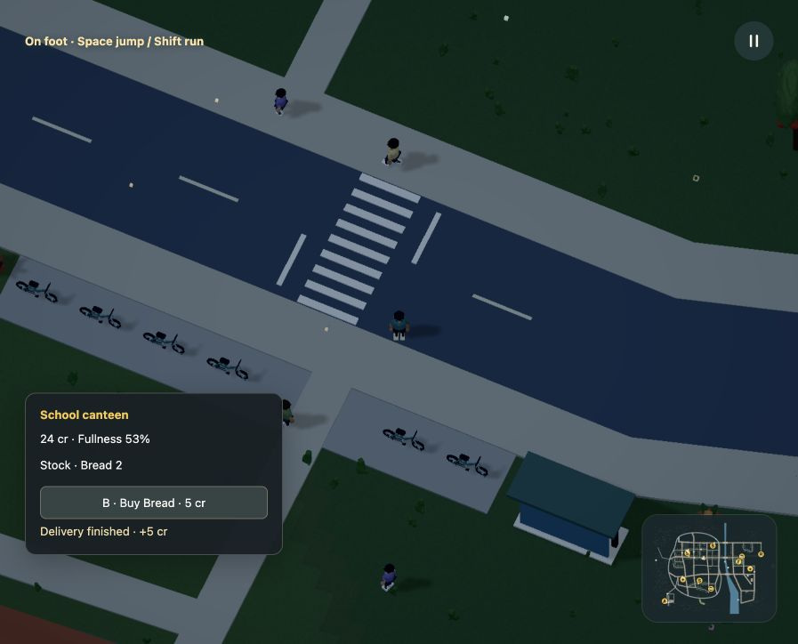
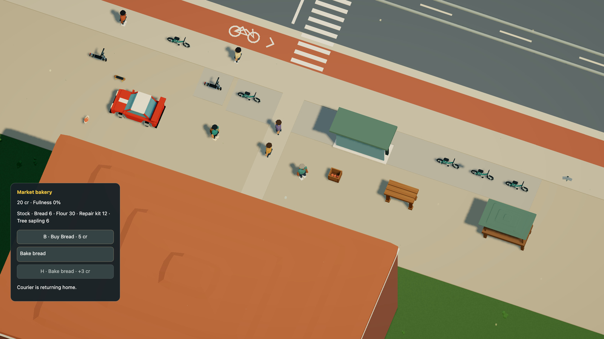

# A market you can use

Walk up to the market vendor and buy bread with **B**. Shelf stock drops by one, your credits move to the business and your bag records one loaf. **G** eats it and restores fullness. **V** sells an owned item back at the listed price, if the business has money and room for it.

Want to earn some credits? **H** starts a six-second bread batch. The business reserves flour, three credits and space on its shelf. Stay nearby until the batch finishes: two loaves reach the shelf, the reserved wage reaches you and work uses some fullness. Press H again or leave the work area to cancel; the reservations return without a wage or finished bread.


[Watch in HD](../media/commerce.mp4)

The vendor works when bread runs low. The commuter buys and eats when hungry, using actual route positions and the same transactions as the player. Neither gets free food or money. Flour is finite, customers have finite budgets and work stops when ingredients, shelf space, wages or fullness run out. Player delivery jobs now connect the station depot, bakery and school canteen; there is no automatic supply generation.

## Author it in Dream

One `economy()` block owns the system for a linked world. Goods, accounts, markets and work have explicit IDs. Accounts reference the player or existing NPC placements. Markets and production workers require stationary NPCs; repair workers start from a stationary home and use their declared grounds, service streets and connecting pedestrian pavement. Customers may use the existing walking routes. The complete-world compiler checks ownership after module linking.

| Declaration | Meaning |
| --- | --- |
| `good` | A named inventory unit; optional food value restores 0..100 fullness |
| `account` | Actor-owned integer credits, carrying capacity, fullness and drain per simulation second |
| `market` | A stationary vendor, treasury and interaction radius of 20..80 world units |
| `lot` | One good's initial stock and capacity; optional positive integer price allows buying and selling |
| `work` | Timed conversion of one input good into another, with wage, effort, shared capacity and refill target |

The player acts through controls. NPC `shop=true` attempts food purchases/consumption at fullness 40 or below. Optional account `work` refills its job's output toward `target`. Policies submit the same transactions and meet the same range, capacity, inventory and money checks. These are bounded engine policies, not generated scripts or general life AI.

[Download this complete world](../examples/market-work.dream):

```dream
dream 2;
material blue(style=toon,colors=[#537eaa,#3c5f87]);
material skin(style=toon,colors=[#c59774,#a97655]);
object pedestrian(label="Pedestrian"){
  measure(kind=person,axis=y,meters=1.8);
  body(interaction=decor,radius=4,height=18);
  part torso(shape=capsule,material=blue,at=[0,11,0],size=[5,6,4]);
  part head(shape=sphere,material=skin,at=[0,16,0],size=[4,4,4]);
  part nose(shape=sphere,material=skin,at=[2,16,0],size=[1,1,1]);
  repeat legs(index=i,count=2){
    joint leg(at=[0,8,i*3-1.5],motion=swing(axis=z,deg=18,hz=.6,phase_deg=i*180)){
      part shin(shape=capsule,material=blue,at=[0,-4,0],size=[2,8,2]);
    }
  }
}
behavior welcome(start=waiting){
  state waiting(action=idle){on talk(event=interact,to=hello,radius=55,familiar=false);on again(event=interact,to=returning,radius=55,familiar=true);}
  state hello(action=idle,face=player,say="Hello. Welcome to the neighborhood."){
    on ask(event=interact,to=about,radius=55);
    on finish(event=after,to=waiting,seconds=6);
  }
  state returning(action=idle,face=player,say="Good to see you again."){
    on finish(event=after,to=waiting,seconds=6);
  }
  state about(action=idle,face=player,say="I like walking by the river. See you around."){
    on finish(event=after,to=waiting,seconds=6);
  }
}
place neighbor(object=pedestrian,at=[580,710],role=npc,behavior=welcome);
world(size=[4000,2400],spawn=[525,609],heading_deg=0);
road circuit(width=118,points=[[300,590],[660,590],[810,500],[810,220],[660,130],[300,130],[150,220],[150,500]]);

checkpoint start(at=[480,612.5],dir=[1,0],width=100);
checkpoint east(at=[828.75,360],dir=[0,-1],width=100);
checkpoint north(at=[480,107.5],dir=[-1,0],width=100);
checkpoint west(at=[131.25,360],dir=[0,1],width=100);

place customer(object=pedestrian,at=[620,730],role=npc,behavior=welcome);
economy(){
 good bread(label="Bread",food=45);
 good flour(label="Flour");
 account pocket(actor=player,credits=20,capacity=8,satiety=40,drain_s=.05);
 account baker(actor=neighbor,credits=0,capacity=4,satiety=65,drain_s=.05,shop=true,work=bake);
 account regular(actor=customer,credits=20,capacity=4,satiety=25,drain_s=.05,shop=true);
 market corner(label="Corner bakery",actor=neighbor,credits=100,radius=70){
  lot bread_shelf(good=bread,quantity=8,limit=16,price=5);
  lot flour_sack(good=flour,quantity=12,limit=12);
 }
 work bake(label="Bake bread",market=corner,input=flour,take=1,output=bread,make=2,seconds=2,pay=3,effort=12,capacity=1,target=4);
}
```

Run `npm run -s dream -- check docs/examples/market-work.dream`. The example uses short work durations for testing; the live market takes six seconds. The example's simple pedestrian has swing joints; full humanoid rigs in the live world also get a planted work gesture through their explicit bone bindings.

## What the engine guarantees

Buying and selling transfer credits atomically. A rejected action changes no stock, inventory or balance. Work reserves wages and input, plus room for its output and any returned input. Cancelling cannot duplicate supplies or earn a wage. Completion is counted once, including the initiating simulation step. One account can hold one job; the job's capacity is shared by NPCs and the player. Stable rotating account order resolves contention.

Food consumption and completed recipe batches are recorded, so restore can check material conservation as well as total credits, including wages in reserve. Fullness is an arcade work resource, not a nutrition or health model. Non-food goods can be owned and traded; they do not yet have item-specific actions or physical pickup/drop models.

Needs and work settle on a resident 4 Hz simulation clock. NPC decisions are at most once per second. Player actions and work interruption are checked at the fixed-step boundary. There is no frame-driven income or offline catch-up. Pause freezes the system; R preserves it and cancels work if recovery leaves its range; Start over resets it. Render chunks own no stock, accounts or clocks.

[Save format and the first-market migration](../persistence.md) preserve earlier world changes while introducing this new system. Later changes to economy rules still need an explicit migration. Limits are in the generated [command contract](../dream-v2-contract.json) and [reference](reference.md#commerce-bounds). Logical Lab scenarios remain independent.

This is an outdoor market loop. Enterable kitchens, opening hours, shifts, multi-stage production chains, relationship progression and customer pathfinding driven by needs remain future work. The supply ledger is working; those institutions should not be described as complete yet.

## Deliveries

At the bakery, choose **Take bread to school** in the work menu and press **H**.
Two loaves leave the shelf and become your delivery cargo. The school reserves
five credits and room for the bread. Follow the marked destination on the map;
the panel shows its name and distance. Walk, cycle or drive there, get out and
press H to hand it over. The school receives real stock and you receive the pay.
Its staff member can then buy and eat that bread through the same market rules.




[Animated pickup](../media/delivery.gif) · [Watch in HD](../media/delivery.mp4)

The other job carries two units of flour from **Station supplies**, beside the
east railway station, to the bakery for four credits. Bake a couple of batches
first to make shelf space. The depot starts with 80 flour; it cannot generate
more. Bread at the school and flour at the bakery remain finite. Work and trade
can stop for a full shelf, full bag, empty source or insufficient business money.

Cargo counts against your bag's capacity but cannot be sold, eaten or used for
another job. You can eat your own carried food while on foot during a delivery;
the sealed cargo stays intact. You can hold one production/delivery/repair task at a time. **Cancel
delivery** returns cargo and reserved pay, without paying you. Travel, vehicles,
R, pause, render unloading and save/reload keep the task; Start over resets it.
The map line is a direction to the destination, not a solved route. Cancellation
returns the reservation directly; there is no dropped package simulation.

Author it in the existing economy block:

```dream
delivery school_run(label="Take bread to school",from=market_stall,to=school_canteen,good=bread,quantity=2,pay=5,capacity=1);
```

Both markets need a lot for the good, enough capacity and separate interaction
areas. Collection reserves source/refund space, destination/output space and the
wage atomically. Optional `price` adds a per-unit supplier invoice, paid by the
destination business. It defaults to zero for existing contracts. The invoice
and wage stay in escrow during travel; handoff pays the supplier and courier
once, and cancellation returns both to the destination. The source treasury
reserves enough headroom to receive its invoice. Completion transfers once; cancellation refunds once. No
per-item meshes or physics bodies are allocated. NPC customers consume delivered
stock. [NPC supply trips](#npc-supply-trips) use explicit contracts and bounded pedestrian routes.

[Download a complete delivery world](../examples/market-delivery.dream). Check it
with `npm run -s dream -- check docs/examples/market-delivery.dream`. Its short
example journey is for learning the rules; the live city jobs connect actual places.

## Repair work

Drive into the table, produce crate or terracotta planter in the market square,
then clear the wreckage. The caretaker
notices the damage, waits 12 seconds for someone to take the job, collects a
repair kit from the vendor and walks over. Eight seconds of work restores the
object and its collision body. The bakery pays four credits and loses one kit.
The caretaker walks back to their starting place before resuming their ordinary
behaviour. A busy worker does not offer its suspended conversation prompt; you
can still talk to other available people. Nothing is spawned from free stock.


[Watch the complete repair in HD](../media/repair.mp4) · [Animated repair](../media/repair.gif)

You can do it too. Go to the bakery before the caretaker collects the kit, choose
**Repair neighborhood furniture** and press **H**. Follow the map marker to the damage and
stand beside it. Work pauses when you walk away, jump, swim or enter a vehicle;
return to continue. **Cancel repair** refunds the unused kit and reserved pay.
You receive the same four credits when the repair finishes.

A car, parked bicycle, boat, loose ball or another solid in the restoration
footprint keeps it broken until the space is clear. A worker also stops for
vehicles or the player on their path. Progress, supplies, wages, work position and
return journey survive render unloading and save/reload. Pause freezes them;
R preserves them; Start over resets them. There is no offline work.

[Complete runnable repair world](../examples/market-repair.dream). Its short
example timings make the loop easy to test. The following declarations are the
repair portion of that file:

```dream
repair yard_tables(label="Repair a table",market=corner,on=work_yard,kind=table,input=kit,take=1,seconds=2,pay=4,effort=5,dispatch_s=0);
```

Put the declaration inside `economy`. An NPC account uses `repair=yard_tables` to
notice and take those jobs automatically. The player never has an automatic
policy. Use `repairs=[service_a,service_b]` for one to four services in priority
order, skipping work that cannot currently start. It excludes `repair` and
automatic `work`; each account still holds one commitment.

`kind` selects one measured category, as shared destruction rules do. Use
`kinds=[table,custom]` for several categories under the same service. Declare
exactly one of `kind` or `kinds`; lists must be nonempty, unique and use existing
measure categories. It covers
eligible break/topple objects and ground-accessible break zones in the named
surface; it never selects by label or makes one table exempt. One account can
hold one commitment, and each damaged object or zone has one claimant across all
repair services. Kits and pay are reserved at collection. Completion consumes
kits and pays once; cancellation refunds once. The saved repair counter accounts
for consumed materials, independently of food and recipe batches.

This is bounded local maintenance. The supply vendor and worker's home must lie
inside the same convex surface, with the home in market reach. Work areas use at
most 4,096 local navigation samples and paths at most 128 points. Routes stay
inside that dry area and clear carriageways, cycle tracks, water and solid
contacts. Optional `grounds` connects explicitly declared service areas through accepted
pedestrian infrastructure. `streets` also enables network travel, with short dry
work approaches beside its sidewalks. When both are omitted, workers remain in
the primary area.
Blocked workers wait;
there is no ladder, construction scaffold or dropped-kit simulation. Trees use
a `regrow_s` repair service for paid planting and physical growth.
[Planting guide and runnable source](growth.md). The live service covers the market table, crate and planter, both benches
at the park/station and the two park wall sections. It does not make other scenery destructible.


### Replacement supplies

The station depot starts with 32 repair kits. After the caretaker or player has
used at least two kits, go to **Station supplies**, choose **Bring repair kits to
the market** and press H. Two kits leave the depot; the bakery reserves six
credits for the supplier and four for the courier. Take the cargo back, get out
and hand it over with H. The bakery receives two kits, the depot receives six
credits and you receive four. No player credits are charged.

```dream
delivery kits_run(label="Bring repair kits to the market",from=station_supplies,to=market_stall,good=timber,quantity=2,pay=4,price=3,capacity=1,on=market_square);
repair market_tables(label="Repair neighborhood furniture",market=market_stall,on=market_square,grounds=[park_seating,station_seating],streets=[market_avenue,high_street,civic_walk],verge=24,kinds=[table,custom,bench,lamp],input=timber,take=1,seconds=8,pay=4,effort=5);
```

These declarations are the live world's policy. The earlier flour and bread
contracts omit `price` and retain their zero-price cargo transfers. Supplier
prices are integers 0..10,000 per unit; invoice plus wage must fit the
1,000,000-credit treasury bound. Shelves, carrying limits, treasury headroom and
shared contract capacity still apply. The depot can run out and the bakery can
run out of money. The caretaker can now fetch these shipments through [NPC supply trips](#npc-supply-trips); upstream kit production remains future work.

[Complete maintenance and procurement example](../examples/market-maintenance.dream).
Run `npm run -s dream -- check docs/examples/market-maintenance.dream`. It includes
a table and a crate served by one category list, plus a separate supplier and a
paid kit contract. [Verification and remaining limits](../evidence/supply/verification.md).


### Connected service grounds

The live caretaker also serves the park seating area and the east station bench.
Both have paving connected to their sidewalk. Parked scooters, lamps and the
planter retain their original positions; the furnishing rules explicitly allow
these new grounds. Repair selection still uses measured categories and available
damage, so the worker may restore a nearer wall before a bench.


[Journey in HD](../media/maintenance.mp4) · [Animated journey](../media/maintenance.gif)

Keep the market and worker home inside `on`. Add `grounds=[park_seating,station_seating]`
for distant work surfaces. The engine derives routes through sidewalks, crossings
and entrance paving, with supported bridge sidewalks where needed. It cannot
cut straight across an unpainted carriageway. The complete-world compiler rejects
unreachable targets. The player can carry a kit in a vehicle; the caretaker walks
at 1.4 m/s and returns after each job. A trip across the city takes several
simulation minutes. Nothing completes during pause or while the page is closed.

The primary ground plus extras are at most eight unique convex surfaces. Together
they retain the 4,096 local-sample limit; the derived pedestrian graph has at most
8,192 nodes and 32,768 directed links. Saved paths still have at most 128 points.
The world worker prepares topology before play; live contacts are checked during
search and movement. The renderer interpolates worker poses with one commerce-tick
visual delay, at most 35 cm while walking; physics, stock and work clocks remain
resident simulation data. Reduced motion and recovery snap the presentation.

[Complete connected repair world](../examples/neighborhood-repairs.dream).
Run `npm run -s dream -- check docs/examples/neighborhood-repairs.dream`.
It connects two work grounds with a street and an authored crossing. When asking
an agent to author both services and infrastructure, use
`node scripts/dream.mjs context --features commerce,city`.
[Checks, recordings and remaining limits](../evidence/network-repair/verification.md).

### Street verges

The same service now reaches 84 targets, including 77 of the 400 city lamps.
`streets=[market_avenue,high_street,civic_walk]` declares which sidewalks it serves.
`verge=24` permits a short approach up to 2.4 metres beyond those sidewalks, near
eligible object contacts. Measured categories still select the targets; names
and coordinates cannot grant a special repair policy.


[Watch in HD](../media/streetrepair.mp4) · [Animated repair](../media/streetrepair.gif)

Approaches use the same miter joins as the streets. They are clipped away from
carriageways, cycle tracks, the circuit and water. They add no paving or shortcuts
across grass between distant targets. A full worker cylinder must connect through
the accepted pedestrian network. The High Street/South Avenue junction now has
an authored four-arm crossing; without it, four lamp jobs are unreachable and
complete-world validation rejects the world.

A service can name 1..32 unique existing streets with sidewalks at least eight
world units wide. Verge is 0..32 units, defaults to 24 and requires `streets`.
At most 512 street targets and 2,048 derived approach polygons are allowed per
service. The existing local-sample, network and saved-path limits above still
apply. `on` remains the supply market and worker home; `grounds` stays optional.
Player jobs and NPC jobs use the same coverage, finite kits, pay and obstruction
checks. A stopped car can delay work or prevent safe restoration.

[Complete street-verge repair world](../examples/street-verge-repairs.dream).
Run `npm run -s dream -- check docs/examples/street-verge-repairs.dream`.
It connects a home yard to a lamp outside the opposite sidewalk using a real
crossing, without a second work-ground surface. Ask for `commerce,city` in an
agent context packet when authoring these routes.

Other districts still need connected recovery coverage. The caretaker now shares furniture and [tree replanting](growth.md) duties and can [fetch supplies](#npc-supply-trips) from the depot. Damaged lamps lose their ground light
pool until repair. [Streetlight destruction](rules.md#streetlights-and-streamed-destruction)
uses the same pooled geometry and saved damage as before.
[Verification and media audit](../evidence/verge-repairs/verification.md).


## Planting and growth

Repair services can plant a small replacement tree instead of restoring a mature
one immediately. Saplings and pay come from the market; a saved growth clock
then enlarges the tree and its collision body. The caretaker shares furniture
and orchard duties through `repairs=[market_tables,orchard_trees]`.
[Authoring, controls and current limits](growth.md).

Network journeys now plan around parked vehicles and stationary physical actors.
A newly blocked segment clears its stale path and retries while keeping its
claim and reserved supplies. Moving transit causes a wait rather than changing
the walking network. Adjacent declared grounds join only through a clear
full-cylinder portal; they cannot bridge a real gap.


## NPC supply trips

The caretaker now repairs and resupplies the neighborhood. If two replacement
kits or saplings will fit on the bakery shelf, they can walk to the station,
collect the shipment, bring it back and return home. Local food choices and
available repairs take priority. Supplies, invoices and wages stay finite.
The player can still take the same delivery contract.


[Supply trip in HD](../media/courier.mp4) · [Animated trip](../media/courier.gif)



[Handoff in HD](../media/handoff.mp4) · [Animated handoff](../media/handoff.gif)

These declarations come from the [complete runnable courier world](../examples/courier-resupply.dream):

```dream
 account regular(actor=customer,credits=20,capacity=4,satiety=65,drain_s=.05,shop=true,repair=yard_furniture,deliveries=[kits_run]);
 delivery kits_run(label="Bring repair kits",from=depot,to=corner,good=kit,quantity=2,pay=4,price=3,capacity=1,on=work_yard,grounds=[remote_yard]);
```

`account.deliveries` is an ordered list of 1..4 unique contracts. It can accompany
repair duties, but excludes automatic production work. The actor needs a stationary
home inside the receiving market's `on` ground and interaction radius. Market
vendors stay at their businesses. The player never gets an automatic policy.

Delivery `on` declares the receiving work ground. Optional `grounds` adds 1..7
unique convex areas for off-pavement approaches, such as the example's depot yard.
A supplier already on accepted pedestrian pavement needs no extra ground. These
areas create no road or paving. The complete-world compiler checks pickup,
handoff and return from every assigned home, using sidewalks, crossings and
supported bridge pavements. Public roads, cycle tracks and water are not shortcuts.

Walking to pickup holds one shared contract slot. It reserves no stock, money or
shelf space yet. Collection rechecks the same rules as a player collection. If
stock, funding or shelf space changed, the worker returns empty-handed without a
wage or a refund of goods they never took. Collected cargo uses the existing
sealed delivery reservation. Handoff pays the supplier and worker once.

One commitment owns the worker's position, program clock and walking animation.
Vehicles can block a crossing; the worker waits and retries. Pickup, carrying and
return paths survive streaming, R and save/load. Restoring performs no offline
travel. Identical ordered delivery grounds share one prepared topology; the same
4096 local samples, 8192 nodes, 32768 links and 128 saved waypoints apply.
Existing NPC, live-rig, physics and render-quality limits stay unchanged.

This is walking resupply through a finite depot. It adds no upstream production,
courier vehicle AI, shifts, general logistics scheduler or item pickup body.

Pickup and handoff approaches stay less than four world units above/below the vendor. A steep unsupported counter needs a level, connected approach before the courier can use it.
