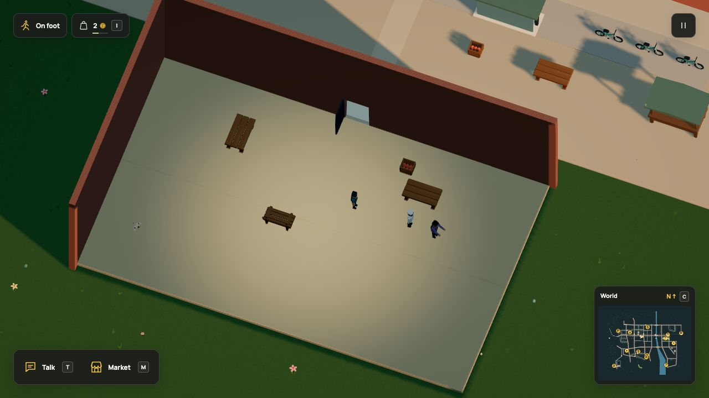

# Walk to work

[Docs](../README.md) / Work commuting

A resident can walk from home to a workplace, perform a paid job and return.
The work uses the same ingredients, capacity, wages, qualification and equipment
rules as the player. Travelling does not issue a wage or manufacture anything. Optional
[daily attendance](attendance.md) keeps the resident at work between jobs.



[Native state and verification](../evidence/work-commute/verification.md).

This declaration comes from the [complete runnable world](../examples/work-commute.dream):

```dream
account regular(actor=customer,credits=20,capacity=4,satiety=65,drain_s=.05,works=[bake],commute=true,on=plaza);
```

`commute=true` opts an NPC into work travel. `work` or `works` names the jobs;
`works` retains its existing preference order. `on` names a convex home/work
ground. Optional `grounds` adds up to eleven more, including building floors.
The accepted pedestrian network joins them. Topology is prepared in the world
worker and cached by ground set and body profile; live movement still checks
current blocking contacts. The compiler checks a clear counter
approach and a return path for every assigned job.

The live commuter now has both a meal plan and work preferences. An available
hungry meal takes priority. Otherwise a shortage can send them to the bakery;
after real work they receive its wage and earn their own completion record.
Those records can qualify them for the existing larger baking job.

## One trip, one owner

| Phase | What happens |
| --- | --- |
| Out | Walk to a clear approach. No stock, refund room, wage or work slot is reserved. |
| Work | Recheck normal work rules on arrival. A successful start reserves real input, pay and future shelf space. |
| Home | Completion pays once. An interruption refunds once. Return to the saved starting pose and resume the paused routine. |

Work targets trigger travel using the existing stock/reservation estimate.
Another worker can fill a shortage or take the slot before the traveller arrives.
Arrival still checks the ordinary work rules; the target is a dispatch threshold,
not a separate paid order. If the counter is closed, unstaffed, damaged or unable
to supply the job, the resident returns without a wage. There is no waiting queue.
A player can take the same available job before an incoming worker arrives.

Shared recipe accounting includes refund room. A held ingredient can suppress a
new production trip until there is a real shortage. No starting resources or
money are added to make the live commuter work.

Vehicles and the player can block the walk. The worker waits and retries through
the same bounded path system used by other work journeys. The engine derives
body clearance from the actual measured character, rounded up to tenths of a
world unit, with minimum radius 4 and headroom 18. This avoids squeezing a wider
character through the fixture's smaller walking profile.

## Authoring bounds

A commuter is a measured person with a complete humanoid rig, a decor body, an
NPC program and either a stationary home or a walking route. The authored body
must fit radius 8 and height 32. The engine owns paths and movement; Dream cannot
provide a graph, an NPC position clock or controller code.

| Data | Bound |
| --- | --- |
| Assigned jobs | 1–4, using `work` or a unique ordered `works` list |
| Declared convex grounds | 1–12, unique |
| Local navigation samples | 4,096 across the grounds |
| Derived graph | 8,192 nodes and 32,768 directed links |
| Saved path | 128 waypoints |

`meal` and [rest](resting.md) may coexist with commuting. A hungry meal comes
first, then low-energy rest before a new work trip. Tasks require their existing
effort in energy for configured accounts and spend it once on completion.
 Other automatic shopping, ration, shift,
social, repair and delivery policies remain excluded. Stocked market operators
also remain excluded. A goods-free service operator may commute and rest for
its own jobs with explicit building premises. See [office work](office-work.md).
These restrictions keep one journey and one commitment owner. Existing account,
NPC and live-rig limits remain unchanged.

The player walks manually and uses the normal work action. This policy gives
NPCs a way to reach that action; it does not let them bypass range, payment,
equipment, food-effort or personal qualification checks.

## Persistence and limits

Outbound, work and return phases persist with their original home, path and work
ownership. The NPC program pauses through the trip and resumes at that same
pose. Pause freezes the clock; R recovers the player without cancelling the
employee. Start over resets the world. Streaming changes rendered chunks only.

The registered format-19 / simulation-40 upgrade preserves the entire r95 state,
including an unfinished home meal. It creates no work commitment, wage or stock
during restore. [Save boundary](../persistence.md#work-commute-upgrade-r96).

This is on-foot work travel. Optional attendance adds a daily workplace window.
Employee contracts, guaranteed hours, vehicle commuting, offline travel and a
general daily scheduler remain separate work. Existing
milestones provide task progression; they are game rules rather than an
employment or learning model.
