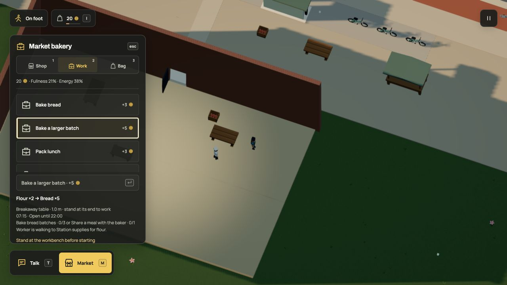

# A shared break changes the next shift

The baker and commuter can learn the larger bread recipe after sharing a meal.
They still need to return to work, reach the preparation table and reserve real
flour and wages. The meal itself pays nothing. Your own qualifications stay yours.



[Run the complete example](../examples/companion-recipes.dream) · [Verification](../evidence/peer-qualifications/verification.md)

## Name the pair

The example connects one remembered meeting to one job:

```dream
milestone pair_recipe(label="Shared break with a companion",kind=shared_meal,task=regular,peer=friend_account,count=1);
 work large_bake(label="Bake a larger batch",market=corner,input=flour,take=2,output=bread,make=5,seconds=4,pay=5,effort=8,capacity=1,target=12,requires=pair_recipe);
```

`task` names the host's NPC account. `peer` names a different NPC account already
listed in that host's `social.peers`. These are stable account references, not
labels or object names. Both participants qualify after the whole eating interval
finishes. A cancelled meal, another pair's meal or a global meal total cannot help.

The engine reads the existing `peerHistory` entry keyed by social plan, host and
guest. There is no second score or counter. A reversed host/guest key is a different
meeting. Omitting `peer` retains the player-and-named-NPC rule used by
[shared recipes](relationships.md). Paired NPC milestones cannot gate player
conversation, and player job details omit requirements belonging only to other
residents.

Use `requires` for one prerequisite, or `requires_any` for up to four alternatives.
An account's ordered `works` list can contain five unique jobs. Only one task can
own that worker, and job/station capacity still applies. Other actor, rig,
navigation and rendering budgets are unchanged.

## What happens in the city

The live `bakers_pair` rule names the baker and commuter. Their completed break
makes the larger batch eligible for both. The baker checks it before the existing
kit, sapling, lunch and ordinary bread choices. Ingredients, shelf targets,
opening hours, energy and occupied equipment can still make another job the next
available choice. The caretaker does not inherit this pair's qualification.

The original player alternatives remain: three ordinary batches, or a shared meal
with the baker. No new people, supplies or starting money are added.

## Keep the memory

Format 19 / simulation 49 upgrades the exact r105 world without changing its saved
state. An existing completed pair meal can qualify later decisions immediately;
an unfinished meal still has to finish. Pending jobs retain their escrow and
remaining duration. R, streaming and reload preserve history; Start over clears
it. The old source slot stays intact.

The existing [companion](companions.md), [workstation](workstations.md) and
[seating](seating-motion.md) recordings still describe the current motion and
controls. The older companion recording predates this work policy. This slice
changes eligibility, not rendering, so it retains those videos instead of
re-exporting identical motion.

This is one explicit consequence of spending time together. General teaching,
relationships and qualifications outside the game remain separate work. All
world authoring and policies are mocked; there are no provider calls.
