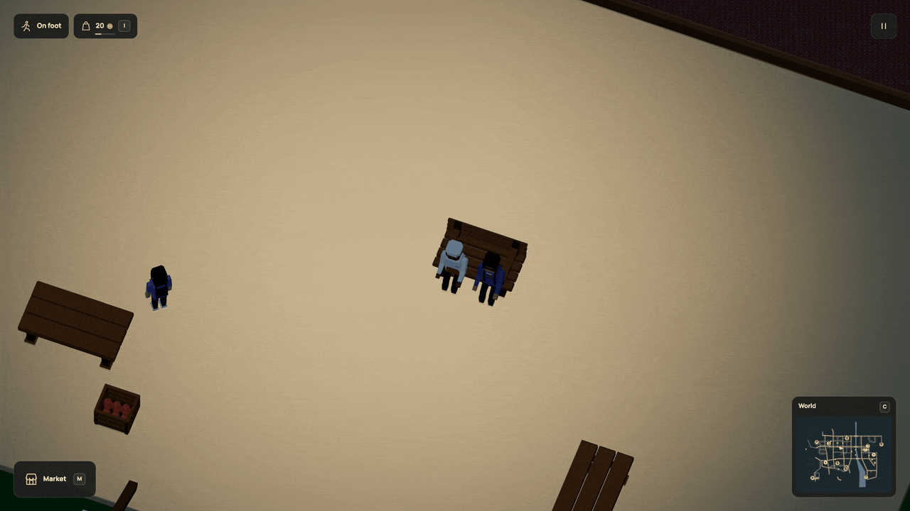

# A break with someone else

The baker can now share a meal with the commuter or caretaker. They use their own
money and food, walk to two free seats, eat together and go back to their routines.
The meal stays in their saved history and controls when they can share another.
An explicit [peer recipe milestone](companion-recipes.md) can now use that same
history to qualify both named residents for work.

The r105 recording shows the meal completing and the beginning of the return
walks. It predates the r106 recipe qualification; motion and controls are unchanged.



[HD recording](../media/companions.mp4) · [Still](../media/companions.jpg) · [Runnable source](../examples/companion-meals.dream) · [Verification](../evidence/companion-meals/verification.md)

## Name the companions in Dream

This declaration appears inside `economy()` in the complete example:

```dream
social bread_break(
  good=bread,seats=[lunch_bench],on=plaza,
  eat_s=8,cooldown_s=600,max_fullness=80,markets=[corner],peers=[friend_account]
);
```

`account.social` selects the host's plan. `peers` lists up to four other NPC
account IDs, in preference order. These are account references, rather than
object labels. Supply `markets` with priced food lots the host can actually reach.
They buy the complete missing quantity through ordinary finite trade before
reserving the two portions for a meeting. Food can be bought during counter hours
and carried into a later break.

Busy residents keep their existing commitments. A guest can be stationary or use
an accepted walking route. Their body and route clock belong to the meeting until
they return to the exact interrupted position. Existing shifts and attendance
still decide when someone can leave and when they must return. A plan checks both
outward and return paths before starting.

Both seats are claimed while they walk. The meal timer begins when both arrive.
Completion feeds each person once and consumes exactly two portions. A broken
bench, a blocked approach lasting 120 simulation seconds, or a due work shift
cancels the meal and returns the portions to the host's bag. The purchase stays
paid. People then walk back before resuming their ordinary decisions.

## Keep the memory separate

The saved `peerHistory` records completed meals by plan, host and guest. It
preserves the count and last completion time through pause, streaming, R and
save/load. Start over clears it. Player-to-resident meal history and recipe
qualifications retain their existing meaning; residents eating together cannot
award the player a qualification.

The live plan names both the caretaker and commuter. Supply trips, work, sleep,
food needs and occupied furniture can make one unavailable. The plan tries the
next eligible companion. Dating, a general affection score and authored dialogue
about these resident meals remain unfinished.

## Bounds and seating

There is one shared social activity at a time: a player meal, a pending player
invitation, or a two-resident gathering. This reuses the existing social budget.
Each plan accepts 1..4 unique peers and needs supply markets; peers cannot name
the player or another host of that same plan. Existing eight-plan, sixteen-account,
NPC, rig and navigation limits stay unchanged. Saved history has at most 64
plan/host/guest records. No new people, physics bodies or generated scripts.

Hosts remain stationary complete humanoid NPCs with reachable supply counters.
Peers may also use validated walking routes. Both need the existing body bounds
of radius <=8 and height <=32, ground-floor paired seating, actual body clearance,
128-waypoint paths and enough time to meet before their next duty.

The town's standard bench now puts its seat centers 84 cm apart. Its mesh,
materials, collision body and height are unchanged. The registered r104 upgrade
moves saved seated poses to those anchors and retargets unfinished approaches,
without advancing meal/rest timers, awarding food or resetting progress.

Check the complete example with:

```sh
node scripts/dream.mjs check docs/examples/companion-meals.dream
```

Sitting and standing now have a shared [body and foot transition](seating-motion.md).
The recording above predates that visual update; its meal and return rules still apply.
