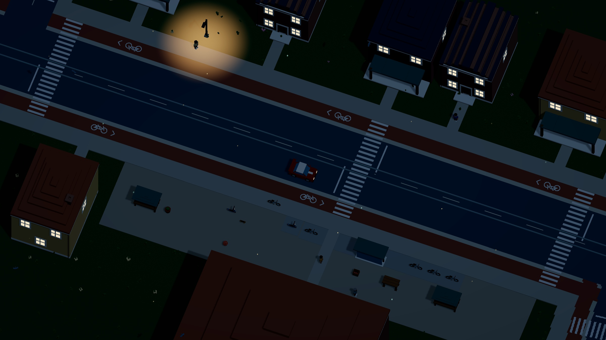

# Let the day pass

[Dream docs](../README.md) / Day and night

The city changes while you explore. The sun moves, shadows lengthen, the sky cools and windows light up. Streetlights leave warm pools on the pavement. Night keeps enough moon and ambient light to see where you are driving.



## Give the world a clock

```dream
// Fragment: place this beside world and road in the world-owning file.
daylight(cycle_s=600,start_hour=10);
```

The mock starts at 10:00 and completes a day in ten minutes of play. A complete cycle can take two to sixty minutes. The starting hour accepts fractions: `6.5` means 06:30. There is one clock for the world, regardless of whether you are driving, walking, swimming or riding as a passenger.

Pause freezes the cycle. R recovers your vehicle at the same time of day. Start over returns to the authored starting hour. Reduced motion freezes the visual clock, including the moving light direction. These rules share the existing visual animation clock; the scene document remains immutable.

Omit `daylight` to retain a static daytime scene. Local review can use `?test-hour=22`; this inspection override is absent from the production build.

## Describe the light in the asset

```dream
// Fragment: materials and lamp metadata belong to an ordinary composed assembly.
material window_glass(style=toon,colors=[#6c929d,#42616f],night=#f2bf7e);
material lamp_glass(style=glow,colors=[#f4db9c,#ffe9ba],night=#ffd18a);
```

`night` is a color, not shader code. It makes the material emit after dusk and fade back to its normal daytime paint at dawn. The engine carries that color through merged vertices, instanced buildings and released fragments.

A lamp assembly can also declare one `lamp(at=[0,38,0],radius=30,color=#ffd18a)` at its root. The local source position follows the measured asset and placement heading. The radius controls a soft surface pool below that source. Its tessellated geometry follows the same terrain and bridge decks used by the world; it stays resident in local culling tiles.

[Compile the complete lantern world](../examples/day-night.dream). It contains the materials, geometry, lamp, daylight clock, road and checkpoints needed for acceptance.

## A full cycle in twelve seconds


[Watch the HD time-lapse](../media/daynight.mp4). The recording uses 360 actual rendered frames at 30 fps. Only its lighting clock is accelerated to show the complete ten-minute cycle; vehicle and street activity continue at their normal replay rate. It is a capture of the renderer, not a browser performance benchmark.

[Day](../media/city-day.jpg) · [Dusk](../media/city-dusk.jpg) · [Night](../media/city-night.jpg) · [Dawn](../media/city-dawn.jpg)

## Rendering and current limits

The world keeps one directional shadow map for the sun and moon. Their direct light fades to darkness during the horizon handoff. Streetlights use shared emissive materials and bounded surface pools, with no per-lamp shadow map. The 398 lights follow city and airport placement rules; the cycle adds no actors or live joints.

Light pools are stylized, unshadowed ground effects. They do not light building walls or simulate occlusion from objects. Windows glow without simulating interiors or occupancy. Existing NPC programs and transit schedules continue through the night; this feature does not add opening hours, weather or an astronomical calendar.

[Exact fields and bounds](reference.md#daylight-and-night-lighting) · [Rendering evidence](../evidence/day-night/verification.md)
