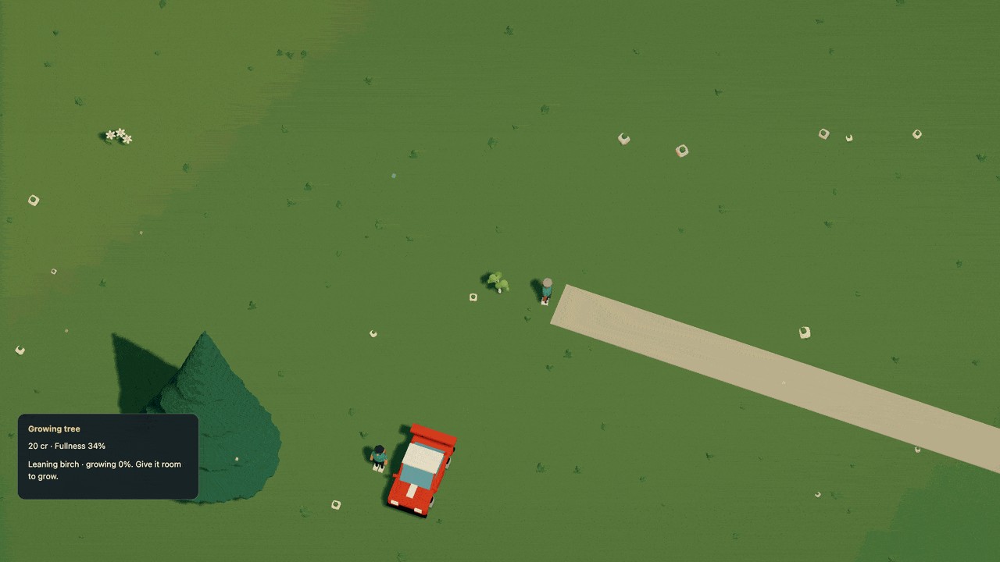

# Bring a tree back

Knock down a street or park tree, then park clear of the walking approach. The caretaker can collect a sapling from the market, walk over and plant a replacement. You can take the same job at the vendor before they leave. The live service covers 106 trees, including all 93 furnished street trees and the original orchard.


[Watch the planting](../media/planting.mp4) · [Animated planting](../media/planting.gif)

The tree starts small. Its trunk, crown, shadow and collision body grow together over three minutes of simulation time. Stand in its expanding footprint and growth waits until you move. Leave the area and it keeps growing; pause or close the page and its clock stops.



[Watch in HD](../media/growth.mp4). This shows the first 30 seconds of a 180-second growth period. It is an offline frame export, not a browser performance measurement.

The caretaker can also fetch saplings when a full shipment fits, using the same
finite stock and payments. Available repair and planting work takes priority.
[Walking resupply](commerce.md#npc-supply-trips) explains the shared delivery slot.

## Planting is paid work

The live bakery starts with six saplings. Planting takes ten seconds, consumes one sapling, uses six fullness and pays six credits from the bakery. The worker returns home after the job. The tree grows independently of that return journey. There is one caretaker, shared with furniture and streetlight repairs, so an existing commitment can keep them busy.

When the bakery has room for two saplings, collect **Bring saplings to the market** at Station supplies. The depot starts with eighteen. The bakery pays two credits per sapling to the depot and four to the courier at handoff. Goods, supplier payment and wages use the existing reserved delivery ledger. No free stock or money appears.

The worker travels on actual sidewalks, crossings and local dry approaches at 1.4 m/s. The inspected Garden park round trip took about 18 simulation minutes; planting and growth are not shortcuts around that journey. Player work uses the same supplies, claim, clearance and payment checks. Collect at the vendor, follow the map marker, stand beside the fallen tree and stop to plant. **H** starts the job; **Cancel planting** returns its unused sapling and reserved pay. Once planted, a sapling is spent. Knocking the young tree down does not refund it.

## Describe it once in Dream

Planting extends an ordinary repair service. Add `regrow_s` to a `kind=tree` service, then optionally set its initial `seed_scale`. Without those fields, existing repairs still restore objects at their full size.

These declarations are copied from the [complete runnable example](../examples/orchard-replanting.dream):

```dream
account regular(actor=customer,credits=20,capacity=4,satiety=65,drain_s=.05,shop=true,repairs=[yard_furniture,tree_care]);
repair tree_care(label="Plant a new tree",market=corner,on=work_yard,streets=[main],verge=24,kind=tree,input=sapling,take=1,seconds=2,pay=4,effort=5,dispatch_s=0,regrow_s=30,seed_scale=.2);
```

Run `npm run -s dream -- check docs/examples/orchard-replanting.dream`. The example uses two-second planting and thirty-second growth for testing. The live city uses ten seconds and three minutes. Its garden path overlaps the natural orchard work area and reaches High Street's sidewalk. Overlapping declared work grounds connect through a clear, full-width walking portal; disconnected surfaces still fail acceptance.

`repairs` is an ordered list of one to four services. An idle worker tries them in order, skips unavailable or unaffordable work and holds one commitment at a time. It cannot also declare `repair` or automatic `work`. Existing single-service `repair=...` remains supported. Player accounts act through controls and cannot declare either automatic policy.

## Work coverage without a painted patch

The orchard uses `surface(...,finish=terrain)` for its work area. It keeps the
terrain and scattered grass, while the garden path remains a painted surface.
This declaration is copied from the same runnable example, outside `economy`:

```dream
surface work_yard(points=[[530,680],[820,680],[820,816],[530,816]],finish=terrain);
```

Omit `color` for terrain finish. Ordinary surfaces still require color and default
to painted ground. Either finish keeps the same coverage, clear walking portals,
furniture reservations and road/water validation. A natural area creates no
pavement or new collider. [Surface authoring](worlds.md#streets-grounds-and-paint).

## Street trees and wind

[Compile the complete city-tree example](../examples/city-tree-replanting.dream).
It combines a shared tree rule, part sway, voxel construction, finite saplings,
paid planting and a 112-unit verge. A verge may now be 0..128 world units, or up
to 12.8 metres. This is a bounded local work approach around selected contacts;
it grants no road or water shortcut and creates no paving. The compiler checks
outbound and return access within the existing graph limits.

The falling crown retains the intact tree's GPU wind phase, material coordinates
and shadow deformation. It adds no per-tree CPU rig or per-cell body. Spinning
parts, cloth and moving joints remain incompatible with whole-tree release.
[Coverage, saves, source and native evidence](../evidence/city-trees/verification.md).

## What the engine checks

| Data | Bound or behavior |
| --- | --- |
| `regrow_s` | 30..86,400 simulation seconds; requires exactly `kind=tree` |
| `seed_scale` | 0.1..0.5 of the resolved authored scale; defaults to .15; requires `regrow_s` |
| Growing plants and reserved planting jobs | At most 32 across the world |
| Tree assembly | Whole-object topple, centered trunk contact, no foundation, break zones, vehicle seat, emitter or lamp |
| Growth | Linear uniform scale about the planted root; blocked physical expansion waits |
| Repeated damage | Uses the tree's current size for fragments and contacts; clears that growth record |
| Persistence | Planting time, elapsed growth, sapling consumption, pay, damage and worker journeys survive travel, R and save/load |

Visual cells and geometry are reused. Streamed instances change their transform and bounds; resident assemblies retain their existing meshes. There is no mesh allocation or physics body per growth step or voxel. The immutable accepted scene retains the mature dimensions. The existing actor, rig, debris and navigation limits remain in force.

A planting completion is recorded when the replacement goes into the ground, not when it reaches full size. Restore checks unique plant IDs, service membership, clocks, progress, reserved jobs, money and material conservation. Format 8 / simulation 10 includes registered upgrades from r53, r52 and the earlier supported releases. The natural-ground upgrade preserves all existing growth, work and ledgers. [Save rules](../persistence.md).

## Still limited

All 345 measured trees can fall, including wind-animated species. The service replants 106 of them. The remaining 239 trees lie outside its declared connected grounds and verges, so they stay broken. Remote woodland needs real service access before workers can restore it.

This is a recovery mechanic with authored timings. There is no soil, water, season, reproduction or biological model. Saplings have inventory units, rather than carried plant meshes. The worker performs a general planting gesture; there is no digging or terrain excavation. Growth checks solid player/vehicle/actor footprints; cosmetic ambient populations do not block it. The station supply is finite, and closed pages do no work.

[Markets and repairs](commerce.md) · [Shared destruction rules](rules.md) · [Current gaps](../world-systems.md)
