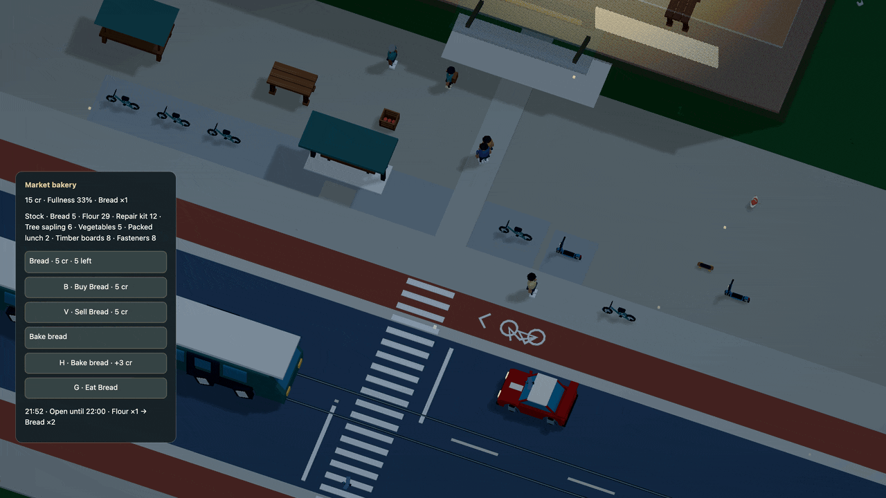

# Come back when the counter opens

The bakery and station supplier serve from 06:00 to 22:00. The school canteen
serves from 08:00 to 17:00. Walk up after closing and the panel gives the next
opening time and a countdown. Your bread, money and unfinished deliveries stay
yours. **G** still eats food in your bag.



[Watch in HD](../media/hours.mp4). This is a sixteen-second recording of the mock
simulation, with 480 rendered frames. Preparation buys one loaf and advances the
complete city to three seconds before closing. The player starts a batch before
22:00, receives its ordinary pay after closing, then eats the carried loaf. The
preparation is not shown, and the export does not measure live frame rate.

## The same rule at every counter

Declare `hours=[6,22]` on a `market`. Opening is included; closing is excluded.
`hours=[22,6]` serves overnight. Opening must be at least zero and below 24;
closing can be zero through 24. Both are finite numbers and must differ. Omit
`hours` for service all day. `[0,24]` also covers the whole day.

The world must declare `daylight(cycle_s=...,start_hour=...)`. Hours derive from
saved **simulation time**, using the same day arithmetic as lighting. Pausing
stops both; reduced motion freezes the sky while business hours keep advancing.
R, travel and streamed scenery do not reset a business day. Reload resumes the
saved time with no offline trading, work or travel.

| Action | After closing |
| --- | --- |
| Buy or sell | Wait for service; no money or goods move |
| Start a production job | Wait for service, for both player and staff |
| Finish a committed job | Finish and receive its reserved pay normally |
| Collect a shipment | Wait at its source; no cargo or pay is reserved before pickup |
| Deliver committed cargo | Keep cargo and escrow until the receiver opens, or cancel |
| Eat owned food, cancel a task or perform local repairs | Keep using the existing rules |

A courier already on the way can arrive after closing. It waits at the connected
approach, then retries the same transaction when service opens. The wait, cargo,
reservations, paused routine and position survive saves. A hungry customer skips
closed shops. If closing happens before arrival, they return without buying or
claiming a seat; no free food or refund is created.

These are counter hours. [Counter shifts](shifts.md) and [workplace attendance](attendance.md)
can give staff physical workdays. Hours alone do not move them or pay for idle
time. Queues, appointment slots and weekly calendars remain separate features.
Repair services use their existing finite stores and pay; closing a shop does
not switch off street maintenance.

## A bakery and an overnight supplier

This [complete example](../examples/market-hours.dream) begins at 21:30 with a
two-minute day. The bakery closes at 22:00 and its supplier opens for the night.
They use the same recipe, food and courier rules as an all-day business. This
short clock makes boundaries quick to inspect; the live city uses ten minutes.

```dream
dream 2;
material blue(style=toon,colors=[#537eaa,#3c5f87]);
material skin(style=toon,colors=[#c59774,#a97655]);
object pedestrian(label="Pedestrian"){
  measure(kind=person,axis=y,meters=1.8);
  body(interaction=decor,radius=4,height=18);
  part torso(shape=capsule,material=blue,at=[0,11,0],size=[5,6,4]);
  part head(shape=sphere,material=skin,at=[0,16,0],size=[4,4,4]);
  part nose(shape=sphere,material=skin,at=[2,16,0],size=[1,1,1]);
  repeat legs(index=i,count=2){
    joint leg(at=[0,8,i*3-1.5],motion=swing(axis=z,deg=18,hz=.6,phase_deg=i*180)){
      part shin(shape=capsule,material=blue,at=[0,-4,0],size=[2,8,2]);
    }
  }
}
behavior welcome(start=waiting){
  state waiting(action=idle){on talk(event=interact,to=hello,radius=55,familiar=false);on again(event=interact,to=returning,radius=55,familiar=true);}
  state hello(action=idle,face=player,say="Hello. Welcome to the neighborhood."){
    on ask(event=interact,to=about,radius=55);
    on finish(event=after,to=waiting,seconds=6);
  }
  state returning(action=idle,face=player,say="Good to see you again."){
    on finish(event=after,to=waiting,seconds=6);
  }
  state about(action=idle,face=player,say="I like walking by the river. See you around."){
    on finish(event=after,to=waiting,seconds=6);
  }
}
place neighbor(object=pedestrian,at=[580,710],role=npc,behavior=welcome);
world(size=[4000,2400],spawn=[525,609],heading_deg=0);
daylight(cycle_s=120,start_hour=21.5);
road circuit(width=118,points=[[300,590],[660,590],[810,500],[810,220],[660,130],[300,130],[150,220],[150,500]]);

checkpoint start(at=[480,612.5],dir=[1,0],width=100);
checkpoint east(at=[828.75,360],dir=[0,-1],width=100);
checkpoint north(at=[480,107.5],dir=[-1,0],width=100);
checkpoint west(at=[131.25,360],dir=[0,1],width=100);

place customer(object=pedestrian,at=[760,730],role=npc,behavior=welcome);
place depot_keeper(object=pedestrian,at=[1120,970],role=npc,behavior=welcome);
place helper(object=pedestrian,at=[620,730],role=npc,behavior=welcome);
street access(width=60,sidewalk=24,points=[[400,590],[400,850]]);
street main(width=60,sidewalk=24,points=[[400,850],[1400,850]]);
crossing main_cross(street=main,at=[900,850],width=20);
surface depot_yard(color=#b2aa96,points=[[1080,884],[1260,884],[1260,1020],[1080,1020]]);
surface plaza(color=#b2aa96,points=[[530,680],[820,680],[820,816],[530,816]]);
economy(){
 good bread(label="Bread",food=45);
 good flour(label="Flour");
 good vegetables(label="Vegetables",food=20);
 good lunch(label="Packed lunch",food=65);
 account pocket(actor=player,credits=20,capacity=8,satiety=65,drain_s=.05);
 account baker(actor=neighbor,credits=0,capacity=4,satiety=65,drain_s=.05,shop=true,works=[pack_lunch,bake]);
 meal bakery_break(good=lunch,markets=[corner],on=plaza,eat_s=4);
 account regular(actor=customer,credits=20,capacity=4,satiety=25,drain_s=.05,meal=bakery_break);
 account supply_helper(actor=helper,credits=0,capacity=4,satiety=65,drain_s=.05,deliveries=[flour_run]);
 market corner(label="Corner bakery",actor=neighbor,credits=100,radius=70,hours=[6,22]){
  lot bread_shelf(good=bread,quantity=8,limit=16,price=5);
  lot flour_sack(good=flour,quantity=6,limit=8);
  lot vegetables_box(good=vegetables,quantity=4,limit=8,price=2);
  lot lunch_counter(good=lunch,quantity=0,limit=4,price=8);
 }
 market depot(label="Station supplies",actor=depot_keeper,credits=0,radius=70,hours=[22,6]){lot flour_store(good=flour,quantity=12,limit=12);}
 delivery flour_run(label="Bring flour",from=depot,to=corner,good=flour,quantity=2,pay=4,capacity=1,on=plaza,grounds=[depot_yard]);
 work bake(label="Bake bread",market=corner,input=flour,take=1,output=bread,make=2,seconds=2,pay=3,effort=6,capacity=1,target=4);
 work pack_lunch(label="Pack lunch",market=corner,output=lunch,make=1,seconds=2,pay=3,effort=6,capacity=1,target=2){
  ingredient(good=bread,take=1);
  ingredient(good=vegetables,take=1);
 }
}
```

Run `npm run -s dream -- check docs/examples/market-hours.dream`. Removing
`daylight`, using equal endpoints or supplying an invalid hour fails acceptance.
Hours do not add actors, physics bodies, navigation nodes or render geometry.

## Keep the day you already played

The r62 update retains save format 12 and moves simulation semantics to version
19. Its registered r61 projection removes only counter hours. Existing positions,
seats, meals, jobs, needs, stock, money, history and both clocks stay exact. The
original slot is retained. Changing any unrelated accepted rule still requires
its own migration. [Saving and compatibility](../persistence.md).

Hours can now connect to [physical staff shifts](shifts.md). Hours alone still
require no travel; an assigned counter owner must actually return before service.
