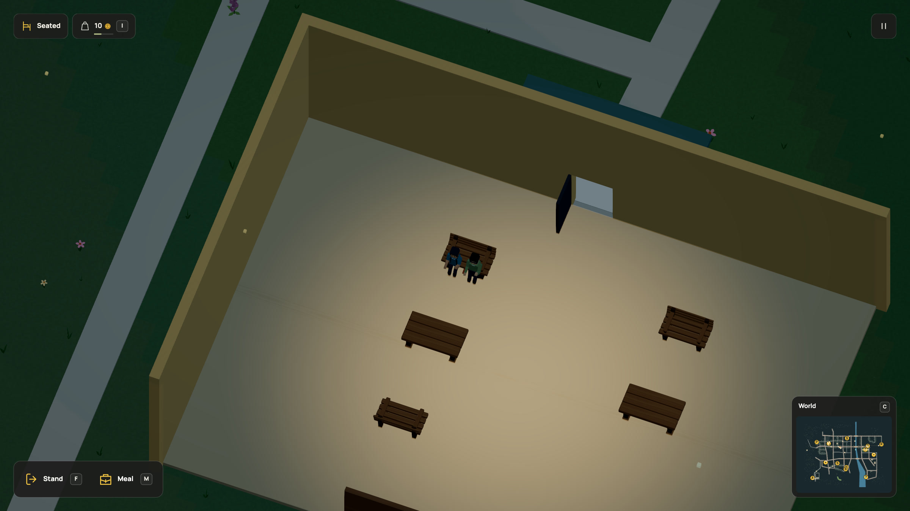
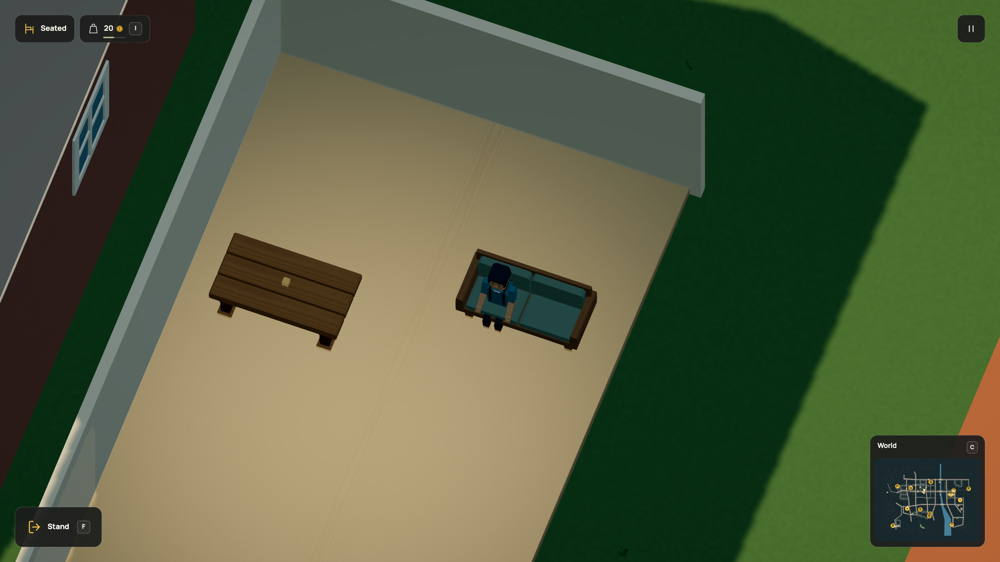
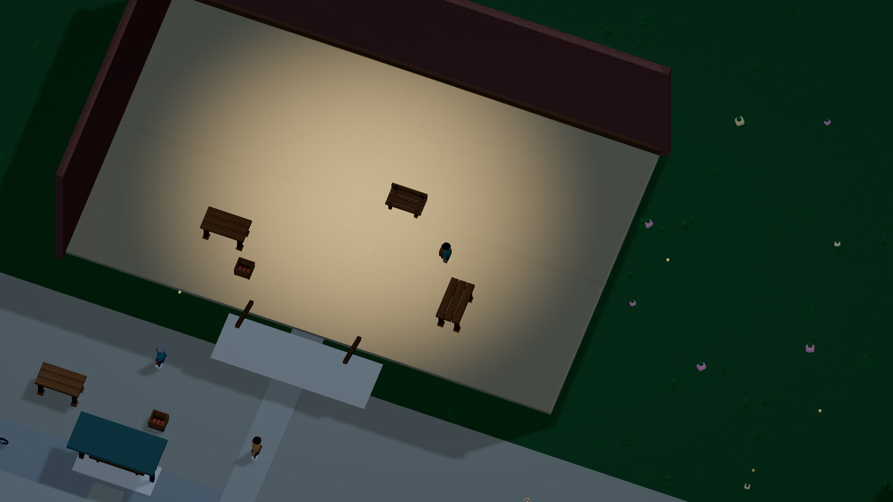

# Walk into a building

[Docs](../README.md) / Interiors

The covered market now has a doorway you can walk through, a floor you can stand on and walls you cannot walk through. Inside, the roof and the walls nearest the camera cut away. The floor, furniture and people stay visible.


[Watch the walkthrough](../media/interior.mp4) · [30 fps GIF](../media/interior.gif) · [Complete Dream source](../examples/enterable-market.dream)

Leave your vehicle with **F**, then walk through the market's front entrance. The vendor now stands inside, behind the existing table: **H** starts paid baking, **B** buys bread and **G** eats what you carry. Walk around the table to the counter. The outdoor square is outside its forty-unit reach. Staff, customers and supply workers use the same doorway and clear interior aisle. A wall blocks buying, starting work and conversation; proximity alone is not enough. Leaving the work area or jumping cancels a batch and returns its reserved supplies and wage.

Each building currently has one usable ground floor. Stacked floors and a finished interior library remain future work. K can now hit reachable props on foot. Handheld tools and furniture pickup are not implemented. The hall's tables, bench and crate use the existing impact and repair rules; the caretaker can walk to them through the doorway after damage.

## The school common room

The Garden primary school's ground floor is now another connected interior.
Its existing entrance path continues to a 1.6 m doorway, a 20 cm floor step and
3.2 m of clear headroom. The upper floor remains part of the shell, without
stairs or a usable second level.



[Common-room video](../media/schoolroom.mp4) · [GIF](../media/schoolroom.gif) · [Complete school assembly](../examples/enterable-school.dream)

The teacher still serves the outdoor canteen during its 08:00–17:00 hours.
After closing, they walk through the door to their indoor break spot. Meet them
with T, buy two portions of bread while a counter is open, sit on a nearby bench
with F and invite them with Y. Both consume a portion after the shared meal;
the teacher's existing per-person memory and return dialogue record it. They
can decline when busy, full or due back at work. This is a common room, without
classroom lessons or an education simulation.

All three new benches use the same seating and splintering rules as the yard.
The two tables also retain their category's break policy. The existing
caretaker's added `classroom_furniture` service uses finite repair kits, wages
and the same pedestrian network and doorway. The player can claim that paid
service too. Repaired seating becomes usable again; reclaimed fasteners return
to the bakery supply chain. There are no extra NPCs or live rigs.

The registered r90 upgrade keeps saved resources and visible journeys. A teacher
already resting outside walks to the new break spot. An active outdoor shared
meal retains its visible pose, food and timer, then returns indoors. The old
source slot remains available. [Checks and capture](../evidence/school-interior/verification.md).

## The commuter's home

The brick terrace beside Market Avenue now has an open ground floor, a timber
settee, a table and a planter. Its existing commuter walks through the doorway
and waits in the foyer before the next market trip. The route and waits are
unchanged. You can enter from the street, sit with F, stand with F or movement,
and hit reachable furniture with K.



[Walkthrough](../media/home.mp4) · [GIF](../media/home.gif) · [Complete home and settee source](../examples/enterable-home.dream)

The doorway is about 1.17 m wide, the floor step 20 cm and clear headroom 3.13 m.
The car stays outside. Window frames are carved voxel parts, with the same
`cutaway` tags as their walls. Rotating the view hides the appropriate shell;
floors, contents and physical contacts remain.

The settee uses the shared bench splintering policy. Its frame, cushions and
arms form five released groups. The table and pot keep their own category
policies. `home_furniture` connects the interior to the existing caretaker,
finite repair kits, wages and reclaimed fasteners. The player can claim that
service at the market counter too. Its existing counter area also covers the
hall's east table and produce crate. Indoor repairs can start during rain.

The r93 save upgrade keeps resources, damage, work and commute clocks. It
initializes only the new repair counters, retargets derived paths and recovers
poses blocked by the new shell. A saved car newly enclosed by the home moves
to a clear nearby exterior position, retaining its heading, travel and ownership. The old source slot survives. The upper storey
is a closed visual shell: no stairs, sleeping, ownership or access permissions
are implemented. [Checks](../evidence/home-interior/verification.md).

## Give the floor an owner

`interior` belongs directly inside a static object with a solid body and foundation. `at` is the local centre of its floor, including the **top** of that floor in Y. `size` is its full width, clear height and depth. These values scale with the rest of the measured building.

Declare the visible floor and its rectangle contact separately. The contact must cover the interior bounds and end at the declared floor height. A second rectangle contact starts at the clear ceiling height. The engine checks and uses those contacts; drawing a floor or roof does not create collision implicitly.

In this market, `.5` local units becomes a roughly 20 cm step after measurement. The entrance is about 1.57 m wide and 2.36 m high. The player's walking cylinder fits; the car does not. Ten world units represent one metre. Those dimensions come from this assembly, rather than a global size assigned to every building.

## Leave an actual opening

A `portal` describes an opening that already exists between the contacts. It does not carve a hole for you. `front` is local −Z, `back` +Z, `left` −X and `right` +X. Offset follows X on the front/back, and Z on either side. Width and height are full local dimensions.

Complete-world acceptance walks a conservative cylinder through each declared portal. It needs at least nine world units of width, twenty of headroom, clear contacts and floor steps no taller than four units. A painted door in a filled collision box fails that check. In the city, the entrance path and room polygon join the existing pedestrian network. NPC work paths use the same walls and opening.

Rectangle contacts use `size=[width,depth]`, plus `at`, `height` and optional `heading_deg`. Cylinder contacts keep `radius`. Choose exactly one shape. Rectangles are upright static structures; moving vehicles retain their cylinders. The existing eight-contact budget is shared by the floor, walls, lintel and ceiling. Road-clearance validation uses these same rectangles, so a long wall beside a street does not block the street merely because its broad-phase circle overlaps it.

## Cut away the shell

Tag the appropriate static `part` or `voxels` sections with `cutaway=roof|front|back|left|right`. The directions describe the object, including its placement heading. Keep the floor and contents untagged. The camera hides the roof and the near sides while you are below the ceiling and inside the room. Q/E changes which sides are hidden, without changing the character's heading.

The reveal opens cleanly instead of stippling the player. Fully hidden tagged
parts still cast their ordinary shadows; the floor, contents and physical
contacts stay intact. [GPU visibility checks](../evidence/clean-cutaways/verification.md).

The tags survive compaction, instancing and worker transfer. A newly loaded chunk immediately uses the current room view. Cutaways affect the view; the walls and ceiling still collide and the building retains its shadow. Ordinary foreground occlusion still works outside the building.

## Connect work and lighting

A work ground can name the **placed building ID** instead of another painted polygon. For example, the live `market_tables` repair service includes `market_hall` in its `grounds` list. The engine derives the same rotated floor footprint used for support and navigation. It does not create staff, stock, jobs or business accounts for you: those remain explicit economy data.

A room-owning `lamp` draws an always-on pool clipped to that floor. It remains readable at night, with no extra point light or shadow map. It is a surface effect: it does not light walls or calculate object occlusion.



[Earlier night walkthrough, before indoor service](../media/interiornight.mp4) · [30 fps GIF](../media/interiornight.gif)

## Complete assembly

This is the exact live market assembly and the contents of [enterable-market.dream](../examples/enterable-market.dream). Import it through the host's closed module map, place it and attach a city entrance. Object-only compilation checks the assembly; complete-world compilation also checks the portal and pedestrian access.

```dream
dream 2;
material redbrick(style=brick,colors=[#995b4c,#b9ae9e]);
material glass(style=toon,colors=[#6c929d,#42616f],night=#f2bf7e);
material tile(style=toon,colors=[#aa6b50,#864d3e]);
material trim(style=toon,colors=[#e5decd,#c5bfae]);
material wood(style=wood,colors=[#805c40,#aa815a]);
material dark(style=toon,colors=[#35464c,#28363e]);
material green(style=toon,colors=[#5e7c73,#405d55]);
material sign(style=toon,colors=[#e4b948,#c79435]);
material floorboards(style=wood,colors=[#c7b796,#ab9874]);
material warm_light(style=toon,colors=[#f2d6a0,#e2c48c],night=#f6ce84);
object market_hall(label="Covered market hall"){
  measure(kind=building,axis=y,meters=11);
  body(interaction=solid,radius=30,height=28);
  foundation(size=[65.4,40.4],color=#9e9d8c);
  lamp(at=[0,19,0],radius=30,color=#ffd69a);
  interior(at=[0,.5,0],size=[63,21,38]){
    portal entrance(side=front,offset=0,width=4,height=6);
  }
  contact c_floor(at=[0,0,0],size=[63,38],height=.5);
  contact c_left_wall(at=[-32,0,0],size=[1,40],height=22);
  contact c_right_wall(at=[32,0,0],size=[1,40],height=22);
  contact c_back_wall(at=[0,0,19.5],size=[65,1],height=22);
  contact c_front_left(at=[-17.25,0,-19.5],size=[30.5,1],height=22);
  contact c_front_right(at=[17.25,0,-19.5],size=[30.5,1],height=22);
  contact c_lintel(at=[0,6.5,-19.5],size=[4,1],height=15.5);
  contact c_ceiling(at=[0,21.5,0],size=[65,40],height=6.5);
  part floor(shape=box,material=floorboards,at=[0,.25,0],size=[63,.5,38]);
  part left_wall(shape=box,material=redbrick,at=[-32,11,0],size=[1,22,40],cutaway=left);
  part right_wall(shape=box,material=redbrick,at=[32,11,0],size=[1,22,40],cutaway=right);
  part back_wall(shape=box,material=redbrick,at=[0,11,19.5],size=[65,22,1],cutaway=back);
  part front_left(shape=box,material=redbrick,at=[-17.25,11,-19.5],size=[30.5,22,1],cutaway=front);
  part front_right(shape=box,material=redbrick,at=[17.25,11,-19.5],size=[30.5,22,1],cutaway=front);
  part lintel(shape=box,material=redbrick,at=[0,14.25,-19.5],size=[4,15.5,1],cutaway=front);
  part roof(shape=pyramid,material=tile,at=[0,25,0],size=[65.2,6,41.5],cutaway=roof);
  part eaves(shape=box,material=trim,at=[0,21.75,0],size=[65.2,.5,41.5],cutaway=roof);
  part left_window(shape=box,material=glass,at=[-16,12.1,-20.15],size=[16,5,.5],cutaway=front);
  part right_window(shape=box,material=glass,at=[16,12.1,-20.15],size=[16,5,.5],cutaway=front);
  part rear_window(shape=box,material=glass,at=[0,12.1,20.15],size=[24,5,.5],cutaway=back);
  part door_open(shape=box,material=dark,at=[-2.2,3.5,-17.5],size=[.3,6,3.5],cutaway=front);
  part door_header(shape=box,material=trim,at=[0,6.85,-20.3],size=[4.8,.7,.6],cutaway=front);
  part porch_base(shape=box,material=trim,at=[0,.05,-23],size=[20,.1,6.5]);
  part canopy(shape=box,material=green,at=[0,8.5,-23],size=[18,.7,6.5],cutaway=roof);
  beam bracket_left(shape=box,material=wood,from=[-7,5.5,-20],to=[-7,8.2,-25],width=.5,depth=.5);
  beam bracket_right(shape=box,material=wood,from=[7,5.5,-20],to=[7,8.2,-25],width=.5,depth=.5);
  part signboard(shape=box,material=dark,at=[0,11,-20.4],size=[16,3,1],cutaway=front);
  part sign_stripe(shape=box,material=sign,at=[0,11,-21],size=[13,.7,.5],cutaway=front);
  part lamp_bar(shape=box,material=warm_light,at=[0,21.6,0],size=[28,.4,1.4],cutaway=roof);
  part skirting_back(shape=box,material=wood,at=[0,1.1,18.8],size=[63,1.2,.4],cutaway=back);

}
```

```sh
node scripts/dream.mjs check docs/examples/enterable-market.dream
node scripts/dream.mjs context --features interiors,commerce
```

The current limits are 32 placed interiors, four portals per interior, eight contacts and 32 visual parts per assembly. Existing NPC, live rig, destruction, fragment, source and navigation limits remain unchanged. Floors and room ownership live in accepted Dream data; saved people, goods, jobs and damage remain simulation state. Unloading a render chunk resets neither.

[Indoor service and migration checks](../evidence/indoor-service/verification.md) · [Original interior verification](../evidence/interiors/verification.md) · [World systems still to build](../world-systems.md)


The indoor bench now has two usable slots shared by the player and meal customer.
Its authored approaches fit the existing floor and doorway network. Furniture
remains destructible and repairable. See [shared seating](seating.md).

Baking now depends on the existing table through [work equipment](commerce.md#work-needs-equipment). Damage refunds unfinished batches; repair restores production. Trade and repair remain usable.
