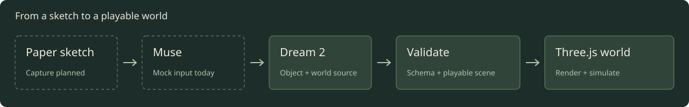

# Generate and repair Dream

[Docs](../README.md) / Model authoring

Dream 2 gives an agent a finite language for proposing a world from a prompt or paper sketch. It uses regular records, reusable components, stable IDs and located diagnostics. Muse isn't connected yet. The current world, examples and interpreter are handmade mocks.



## Give the agent the context it needs

Start with a scoped packet instead of sending the entire language on every request:

```sh
node scripts/dream.mjs context --features objects
node scripts/dream.mjs context --features objects,voxels
node scripts/dream.mjs context --features city,population,lighting
node scripts/dream.mjs context --features scenarios
```

Stdout is compact JSON containing `features`, `availableFeatures`, `instructions` and `contract`. This is host context metadata. The agent still writes Dream 2 text beginning with `dream 2;`.

| Feature | What it supplies |
| --- | --- |
| `objects` | Materials, numeric/material components, measured geometry and joints |
| `world` | Layout, terrain, roads, bridges, water, routes and placements |
| `modules` | Closed asset and district imports |
| `interactions` | Shared impact rules, break zones, fragments, bounce and topple |
| `city` | Streets, grounds, paint, connected entrances, crossings and stops |
| `npcs` | Bounded behavior states, actions and transitions |
| `population` | Street/site furnishing, pavement walkers, reactive roaming and cosmetic bird populations |
| `lighting` | Daylight, night emission and lamp pools |
| `scenarios` | Logical task networks, agents, resources, services and objectives |
| `voxels` | Filled/carved volumes and the whole-world construction policy |
| `sports` | Connected practice grounds, balls and targets |

The helper adds dependencies once, in deterministic order. For example, `city` adds `world`, `objects` and `npcs`; `voxels` adds `objects` and `interactions`. A standalone `scenarios` packet contains eight commands and no geometry instructions. Add `world` when generating a complete layout; `lighting` and `voxels` can also be used for standalone object libraries. The default is `objects`. `all` supplies every feature and must be requested alone. Unknown feature names fail with `E_CONTEXT`.

These packets are subsets of the same compiler-owned contract, including its source/project limits. They do not create alternate validators or relax budgets. Request another feature if the intent needs vocabulary outside the packet. Use the [full instructions](../dream-v2-model.txt) and [complete generated contract](../dream-v2-contract.json) as the fallback. Every full instruction section and every contract entry is covered by `all` in regression tests.

A host can use the same helper directly:

```ts
import {dreamAgentContext} from './src/scene/dream-agent';
import {checkDream} from './src/scene/dream';

const context = dreamAgentContext(['objects', 'voxels']);
// Supply context, the user's intent, relevant source and stable IDs to your transport.
// No real provider transport is connected in this project.
const checked = checkDream(proposedSource, modules);
if (!checked.ok) {
  return {accepted: false, diagnostics: checked.diagnostics};
}
return {accepted: true, world: checked.world};
```

`proposedSource` and the closed `modules` map are host inputs in this integration fragment. Checking is still separate from applying a fresh, valid revision at a simulation boundary.

## Reuse instead of repeating

Supply one small relevant example and the existing revision's stable IDs. When imports are needed, supply a closed module registry. Describe the intended objects and relationships without asking the agent to choose arbitrary code or shaders.

Components accept numbers and material IDs in separate, typed lists. [Two complete tables](../examples/material-components.dream) share one assembly, including nested legs. The live commuter, health worker, market vendor and teacher share one twelve-joint rig with different uniform materials. Material binding doesn't change dimensions, motion or physical behavior. [Composition and scope](objects.md#reuse-a-shape-without-copying-it).

Every new object declares `measure`, a separate body and bounded visual parts. Use IDs for references and labels for display text. Return one complete source file without a Markdown wrapper. Unsupported intent belongs in an explicit `unresolved` declaration in a full world, rather than an invented command.

For moving people, supply the [complete humanoid example](../examples/humanoid.dream) and the contract's `humanoid` entry, included in `objects`. Bind `joint.bone` to anatomy; the engine owns walk, run and swim cycles.

## Validate before applying

1. Parse source and resolve references inside the compiler's vocabulary.
2. Expand bounded components/repeats into Object DSL data and validate it.
3. Merge supplied modules and check project budgets and unique world IDs.
4. For a complete world, validate road, spawn, checkpoints, landscape and route clearance using `compileDreamScene`.
5. Accept a complete valid scene at a simulation boundary. Keep identity and source hash host-owned.

`compileDreamWorld` performs structural compilation. It doesn't certify playability on its own. `checkDream` adds playability checks when the source contains a full layout; object libraries can be checked without inventing a racing world.

## Return a specific repair

A failure has `code`, `line`, `column`, `path` and `message`, with `expected` choices when available. Imported failures also identify their source `module`. The checker returns the first error and no partial world. Keep unaffected IDs and send a corrected complete file.

For `component leg(params=[h],materials=[finish])`, a missing material list reports `E_ARITY` at the use site's `/materials` path with `expected: ["finish"]`. A missing numeric argument reports `/args` with `expected: ["h"]`. An unknown actual material points to `/materials[0]` and lists available bindings. These names describe the required argument positions, rather than guessed replacement values.

The CLI prints machine-readable stdout and exits 0 on success or 1 on failure:

```sh
node scripts/dream.mjs check file.dream
node scripts/dream.mjs format file.dream
node scripts/dream.mjs migrate file.dream
node scripts/dream.mjs contract
```

`format` canonicalizes spelling, field order and expressions; it doesn't repair semantic errors. `migrate` validates both sides when moving Dream 1 source to Dream 2. Both support `--write` for atomic file replacement. `context` takes no file, module directory or write option.

## What we measured

The [verification note](../evidence/agent-authoring/verification.md) compares context size and the actual civic source before/after reuse. These are character, UTF-8 byte and lexer-token counts. They are not model-token counts, generation benchmarks or cost estimates. No Muse generation accuracy, latency or repair-success rate has been measured.

[Dream Lab](https://musedream.vercel.app/lab/) retains its existing mocked town interpreter and policies. Its helper now requests the `scenarios` packet. This change adds no prompting interface or provider integration. [Scenario boundary](scenarios.md) · [World systems still needed](../world-systems.md).

Source cannot set provenance, credentials, arbitrary URLs, callbacks or executable modules. The host chooses the model, supplies module text, checks freshness and owns the active revision. Capture, interpretation, preview and atomic apply remain separate work.

[Compiler APIs and diagnostics](reference.md) · [Version policy](../dream-language.md)

Use `motion=walk(...)` for measured humanoids on the accepted pedestrian network and `motion=roam(...)` for animals with bounded nearby flight. These use explicit ambient ownership and shared GPU rigs, separate from full NPC programs. [Bounds, examples and limits](populations.md).

The live character family shares its geometry between civic people, sports and
the standing/seated player. [Import two complete characters](../examples/character-import.dream)
from a host-listed module, or [compose the full family](../examples/city-person.dream).
Repeated limbs use material parameters; imported assets still obey the same
source and expansion budgets. [People and module scope](people.md).
