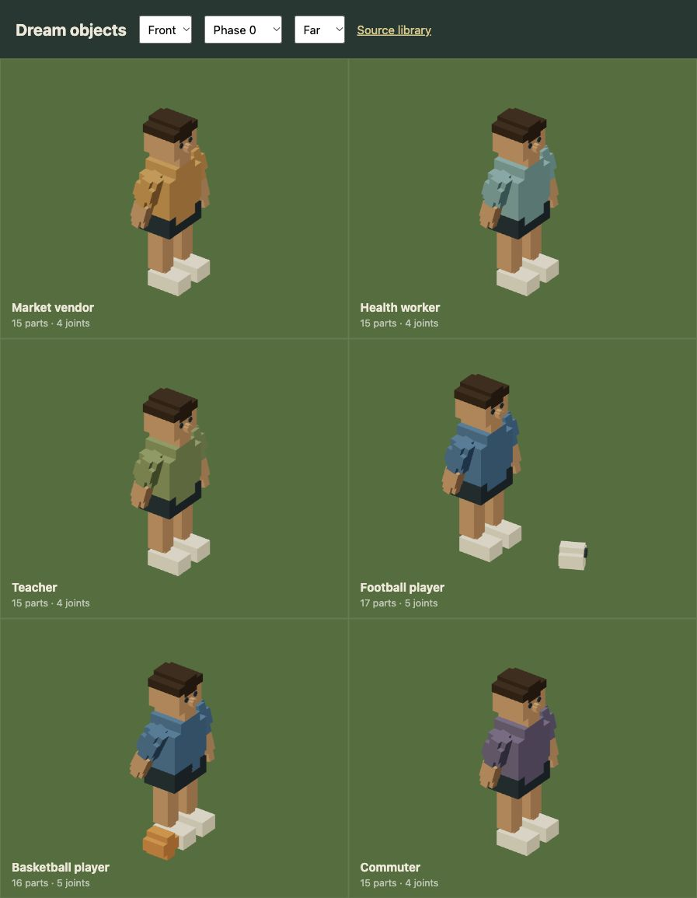
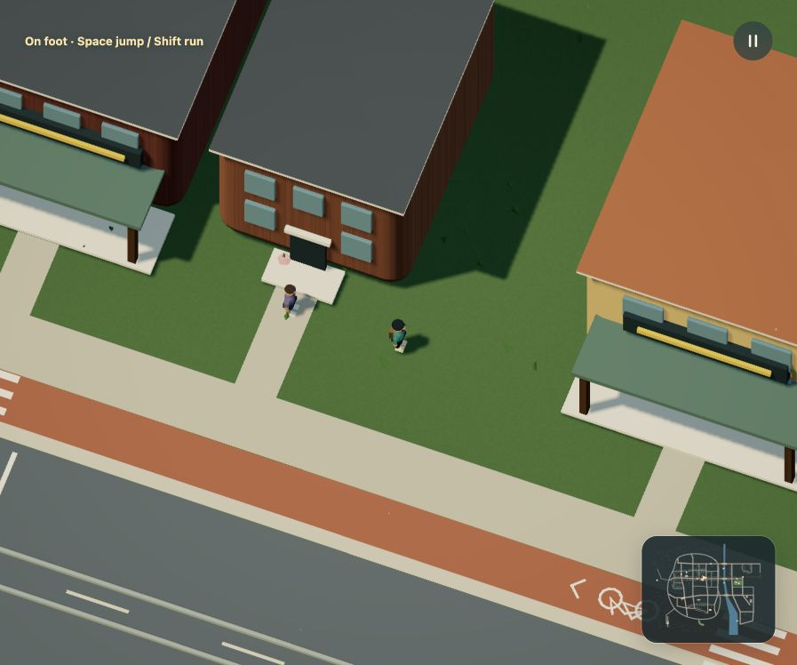
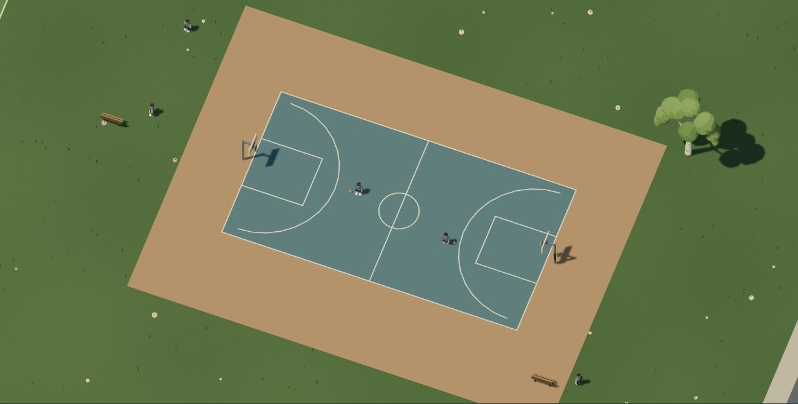
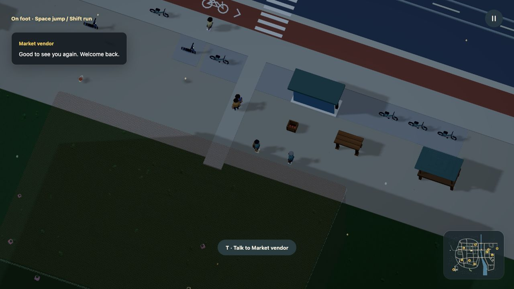

# Who controls an object?

[Docs](../README.md) / NPCs and control

An assembly describes what something can do. A placement decides who controls it. A bicycle can be parked for you to ride, or belong to an NPC. A pedestrian can follow a route, stop when you approach and look at you. Those choices are Dream 2 data.

| Placement role | Owner | Behavior |
| --- | --- | --- |
| `ambient` | Bounded engine motion | Instanced decor using Dream `walk` or `roam`, with no general program, contact body or boarding. |
| `prop` | Nobody | Scenery and physical props. No actor route or NPC program. Mechanical joints and destruction still work. |
| `controllable` | Player after boarding | Requires a `rideable` control profile. Starts parked; F boards it from nearby dry ground. |
| `npc` | Engine | An autonomous route or a bounded `behavior` program. A driver-capable NPC cannot be taken over. A passenger-only train seat still works. |

Dormant parking uses `parked=true` on a fixed controllable placement, or `role=controllable` on `furnish`. It activates one fleet rig when occupied, within the existing animation cap, and retains moved poses in saves. [Parking rules](populations.md#make-the-parked-vehicles-usable). NPC driver and passenger ownership are unchanged.

Declare `role` on each new actor placement. For legacy source, omitting it infers controllable from the template's control capability, otherwise NPC from a route, otherwise prop. `world(player=...)` still selects the original car; the walking Explorer is engine-owned. Humanoid possession and custom input profiles are not implemented.



## A pedestrian who notices you

This complete object-and-actor module compiles on its own and can be included in a world. [Download npc-behavior.dream](../examples/npc-behavior.dream).

```dream
dream 2;
material blue(style=toon,colors=[#537eaa,#3c5f87]);
material skin(style=toon,colors=[#c59774,#a97655]);
object pedestrian(label="Pedestrian"){
  measure(kind=person,axis=y,meters=1.8);
  body(interaction=decor,radius=4,height=18);
  part torso(shape=capsule,material=blue,at=[0,11,0],size=[5,6,4]);
  part head(shape=sphere,material=skin,at=[0,16,0],size=[4,4,4]);
  part nose(shape=sphere,material=skin,at=[2,16,0],size=[1,1,1]);
  repeat legs(index=i,count=2){
    joint leg(at=[0,8,i*3-1.5],motion=swing(axis=z,deg=18,hz=.6,phase_deg=i*180)){
      part shin(shape=capsule,material=blue,at=[0,-4,0],size=[2,8,2]);
    }
  }
}
route promenade(kind=ambient,mode=loop,speed=9){
  point(at=[400,400]);
  point(at=[650,400]);
  point(at=[650,600]);
  point(at=[400,600]);
}
behavior attentive_walk(start=walking){
  state walking(action=patrol){
    on notice(event=near_player,to=watching,radius=65);
  }
  state watching(action=idle,face=player){
    on leave(event=far_player,to=walking,radius=95);
  }
}
place neighbor(object=pedestrian,route=promenade,role=npc,behavior=attentive_walk);
```

The NPC walks its placement's route until you come within 65 units, or 6.5 metres. It stops, rests its joints and turns toward you. Moving beyond 95 units lets it resume from the same point. The two radii prevent flickering between states at one boundary.



## Program the routine

A `behavior` contains named `state` blocks and a starting state. Each state chooses one action:

| Action | Movement | Animation |
| --- | --- | --- |
| `idle` | Hold position; pause route clock | Rest pose |
| `patrol` | Follow the route on this placement | Run existing joints while moving; rest at route waits |
| `perform` | Hold position; pause route clock | Run existing joints in place |

`face=player` is available on stationary states. It turns at at most 2.5 radians per second. Author assets facing local +X so their face agrees with their travel heading. Joints respect reduced motion.

Inside a state, `on` selects a transition:

| Event | Required field | Condition |
| --- | --- | --- |
| `after` | `seconds` | Elapsed time in this state reaches the duration |
| `near_player` | `radius` | 3D distance to the active player is at most the radius |
| `far_player` | `radius` | 3D distance is at least the radius |
| `interact` | `radius` | One grounded on-foot talk press selects the nearest eligible NPC within 10–80 units |

Give each transition a stable local ID and `to` state. Conditions are checked in declaration order. The first match wins, at most once per fixed simulation tick. State time resets on entry, including self-transitions. Use `perform → idle → perform` with `after` transitions for activity and rest, as the mock sports players do. These are authored routines, without football or basketball match rules.

Programs are reusable by placements in their source module. State names and targets belong to that program; every state must be reachable from its start. A patrol state requires a route on the placement. `include` merges programs and placements; `asset` imports only object capability data. Programs do not fetch modules, run JavaScript or call a model.



The live world now declares its people, animals, train and player vehicles explicitly. A commuter walks from home to the market and pauses near you. A vendor, teacher and health worker react in front of their destinations; sports players practise and notice you. Buses, a tram and a regional train follow street/rail routes with intermediate stops. Deer and gulls retain bounded habitats.

## Clocks, collisions and limits

Each NPC owns a runtime snapshot: current state, elapsed state time, route time, animation time and heading. It lives beside vehicle and damage state, outside the accepted scene. Switching between walking, car, bicycle, scooter, boat, plane and passenger travel advances the same NPC clocks once per tick. Pause freezes them. R preserves them; Start over resets them.

A program-controlled NPC requires a version 2 assembly with a decor or solid cylinder, without a foundation or destruction. Street, tram and rail NPCs may use up to eight compound contacts for a long vehicle body. Ambient routes still require decor. Ground NPCs follow terrain; stationary people stay upright unless their template requests surface grounding. Complete-world validation checks dry, clear stationary footprints and the full authored route. Solid NPCs participate in the authored actor contacts; decor people remain nonblocking. General NPC programs use explicit clear patrol routes, without runtime pathfinding or an actor-to-actor traffic solver. Instanced ambient populations have separate bounded pavement navigation and animal avoidance. Keep NPC patrol routes clear.

The bounds are 16 programs per linked scene, 32 NPCs, 1–8 states per program and 0–4 transitions per state. Durations are .1–300 seconds; proximity radii are 10–240 world units. Existing caps remain 24 route actors/controllable vehicles and 24 live jointed assemblies including the player. A static NPC without joints does not consume an animation slot.

[Command reference](reference.md#npc-programs) · [Vehicle controls](behavior.md#bodies-contacts-and-boarding) · [Model instructions](../dream-v2-model.txt)

## Journeys with destinations

Use `route(kind=walk)` to keep a person's full body on entrance paths, pavements and crossings. A named `stop` can reference a home, market or other site; the live commuter visits both ends of the market journey. `street` buses and `tram` vehicles use existing roads, with platform sites for intermediate waits. [The complete city example](../examples/connected-city.dream) connects buildings, a bus stop and its served destinations. There is no generated pathfinding: author the route and let the acceptance checks reject invalid geometry.

For passive residents, `pose=rest` on an explicit prop or `furnish` preserves the full model without live NPC or rig state. `on=sidewalk` keeps their complete footprints on the outer paving, clear of crossings and entrances. These resting instances stay passive. Use `motion=walk(...)` or `motion=roam(...)` with ambient ownership for instanced movement and nearby flight, or `role=npc` for a custom bounded program. [Population rules and runnable example](populations.md).


## Talk to a person

Walk up to the market vendor, teacher, health worker or commuter and press **T**,
or use the contextual talk button. Each press advances one authored transition.
The person faces you and their reply appears as plain text. Move away or board a
vehicle and the caption disappears. People remember meeting you and can give a different return greeting. Familiarity survives R, travelling and local save/load. It resets on Start over. The vendor has a second reply; the commuter
pauses their journey and later resumes from the same point.


[Watch the conversation](../media/conversation.gif) · [HD video](../media/conversation.mp4)

Use `on talk(event=interact,to=hello,radius=55)` to enter a reply state. Put
`say="Hello."` on a stationary `idle` or `perform` state. Text accepts 1–240
nonblank characters. Interaction uses 3D distance and a 10–80-unit radius; one
press selects one eligible person, with stable ID ties. A reply lasts at most eight
simulation seconds and remains local to that NPC. Ordinary proximity reactions do
not speak automatically.



The engine displays text safely and owns input, timing and range. Dialogue does
not create audio, inventory, trade, employment, quests or relationship changes.
Use `familiar=false` or `familiar=true` on an `interact` transition to branch between a first meeting and a return visit. Other events reject that condition. This one-player memory is familiarity, without friendship or dating progression. [Saved world state](../persistence.md). These conversations are authored mocks. The same bounded state machine can be
extended as those mechanics become executable.

The complete example below is identical to [its downloadable source](../examples/npc-conversation.dream).

```dream
dream 2;
material blue(style=toon,colors=[#537eaa,#3c5f87]);
material skin(style=toon,colors=[#c59774,#a97655]);
object pedestrian(label="Pedestrian"){
  measure(kind=person,axis=y,meters=1.8);
  body(interaction=decor,radius=4,height=18);
  part torso(shape=capsule,material=blue,at=[0,11,0],size=[5,6,4]);
  part head(shape=sphere,material=skin,at=[0,16,0],size=[4,4,4]);
  part nose(shape=sphere,material=skin,at=[2,16,0],size=[1,1,1]);
  repeat legs(index=i,count=2){
    joint leg(at=[0,8,i*3-1.5],motion=swing(axis=z,deg=18,hz=.6,phase_deg=i*180)){
      part shin(shape=capsule,material=blue,at=[0,-4,0],size=[2,8,2]);
    }
  }
}
behavior welcome(start=waiting){
  state waiting(action=idle){on talk(event=interact,to=hello,radius=55,familiar=false);on again(event=interact,to=returning,radius=55,familiar=true);}
  state hello(action=idle,face=player,say="Hello. Welcome to the neighborhood."){
    on ask(event=interact,to=about,radius=55);
    on finish(event=after,to=waiting,seconds=6);
  }
  state returning(action=idle,face=player,say="Good to see you again."){
    on finish(event=after,to=waiting,seconds=6);
  }
  state about(action=idle,face=player,say="I like walking by the river. See you around."){
    on finish(event=after,to=waiting,seconds=6);
  }
}
place neighbor(object=pedestrian,at=[580,710],role=npc,behavior=welcome);
world(size=[4000,2400],spawn=[525,609],heading_deg=0);
road circuit(width=118,points=[[300,590],[660,590],[810,500],[810,220],[660,130],[300,130],[150,220],[150,500]]);

checkpoint start(at=[480,612.5],dir=[1,0],width=100);
checkpoint east(at=[828.75,360],dir=[0,-1],width=100);
checkpoint north(at=[480,107.5],dir=[-1,0],width=100);
checkpoint west(at=[131.25,360],dir=[0,1],width=100);
```

## Accounts, customers and staff

An NPC can own an account through the optional [commerce system](commerce.md).
The market commuter buys and eats at its actual route position; a stationary
vendor can replenish stock through the same paid work available to the player.
Conversation still changes only its authored social state and familiarity.
Commerce adds explicit inventory, money, needs and work state, without new actor
or rig slots. It does not add needs-based pathfinding, shifts or relationships.

The school staff account can buy and eat bread after a player delivery fills its
market lot. Delivery cargo remains separate from owned food. Contracts currently
require player collection/handoff; NPC dispatch and routing are not implemented.
