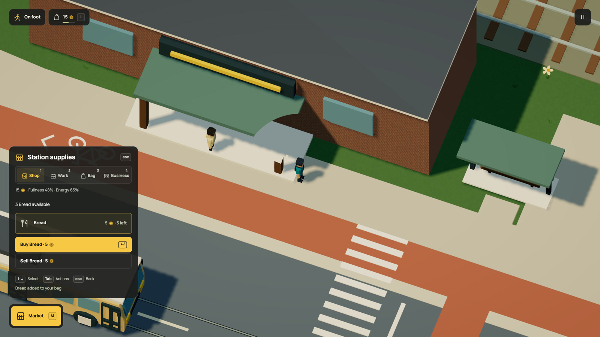

# Earn lunch, then bring more bread

The office clerk now needs food too. They earn wages upstairs in Lantern
Exchange, buy bread at Station supplies, walk home and eat on Copper Court's
bench. You use the same shop, money, food and seat rules.



[HD video](../media/stationfood.mp4) · [GIF](../media/stationfood.gif) ·
[Complete runnable office with meals](../examples/service-office-meals.dream)

The station shop already existed. It now sells a loaf for five coins. It starts
with four loaves and can hold eight. Those are explicit finite supplies, with no
new people, geometry, goods or money. The existing depot owner keeps the business.

## A wage has somewhere to go

The clerk starts with no money. Work pays from the office treasury; buying bread
moves five earned coins into the station shop. The clerk then walks to a free
home bench slot and eats their own loaf. Fullness improves through the ordinary
food action. Travel and waiting earn nothing.

The same seat can be used by the player. An occupied slot leads to another free
one; broken or unreachable furniture leaves a standing meal with food already
purchased. Losing a shelf unit to another customer before arrival sends the
clerk home without a refund or a free loaf. Counter hours still apply, so a late
arrival can mean returning empty-handed and trying another day.

A goods-free service operator with explicit building premises can compose a
meal plan with its own service work, rest and attendance. A stocked vendor still
keeps its existing staffing restrictions. Automatic shopping, shifts, repairs
and courier work do not become extra competing clerk controllers.

## Sales pay for a real delivery

The existing porter can bring two bakery loaves to the station. The receiving
shop reserves two coins for the bread and three for the courier's wage. One
five-coin customer purchase can fund that order. No money is charged twice,
sealed cargo cannot be eaten or sold, and the wage arrives only after handoff.

Station restocking comes before another school order when eligible, after the
porter's existing hardware job. Empty funds, a full shelf, busy cargo capacity,
closed counters and blocked paths still matter. The bakery's existing recipes
and finite flour supply provide replacement bread; there is no automatic stock
creation.

## Floors belong to the meal too

A named-floor seat needs its enclosing building in the meal's walking grounds.
The engine now preserves supported XYZ paths and checks full-height arrival.
Seat approaches, walking positions and captured homes retain their elevation
through format-19 / simulation-58 saves. A forged floor height is rejected.
The model declares floors and furniture; it does not write NPC paths or clocks.

Compile the complete example with:

```sh
node scripts/dream.mjs check docs/examples/service-office-meals.dream --modules src/scene/world
```

The example composes a service office and a nearby food shop. It uses the same
work, meal, price and seating declarations as the city, with a shorter street.
[Office rules](office-work.md) · [Meal rules](commerce.md#customers-with-somewhere-to-go)

## Coming back

The r117 upgrade validates the exact r116 world and save first. It adds four
station loaves and zero delivery counters, retaining all older money, stock,
claims, tasks, needs, poses, journeys and clocks. Existing loaves are not moved
or copied. The earlier unpaid clerk relocation remains a physical journey, and
the clerk still has to earn the money for food. Original slots remain intact.
[Runtime and save evidence](../evidence/office-food/verification.md).

Office checks now renew six shared tasks every 600 simulation seconds; wages
still need real office funds. [Recurring work](service-work.md#work-comes-back). Broader paid demand,
additional food shops, cooking tools, table service and richer diets remain
unfinished. This is a working mock routine, not a nutrition model or a complete
business simulation.
