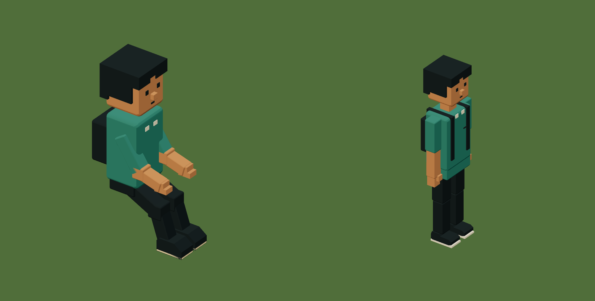

# People, clothes and connected parts

Build a body once, then dress it in components. A coat moves with the chest. A
bag moves with the hand carrying it. Hair, glasses and a hat belong to the head's
frame. The engine owns walking, running, swimming and sports poses.


The [complete example](../examples/city-person.dream) is the live city's character
library: twelve templates with short and long hair, curls, ponytails, facial hair,
glasses, uniforms, coats, aprons, skirts, hoodies, backpacks and carried items.
These are handmade voxel assemblies. No model call or imported character pack is
involved.

## Start with the anatomy

Every moving person binds the same twelve bones: pelvis/root, spine, and paired
shoulder/elbow and hip/knee/ankle chains. Each segment keeps its length while the
engine bends the joints. The [small rig example](../examples/humanoid.dream)
shows the hierarchy; [humanoid motion](behavior.md#humanoid-motion) explains the
runtime poses and their limits.

The live `civic_person` component takes three numeric arguments and five material
arguments. Eight names is the combined limit. The numeric flags choose athletic
clothing, long sleeves and a backpack. Materials choose the shirt, complexion,
hands or gloves, trousers and shoes. A separate face component is shared with
the seated passenger. Both forms keep their independent measured size.

## Attach another component to a bone

This fragment goes inside an object, after its anatomy has been declared or
expanded with `use`:

```dream
mount head(bone=spine){
  use hair(component=ponytail,materials=[hair_black]);
  use glasses(component=glasses);
}
mount clothing(bone=root){
  use skirt(component=skirt,materials=[dark]);
}
mount book(bone=left_elbow){
  use book(component=book,materials=[rust]);
}
```

`mount` starts its block in the selected bone's local frame. Its ID keeps expanded
part identities stable. It creates no joint and adds no animation clock. Declare
the anatomy first: a missing, ambiguous or later bone produces a field-specific
`E_REFERENCE` diagnostic. A mount belongs at the object root and cannot target a
bone in another object. Add a `group` inside it for a local offset or rotation.

All mounted geometry still counts toward the object's 32 parts and twelve joints,
the normal depth limits and the complete project's expansion budget. Numeric
and material bindings keep their [existing lexical scope](objects.md#reuse-a-shape-without-copying-it).
A hat cannot raise a geometry limit by being reusable.

## Keep clothing and physical space separate

`measure` resolves the whole rest-pose height. The body remains the physical
cylinder; clothing does not create a contact for every sleeve or button.
Optional `body(clearance=14)` reserves at least that local radius when furnishing
streets. It must be 4..128 and at least the body's radius. A larger visible
assembly still needs its full space. This affects placement, not collision,
render culling or how large the person looks.

The city keeps the previous furnishing reservation while replacing its clothing,
so the new variants do not shuffle existing people around the pavement. The
registered r71 upgrade also preserves saved lives and rebases derived walking
portals. [Save compatibility](../persistence.md#character-wardrobe-r71).



## Check the construction in motion

Inspect front, right, back and left. Check hands against sleeves, hats against
hair, shoes against ankles, and carried items against their grip. Then inspect
walking, running, sitting and swimming. Clothing is rigid geometry attached to
bones; there is no cloth simulation or character editor yet.

The live templates have 27..32 parts each. Existing people and shared sports
squads use their current owners and budgets. Ambient walkers remain instanced;
adding an outfit does not add a per-person CPU rig. The seated passenger remains
a static pose inside the occupied vehicle.

[Compile the character library](../examples/city-person.dream) ·
[Construction and persistence checks](../evidence/character-wardrobe/verification.md)
