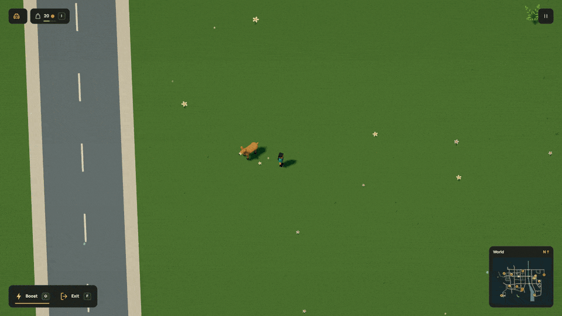

# Put things where they belong

[Dream docs](../README.md) / Populations

A street needs lighting along its length. A school needs bicycle parking beside its entrance. Birds need habitats across the city. Dream can describe those relationships once, then expand them against the complete world.


[Inspect the eight new street assemblies](../media/street-assets.jpg).

## Start with a network

Author the streets, crossings, buildings and entrance paths first. `furnish` refers to those IDs instead of scattering coordinates over the map. It runs after includes are linked and keeps candidates clear of the accepted network, water and existing objects.

```dream
// Fragment: these IDs refer to objects, streets and sites in the linked world.
furnish avenue_lights(objects=[avenue_lamp],streets=[market_avenue],spacing=340,setback=2,seed=41,facing=street);
furnish school_parking(objects=[bicycle],sites=[access_garden_school],spacing=26,setback=4,count=6,seed=82,paving=#aaa99f,role=controllable);
```

Street spacing follows distance along the authored polyline. Offset includes the carriageway, cycle track, sidewalk and full visual radius. Destination rows follow the entrance side of their named street, with gaps around the access path. Optional paving connects parking to the pavement. Existing controllable vehicles reserve extra maneuvering space.

The seed chooses among declared templates and varies longitudinal spacing when `jitter` is set. It does not invent arbitrary scale changes. Put willows near water, neighborhood lanterns by houses and taller lights on avenues by choosing those templates and targets explicitly.

Candidates that cannot fit are skipped. A rule can emit nothing, so compile the world and inspect counts by rule and district before accepting it. Do not increase the output cap to hide a bad placement rule.

## Make the parked vehicles usable

Use `furnish(...,role=controllable)` for available parking. Every template needs an explicit `rideable` control profile. The compiler retains its rolling mechanisms and marks each generated placement `parked=true`. Default prop furnishing cannot be boarded. Static whole-object break/topple props may use `world(...,damage_pool=true)`; their intact models remain instances and damage stays per placement. See [pooled destruction](rules.md#streetlights-and-streamed-destruction). The renderer instances unoccupied models and activates one full rig when you board; it does not spend one live actor slot per parked bicycle.

Dormant parking supports cars, bicycles, skateboards and scooters. Boats and planes keep ordinary resident controllable placements with their water/air support. There are at most 256 dormant vehicles, with one reserved occupied rig inside the existing 24-assembly cap. Their physical bodies, moved positions and ownership stay in simulation when rendering unloads. Walkers yield to moved vehicles on their paths. This does not add autonomous parking or vehicle damage. [Complete two-bicycle example](../examples/parked-vehicles.dream).

The live mock has 48 usable parked bicycles, 25 scooters, 14 cars/vans, two pickups and two parcel trucks at destinations, plus the original controllable rides. The market scooter uses WASD and a press of Space to jump.

Compile the complete parking example:

```dream
dream 2;
material teal(style=toon,colors=[#448b87,#448b87]);
material rubber(style=toon,colors=[#273239,#273239]);
object bicycle(label="Parked bicycle"){
  measure(kind=bicycle,axis=x,meters=1.8);
  body(interaction=solid,radius=8,height=16);
  rideable(at=[-2,12,0],control=bicycle);
  repeat wheels(index=i,count=2){
    part tire(shape=torus,material=rubber,at=[i*16-8,4,0],size=[8,8,1.2],motion=roll(axis=z,radius=4),rot_deg=[0,180,0]);
  }
  beam frame(shape=cylinder,material=teal,from=[-8,4,0],to=[6,12,0],width=1,depth=1);
  beam fork(shape=cylinder,material=teal,from=[6,14,0],to=[8,4,0],width=1,depth=1);
  beam seatpost(shape=cylinder,material=teal,from=[-2,7,0],to=[-2,12,0],width=1,depth=1);
  part seat(shape=box,material=rubber,at=[-2,12,0],size=[4,1,2]);
  part handlebar(shape=box,material=rubber,at=[6,14,0],size=[1,1,7]);
}
place first(object=bicycle,at=[300,400],role=controllable,parked=true);
place second(object=bicycle,at=[350,400],role=controllable,parked=true);
```

## Give residents and ground wildlife a place


The city has 141 people. Of those, 129 walk around the connected pavement, while twelve keep their existing NPC activities, greetings and commutes. The 60 ground animals and birds now roam their habitats and flee when you approach. Dogs and cats use neighborhood green areas; deer, hares and foxes use woodland; sparrows hop around gardens and park edges.


```dream
// Fragment: explorer is a rigged decor person; avenue is a connected street.
furnish neighbors(objects=[explorer],streets=[avenue],spacing=160,setback=0,seed=31,on=sidewalk,motion=walk(speed=14,wait_s=1));
place garden_hare(object=hare,at=[2400,2100],role=ambient,motion=roam(radius=90,speed=5,alert=70,flee_speed=30,recover_s=2,gait=hop));
```

`walk` uses a cached graph derived from accepted sidewalks, entrance paths, explicit walkable surfaces and zebras. Pedestrians choose connected segments, pause briefly at their ends and wait for the swept space of approaching vehicles. They never invent a straight shortcut across a carriageway. `speed` is 4–24 world units per second and `wait_s` is 0–5, default 1.

`roam` stays within `radius` of the authored home. Animals avoid water, roads, reserved grounds, solids and world edges. A player within `alert` triggers flight at `flee_speed`; after separation, `recover_s` settles them back to roaming. Height matters, so a high aircraft does not frighten everything underneath it. Hares and sparrows use `gait=hop`; quadrupeds use authored distance-driven stride joints. If no safe direction fits, the animal waits rather than jumping through an obstacle.

Ambient walkers also give each other room. They choose a short passing step,
slow down or back away while their complete rest footprints stay on accepted
pavement. Stable placement IDs decide who may yield. The rule also separates
people that already overlap in an older save, without moving them instantly.
A narrow bottleneck may still make people wait or back away. This applies to
ambient walkers; it does not make animals or individual decor NPCs physical crowd
obstacles.




These instances have explicit `role=ambient`, or acquire it from `furnish(...,motion=...)`. They are cosmetic populations, separate from general NPC programs, seats and physical contacts. Their validated rig and full voxel geometry are shared in GPU instances. Pure movement runs at 20 Hz with interpolated rendering. Animal `stride` joints follow interpolated travel in local units, independently of timed head or wing swings. A common stride length also paces an existing hop. This uses the existing three animal instance floats; saved distances remain unchanged. All 189 members remain resident; frustum culling checks both the camera and shadow view. Walking members share the player’s terrain-aware stance anchors. Returning feet sample support at most 20 Hz; planted feet keep their world height and normal until release. Color and shadow passes use the same packed contacts, without another attribute slot or rig. The cap is 192 ambient members and 8,192 cached walking nodes. The existing NPC, route, vehicle and CPU live-rig limits stay unchanged.

Pause freezes the population clock. R preserves it; Start over restores its seed and home poses. Reduced motion rests limb and hopping animation. This is bounded walking and avoidance, without pushing, general crowd physics, traffic signals, full animal intelligence or ecological simulation. Use a full `role=npc` program when an individual needs custom states or a transit route.

`motion` cannot combine with `pose=rest`, routes, behavior programs, seats, contacts, foundations, impacts, emitters, lamps, part clocks, proximity or rolling joints. Swing and distance-driven stride joints are permitted. Walking requires the complete measured humanoid rig. [Complete runnable moving population](../examples/moving-population.dream) · [HD pedestrians](../media/pedestrians.mp4) · [HD wildlife](../media/wildlife.mp4).

`pose=rest` remains available for deliberately passive props, preserving every part, material and rest transform. It requires explicit prop ownership on `place`. `on=sidewalk` fits the complete radius on the outer paving, leaves an inner walking corridor and reserves crossings and entrances. The default `on=verge` places objects beyond the pavement. [Passive authoring example](../examples/resting-population.dream).


## Give birds room to fly

```dream
// Fragment: pigeon is a passive decor assembly in this file or an asset import.
flock market_birds(object=pigeon,at=[6400,4400],radius=[900,850],count=16,altitude=65,speed=32,seed=101,flap_hz=3.2,flap_deg=18);
```

Flocks share geometry and fixed instance buffers. Flight and wing flex run in the color and shadow shaders; no CPU transform or NPC state is created for each bird. The envelope clears nearby roofs and terrain. Reduced motion freezes the birds, and their complete habitat remains resident.

The mock distributes 256 birds through 16 city, river, lake, woodland and meadow habitats. These are decorative flight populations. The separate route deer pauses and watches a nearby player before resuming its route; the high route gull retains its flight behavior. A reactive bird would need an explicit bounded actor rather than a flock member.

## Transport serves places

The live city has four road cars with three silhouettes, five buses across neighborhood, airport and eastbank medical services, a tram and a regional railcar. Their routes use the connected network and named stops. Passenger-only seats let F board those public services while the engine keeps their schedule. Inputs do not take over a passenger vehicle. The three explicit scooters and all twenty-two generated parked scooters use the same direct controls. Available parking uses `furnish(...,role=controllable)`; default prop furnishing remains scenery.

Use `place.phase_s` to stagger the entire service clock, including waits. A distance offset is useful for carriage spacing but can stack buses at stops. Neither setting supplies traffic signals, overtaking or avoidance; route authoring still owns safe scheduling.

Underground metro and subway service is still pending. It needs connected entrances, platforms, tunnels, vertical clearance, navigation and boarding support. Hiding a railcar under the terrain would not provide that contract.

[Complete runnable neighborhood](../examples/populated-neighborhood.dream) · [Fields and bounds](reference.md#contextual-populations) · [Live population rules](../../src/scene/world/street_life.dream)


Garden park adds eight explicit walking placements using the existing humanoid
assets and `motion=walk(...)`, and six dormant bikes/scooters beside its entrances.
Its [walkable paths](paths.md) join the city pavement. These visitors use the same
resident population clock, GPU transforms, crossing waits and saved movement state.
