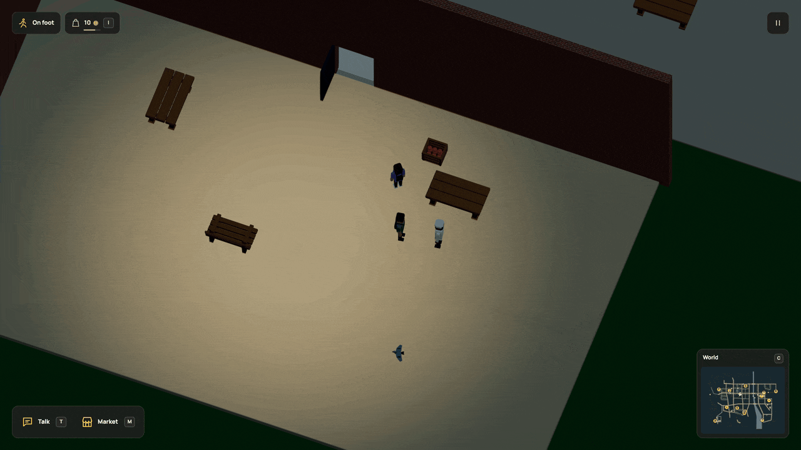

# Learn a recipe over lunch

Sharing a meal now changes what you can do. Spend a break with the baker and the
larger bread batch becomes available, even if you have never baked before. You
can still earn it by completing three ordinary batches. Both routes use the same
ingredients, equipment, capacity and finite wage.



[Watch in HD](../media/sharedrecipe.mp4) · [Still](../media/sharedrecipe.jpg) · [Runnable world](../examples/shared-recipe.dream) · [Verification](../evidence/social-qualifications/verification.md)

## Give a shared activity a consequence

These declarations come from the complete example:

```dream
milestone practiced_baker(label="Bake bread batches",kind=work,task=bake,count=3);
 milestone table_friend(label="Share bread with the baker",kind=shared_meal,task=baker,count=1);
 work large_bake(label="Bake a larger batch",market=corner,input=flour,take=2,output=bread,make=5,seconds=4,pay=5,effort=12,capacity=1,target=12,requires_any=[practiced_baker,table_friend]);
```

A `shared_meal` milestone uses an NPC **account ID** in `task`, not its object,
label or market. That account needs a social plan. Existing completed shared
meals provide the count; there is no separate friendship score to keep in sync.
The player and the named NPC both qualify. Another resident cannot use someone
else's meals or the bakery's global production count.

`requires_any` accepts any one of 1–4 unique milestone IDs. It excludes the
single `requires` field. The compiler checks references and rejects cycles
through every prerequisite branch, including a cyclic branch beside a valid
social alternative. Existing sources using `requires` keep their previous rule.

## Play it in the city

1. Buy two loaves while the bakery is open and meet the baker with **T**.
2. After 22:00, sit at the hall bench with **F** and invite them with **Y**, or
   accept their paid invitation. Stay until the meal finishes.
3. Return when the counter opens at 06:00. Open the nearby panel with **M**,
   choose Work with **2**, and select the larger batch with the arrow keys.
4. Close the panel with **Esc** and walk to the [workstation ring](workstations.md) at the east end of the prep table. **H** starts the selected job. Keep the equipment intact and stay at the station.

The Work view shows both alternatives while locked and the fulfilled one once
available. A cancelled or interrupted meal refunds its donor and earns no shared
history. A completed meal consumes two actual portions and feeds both people;
it grants no wage, goods or baking practice. Only the later completed job pays.

The current larger batch takes two flour, makes five bread and pays five coins.
Its ordinary three-batch qualification remains available. The live commuter can also qualify through the [named baker/commuter meal](companion-recipes.md). The standalone example also assigns
the larger job to the meal's NPC participant, demonstrating the same eligibility
and finite transaction for both sides.

## Keep the memory and the commitment

Completed history survives travel, streaming, R and reload. Start over clears it.
The existing saved shared-meal claim also survives an upgrade: it earns nothing
until its remaining eating time completes. A qualified active job retains its
reserved input, wage, deadline and progress. Original source slots remain intact.
[Save rules](../persistence.md#shared-recipes-r102).

The r102 city recording is historical for work placement; use the [current station recording](workstations.md) for physical work. It uses ordinary fixed ticks for purchases, meeting, walking,
sharing and the return to work. The export is 30 rendered frames per simulation
second, with no interpolation; it is not a live performance measurement.

This connects remembered time together to one authored work opportunity. It is
not a general relationship, dating, teaching or emotional model. Residents can also [share meals](companions.md) and earn [explicit pair qualifications](companion-recipes.md). Muse prompting stays deferred and mocked.
