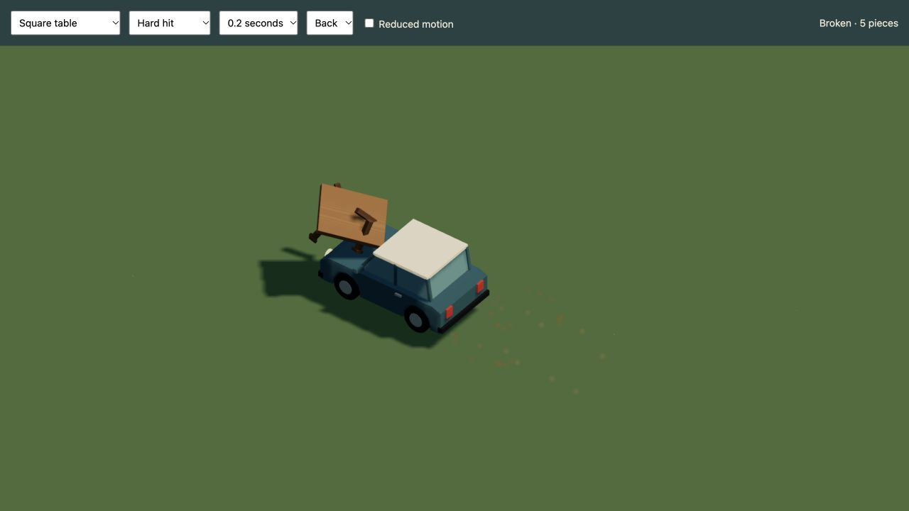
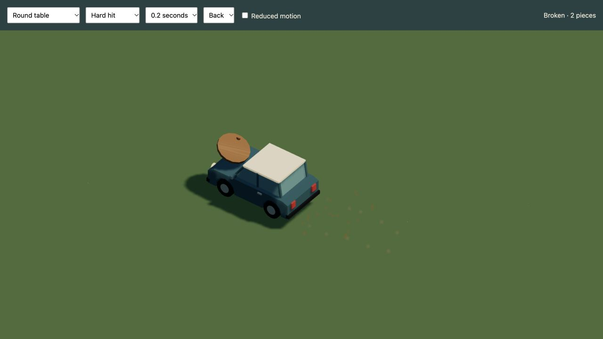
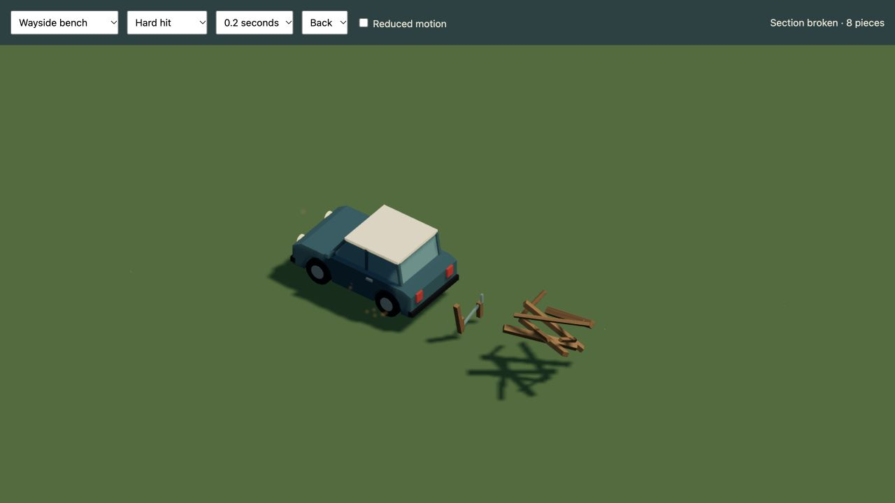
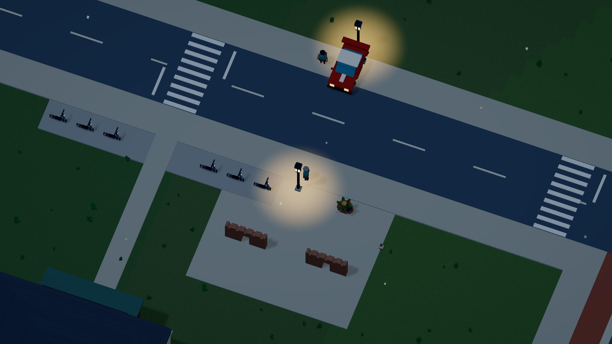
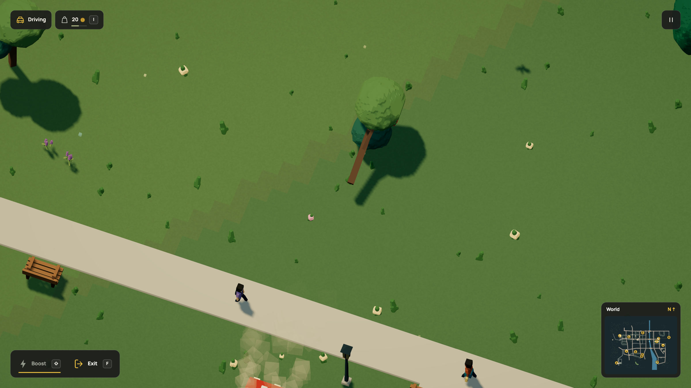

# One rule, every table

[Docs](../README.md) / Shared rules

If a wooden table breaks when a car hits it, the next table should behave the
same way. Its shape, size and location can change. The rule stays shared.

```dream
rule wooden_tables(kind=table,mode=break(speed=90,scatter=62,lift=100,spin=4,lifetime=6,pattern=splinter));
```

Put this in the entry file. Every object with `measure(kind=table,...)` receives
that impact behavior, including objects imported from other modules. Change the
threshold or release motion once and recompile the whole world.

The compiler applies the rule before validating each assembly. It replaces
matching per-object impact settings, so an imported variant cannot quietly
keep a different threshold or become indestructible. The serialized scene keeps
the rules too; validation rejects a placement whose behavior contradicts them.





Both examples use the same threshold and splinter motion. The square table has
a top and four legs; the round table has a top and a pedestal. Their fragment
construction stays in their own object definitions. These are native fixed-step
review captures with the measured town car.

Copy the complete [two-table example](../examples/interaction-rules.dream).
Neither table needs its own `impact` declaration. A gentle touch leaves both
intact; sufficient closing speed breaks the table that was hit. Damage belongs
to each placement, so hitting one does not destroy the other. R preserves
damage and Start over restores the world.

## Benches and retained supports

The live world declares a second rule for `kind=bench`:

```dream
rule wooden_benches(kind=bench,mode=break(speed=95,scatter=65,lift=65,spin=4,lifetime=6,pattern=splinter));
```

For assemblies with existing break zones, a `break` rule supplies the parameters
to every zone. The retained structure keeps its own contacts. The older Wayside
bench now releases eight wooden board/armrest groups, with bolts travelling
with their back boards. Its foundation and supports remain. The slatted park
bench keeps its existing seven-piece construction under the same bench rule.



## The contract

- Selectors use the existing `measure.kind` category. Labels, coordinates and
  random seeds do not select physics. Renaming a table does not change its rule.
- At most 16 rules, with one owner per category. Rules belong in the entry
  file; included modules cannot override them.
- Modes are the existing bounded `break(...)`, `topple(...)` and `bounce(...)`
  constructors. For an existing break zone, only a `break` rule is compatible.
- Bodies, foundations, seats, animation and fragment grouping must remain
  compatible with the resulting impact. The compiler rejects incompatible
  models instead of discarding their construction.
- Eight fragments per assembly remain. Legacy worlds retain 24 reactive objects
  and 128 potential fragments; pooled worlds use the separate bounds below.
  A rule never bypasses the chosen world policy.

The live world currently shares rules for tables, benches, lamps and trees. Other categories
retain their authored behaviors until a rule is declared for them. Legacy
objects without a semantic category are not guessed from their names.
`kind=custom` is a single category, so a custom rule would affect every custom
object; it cannot distinguish bread, rocks and balls. More specific semantic
categories can be added as the language grows.

This is a bounded interaction policy, not a general scripting language or a
materials/structural solver. The engine still owns contacts and execution.
Mock-only. [Checks and media audit](../evidence/interaction-rules/verification.md).


## Streetlights and streamed destruction

Drive into a streetlight hard enough and the whole lamp falls about its base.
Its ground light pool turns off. The damage stays after the fallen piece fades,
after you drive away and unload the district, and after saving or reloading.
All 416 lamps use their shared category rule, including both lantern and avenue
models. A gentle touch still leaves them intact.


[Watch the impact in HD](../media/lamps.mp4) · [Animated impact](../media/lamps.gif)

Enable pooled static destruction in the world declaration and define the rule:

```dream
rule street_lamps(kind=lamp,mode=topple(speed=95,duration=1,lifetime=8));
```

Add `damage_pool=true` to `world(...)`. Declare `measure(kind=lamp,axis=y,meters=3.8)`
on the model. Lamp height is 1..15 metres. Dream 2 automatically groups an
otherwise ungrouped topple assembly into one rigid fragment. Authored fragment
blocks still need exactly one group. An optional single centered `contact`
keeps a narrow pole's real collision radius; body bounds stay unchanged.
The rigid fall uses the root body's radius for its hinge envelope, so keep that
envelope wide enough for the model's foot.

Intact objects remain streamed instances. Their persistent damage records live
in simulation, alongside their existing cylinder contacts. There is no scene
node or physics body per voxel. On impact the renderer borrows fragment meshes
from a bounded template cache. It releases expired transforms and evicts unused
geometry after ten simulation seconds or when another template needs space.

| Owner | Bound |
| --- | --- |
| Accepted world | 4,096 total placements and 128 pooled template records, within existing project limits |
| Resident impacts | 24 objects and 128 potential fragments; bounce props and partial building zones stay resident |
| Active destruction | 24 object assemblies and 128 debris pieces |
| Fragment mesh cache | 24 templates and 128 fragment meshes |
| Each template | At most eight fragments |

When active capacity fills, the oldest cosmetic debris yields to the new impact.
The damaged object stays broken. Changing the camera or unloading render tiles
cannot restore it. Pause freezes simulation and cache time; R preserves damage;
Start over restores the authored world. Reduced motion applies damage without
flying pieces. Lamps retain their authored material paint/emission on fragments;
their declared surface pool is off. This is not an electrical network simulation.

The caretaker can repair all 413 lamps beside the declared service streets and grounds
with the same finite kit and four-credit wage used for furniture. The full model,
collision and light pool return together. The service covers 449 targets in total,
including furniture, wall sections, planted street tubs and produce stalls.
[Street verges](commerce.md#street-verges) connect nearby work to sidewalks and
crossings. Neither the renderer nor a category rule grants free repairs.



[Watch the repair in HD](../media/lamprepair.mp4) · [Animated repair](../media/lamprepair.gif)

[Complete streetlight repair world](../examples/streetlight-repairs.dream).
Check it with `npm run -s dream -- check docs/examples/streetlight-repairs.dream`.
It uses two connected grounds and real kit/wage reservations. The live world's
longer journey uses the accepted sidewalks and crossings.
[Street-verge example](../examples/street-verge-repairs.dream) adds a lamp outside
the sidewalk without inventing paving. [Watch that repair](../media/streetrepair.mp4).

[Streetlight verification and media audit](../evidence/streetlights/verification.md).


## Trees share one fall policy

The live entry file applies one rule to all 348 measured trees:

```dream
rule living_trees(kind=tree,mode=topple(speed=110,duration=1.1,lifetime=8));
```

This includes the 342 wind-animated trees. Their crowns keep swaying with the
same phase as the intact object while the trunk and crown fall together. The
compiler permits only part-level sway on pooled static topplers; moving joints,
spin, rolling parts, cloth and animated break zones stay rejected. Instance
geometry stays shared until an actual impact needs a falling piece.



[Impact in HD](../media/treefall.mp4) · [Animated impact](../media/treefall.gif)

The existing caretaker can plant replacements for 106 trees, including all 93
furnished street trees. The remaining 239 trees have no declared recovery service
and remain damaged. Supplies and pay still come from the finite economy.

Whole-tree topple rules feed that finite-sapling planting service. A young
replacement uses its current scale when hit, including its retained debris, and
loses its growth record without refunding its planted input.
[Planting and shared worker policies](growth.md) ·
[Complete wind-tree world](../examples/city-tree-replanting.dream) ·
[Checks and media](../evidence/city-trees/verification.md).
