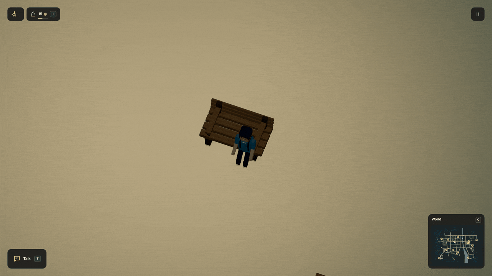

# Take a seat

People now turn, lower into a seat and stand with a short pair of steps. This
works for the player, meal companions, resting residents and ordinary customers.
It uses the same Dream seats and complete humanoid bones already in the world.



[HD recording](../media/seatmotion.mp4) · [Still](../media/seatmotion.jpg) ·
[Runnable seats](../examples/shared-seating.dream) ·
[Checks and limitations](../evidence/seating-motion/verification.md)

## The seat supplies the destination

```dream
seat left(at=[-14,18,12],approach=[-14,48],heading_deg=90);
seat right(at=[14,18,12],approach=[14,48],heading_deg=90);
```

These are the standard bench's existing declarations. `at`, `approach` and
`heading_deg` provide the sitting point, standing approach and final facing.
There is no new animation program or model-generated controller to write.
The [complete example](../examples/shared-seating.dream) compiles with:

```sh
node scripts/dream.mjs check docs/examples/shared-seating.dream
```

The renderer blends position, facing and the rigid body posture over 0.7 seconds.
Feet take staggered steps, retain ground contacts and fit the floor; the pelvis
lowers enough to reach both ankles without stretching a leg. The final contacts
pass back to ordinary walking. Clothes and accessories follow their existing
bones, and the same transforms cast the shadows.
The camera follows that visual handoff while retaining your view angle and zoom.

Pause holds an unfinished transition. Changing your mind can reverse it from its
current pose. Reduced motion, reset, loading a saved pose, jumping, swimming and
large position discontinuities use the immediate supported pose instead. These
visual contacts and offsets are renderer state and are never saved.

## Controls and ownership still respond immediately

**F** claims a free seat or stands through a safe exit. Movement and jumping can
leave it immediately. Damage releases the seat through the existing rules.
The collision body, seat claims, food, work, energy and meal timers stay in the
fixed-step engine; the short visual transition does not delay an action or award
anything. NPC walking journeys and interrupted routines keep their existing
ownership and save behavior.

Vehicle boarding still uses its separate seated passenger model. Hand contact
with an armrest, obstacle-aware footstep planning around furniture and a general
motion-authoring language remain unfinished. The engine retains its existing ground and furniture physics.
