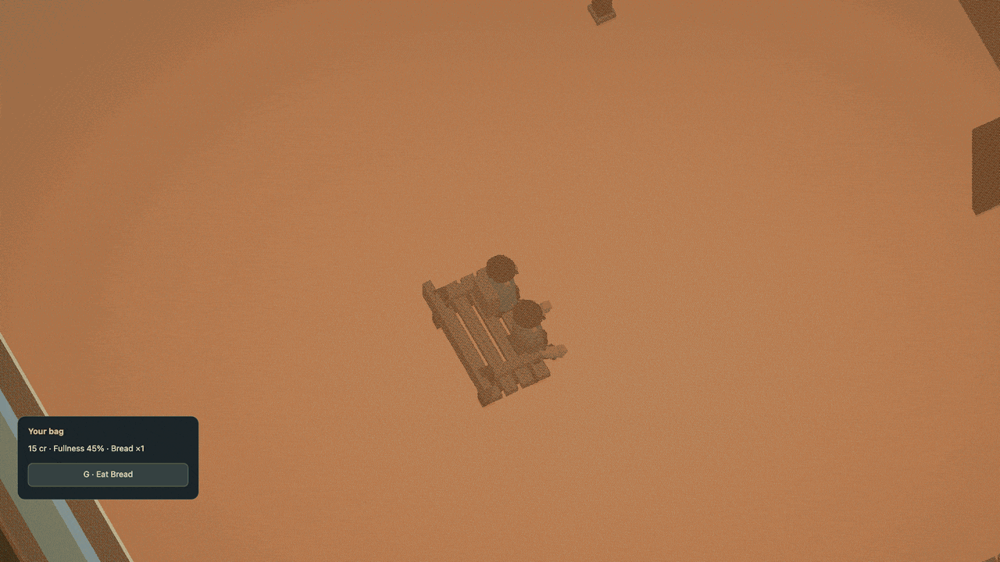

# Take a seat

[Docs](../README.md) / Seating

A bench can be furniture you use. Walk to its front and press **F** to sit. Press
**F** again to stand, or move or jump to leave through a clear exit. **G** eats
food from your bag using the same inventory and fullness rules as standing.
The camera moves closer while seated, retaining your view angle and manual zoom.
The standard bench now spaces its seat centers 84 cm apart for two resident bodies.
Player and resident bodies now use the same [smooth sitting and standing motion](seating-motion.md).



[Watch in HD](../media/seating.mp4) · [Still](../media/seating.jpg) · [Complete runnable Dream world](../examples/shared-seating.dream)

The hall recording shows the earlier meal preference. The current commuter
brings lunch home; the furniture, shared claims and controls work the same way.

## Describe a sitting surface

These declarations live directly inside the live `slatted_bench` object:

```dream
seat left(at=[-14,18,12],approach=[-14,48],heading_deg=90);
seat right(at=[14,18,12],approach=[14,48],heading_deg=90);
```

`at` is the sitting surface in object-local coordinates. `approach` is a point on
the floor in front of that seat. `heading_deg` faces the occupant along local +X
at zero degrees, with the same heading convention as placed objects. Object
rotation and measured scale apply once. The engine fits the existing humanoid's
pelvis and feet; the bench does not resize its occupant.

The bench keeps its existing collision body, seven destruction fragments and
shared `kind=bench` break rule. A broken bench cannot be used. Repairing it makes
the same slots available again.

## Customers use the same seats

The commuter's meal plan lists the home settee first, then the hall bench:

```dream
meal market_break(good=lunch,markets=[market_stall],on=market_hall,grounds=[market_square,oldtown_044,home_entry],eat_s=4,seats=[home_settee,hall_bench]);
```

A hungry customer walks to the vendor and pays through the ordinary transaction.
After buying, they reserve the first reachable free slot in that furniture
preference order, retaining authored slot order inside each piece. They walk
through the actual doorway,
sit for the declared eating duration, consume their owned lunch and return to
their interrupted routine. A player sitting there already owns that slot. A
customer on the way also holds a claim, so another occupant cannot take it.

Busy, broken or unreachable furniture yields to the next preference. Without
an available slot, the customer eats standing with their purchased food. Breaking a reserved
bench releases the claim without refunding, duplicating or losing the food.
There is no seating queue, waiter, restaurant menu or table service yet.

## Bounded and persistent

| Rule | Limit |
| --- | --- |
| Named slots per object | 1–4 |
| Slots in an accepted world | 512 |
| Surface fit tolerance after placement | 0.2 world units (2 cm) |
| Sitting surface above the floor | 3–9 world units |
| Approach-to-seat transfer | 6–40 world units |
| Player walking radius and headroom | 3 and 17.5 world units |
| Height change along the transfer | At most 4 world units per step |
| Furniture placements in one meal plan | 1–4 unique IDs |

A seat needs an upright static solid prop with one body cylinder and no explicit
contacts, foundation, interior, transport seat, moving parts,
surface grounding, break zones or bouncing/toppling impact. Whole-object break is
supported. Complete-world acceptance checks dry approaches and surrounding solids.
The sitting point must lie on furniture geometry, and slot centers and approaches
need six world units of separation. Approaches must lie outside the furniture body. The player must reach the approach without
crossing a wall. Occupants cannot
stand inside a blocked vehicle or another solid; they wait or use a nearby clear
exit. Seated customers need the complete declared humanoid rig.

Seat claims, customer paths and meal timers survive streaming, pause and save/load.
**R** returns the player to the car and preserves the customer's trip and the world.
**Start over** resets them. Reduced motion retains the seated posture without
idle or eating movement. Work, trade, vehicle boarding and sports require standing.

Seats add metadata and one bounded shared claim, with no new physics bodies,
per-cell simulation, NPCs or animated rigs. The current live world has two slots
on the market, civic park, station and school benches, plus the two-cushion home
settee. Meal-trip walkers retain their existing 4-unit walking radius and 18-unit
headroom; their full approach must also clear.
[Compile ordered preferences](../examples/seat-preferences.dream).

[Shared meals](social.md) reserve the other slot for an invited person and record the time you finish together. Leaving early returns the reserved food; ordinary customer meals keep their own claims.

The [school repair connection](commerce.md#school-yard-repairs) now restores that
bench through the same finite caretaker service. Damage releases its claims;
paid restoration returns the same two slots, with no new seat or physics body.
