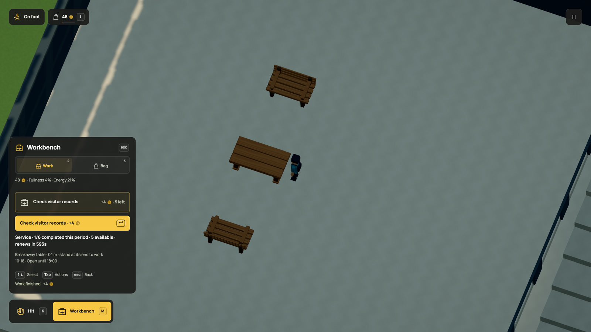

# Work without making another object

Checking stock is useful work even when it doesn't turn flour into bread.
Dream can now describe that as a paid task at an actual workstation. The player
and the resident claim the same limited work, use the same desk and get paid
only after finishing.


[Watch in HD](../media/servicework.mp4) · [GIF](../media/servicework.gif) ·
[Complete runnable Dream world](../examples/service-work.dream)

The live bakery offers three stock checks, each taking four simulation seconds
and paying two coins. They are a shared lifetime quota, so finishing one leaves
two for everyone else. They do not replenish when you leave, reload or press R.
Start over resets the world. Only an explicit recurring rule refills a quota; customer demand is not inferred.

## Declare the task

This declaration is an excerpt from the complete example. Its desk, standing
point, business and worker are declared in that same file.

```dream
work stocktake(label="Check bakery stock",kind=service,market=corner,seconds=2,pay=3,effort=2,capacity=1,target=3,equipment=[prep_table],station=preparation);
```

The example uses two seconds and three coins to keep local checks short. The
live world authors its own duration and pay; the rules are the same.

`kind=service` forbids recipe inputs and outputs. It needs a physical `station`,
matching `equipment` and `capacity=1`. `target` is an integer from 1 to 10,000.
Completed tasks and active reservations share that cap. Recipe jobs still use
stock targets; omitting `kind` preserves their previous behavior.

Starting reserves one task and its wage atomically. Completion spends effort,
pays once and increments personal and shared work history. It creates no goods.
Walking away, cancelling, sitting or breaking the desk releases the reservation
and refunds the wage. The shared guards for money, qualifications, opening hours,
food, energy and station occupancy still apply.

## Work comes back

The records office now offers six shared tasks per 600 simulation seconds.
Its treasury stays finite. You or the clerk can use the available work, and a
later period can supply another task without forgetting what either person earned.
Bakery stock checks retain their lifetime quota.



[HD video](../media/periodwork.mp4) · [GIF](../media/periodwork.gif) ·
[Complete recurring office](../examples/recurring-service.dream).
The clip records the actual player exhausting a period, waiting unpaid and
finishing one renewed task. The long wait happens before the twelve-second clip.

The complete example uses two tasks per minute so the same behavior is quicker
to try. This is its exact work declaration:

```dream
work check_records(label="Check visitor records",kind=service,market=office,seconds=6,pay=4,effort=2,capacity=1,target=2,period_s=60,equipment=[desk],station=records);
```

`period_s` accepts 30..86400 finite simulation seconds and only service work.
Windows start at simulation time zero: a 60-second period covers 0..60, then
60..120. This clock is independent of the visual daylight hour. Omit the field
for the existing lifetime quota. Missed windows do not accumulate extra tasks.

| At a boundary | What happens |
| --- | --- |
| Completed tasks | Only current-window usage returns to zero |
| Unfinished work | Keeps its reserved wage and slot; completion uses the new window |
| Cancellation | Refunds once and releases the slot |
| Lifetime work history | Continues increasing for pay, practice and milestones |
| Treasury, stock and needs | Keep their actual values |

The HUD shows usage, availability and the next renewal. Empty funds, damaged
furniture, occupied stations, opening hours and qualifications can still block
a task. Quota renewal pays nobody. It does not create a visitor queue, business
income or wages the treasury cannot cover.

Pause freezes the period. R, streaming and reload retain it; Start over begins a
new world. A save with unfinished work keeps the claim. The registered r118
upgrade validates r117, retains all old fields and clock, then initializes the new usage from
existing completions, capped at the target. An already exhausted quota stays
exhausted until its next real simulation boundary. No offline catch-up.

Compile the example with:

```sh
node scripts/dream.mjs check docs/examples/recurring-service.dream --modules src/scene/world
```

## Play it

Walk to the bakery preparation table and press M, then choose Work. Select
**Check bakery stock** with the arrow keys and press H. The panel shows the
shared count and how much work remains. You must stay at the supported standing
point. Nearby counter service alone does not start a workstation task.

The commuter's ordered `works` list starts with stocktaking, followed by the
existing baking recipes. It walks to the same desk, waits unpaid when occupied
and draws from the same finite treasury and quota. There are no extra characters
or animation rigs for this task.

A save made during work retains the claim and remaining duration. Restoring the
registered r114 world initializes only zero counters for the new task, preserving
old money, stock, journeys, clocks and jobs. [Save rules](../persistence.md).

## Current limits

This is a bounded service task in the mock world. It does not infer demand,
customer satisfaction, clinical care, lessons or meaningful paperwork from a
label. Goods-free service desks now use empty market blocks, with an optional
explicit building binding. [A working office](office-work.md) separates premises
from its operator home. Quota renewal is explicit and bounded. Customer requests, visitor queues and
service outcomes still need their own authored systems.

Compile the example with:

```sh
node scripts/dream.mjs check docs/examples/service-work.dream
```
