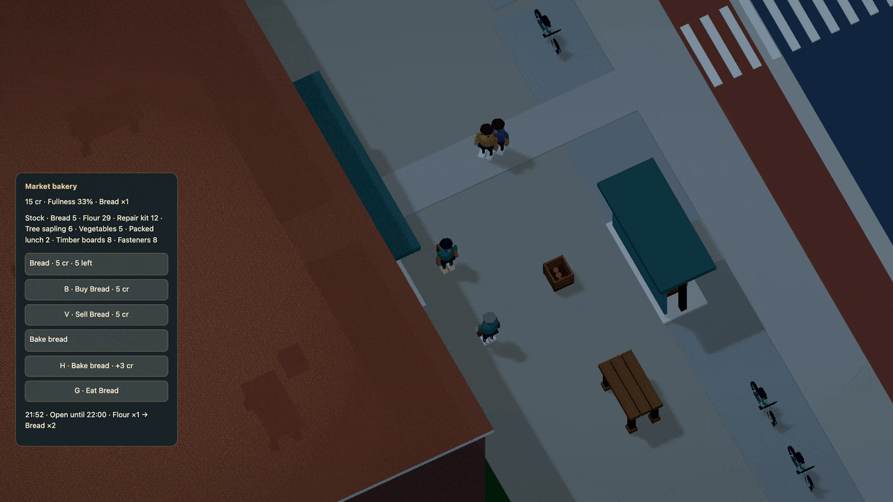

# People leave work

The counter closes. The baker finishes the batch already underway, walks into
the market hall and rests. Before morning service, they walk back. A clock alone
cannot serve a customer: the counter waits if its owner has not arrived.



[HD recording](../media/shifts.mp4) · [Complete runnable world](../examples/staff-shifts.dream)

## Give a shift a destination

Inside `economy()`, connect a named plan to an existing account:

```dream
shift bakery_day(market=corner,rest=[780,740],on=plaza,lead_s=18);
```

The example's baker account has `shift=bakery_day`. Its market declares
`hours=[6,22]`; the depot uses the same mechanism with `hours=[22,6]` for overnight
service. `rest` is a world coordinate, not a new place created by the declaration.
`on` names an existing convex surface or an enterable ground floor. Optional
`grounds` adds up to seven connected convex grounds. Paths can also use accepted
sidewalks and crossings. Walls, water and gaps still matter.

`lead_s` is how many simulation seconds before opening the person starts back.
It defaults to 15, accepts 0–120 and must be shorter than the closed interval.
It does not shorten travel. Set it to zero in the example to see an open counter
wait for its returning owner.

## Attendance changes what you can do

- New trade, production, supplier pickup and delivery handoff require the
  counter to be open and its shifted owner present. Player and NPCs share the check.
- Committed batches finish after closing. Staff finish their own batch before
  leaving; your committed batch can finish while they walk away.
- Couriers waiting for staff keep their cargo and reserved payment. Handoff pays
  once, after service actually becomes available.
- Owned food, cancellations, refunds and local repairs keep their existing rules.
- Resting staff can talk through their existing Dream program and remember a
  meeting. They pause that program while walking and resume it at rest or work.

The live baker rests inside the market hall. The school staff member walks around
the school to its yard. These are local authored routines, not home ownership,
employment contracts, weekly timetables or wages for idle time.

## Keep travel bounded

There are at most eight plans and one assigned account per plan. Staff must be
stationary measured-person decor NPCs with a program. They cannot also own a
route, meal trip, repair duty or courier policy. `shop` and production may coexist;
the assigned jobs and any owned counter must match the shift's market.

Work must start within the counter's reach. Rest must be at least 16 world units
away, dry, clear and reachable in both directions. Paths use the person's actual
body radius and height, rounded upward to a tenth of a world unit, within radius
8 and height 32. No body or model is shrunk to fit. Convex grounds share 4,096 local
samples; the existing 8,192-node, 32,768-link and 128-waypoint bounds still apply.
No actor, rig or physics budgets increase.

Run:

```sh
npm run -s dream -- check docs/examples/staff-shifts.dream
```

Invalid hours, unknown grounds, incompatible account policies, obstructed rest
points and disconnected paths fail complete-world acceptance. Splitting an
L-shaped path into connected convex pieces makes its actual clearance explicit.

## Return to the same day

Outward travel, rest, return, route retries, distance and conversation memory stay
in simulation state. Walking away, chunk unloading, R and saving do not reset
them. Pause freezes them; Start over starts a new world. Blocked journeys wait and
replan through the same contacts rather than teleporting.

Save format 13 / simulation 20 validates the registered r62 world before retaining
every saved field and both clocks. The original slot remains. The school path's
two sections retain its old paved footprint, and the teacher's work anchor is
centered on the existing entrance. [Persistence](../persistence.md) ·
[Verification and limits](../evidence/staff-shifts/verification.md).

Off-duty staff can now join [shared meals](social.md) at their break destinations. Current saves use format 14 / simulation 21; the shift upgrade above remains in the preserved migration chain.
