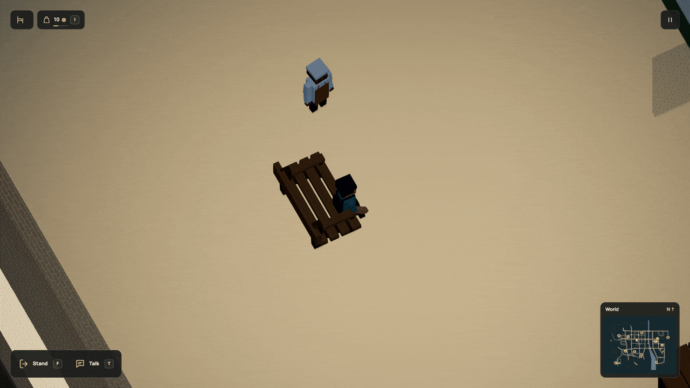

# Have a meal together

Bring two portions, find a seat and invite someone to join you. They walk over,
eat with you and go back to their day. Meet again later and they remember it.
You can supply the food, or accept their invitation. Either way, the portions
come from someone’s bag and were paid for through the ordinary economy.



[Watch in HD](../media/shared.mp4) · [Still](../media/shared.jpg) · [Complete runnable world](../examples/shared-meal.dream)

## Try it in the city

Buy two loaves at the market before 22:00. Talk to the vendor with **T**.
After closing, follow them into the hall and use **F** at the bench. If they
have two loaves, they may offer to host. **Y** accepts and **X** declines. With no
pending offer, **Y** invites them to share your own bread. Stay seated while they come over and through the meal.
The same activity works with the school staff at the school-yard bench after
the canteen closes at 17:00. They have their own schedule and memory.

The button explains missing food, a first meeting or unavailable seating. People
can decline when full, busy, due back at work or wanting time before another
meal. An invitation is not permission to interrupt their job.

## Author the activity

Inside `economy()`, name food, existing paired furniture and connected grounds:

```dream
social bread_break(
  good=bread,seats=[lunch_bench],on=plaza,
  eat_s=8,cooldown_s=600,max_fullness=80
);
```

The example's `regular` account declares `social=bread_break`. Its person has a
complete humanoid rig and an existing stationary program. The plan creates no
bench, food, path or character. Complete-world acceptance checks outward and
return walking paths using the person's actual body.

| Field | Bounds |
| --- | --- |
| `good` | Existing good with a positive food value |
| `seats` | 1–4 unique furniture placement IDs, at least two slots on each |
| `on`, `grounds` | One convex ground and up to seven extra connected grounds |
| `eat_s` | 1–12 simulation seconds |
| `cooldown_s` | 30–86,400 seconds between completed meals and between NPC offers; default 600 |
| `max_fullness` | 0–100; default 80. A completely full person always declines |
| `markets` | Optional 1–4 unique existing counters with a priced lot for this food |

There are eight plans at most. NPCs need a stationary measured-person decor body
within radius 8 and height 32, with all twelve humanoid bones. Existing actor,
rig, navigation and geometry limits remain. Matching staff/meal walking areas
share prepared data; nobody gets a controller or physics body for a plate.

## Let them host

Add an ordered supply list to a social plan. This fragment is from the
[complete hosted-meal world](../examples/hosted-meal.dream):

```dream
social bread_break(
  good=bread,seats=[lunch_bench],on=plaza,
  eat_s=8,cooldown_s=600,max_fullness=80,markets=[corner]
);
```

The NPC needs capacity for two portions and an existing counter within reach of
its authored work placement. It buys only from a reachable, open and staffed
counter, using its own credits. It checks the entire needed purchase before
spending, including stock, capacity and treasury headroom. There is no added
shopping journey. Omitting `markets` keeps the existing player-hosted activity.

A known NPC can offer while you are seated within 80 units, with sight, an
adjacent free seat and a clear outward/return path. Full, busy and soon-due
staff do not offer. There is one pending invitation for the whole world, lasting
30 simulation seconds. **Y** accepts, **X** declines; the two keyboard-focusable
buttons offer the same actions without moving your focus when they appear.
Pause freezes the deadline.

While waiting, the portions remain in the NPC’s bag and its seat is reserved.
Acceptance moves them into the existing two-portion escrow. Refusal or expiry
releases the seat and leaves the purchase with the NPC. It can eat that food
later. Repeated refusals cannot trigger repeated offers inside `cooldown_s`.


[HD recording](../media/hosted.mp4) · [Still](../media/hosted.jpg)

In a fresh city, the baker can earn the cost through packing lunch and baking.
The lunch refill target is three; initial wallets and supplies are unchanged.
An existing save keeps its actual funds and stock, so an offer depends on what
that person can afford, rather than a guaranteed free meal. School staff use
their own account, supply and schedule under the same rules.

## Remember time spent together

```dream
on meal_memory(
  event=interact,to=remembered,
  radius=55,shared_meals=1
);
```

`shared_meals` is an integer from 1 to one billion and only works on `interact`.
It checks completed meals with this particular person. Every NPC using the
program must have a social plan. Put the guarded response before its fallback.
The example has a further response after three meals; repeated talk presses
cannot earn it. This is shared-activity history, without a general relationship
score, dating or simulated emotional validity.

## Leave, break the bench, come back

An accepted invitation reserves two real portions and the payer’s bag space. Food is consumed
once when the whole meal finishes, and restores both participants' fullness.
Stand, move, jump, press **Y** to end it or use **R**, and unfinished portions
return once to the player or NPC who supplied them. The person walks home before resuming their shift or program.
A broken bench follows the same cancellation rule. A blocked return waits for
clearance. The school bench is destructible. The [caretaker service](commerce.md#school-yard-repairs)
now follows the school access paths to restore it with a paid kit; both seats
become usable again after the space is clear.

Pause freezes time. Streaming keeps the activity resident. Save/load preserves
claims, paths, eating time, returning poses and completed history. **R** keeps
completed history while ending the present meal; **Start over** resets it.
Format 17 / simulation 30 keeps the exact registered r71 state and all earlier
upgrades. Old slots remain available; no food, money, completed work or history
is reset. The pending deadline, last NPC offer and accepted meal’s donor also
persist. Nothing progresses while the page is closed.

NPCs do not invite each other. There is no queue, waiter, table service,
physical food prop, general relationship score or provider call.
