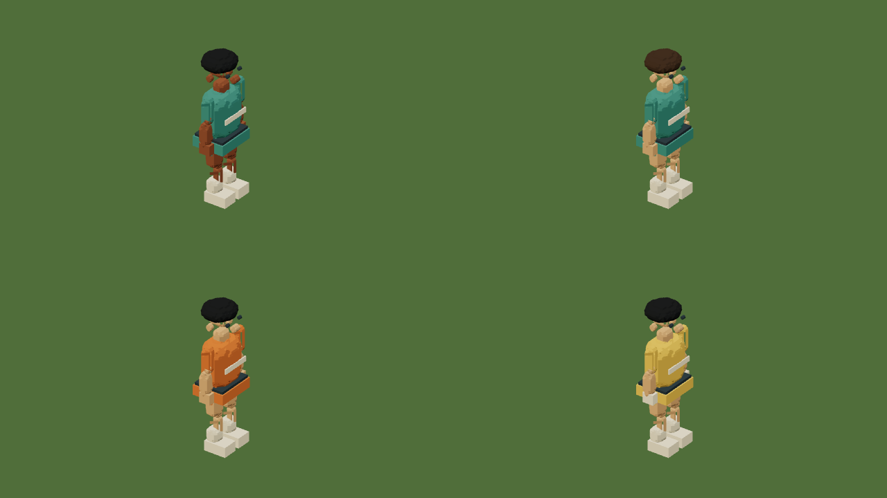

# Get out and play

[Docs](../README.md) / Sports

Drive to **F** or **B** on the map, get out with F and walk onto the ground.
Press **N** to join six-a-side: you and five teammates against six opponents.
Approach the ball to start dribbling. The camera moves closer and follows the
player and ball, widening when a shot travels away. Leaving the ground restores
ordinary walking controls and framing. Trackpad zoom and Q/E still work. Team framing leaves room to find a passing
lane; it never rotates to follow a shot.


[Football recording](../media/football.gif) · [HD video](../media/football.mp4)

| Control | Football | Basketball |
| --- | --- | --- |
| N | Join, rest, resume or start a new match | Same |
| K | Pass, call for a pass, or tackle the nearby carrier | Same |
| WASD / arrows | Move, dribble and face a direction | Move and dribble |
| Click or drag on the ground | Aim precisely | Choose the nearer hoop to that point |
| Hold J, then release | Charge and kick | Charge and shoot; release at the gold mark |
| Hold the shot button, then release | Same kick control | Same shot control |
| Space | Jump; kicking in the air lofts the ball | Jump and shoot |
| Shift | Sprint | Sprint |

Keyboard football shots assist a goal within the facing cone. Clicking the
ground supplies an exact direction instead. Basketball assists the selected
hoop within 140 units, or 14 metres; moving and releasing with too little or
too much power can miss. The dashed preview shows an obstacle-free trajectory.
It does not guarantee a score through an obstruction.

A football must pass completely beyond the line, between the posts and below
the bar. A basketball scores only while passing down through the ring. Close
baskets count two; shots from at least 67.5 units count three. A goal or basket
shows a short celebration, then the ball returns to its authored start. An
out-of-bounds ball returns after two seconds. Pause freezes the simulation;
charging is cancelled on pause, lost focus, boarding or leaving the ground.
R retains scores and ball positions; Start over resets them.


[Basketball recording](../media/basketball.gif) · [HD video](../media/basketball.mp4)

## Connect the parts in Dream

The surface, ball and targets are explicit references. Labels don't make an
object playable. These declarations are taken from the complete
[sports-practice.dream](../examples/sports-practice.dream) example:

```dream
sport football_practice(kind=football,surface=pitch,ball=match_ball,targets=[west_goal,east_goal],target_at=[0,12,0],target_size=[72,24]);
sport basketball_practice(kind=basketball,surface=court,ball=court_ball,targets=[west_hoop,east_hoop],target_at=[0,30,12],target_size=[4.3,4.3]);
```

`target_at` is a point in each target assembly's local coordinates. Placement
heading, measured scale and surveyed base transform it into the actual world
anchor. `target_size` is the football opening's width/height, or a basketball
ring's clear X/Z diameter. Goals point local +Z out of the field; hoops point
it into the court. Both targets must be static upright assemblies, at least 64 units
apart, attached to the same surface. The football opening starts at ground
level. This keeps the scoring geometry connected to the visible assets.

A ball is an ordinary measured Dream assembly with a round `knockable` body
and `impact(mode=bounce(...))`. The example builds 22 cm and 24 cm balls from
eight-local-unit shapes; uniform measurement scales their bodies too. Cars
can still knock them around. The sports engine adds player possession and shots
to that existing prop physics. It creates no separate physics world.

At most eight grounds fit one linked project. Surfaces must be distinct,
non-overlapping, dry and nearly level, with no more than three units of sampled
height variation. Ball bodies have world radius 0.5–3 and height twice that.
Football openings are 6–120 wide and 4–50 high; basketball rings are 2.5–12 in
each direction, large enough for the ball, and 16–50 above the ground. Balls
and targets keep the existing scene object and reactive-object budgets.

The complete scene compiler validates these connections after module linking.
The engine owns controls, gravity, contacts, scoring and camera behavior.
Dream supplies data, never controller scripts.

The live world uses six-a-side matches. Both teams move, defend, pass and shoot.
Football has one goalkeeper per side in a different kit. Keepers stay near their
own goal, catch reachable balls and pass them out. Opponents can take possession;
get close, face the carrier and press K to tackle it back. A successful tackle
has a .6-second recovery. K asks a teammate for the ball when they hold it, or
passes towards an open teammate when you hold it. The action label and its
availability follow those same rules.

The scoreboard keeps separate home/away scores and remaining time. A match ends
at its authored score target or deadline; N starts a new round. Leaving the
ground rests team movement and match time. Returning resumes them. R retains
results, pause freezes time, and Start over clears matches. Saves retain poses,
possession, tactics clocks and both grounds' results.

The city shares one eleven-NPC squad between its two grounds, including the four
earlier sports residents. That fits the existing 32-NPC budget alongside civic
life and transit. The squad assembles at the latest joined venue; it does not
walk between grounds. Only one match plays at a time. These are bounded arcade
team rules. Fouls, offside, bank-shot backboard physics and a competition rulebook
remain separate work. Drawing interpretation and real model calls remain deferred.

[Assets and controls verification](../evidence/sports/verification.md) includes
native HUD captures, four asset angles and the media audit.



[Match verification and four-angle assets](../evidence/team-sports/verification.md).

## Make teams in Dream

These declarations come unchanged from the complete [team-sports.dream](../examples/team-sports.dream).
It supplies its own rigs, balls, goals, surfaces and player spawn.

```dream
sport football_practice(kind=football,surface=pitch,ball=match_ball,targets=[west_goal,east_goal],target_at=[0,12,0],target_size=[72,24],net_depth=18,team_size=6,duration_s=180,score_to=5){
 team home(objects=[home_athlete,home_athlete_warm],role=npc,keeper=0,keeper_object=keeper_athlete,style=balanced,skill=.7);
 team away(objects=[away_athlete,away_athlete_deep],role=npc,keeper=0,keeper_object=keeper_athlete,style=press,skill=.7);
}
sport basketball_practice(kind=basketball,surface=court,ball=court_ball,targets=[west_hoop,east_hoop],target_at=[0,30,12],target_size=[4.3,4.3],team_size=6,duration_s=180,score_to=5){
 team home(objects=[home_athlete,home_athlete_warm],role=npc,style=balanced,skill=.7);
 team away(objects=[away_athlete,away_athlete_deep],role=npc,style=press,skill=.7);
}
```

`team_size` is 2..6 per side and includes the player on home. Each team needs
`role=npc` and exactly one `object`, or `objects` containing 1..4 complete measured
humanoid templates. Variants can share a component with different materials,
proportions and kits. `style` selects balanced, pressing or counter-attacking
spacing; `skill` stays between .3 and 1. These are deterministic engine tactics.
Duration is 30..900 seconds and the score target is 1..21. Rectangular team
grounds are at least 108 by 70 world units and align with their targets.

Optional `members` references stationary person NPC identities without routes,
commerce or conversation; the team object supplies their playing appearance.
`player` is reserved for the active player and cannot be a named NPC member.
Other IDs derive from sport/roster, side and member index. Generated and existing
identities share the 32-NPC cap. A shared `roster` must keep identical member lists
and team sizes across its grounds. Humanoids use GPU bone transforms in both
color and shadow passes; the CPU rig, route and ambient-population caps stay intact.

Football defaults to keeper index 0 on both sides. `keeper` can choose another
NPC, and `keeper_object` gives that position a separate kit. Basketball rejects
both. `net_depth` is optional football target-local Z depth, 6..64: it matches
the example's triangular side and back net. The ball's full sphere rebounds from
those planes, including the floor seam; the mouth stays open. The engine does
not allocate a contact for every net thread.
