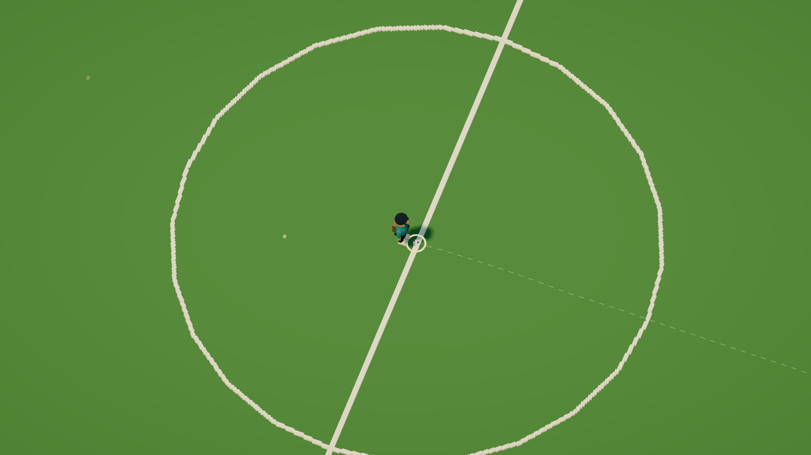
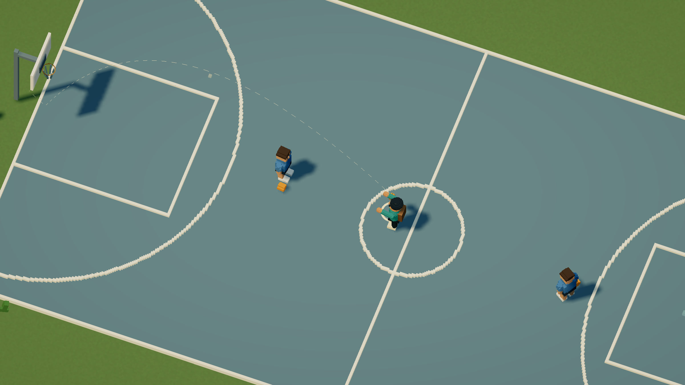

# Get out and play

[Docs](../README.md) / Sports

Drive to **F** or **B** on the map, get out with F and walk onto the ground.
Approach the ball to start dribbling. The camera moves closer and follows the
player and ball, widening when a shot travels away. Leaving the ground restores
ordinary walking controls and framing. Trackpad zoom and Q/E still work.



[Football recording](../media/football.gif) · [HD video](../media/football.mp4)

| Control | Football | Basketball |
| --- | --- | --- |
| WASD / arrows | Move, dribble and face a direction | Move and dribble |
| Click or drag on the ground | Aim precisely | Choose the nearer hoop to that point |
| Hold J, then release | Charge and kick | Charge and shoot; release at the gold mark |
| Hold the shot button, then release | Same kick control | Same shot control |
| Space | Jump; kicking in the air lofts the ball | Jump and shoot |
| Shift | Sprint | Sprint |

Keyboard football shots assist a goal within the facing cone. Clicking the
ground supplies an exact direction instead. Basketball assists the selected
hoop within 140 units, or 14 metres; moving and releasing with too little or
too much power can miss. The dashed preview shows an obstacle-free trajectory.
It does not guarantee a score through an obstruction.

A football must pass completely beyond the line, between the posts and below
the bar. A basketball scores only while passing down through the ring. Close
baskets count two; shots from at least 67.5 units count three. A goal or basket
shows a short celebration, then the ball returns to its authored start. An
out-of-bounds ball returns after two seconds. Pause freezes the simulation;
charging is cancelled on pause, lost focus, boarding or leaving the ground.
R retains scores and ball positions; Start over resets them.



[Basketball recording](../media/basketball.gif) · [HD video](../media/basketball.mp4)

## Connect the parts in Dream

The surface, ball and targets are explicit references. Labels don't make an
object playable. These declarations are taken from the complete
[sports-practice.dream](../examples/sports-practice.dream) example:

```dream
sport football_practice(kind=football,surface=pitch,ball=match_ball,targets=[west_goal,east_goal],target_at=[0,12,0],target_size=[72,24]);
sport basketball_practice(kind=basketball,surface=court,ball=court_ball,targets=[west_hoop,east_hoop],target_at=[0,30,12],target_size=[4.3,4.3]);
```

`target_at` is a point in each target assembly's local coordinates. Placement
heading, measured scale and surveyed base transform it into the actual world
anchor. `target_size` is the football opening's width/height, or a basketball
ring's clear X/Z diameter. Goals point local +Z out of the field; hoops point
it into the court. Both targets must be static upright assemblies, at least 64 units
apart, attached to the same surface. The football opening starts at ground
level. This keeps the scoring geometry connected to the visible assets.

A ball is an ordinary measured Dream assembly with a round `knockable` body
and `impact(mode=bounce(...))`. The example builds 22 cm and 24 cm balls from
eight-local-unit shapes; uniform measurement scales their bodies too. Cars
can still knock them around. The sports engine adds player possession and shots
to that existing prop physics. It creates no separate physics world.

At most eight grounds fit one linked project. Surfaces must be distinct,
non-overlapping, dry and nearly level, with no more than three units of sampled
height variation. Ball bodies have world radius 0.5–3 and height twice that.
Football openings are 6–120 wide and 4–50 high; basketball rings are 2.5–12 in
each direction, large enough for the ball, and 16–50 above the ground. Balls
and targets keep the existing scene object and reactive-object budgets.

The complete scene compiler validates these connections after module linking.
The engine owns controls, gravity, contacts, scoring and camera behavior.
Dream supplies data, never controller scripts.

This is solo practice in the mock world. The other people keep their ambient
programs. Team matches, opponent AI, bank-shot backboard physics, fouls and
competition rulebooks are further work. Ring and goal-frame rebounds use bounded
arcade contacts. Drawing interpretation and real model calls remain deferred.

[Assets and controls verification](../evidence/sports/verification.md) includes
native HUD captures, four asset angles and the media audit.
