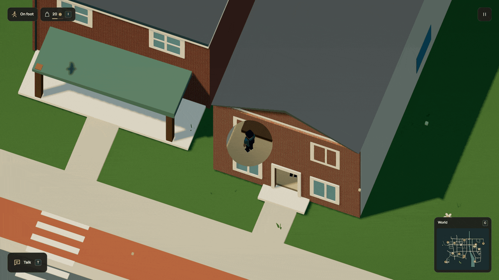

# Go upstairs

A floor should take you somewhere. The commuter's home now has a staircase,
an upper room and a landing you can walk across, jump on and come back down from.
Reload upstairs and you stay upstairs. Named [floors](floors.md) now bring
furniture, resident rest and paid repairs upstairs too.

The following recording predates upstairs furnishing; the stair geometry and controls remain current.



[HD walkthrough](../media/stairs.mp4) · [Complete house source](../examples/stairs-home.dream) · [Verification](../evidence/stairs/verification.md)

## One declaration owns the treads

```dream
stairs flight(material=home_wood,at=[6,.5,0],size=[4,8.5,22],steps=12);
```

`at` is the footprint centre at the lower floor's height. `size` is width, rise
and run. The flight rises along +Z; optional `heading_deg` rotates the whole
flight. Dream emits one bounded voxel volume and matching static rectangle
contacts. The compiler checks the same measured dimensions for both.

Use 2..24 integer treads, at most two flights per interior. All generated
contacts count toward the interior's 32-contact cap; the voxel volume counts as
one of its 32 visual parts. Outside interiors the eight-contact cap remains.
After measured scale, width must be at least nine world units, each riser at
most four and each tread at least six. Landings must be supported and leave
18 units of standing headroom; blocked or unsupported flights fail compilation.
Ten world units represent one metre.

## Leave an opening

The enclosing `interior` spans the usable building volume. Keep its continuous
ground floor and top ceiling, then author internal slabs with separate rectangle
contacts. Leave the stairwell clear, connect its upper end to a landing and fit
a guard rail along exposed floor edges. A full-width slab across the staircase
blocks it physically.

The home uses a main upper slab beside the stairs and a short rear landing.
Both share their visible dimensions with their contacts. Tag upper slabs and
rails with `cutaway=above`: they disappear while the player is below their lower
bound and remain opaque underfoot upstairs. Roof and camera-facing wall tags
continue to work. The lower bound survives batching and worker chunk transfers;
loading a different chunk never changes physical support.

Walking and jumping use ordinary fixed-step contact support, without a second
physics engine, controller scripts or per-cell bodies. Ceilings stop a jump from
passing through an upper slab. Descending uses the same contacts and gravity.

## Current boundary

The room now has named slabs and floor-bound furnishing. Rest and repair plans
can use the floors and traverse the stairs with supported heights. See the
[current walkthrough and runnable source](floors.md). Indoor lamp pools still use
the ground floor; lifts, independent stacked rooms and upstairs commerce remain
missing. Existing actor, live rig and navigation budgets stay fixed.

The registered r97 save upgrade preserves food, energy, stock, wages, repairs
and claims. It reroutes an old table repair approach because the table now sits
clear of the stairwell. [Save contract](../persistence.md#stairs-upgrade-r98).
