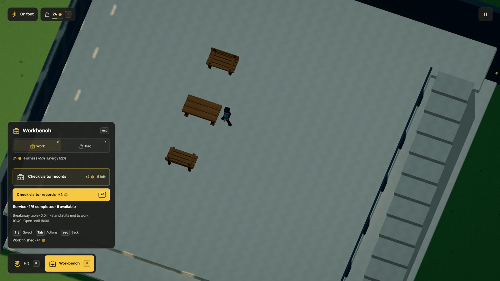
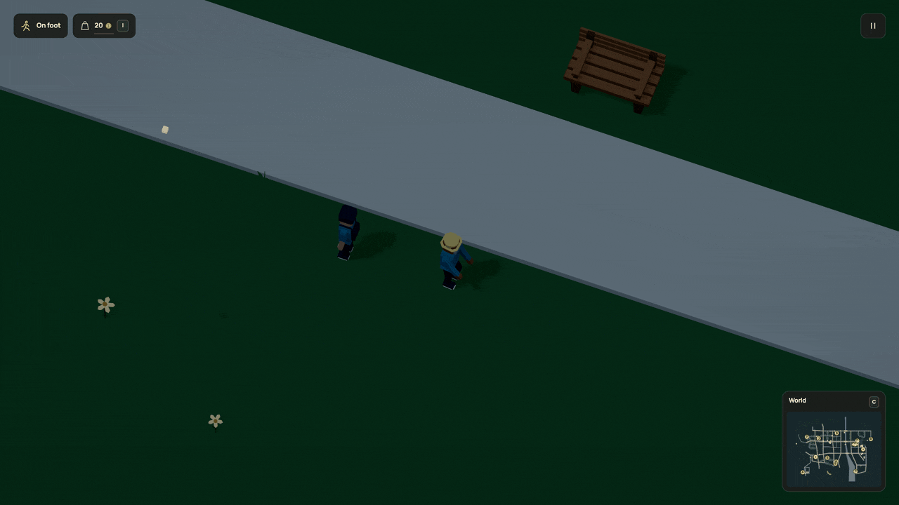

# A station quarter with some height

[Dream docs](../README.md) / Station quarter

Copper Court and Lantern Exchange sit north of Workshop Street, near the station
and eastbank medical center. One is a stepped brick residential tower, 55 metres
high; the other is a 75-metre office tower with framed glazing and vertical fins.
Their entrances face the same street. A promenade joins the two entrance paths,
with seating, planting and room for people to pass.


[Watch the quarter](../media/stationquarter.mp4) ·
[GIF](../media/stationquarter.gif)

## Walk in, sit down, take a ride

Leave your car with **F** and walk through either lobby doorway. Each lobby has a
bench on its declared floor. The roof and upper shell open the view when you are
inside; the floor and physical walls keep their support. **F** sits or stands,
using the same controls as every other bench. Four more benches face the promenade.
They share the city's sitting and splinter rules.

Two yellow station taxis and two high-roof cargo vans use separate paved aprons
beside the entrances. Walk up and press **F** to drive one. They use the existing
car controls, collisions and **Shift** boost. The aprons meet Workshop Street,
so a parked vehicle has a way out. Leaving a ride keeps it where you parked it.

Eight walking residents use the connected pedestrian network. Three lamps, three
rowan trees and two planters give the path edges some structure without filling
the walking corridor. These additions use existing population, lighting and
streaming systems.

## Take the stairs

Lantern Exchange now has a usable mezzanine above its lobby. Enter from Workshop
Street and take the staircase against the right-hand wall. The landing opens
onto an upstairs seating area with two benches facing a timber table. **F** sits
and stands; ordinary movement also gets you up. Sitting recovers energy through
the same rule as every other bench. Walk back down to leave.


[Full climb, seat and return in HD](../media/towerroom.mp4) ·
[GIF](../media/towerroom.gif) · [Runtime and save checks](../evidence/tower-room/verification.md)

The slab, landing, guard and each tread have matching physical contacts. Dream
names the retained slabs with `floor`; furniture binds to those floors. The
upper slab and its contents cut away while you are below them. The flight uses
the current arcade step sizes; finer stair proportions remain a construction
improvement. No lift or teleport is involved.

[The complete small world](../examples/tower-mezzanine.dream) imports the same
office and benches. It can be checked with:

```sh
npm run -s dream -- check docs/examples/tower-mezzanine.dream --modules src/scene/world
```

Its two upper floor bindings use existing vocabulary:

```dream
floor mezzanine(on=exchange,at=[4,12.5,0],size=[54,54]);
floor landing(on=exchange,at=[-27,12.5,23],size=[8,8]);
```

These declarations bind slabs already built by the object; they do not create
floating floors. The enclosing building supplies the doorway, clear room,
stair treads, landing and guard. Keep their geometry connected before placing
furniture. The office remains 75 metres tall and fits the existing 32-part and
32-contact limits, with 29 parts and 28 contacts.

## Work upstairs and rest across the promenade

The mezzanine table is now a shared records workstation. The clerk lives in
Copper Court, uses its lobby bench for energy and walks over for scheduled work.
The player uses the same desk and finite task quota. The business binds to the
office building independently of its operator home and needs no fake stock.



[Current office flow](../media/officework.mp4) · [GIF](../media/officework.gif) ·
[Rules, controls and complete example](office-work.md)

The earlier room recording still shows the same stairs, seats and geometry. Its
world activity list predates this office. Higher floors and lifts remain future
work.

## Damage has a follow-up

All eight benches, the upstairs table, three lamps and two planters are connected to the caretaker's
existing fixture service. The three rowans use the tree service. A damaged
fixture reserves a real kit and wage at the market; the caretaker walks to it,
works there and returns home with any eligible recovered hardware. Replanting consumes a sapling,
pays once and leaves a young tree to grow. Missing stock or an obstructed repair
space can delay the job. Nobody earns money while travelling.

The lobby and mezzanine furniture use their named floors and actual doorways. The
caretaker reaches upper jobs through the same stairs and returns by that route.
Outdoor approaches
join the promenade; invisible `finish=terrain` work grounds describe where a
worker may stand without painting another patch over the landscape. The same
finite repair offers remain available to the player through **H** at the market.



[Repair in HD](../media/stationrepair.mp4) ·
[Repair rules and example](commerce.md#connected-service-grounds)

Ground lists now allow twelve areas including `on`, so the tree service retains
every old work area while adding three narrow approaches here. This does not
raise the 4,096 local samples, 8,192 nodes, 32,768 links or 128 saved waypoints.
An enormous work rectangle still fails validation. New service coverage changes
future choices; it does not reset existing damage, jobs, supplies or saved time.

[This complete twelve-courtyard world](../examples/station-maintenance.dream)
shows the same bounded grounds list with twelve breakable tables, twelve finite
kits and one caretaker. Check it with
`npm run -s dream -- check docs/examples/station-maintenance.dream`.

## A more direct walk from the market

The quarter's entrances were connected, but missing crossings sent the caretaker
on a long loop around the eastern lake. Four authored junction crossings now
connect the medical interchange, Copper Street and Copper Lane, Market Avenue
and Weavers Lane, and High Street and South Terrace.

At simulation 53, the route to the north-west station bench became 9,546 world units,
compared with 20,983 in r112. Across all fourteen station targets, route lengths
are 9,278–9,689 units, previously 17,557–21,125. Ten world units are one metre.
These are route distances; live contacts and waits still affect travel time.
They do not measure browser performance.


[Crossing walk in HD](../media/crossingwalk.mp4) ·
[GIF](../media/crossingwalk.gif) ·
[Source, routes and save checks](../evidence/crossing-access/verification.md)

The r112 [station repair recording](../media/stationrepair.mp4) remains historical
for its longer journey. It shows the same repair, supplies and wage rules.
The current crossing change adds no new model vocabulary or moving actors.
Simulation 54 also joins nearby clear pavement inside an already connected
area. Those two remaining corner detours now have short supported routes. The
bench journey is 7,479 units; all fourteen station jobs are 7,216–7,621 units.
Live bodies still cause waits or replanning. These are route distances, not
browser-performance measurements. Existing paid trips retain their saved paths.


[Current journey in HD](../media/workerwalk.mp4) · [GIF](../media/workerwalk.gif) ·
[Routing, budgets and save checks](../evidence/short-links/verification.md)

## Build the same things in Dream

The [district source](../../src/scene/world/station_quarter.dream) owns placements,
entrance connections, promenade, parking, floor bindings and walking behavior.
The same vehicle asset can serve several parking spaces; `role=controllable`
and `parked=true` make each placement available to the player.

The [complete tower library](../examples/station-towers.dream) describes both
buildings, including their lobby shells, openings, floor and ceiling contacts,
recessed roofs, parapets and night windows. Upper storeys use compact voxel
volumes. Separate contacts follow the recessed roof and its raised edges.

The [complete vehicle library](../examples/station-vehicles.dream) describes the
4.8-metre taxi and 5.2-metre van. Their bodywork, wheel openings, axles, cabins,
mirrors and lamps are composed parts. Rolling joints keep the wheels and hubs
on the same axles. `rideable(control=car)` supplies the driving capability.

Both examples are identical to their live asset modules and can be checked on
their own:

```sh
npm run -s dream -- check docs/examples/station-towers.dream
npm run -s dream -- check docs/examples/station-vehicles.dream
```

`measure(kind=building,axis=y,meters=...)` now accepts 3–120 metres. The compiler
still resolves a uniform scale from the assembled geometry; the declared height
does not stretch a building. The linked project allows 40 reachable modules and
144 object definitions. Per-object geometry, expanded-world, vehicle, rig and
route limits remain bounded as before. [Physical proportions](../proportions.md)
and the [language reference](reference.md) describe those contracts.

## Put the bench on its floor

This small world reuses the same tower and bench modules. Its named floor matches
the lobby slab at local height `.5`, so the furniture shares its support.

```dream
dream 2;
rule benches(kind=bench,mode=break(speed=95,scatter=65,lift=65,spin=4,lifetime=6,pattern=splinter));
asset homes(module=tower_assets,object=station_residences);
asset bench(module=destructible,object=slatted_bench);
world(size=[2400,1800],spawn=[1400,1400],heading_deg=0);
street avenue(width=80,sidewalk=24,points=[[200,1400],[2200,1400]]);
place hall(object=homes,at=[1200,950],heading_deg=180,role=prop);
site hall_entry(object=hall,kind=civic,entry=[0,-31],street=avenue,width=16,points=[[1200,1348]]);
floor lobby_floor(on=hall,at=[0,.5,0],size=[70,60]);
place lobby_bench(object=bench,at=[1130,940],heading_deg=270,role=prop,floor=lobby_floor);
```

The host supplies the closed module map. [Download the complete example](../examples/ground-floor-seating.dream), then check it from the repository:

```sh
npm run -s dream -- check docs/examples/ground-floor-seating.dream --modules src/scene/world
```

## What is still missing

The ground-floor lobbies and first office mezzanine are enterable. The remaining
tower storeys and lifts are not implemented. A residential label does not create
households, and the upstairs seating area does not create office staff or paid
office work. The taxis are driveable cars; they do not yet
take passengers or charge fares. The van has no separate cargo-storage mechanic.
Building shells are not repair targets; maintenance here covers the seventeen
placed benches, lights, planters and trees.
The live review confirmed the office doorway and bench and found walkers stalled
at the promenade junction. Simulation 55 now clears that shared portal through
body-sized arrival and safe yielding steps. Existing saves retain their state
before the rule takes effect. [Current crowd recording and checks](../evidence/crowd-flow/verification.md).
[Earlier native review](../evidence/station-review/verification.md).
The world remains a handmade mock with no provider calls.

r114 validates the exact r113 world before applying construction. Existing
resources, damage, journeys, population, time and original save slots stay intact.
A grounded pose newly obstructed by stairs uses bounded local recovery. Saved
upstairs seating and pending repairs retain their floor and claims on reload.
The save format remains 19 and the engine simulation version remains 55.

[Placement, persistence and runtime evidence](../evidence/station-quarter/verification.md).
[Maintenance and save evidence](../evidence/station-maintenance/verification.md).
