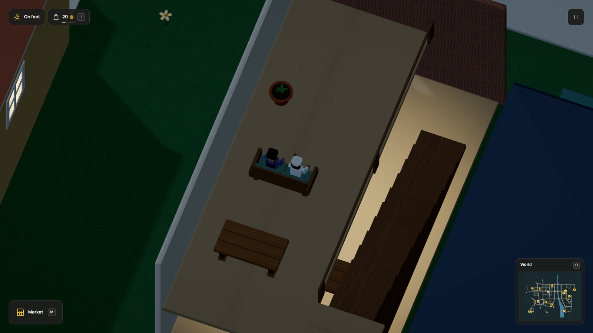

# Take a break upstairs

A home needs something to do inside it. The baker and commuter can now leave the
market, walk up the home's stairs and share a meal on the upper settee. The host
buys and carries the food. They claim separate seats, eat together and walk back. The meal
restores their configured needs and stays in their shared history.



[Watch in HD](../media/upstairsmeal.mp4) · [30 fps GIF](../media/upstairsmeal.gif) · [Runnable world](../examples/upstairs-social.dream) · [Checks](../evidence/upstairs-social/verification.md)

## Connect the room, seats and people

The complete example already has a building, matching upper-floor slabs, stairs
and a floor-bound settee. Its social plan adds those existing places:

```dream
social upstairs_break(peers=[fixer],good=bread,seats=[upper_settee,lunch_bench],on=plaza,grounds=[house,upper_room,upper_landing],eat_s=8,cooldown_s=600,markets=[corner]);
```

`seats` is the furniture preference order. A claimed or broken upstairs pair
leaves the downstairs bench available. The two people need separate slots on the
same object, with room for their actual bodies. A player sitting on one of those
slots prevents that pair from being reserved.

Upper travel uses named floors together with their enclosing building in
`grounds`. Every route must connect through the building's actual stairs, in both
directions. A floor ID cannot create a route through a slab or a doorway. The
compiler checks the complete body, supported transfers and reachable return from
each participant's ordinary position or walking-route corners.

There is no new Dream command. The same `floor`, `place`, `social`, `account` and
`grounds` declarations compose this activity. Check the complete world with:

```sh
node scripts/dream.mjs check docs/examples/upstairs-social.dream
```

## Finish the trip, then the meal

Each journey retains its supported height, including the stair path, destination
and interrupted home position. Both people must arrive on the correct floor
before the eating timer starts. Matching X/Y coordinates downstairs earns nothing.
The existing indoor graph and movement rules provide the steps; no new physics
body, animation rig or NPC is added.

Two portions stay reserved while people walk. Completion consumes and feeds once, restores configured Company and records the
pair's meal. Energy recovers while an energy-enabled person is actually seated,
through the existing rest rule. Broken furniture, due duties or the existing blocked-trip
timeout refunds unconsumed portions once. People physically descend before their
original routines resume. Refunded food can still be eaten or used for a later
break through ordinary transactions.

The current city uses this for resident meals. Player invitations retain their
nearby, visible, familiar-person and occupied-seat requirements. This does not add
remote invitations, household ownership, sleep, dating or lifts.

## Come back to the same world

Pause freezes the activity. R, streaming and reload retain both journeys, seat
claims, held food, remaining meal time and memories. Start over clears them.
Unsupported heights and through-floor saved paths are rejected.

Format 19 / simulation 53 accepts the exact r109 world first, then preserves its
state unchanged. An old meal at the hall bench stays there until it finishes;
only a future gathering uses the new furniture preference. Original save slots
remain available. There is no offline travel or replayed reward.

The recording exports 600 consecutive frames at 30 rendered frames per simulation
second. It uses the ordinary resident simulation with a following review camera.
It is an offline walkthrough, not a browser performance measurement. Earlier
[companion footage](companions.md) remains historical for the downstairs venue.
Muse and prompt interpretation remain mocked and deferred.
