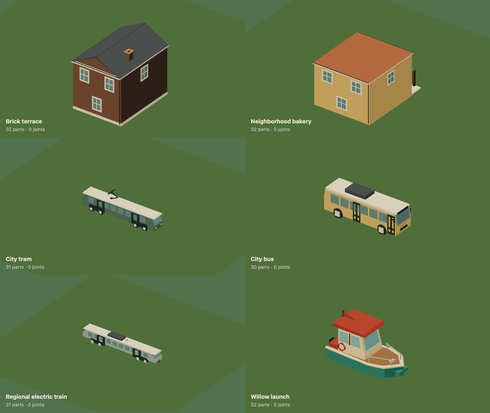

# Build with voxels

A wall doesn't need one mesh per brick. Describe the occupied cells, cut openings into them and let the engine build its visible surface. Flat faces merge into larger rectangles. Repeated city buildings still share instanced geometry.


[HD recording](../media/voxels.mp4) · [Download the complete wall](../examples/voxel-wall.dream)

## Voxel construction across the world

The live city now uses `voxel_world(object_cell=1,ground_cell=8,height_step=1);`. It converts every linked object template, generated furnishing, player vehicle and flock after the world is assembled. Ground, streets, cycle tracks, painted crossings, bridge decks, water, plants and vehicle parts all produce voxel surfaces. [Build a complete voxel world](../whole-world-voxels.md).


`part` and `beam` remain compact shape stamps for the model. The engine samples their occupied cells, preserving outlines, openings, material, measured bounds and rigid motion. Explicit `voxels` gives the model direct control of fill/cut operations and fracture chunks. The world policy changes construction; it does not silently add damage or replace contacts.

## Fill, cut, repeat

`voxels` creates one rigid visual part. `grid` gives its cell counts, `size` its full local dimensions and `at` its center. Cell coordinates start at the minimum corner. Every operation uses integer half-open bounds: `from` is included, `to` is excluded. A `[30,16,4]` grid with size `[60,32,8]` has two-unit cubic cells.

```dream
dream 2;
material masonry(style=brick,colors=[#a96f55,#bcb1a0]);
object garden_wall(label="Voxel garden wall"){
  measure(kind=custom,axis=x,meters=3);
  body(interaction=solid,radius=24,height=32);
  impact(mode=break(speed=90,scatter=50,lift=55,spin=3,lifetime=6,pattern=crumble));
  voxels wall(material=masonry,at=[0,16,0],size=[60,32,8],grid=[30,16,4],chunks=[2,2,1]){
    fill solid(from=[0,0,0],to=[30,16,4]);
    cut opening(from=[12,0,0],to=[18,10,4]);
    repeat top(index=i,count=5){
      cut notch(from=[i*6+2,14,0],to=[i*6+4,16,4]);
    }
  }
}
```

Operations run in source order. A fill after a cut can restore cells. `shape=ellipsoid` uses the same bounds and fills or removes cells whose centers lie inside that ellipsoid. Omit `shape` for a box. Use separate volumes for different materials and `component`, `group`, `repeat` or rigid joints to compose them. Give each volume the same size/grid ratio on all axes for cubic cells; different ratios deliberately create rectangular cells.

The model writes a few operations rather than thousands of cell entries. It cannot upload a mesh, request a shader, fetch a file or supply executable generation code. The [compiler contract](../dream-v2-contract.json) includes the exact vocabulary and limits.

## Destruction uses the same cells

`chunks=[2,2,1]` divides this volume into four pieces. It requires whole-object `break` behavior or a `zone` with break behavior. Each axis must divide the grid exactly, every piece must contain cells, and all parts together must fit the existing eight-fragment assembly limit. Don't wrap an automatically chunked volume in `fragment`.

The intact mesh hides faces between occupied cells. A fracture meshes each chunk with its newly exposed cut faces. The existing engine supplies impact thresholds, scatter, gravity, settling and fade. No voxel becomes an independent physics body. Existing authored `fragment` groups still work for voxel furniture, while `zone` preserves a building's structural core.

A visual opening does **not** create a traversable opening. Bodies and compound contacts remain explicit cylinders. Terrain has one ground height per XY position. Editable terrain, tunneling, per-cell collisions, local damage masks and structural collapse are further work.

## What's in the city

Two carved garden walls flank the river-park bench and break into four chunks each. Eleven residential and commercial building templates now use voxel wall shells. The slatted benches use voxel boards inside their existing seven fragment groups. The asset-library bakehouse storefront uses a carved volume with six masonry chunks, plus its canopy and door. Their measured proportions, entrances, foundations, roads and physical contacts remain shared with the existing world.

The live world's remaining curved shapes now become occupied-cell stamps too. The city uses sparse solid ground columns and infrastructure tiles rather than allocating a kilometre-wide 3D array. The world policy leaves older standalone examples readable in their original shaped mode; add it to a complete world to use voxel construction throughout.



## Rendering and bounds

The mesher culls hidden faces and greedily merges coplanar faces within each volume. It caches identical CPU mesh data across validation copies, with an eight MiB / 128-entry bound. Callers own their GPU buffers. Static prototypes continue through the existing material batching, instancing, local bounds and occlusion system. Intact objects don't remesh every frame; debris meshes are built on first fracture and reused after restart.

| Budget | Limit |
| --- | --- |
| Grid axis | 1–32 integer cells |
| Volume | 32,768 allocated cells, 64 expanded operations, 8,192 merged quads |
| Assembly | 65,536 allocated cells, 1,048,576 fill/cut cell visits, 32 visual parts |
| Linked project | 1,048,576 allocated cells across assembly definitions |
| Scene input | 1,048,576 unique volume cells, including player and flocks |
| Destruction | Eight fragments per assembly, 24 reactive objects and 128 potential scene fragments |

Empty volumes, empty chunks, out-of-grid bounds, fractional indices, excessive work and unsupported fields fail validation. Voxels don't accept deform, cloth or part-level motion; put rigid motion on a joint. Dream 1 remains unchanged.

A test block with 4,096 occupied cells needs six quads, compared with 24,576 faces if each cell were drawn as a cube. This measures geometry, not browser frame rate. The approach follows Mikola Lysenko's [greedy meshing explanation](https://0fps.net/2012/06/30/meshing-in-a-minecraft-game/). See the [verification record](../evidence/voxels/verification.md) for the live-city geometry comparison and capture audit.
