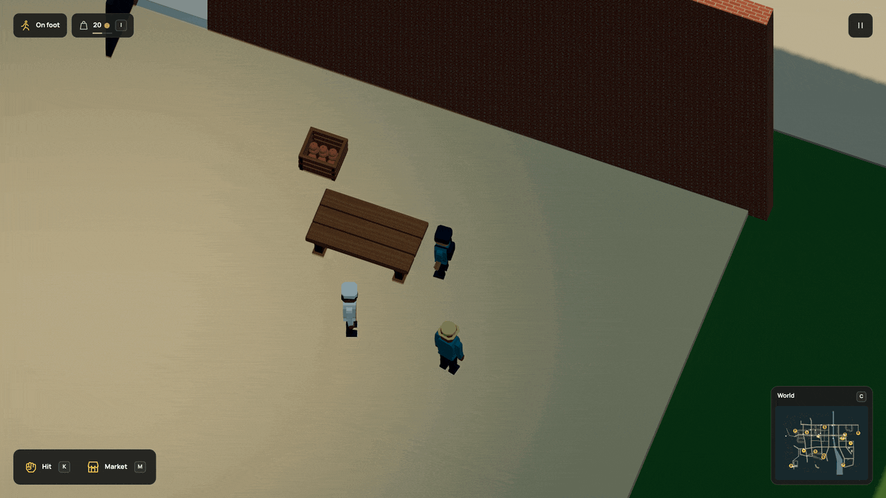

# Give the work its own motion

Knead dough. Fold a lunch parcel. Hold one hand steady while the other fastens a
repair kit. These are now different motions, defined in Dream and shared by
people doing the same task.



[HD recording](../media/workstations.mp4) · [Still](../media/workstations.jpg) · [Complete runnable source](../examples/work-gestures.dream) · [Verification](../evidence/work-gestures/verification.md)

## A closed hand path

The complete example defines this motion inside `economy()`:

```dream
gesture kneading(cycle_s=1.15){
 key(t=0,left=[-.8,1.1,1.3],right=[-.8,1.1,-1.3]);
 key(t=.25,left=[.2,.6,1.5],right=[.2,.6,-1.5]);
 key(t=.5,left=[.65,.65,1],right=[.65,.65,-1]);
 key(t=.75,left=[-.6,1.6,1],right=[-.6,1.6,-1]);
 key(t=1,left=[-.8,1.1,1.3],right=[-.8,1.1,-1.3]);
}
```

Each key gives the two hands an offset from the work anchor. +X is forwards,
+Y is up and +Z is the person's left. These are world units, ten per metre;
a larger model does not multiply the authored movement. The engine turns the
frame with the person and solves their existing rigid arms.

Bind a program with `work(...,station=preparation,gesture=kneading)` or
`repair(...,gesture=mending)`. References must resolve. A job needs a physical
[station](workstations.md), so its anchor rests on the furniture. Repairs use a
generic point in front of the worker; exact contact with each damaged part is
still missing.

The live bakery uses kneading for bread, folding for lunch packs, fastening for
kits and tending for saplings. Furniture repairs reuse mending; replanting uses
tending. Existing task eligibility, wages, stock, damage and travel still decide
what can happen. An animation cannot complete a job or create its output.

## Small programs, predictable execution

| Rule | Bound |
|---|---|
| Programs | 1..8 unique IDs in an economy |
| Keys per program | 2..8, anonymous |
| Cycle | .6..8 seconds |
| Key times | Start at 0, end at 1, increase by at least .1 |
| Closure | First and last positions match within 1e-8 |
| Hand offsets | X ±1.25, Y .6..3, Z ±3 world units |
| Hand separation | Left Z >=.6, right Z <=-.6 |
| Peak path speed | At most 12 world units per second |

Smoothstep interpolation stops smoothly at each key and never overshoots a
segment. The compiler checks its peak speed, including the 1.5 interpolation
factor. The renderer blends entry, task changes and release. Feet stay planted;
arms retain their segment lengths. Reach is still constrained by the rig, so
inspect a new motion on its actual worker and station.

Phase comes from the existing job deadline or repair progress. Pause holds it;
reload resumes that progress with the ordinary entry blend. Reduced motion uses
the existing resting pose. No new saved animation clock, physical item, actor or
rig is added. Handheld tools, ingredients and finger articulation remain to build.
