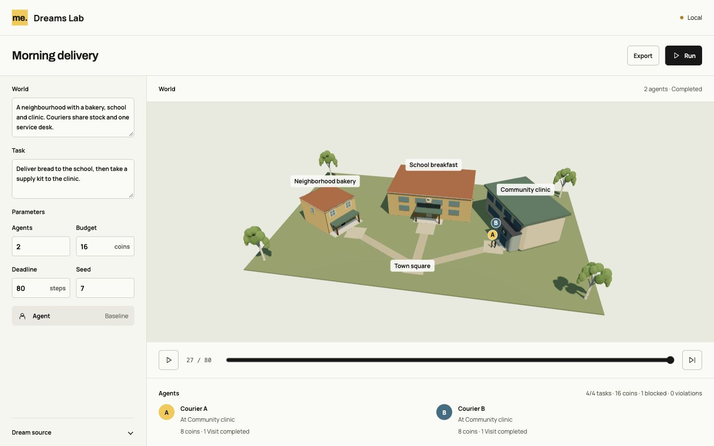

# Dreams Lab

[Docs](README.md) / Research workspace

Define an environment and a task. Run agents, change the conditions and try
again. The Lab now shows its delivery world in Three.js, with walking couriers,
visible purchases and service activity connected to the accepted episode.

[Watch in HD](media/dreams-lab-3d-run.mp4) · [GIF](media/dreams-lab-3d-run.gif)

## Run, inspect, repeat

From the repository root, run npm run lab:dev. From dreams-lab itself, run
npm ci once, then npm run dev. The folder has its own package, TypeScript/Vite
configuration, engine copies, fonts, assets, CLI and tests. It builds to its own
dist/ without reading parent source or build assets. Original city files remain.

Press **Run**. The local builder expands the delivery template and bounded
parameters into Dream. The compiler checks it before a fresh episode starts.
The view derives paths and positions from the accepted scenario, with explicit
mock bindings for the bakery, school and clinic. Agents carry bread and kits
from their actual inventories and animate the existing service state.

The default run completes four tasks in 27 logical steps, spends 16 coins and
records one blocked request with no violations. Four coins per courier and an
eight-step deadline produce two completed tasks at the deadline. The rules and
source hashes remain the same as the earlier logical runner.

**Pause** holds playback and animation. **Step** advances one transition.
The timeline reads recorded states without changing the engine head. **Play**
replays a completed episode, or resumes an unfinished one after its history.
Each logical step occupies one display second. Hiding the tab pauses playback.

Drag the world to orbit; scroll or pinch to zoom. Tab to the view, then use
arrows, plus/minus and Home. Reduced motion keeps static poses. WebGL failure
is explicit, with no 2D fallback.

## Edit the scenario

Open **Dream source**, choose **Edit**, paste a standalone scenario and press
Run. **Use brief** returns to the local template; the manual draft stays in
memory. Invalid source preserves the accepted result and export. The mock
builder recognizes the supplied delivery brief only; other tasks use Dream.

The [classroom example](../dreams-lab/examples/classroom.dream) also runs.
Other scenarios receive generic destination pavilions. Display labels do not
invent an asset, behavior or domain meaning. Arbitrary generated scenery needs
explicit validated presentation bindings first.

## Keep the record

**Export** downloads a paused or completed run with canonical source, SHA-256,
seed, policy label, observations, actions and outcomes. The Lab's own CLI replays
and verifies it. From dreams-lab:

    node scripts/experiment.mjs replay path/to/episode.jsonl

[3D verification](evidence/dreams-lab-3d/verification.md) records the native
controls, exports, isolation build and captures. The earlier
[logical-runner exports](evidence/dreams-lab-runner/verification.md) remain valid
historical evidence. Reload clears local history; exported records remain local
and unsigned, without a certified dataset or training pipeline.

## What was copied

The [port guide](../dreams-lab/docs/port.md) lists the bounded dependency closure
and nine Dream objects. Source bytes are pinned to the committed baseline,
without the parent checkout's unfinished changes. Seven rendering modules
supply the object builder, materials, batching and humanoid animation. The city
world, HUD, worker and saves are outside the port.

This is a 3D observation of a logical task environment. The renderer cannot
submit actions, change inventories, set rewards or decide completion. Agents
follow accepted links; city collisions, physical pathfinding, real Muse calls
and persistent experiment storage remain later integrations.

The approved compact Workspace A layout remains. Older graph-only, Notebook
and Compare captures are historical references.

[Run locally](../dreams-lab/README.md) · [Scenario guide](../dreams-lab/docs/scenarios.md)
