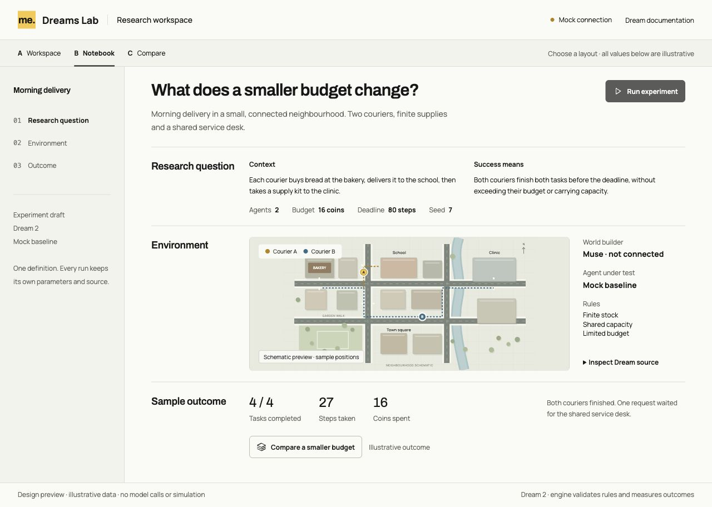
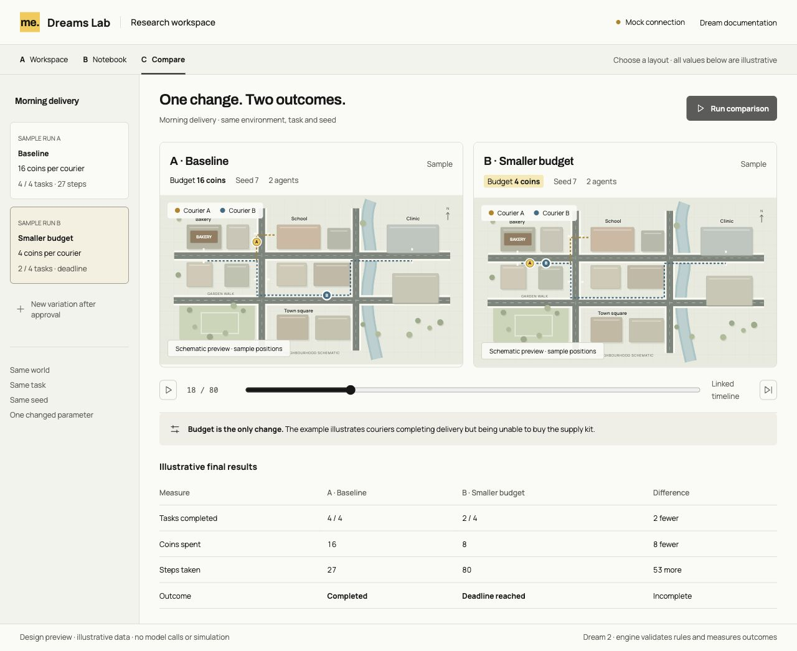

# A fresh Dreams Lab

[Docs](README.md) / Research workspace

Describe a world and the task an agent should perform there. Muse would turn
that brief into Dream source. The compiler checks the proposal; the engine runs
the supported rules and records what happened. Change a parameter, run again
and compare the outcome.

The new `dreams-lab/` folder starts with three interface variants for approval.
All three inherit Minimum Effort's fonts, colors and spacing. The maps, agent
positions and results are illustrative. The simulation controls are disabled.
There are no model calls or generated environments in these previews.

## A · Workspace

The environment stays in view. The brief and parameters sit at the left, with
individual agent activity below the map. This layout gives the most space to
watching and debugging one run. Detailed comparisons would use another view.


## B · Notebook

A research question, environment and outcome form one continuous experiment.
This layout gives more context to someone preparing or explaining a study,
with less space for watching several agents at once.



## C · Compare

Two runs share a timeline. The changed parameter stays visible above their
environments, with a results table below. This layout puts repeated experiments
first; defining the initial world would need a separate setup step.



## Open the previews

From the repository root, with its existing dependencies installed:

```sh
npm run lab:design
```

Open the local address printed by Vite. Links across the top switch variants.
The source disclosure uses a native keyboard-accessible control. Brief and
parameter fields are preview controls and do not alter the sample map or
results. No prototype state is sent or saved by the app.

The complete sample Dream file is generated alongside the previews and checked
by the existing compiler. It is a small standalone delivery example, separate
from the illustrative two-courier timeline. No new Dream vocabulary was added.

## Port only what we need

After the layout is chosen, the first functional slice should reuse the
canonical compiler, bounded scenario rules, observation/action interface and
recording/replay tools. The [existing Lab](dream/scenarios.md) already exercises
these with mocked interpretation and policies on a logical network.

Real Muse interpretation, a real agent policy, physical world binding, parameter
comparisons and stored run history still need implementation in the fresh app.
The world builder proposes rules; the evaluator enforces accepted rules and
scores committed events. Agents must not set their own rewards or completion.

[Design source and launch instructions](../dreams-lab/README.md) ·
[Current verification](evidence/dreams-lab-design/verification.md)
