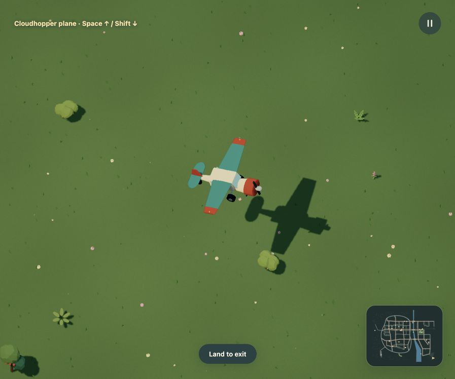

# Aircraft terrain contact

Recorded 2026-10-16. The accepted r30 Dream world, aircraft geometry, lighting,
camera and render quality settings are unchanged. This is a mock-only engine fix.

## Cause and change

The aircraft controller sampled terrain only at its center and computed visual
pitch and bank after resolving contact. A nose or wing could therefore enter a
hill even when the body origin was above ground. The ground controller also
prohibited reverse, so a stopped aircraft could not back away from an obstruction.

The new terrain survey uses the assembly's existing rest-pose underside geometry.
It caches lower support tiles, with at most 13 by 13 occupied cells and five
samples per cell. Tile corners conservatively extend the lower envelope. Heading,
pitch and bank match the renderer. Both analytic terrain/deck height and rendered
ground triangles participate; parked initial poses, active movement, collision
rollback and exit checks share the same survey. Static initial elevations are
cached, rather than surveyed again every NPC tick.

Ascending contact can clear the ground during takeoff. Descending contact settles
the aircraft level and resamples its underside in that pose. Landed obstacle caps
stay supporting during horizontal movement; leaving a sufficiently high edge
returns to airborne control. This prevents a grounded plane from trying to move
through the side of the very platform it landed on. S brakes, then permits slow
reverse taxiing on land. It cannot reverse in flight or power away after a water
landing. Authored solid collision cylinders and the single active-body owner remain.

## Behavior and browser evidence

The added hill regression moves the actual 31-part Cloudhopper through a steep
isolated hill while descending, banking and taxiing. Every fixed step checks all
3,877 original geometry support points against the surface, independently of the
cached tile survey. The original controller failed this check. The reverse
regression also failed before the change. A platform regression checks remaining
on a cap, rolling off it and descending without becoming trapped.

Native controls in the real city moved the grounded plane from (12500,10200) to
(12667,10200) up the eastern heath. The rendered body root rose from 64.1 to 78.7.
Braking settled it near (12734,10200). W and Space then took it off toward
(13099,10200), with grounded=false, climb speed 71.7 and forward speed 228.2.
An earlier meadow check reversed after an obstruction and retained terrain contact.
The live-world test also checks that the hillside inspection start has a dry exit.

`/?test-movement=plane-hill` is a development-only entry point using actual city
terrain and the normal controller. No world state is injected through the browser.

## Documentation and media review

README, the behavior guide and the local inspection table describe the corrected
contact and reverse controls. Flight GIF, HD video and matching still are refreshed
together from 300 actual frames at 30 rendered frames per simulation second.
These are offline exports, not browser performance measurements. The native hill
screenshots retain their full browser viewport resolution.

The Dream aircraft example and all vocabulary/contracts remain accurate because
this change adds no authoring fields. Geometry atlases, proportions, city stills,
day/night and other movement/destruction recordings show unchanged assets and
mechanics, so they remain current. Historical evidence keeps its own revision labels.

## Limits

This remains arcade flight. The cached rest-pose profile is a conservative terrain
survey, not continuous mesh collision or an aerodynamic model. Animated extensions
outside an assembly's rest pose are not separately swept. Building impacts retain
the authored cylinders. Lower-powered hardware performance was not benchmarked.

## Executed checks

`npm test -- --maxWorkers=2 --testTimeout=60000` passed all 710 tests across
41 files. Coverage includes the winding racing loop, hill driving, all vehicle
profiles, deterministic replay at 30/60/144 fps, obstacle contacts, destruction,
water recovery and boats beneath bridges. `npm run build` passed typechecking
and the production build; its existing large-chunk advisory remains.
`npm run docs:build` built 27 pages. The flight exporter saved 300 consecutive
frames, and `scripts/encode-media.mjs` produced the GIF and HD video from them.
The native browser reported no warnings or errors during that recording.
After the final cache-construction cleanup, the focused aircraft, locomotion and
documentation suites passed all 110 checks, and both builds passed again.
Native R recovery followed by W moved the original car from its (6330,4233)
spawn to (6472,4233), with control=car and no console warnings or errors.
