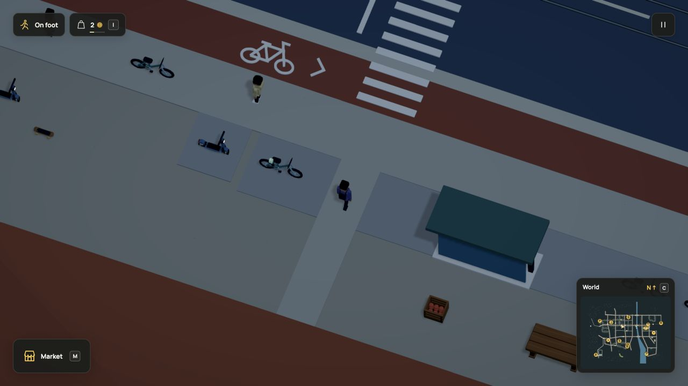

# Daily workplace attendance, r100

This connects the existing commuter, meals, upstairs rest and finite bakery work
to a daily work window. The larger living-world goal remains active: further
interiors/lifts, practical relationships, universal interaction and broader
resident life are still unfinished.

## Acceptance

- Dream `account.attendance` declares one daily window at one workplace. It needs
  commute, connected home/work grounds, existing jobs and the saved daylight clock.
- Outbound and idle presence reserve nothing and earn nothing. Real shortage jobs
  use the same inputs, capacity, qualifications, equipment, wages and refunds as
  player work. Repeated jobs do not require another home trip.
- A committed batch can finish after closing. The worker then walks home. Food
  and energy breaks use ordinary existing needs, shared seats and finite credits.
- Saved out/idle/work/home phases retain departure and ownership. A delayed trip
  cannot extend into tomorrow. Registered r99 saves preserve every old field and
  commitment; old one-batch trips finish before new attendance decisions.
- Existing objects, geometry, resources, actor/rig and navigation caps are unchanged.

## Checks

The focused policy file passed twelve checks. The four live-world checks passed
for current/exact historical fingerprints, meal/rest/work/return, current replay,
old occupied upstairs rest and an old active one-batch commitment. Neighboring
commuting, rest and counter-hours checks passed during implementation. The
production build and standalone `scheduled-workday.dream` acceptance passed.
One full regression run passed all 1859 checks across 179 files in 637.39
seconds. It covers the compiler and command context, old migration chain,
vehicles, sports, shared seats, repairs, streets, streaming, motion and published
documentation. See [raw report](tests.json), [run log](full-suite.txt),
[focused policy checks](policy.txt), [production build](build.txt) and
[standalone compiler acceptance](cli.json).

The review-camera correction changes no simulation rules. Its final build and
fresh native capture pass; the inspected worker stays opaque through work and
the doorway. No second full run was needed for the evidence/media updates.
[Source and frame fingerprints](source-manifest.json) pin the verified files.

## Browser

Used the local Vite build in the in-app browser on this macOS machine. The
review helper seeds only the player counter approach and makes ordinary player
purchases. Fixed ticks drive the resident through food, upstairs rest, attendance,
production and return. Bread starts at simulation 247.28333333327276, finishes
at 253.2833333332673, crossing the attendance closing boundary at 250 seconds.
The resident has 25 coins and one completed bread batch after returning.

Native Save now and reload retained 25 coins, that one completion, inventory and
payment history, while ordinary on-screen time and route motion continued. The
reload snapshot is five simulation seconds later, not an exact paused-state
comparison. Deterministic tests cover exact state replay. Browser warning/error
logs were empty. See `native-saved.json`, `native-reloaded.json` and the earlier
`native-return.json` snapshot.

## Media

The review reveal now follows the inspected NPC rather than the player left at
the counter; the camera faces the entrance and excludes the followed rig from
its own obstruction fade. Normal player framing is unchanged.
Poster frame 479 shows the worker outside the door.

The refreshed attendance clip follows a paid batch past closing and the start
of the walk home. It uses 480 consecutive source frames at 30 rendered frames per
simulation second, with no interpolation. The preparation before the clip is
omitted. HD video/still use 1600×900 and GIF uses 1280×720. This offline recording
is not a live frame-rate or memory benchmark. The HUD purse belongs to the player,
not the resident whose ledger the browser diagnostic records.

Other assets, controls and geometry did not change. Earlier one-batch work-trip
recordings are historical policy examples; the upstairs and other venue/vehicle
recordings still show their current geometry and mechanics.

## Limits

No employee contract, idle wage, guaranteed job, queue, weekly calendar, general
scheduler or vehicle commute. This policy chooses when an NPC attends; ordinary
counter hours continue to govern player and NPC transactions. No provider calls.
