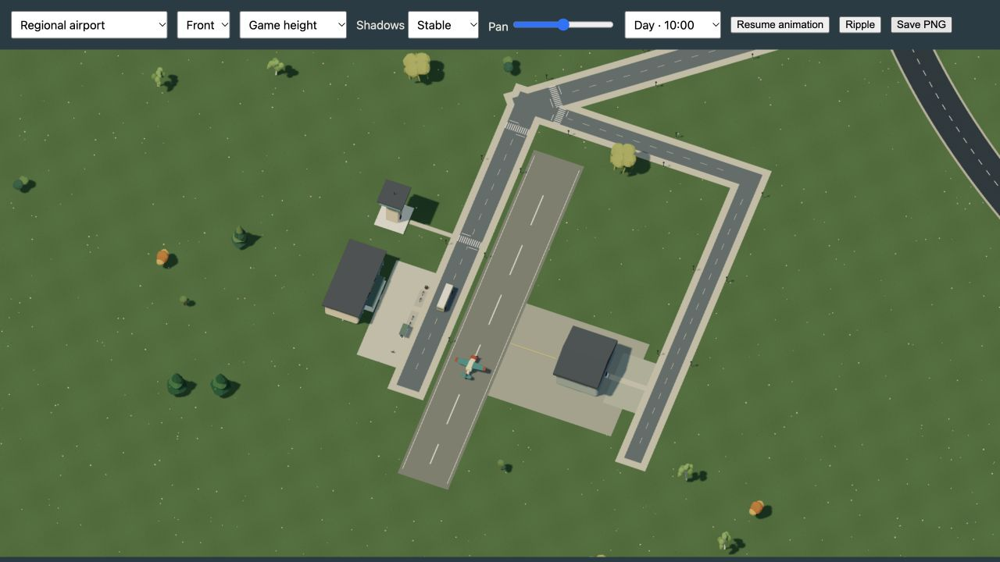
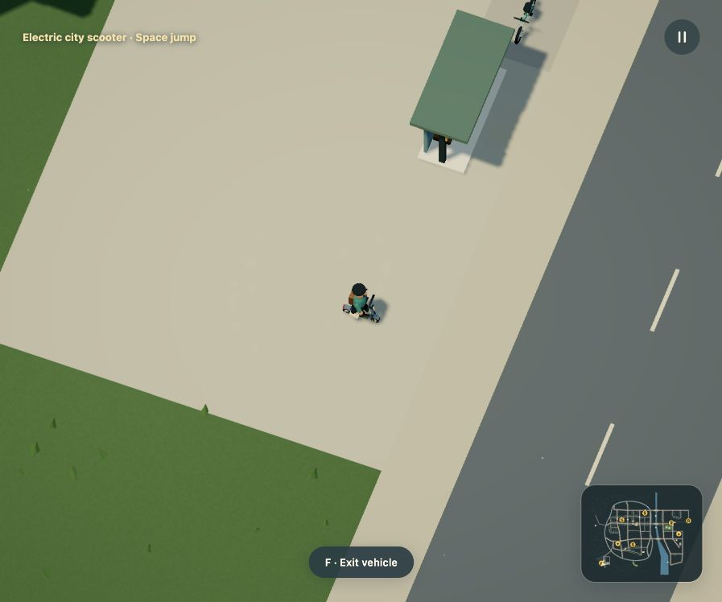
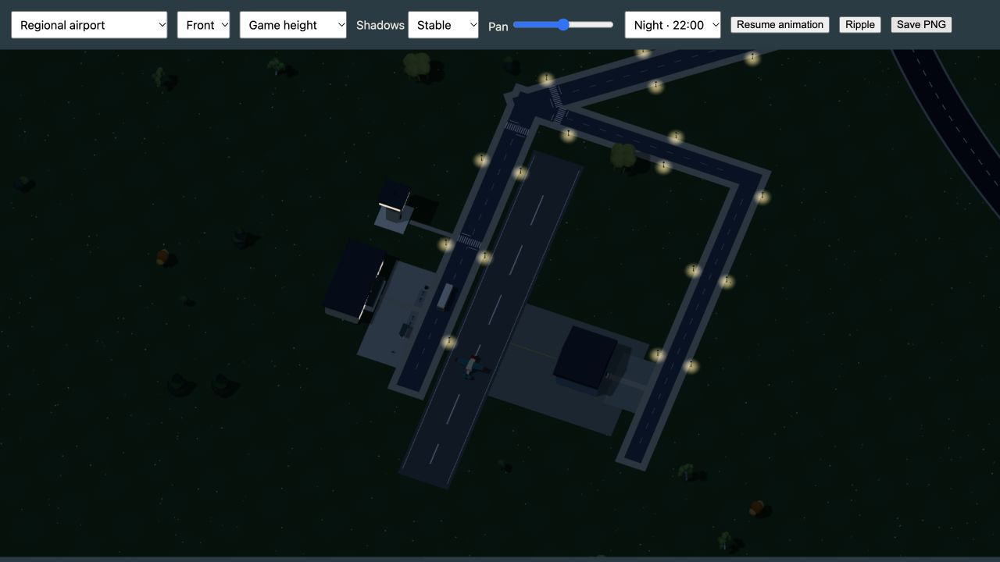

# City services and regional airport, r31

Recorded 2026-10-16. [Compiled coverage](coverage.json): 1,362 placements,
82 Dream assemblies, 32 streets, 218 connected sites and 12 actor routes.
The 1.4 × 1.1 km world remains resident. Render distance, shadows, asset detail,
post-processing, bird count and all existing actor/animation limits are retained.

## What changed

The existing city already had schools, River hospital, three buses, a tram,
regional rail and a market scooter. This pass adds a regional airport, eastbank
medical center, two bus services and two available scooters. It keeps the existing
education destinations, tram and rail services working.

The airport's terminal, control tower and hangar are distinct static Dream
assemblies. The terminal has glazing, a canopy and supporting columns. The hangar
has a gabled roof, front door panels and a rear crew entrance. The tower's cabin
and roof attach to its shaft. Medical care gets a separate building type with a
public entrance block. All four pass a transformed-part attachment graph check;
the gallery was inspected from [front](assets-front.jpg), [right](assets-right.jpg),
[back](assets-back.jpg) and [left](assets-left.jpg).

The apron meets the side of the runway, leaving its entire driving surface
continuous. Public paths stay on the terminal side. Hangar service access goes
around the northern threshold rather than crossing the runway. The new airport
connector shares named junctions with the existing streets and carries sidewalks
all the way to town. The original airfield road only reached the driving circuit;
its walking network was disconnected. Every declared destination and platform now
belongs to one connected pedestrian component.

The airport/hospital shuttle and eastbank medical/station loop use existing
roadways with named stops. Five buses run four services, alongside the original
tram and regional railcar. They retain passenger ownership and their route clocks.
Four road cars still use all three existing car silhouettes. Reassigning traffic
slots preserves the 24 route/controllable limit instead of increasing it. Three
explicit scooters accept direct input; furnished parking remains scenery.

The new destinations have six additional parked bicycles, two planters and 26
airport streetlights, filtered against entrances, roads, runway grounds and other
objects. Existing rules also remove obstructed candidates when roads change.
The compiled world has 398 lights, 33 parked bicycles, 16 parked scooters,
89 street trees, 277 planting groups and 22 planters. Population rules never
promise a minimum count; these are the actual accepted results.

## Dream and navigation

`site(kind=airport)` classifies a connected terminal. It generates no airport
geometry or operations. The model instructions, generated contract, grammar note,
language reference and examples were updated together. The minimap reads site
kinds for S, +, A and R markers, with an accessible key and hover text. Labels do
not choose physics or infer site meaning.

[The terminal example](../../examples/airport-terminal.dream) compiles to exactly
the live assembly. [The standalone shuttle world](../../examples/airport-stop.dream)
connects terminal and medical entrances to a real passenger platform.

## Native browser evidence

F boarded the actual airport scooter; W moved it and Space produced an airborne
state. The observed jump had grounded=false and vertical velocity -70 while
descending. R returned to the original car and W moved it from (6330,4233) to
(6408.4,4233). The semantic minimap key was present. No console warnings or errors
were reported during those checks or the flight recording.

The main-game exporter saved 300 actual flight frames at 30 rendered frames per
simulation second. GIF, HD video and matching still were refreshed together.
These are offline exports, not browser performance measurements. Native scene
canvas exports provide the airport and medical-center product images; full
viewport context is retained [above](airport-context.jpg) and
[here](medical-context.jpg). Screenshots retain their native JPEG bytes and
resolution. PNG scene exports are encoded as high-quality JPEGs for the docs.

## Documentation and media audit

README, city/asset guides, model instructions, language reference, example index,
population and lighting counts, local inspection table and world-systems roadmap
were reviewed and updated. The generated city map uses the accepted source.
Refreshed airport, medical center, four new-asset views, complete asset atlas,
HUD/minimap, wide waterway overview, and flight GIF/video/still.

Existing ground-vehicle, school/hospital, tree, fauna, flora and physical-scale
galleries still depict unchanged assemblies. District closeups and car, switching,
walking, swimming, day/night and isolated destruction clips retain their visible
geometry and behavior. Their WebGL-only motion exports do not include the changed
HTML minimap. Historical verification records retain their revision labels.

## Executed checks and limits

`npm test -- --maxWorkers=2 --testTimeout=60000` passed 720 tests across 42 files.
This includes route-body and entrance clearance, platform waits, passenger clock
ownership, scooter exits/jumps, all-site pedestrian connectivity, attached
architecture, the complete racing loop, water/bridge travel and aircraft contact.
`npm run build` passed typechecking and the production build, with the existing
large-chunk advisory. `npm run docs:build` built 27 documentation pages. Both new standalone Dream examples pass the compiler;
the terminal also has exact live-source equivalence coverage.

Schools, medical facilities, terminal and hangar are exterior mock destinations.
There are no working interiors, classes, clinical services, flight dispatch or
traffic avoidance. The aircraft is freely controlled, not an airport-operations
simulation. Dream Lab remains a separate logical environment without bindings to
these 3D sites. No provider calls or model training were introduced. Lower-powered
hardware and mobile-browser performance were not benchmarked in this pass.
