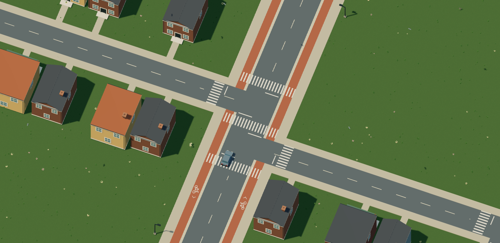
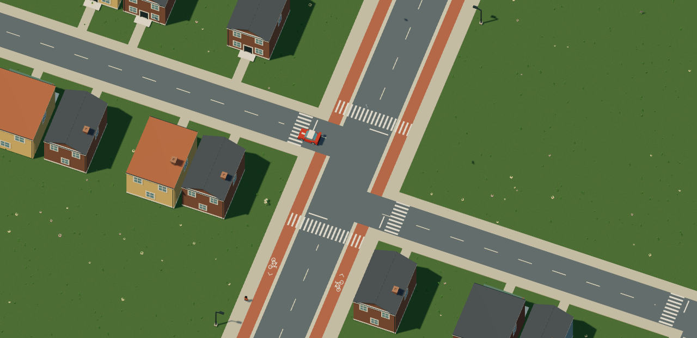
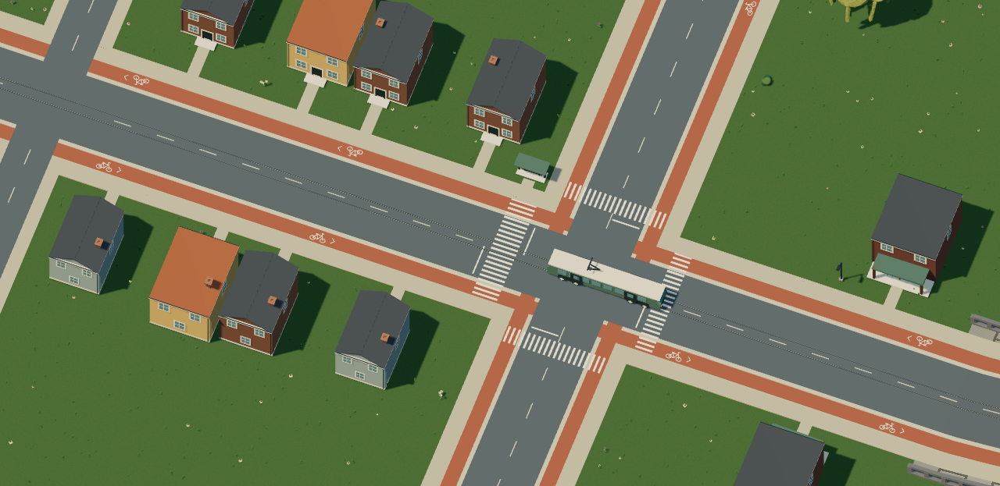
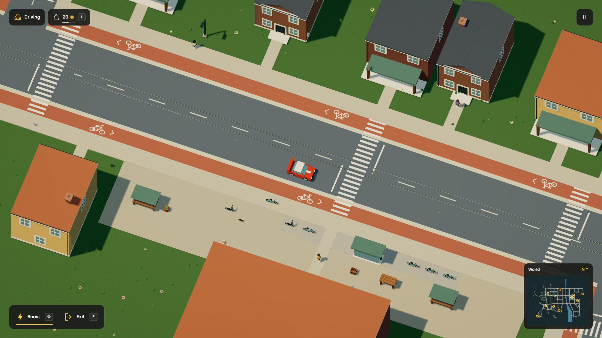

# Streets own the city

The live r68 world has no racing circuit, checkpoints, ice patch or track boost pad.
Its 32 streets provide the driving mask, sidewalks, cycle tracks, bridge approaches
and maps. Car boost and the other vehicle controls remain available. The older
circuit stays in the registered r67 projection and the explicit regression worlds.

The 1,700 existing object placements remain exact. Removing the circuit's reserved
corridor admits 19 existing lamp/tree/plant templates beside their authored streets,
for 1,719 placements. This adds five lamps and one market-maintenance target;
the service now covers 90 targets, including 78 lamps. NPC, route, CPU rig, ambient
and destruction limits have not increased.

## Crossings

The previous circuit-derived zebras are gone. In the street-only layout, nearby
junctions share their outer-arm crossings. Ten short internal arm crossings are
omitted from both paint and accepted pedestrian pavement. The remaining 160
arm/mid-block envelopes resolve into 159 paint groups: overlapping parallel
crossings share one envelope and a world-aligned stripe phase. Centerline and
stop-line clearance still comes from the accepted crossing envelopes. Tram rails
remain visible through crossings.

| Internal crossing during review | Outer arms after correction |
| --- | --- |
|  |  |

These are native PNG exports of actual accepted geometry, not illustrations.
The street-only rule is keyed to explicit scene data; legacy circuits retain their
original geometry for historical save validation.

## Dream and saves

A street-only Dream world declares one `world` with connected `street` data and
omits `road` and `checkpoint`. [Runnable source](../../examples/street-world.dream).
An optional circuit still requires one road and 2..64 checkpoints. The compiler
checks complete car clearance and requires every street component to connect to
spawn. Masks, render footprints, reservations and maps share that decision.

Save format 16 now pins simulation 25 and accepted-world fingerprint
`14dd5d35da484b860586a706311ca7c0adcfedbce87464b8414816cfe51ba6e7`.
The Dream source hash is
`fc58cce16b786720be6815c5f9eac9f1f11a69491b10701c11a5ce69e1accde6`.
The exact r67 projection remains
`b06274e07914b9b26b720ac81f155e6e6f51406adb84768a5a1c1ec01e49b082`.
The upgrade validates the old world/state first. It preserves lives, financial
ledgers, work commitments, owned businesses, damage, vehicles, matches and clocks.
The retired checkpoint index becomes zero and pad cooldowns are removed.

Pedestrian node references are rebased. A walker actually standing on a removed
zebra moves to nearby clear pavement, within a bounded 256-unit search, retaining
history, random state and clocks. Existing staff, repair, food, courier and shared
walking journeys keep valid paths; obsolete segments reroute to the same target
without cancelling a task, paying again or refunding supplies. Their movement
speed resets only when rerouted. Unsupported relocation fails visibly rather than
replacing progress. The old save slot remains available.

## Verification and media

The focused historical migration suite passed 105 tests before the final junction
refinement. Dedicated city checks cover the exact projection, all shared empty
circuit footprints, street-only driving/saving, disconnected-world rejection,
merged paint, old-slot retention, retired-zebra recovery and a rerouted staff trip.
The complete pinned browser-backup matrix checks every historical save through
the street-only target. The final full suite passed 1,348 tests across 104 files.
The subsequent diagnostic-type/boundary check passed 187 tests; the production
build passed typechecking and Vite, and the docs build produced 42 pages.
The standalone street-world example also passed the complete compiler boundary.

A native isolated `test-save` session opened the pinned r67 file, previewed the
compatible update, restored it and downloaded a new backup while paused. The
export retains every non-navigation/circuit field and exact simulation/world
time, including the two-coin player balance and owned three-coin depot.
[Restored backup](native-backup.json), [DOM record](native-restore.json), and
[paused UI](restore.jpg). Production/user slots were not replaced.

The city map was regenerated from compiled geometry. The driving GIF, HD video,
world/voxel-world posters and town-center still were refreshed together from
210 consecutive 2400 × 1350 rendered frames at 30 frames per simulation second.
No frames were interpolated. [Media audit](media.json).

Asset construction and existing local sports, commerce, nature and vehicle
recordings retain their accurate geometry. Older recordings remain historical
control/layout demonstrations; the map and captures above show the current city.
The new road mask uses the same four-unit raster as the released spline city:
9,625,000 bytes for its one-byte cell buffer. This is a mask-buffer count, not
total browser memory.

No new architectural template was added in this change.

## Limits

This removes the old layout constraint and cleans up junction paint. It does not
add a theme park or new park activities yet. Released ground is available for
connected destinations in the next world expansion. Geometry counts here are
not browser FPS, memory or weaker-laptop measurements.
