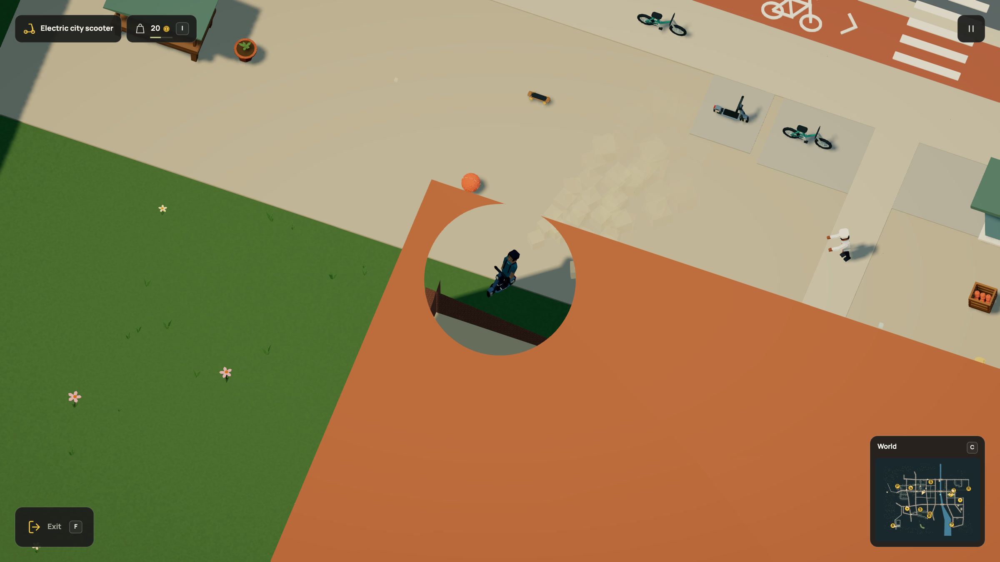

# Clean sight cutaways

2026-10-20. Static scenery and hill roads previously kept a screen-pixel
stipple over the player. Moving behind that fixed pattern interrupted the
character image. The actual GPU probe reproduced 15 blocked samples out of
72 moving-player samples in each of the scenery, terrain and road materials.

The same visibility data now opens a clean world-space corridor around the
viewing ray. At the ordinary .22 obstruction value it has a 26-unit radius.
The opening grows during the existing transition. Authored interior parts
continue to fully hidden at zero; opaque instances take an early return.
Scenery samples position after rigid motion and instancing. Shadow passes
retain the full caster.

This is a visual cutaway, not a hole in the physical building. Nothing changes
in Dream, contacts, collision, saves, geometry, instance buffers or draw counts.
Live unbatched object opacity fades retain their existing behavior. Exterior
shell buildings do not gain interiors through this effect.

## GPU checks

With the Vite dev server, [`tests/visual/cutaway.html`](../../../tests/visual/cutaway.html) renders actual
game materials and reads their render targets. The fixture asserts the result
and throws if it fails. Its controlled 600 × 320 views disable antialiasing for
exact pixel probes; the production renderer retains its normal post-processing.
This is a native WebGL test, rather than a shader-source string comparison.

- All three materials now pass 72/72 player samples through the sight opening.
  The camera and eight player positions match the original moving probe.
- An opaque control blocks all nine center probes. Closing the reveal restores
  all nine. A mid-transition scenery opening keeps the center clear.
- A zero-visibility tagged part disappears completely. Its opaque neighbour
  stays unchanged, including during that full hide.
- The 64 × 64 test shadow-map bytes stay identical through moving reveals and full part hiding.
  Each map contains 231 distinct pixel values, so this is not an empty-map test.
- Final native console warnings/errors were empty. [Before](before.json),
  [after and controls](after.json), [before image](before.png),
  [after image](after.png).

## Complete world

The in-app browser boarded the actual market scooter, drove and turned behind
the roof, and showed a clean opening with one reported occluder. The native
exporter recorded a 240-frame ride, turn, jump and brake at 30 rendered frames
per simulation second. The GIF, HD video and frame-95 still were refreshed
together. No missing frames were interpolated. The final opaque fast path
preserves those exact rendered states and passed the GPU checks again.

[HD recording](../../media/scooter.mp4) · [GIF](../../media/scooter.gif)

The night market interior retained its complete floor, furnishings and light
pool while the tagged roof and near walls hid. Q rotated the view without
moving the player. R returned to the original car. Console warnings/errors
were empty. [Night interior](interior.png), [rotated](interior-rotated.png),
[public state checks](world-checks.json).

## Verification and limits

Focused scenery, streaming, interiors, wind/topple and batching checks passed:
44 tests in five files, 6.77 seconds. The instruction-size check and 38 docs
checks also passed. Production build/typecheck and the 44-page docs build
passed; the existing bundle-size advisory remains. The full suite was not
repeated for this shader change. This was self-reviewed, without independent
review. [Source, frame/output hashes and commands](manifest.json).

README, rendering, interiors, world priorities, media provenance and invariants
were updated. Other asset and interaction recordings retain their recorded
presentation and unchanged rules. Fully hidden interior stills remain accurate
because that final state is unchanged. No vocabulary or runnable Dream example
changed.

This removes the identified stipple interference. Ordinary small-detail aliasing
and live object fades remain separate visual limits. Pixel counts are controlled
GPU correctness checks, not live FPS or lower-powered laptop measurements.
