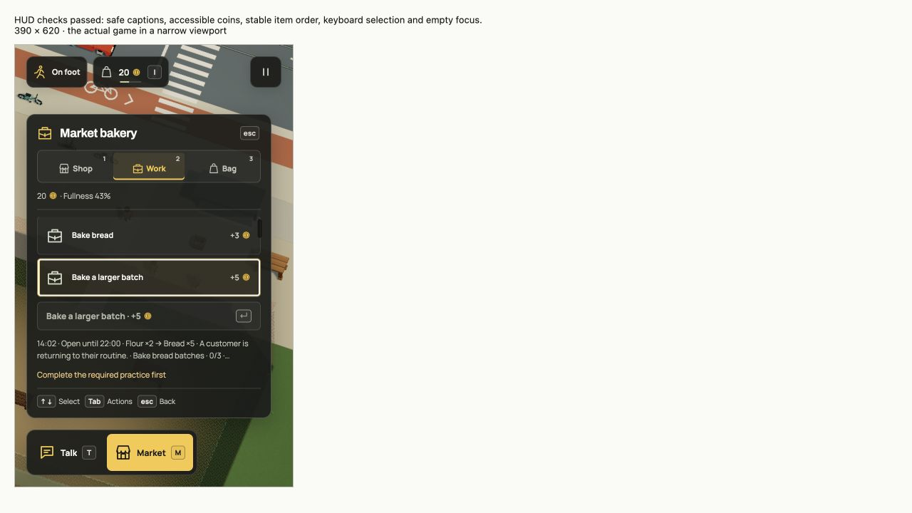

# Contextual keyboard HUD, r66

The HUD now keeps a single left edge for status, actions and activity panels.
It uses charcoal surfaces, warm white labels, yellow selection and a separate
light keyboard-focus outline. Fixed SVG coins have the accessible name “coins”.
This replaces the earlier large paper cards and native gameplay form controls.

## Executed native checks

- Opened the market with M. Arrow keys selected another item; Enter bought it.
  Opening Bag immediately after submission retained the purchase.
- Ate the selected carried food with Enter, then switched to Work. Buying,
  eating and paid work changed the real finite accounts and inventory.
- Tab reached the selected item and secondary actions. Tab wrapped to Close;
  Shift+Tab wrapped back. Escape closed the panel before P opened Pause.
- WASD and Q/E stayed in the activity panel. Read-only rendered diagnostics
  confirmed unchanged player coordinates and camera quaternion while navigating.
- At the owned depot, left/right changed the amount from five to two. Enter
  deposited two; Tab reached Withdraw and Enter returned those two. Player cash
  returned to two, company cash to three. This used an isolated review save,
  loaded from the checked native fixture, not the public player's slot.
- The 390 × 620 native iframe review displayed the selected work row, its locked
  action reason and the keyboard footer together. Source-native caption/slot
  checks passed for literal markup, coin meaning, stable order, one tab stop,
  selection and empty-list focus.
- Rapidly selected Work, moved down/up and pressed Enter: the real bread job
  began and focus moved to Cancel work. A held 900 ms Enter bought one vegetable,
  then Bag + Enter ate one. Action requests used the current selection.
- [Declared text/focus contrast checks](contrast.json) passed with the charcoal
  HUD composited over white, its brightest underlying scene. This is a bounded
  color check, not a complete accessibility certification.
- + increased rendered camera zoom; 0 returned manual framing towards its
  default through the ordinary follow-camera smoothing.

The [market](../../media/market-controls.png),
[business](../../media/business-controls.png) and
[closed HUD](../../media/context-actions.png) screenshots use the actual game.
Current 30 fps motion exports are listed in the [media audit](../../media/README.md).

Automated regression, build and docs results are recorded with the
[business evolution](../business-ownership/verification.md). No automated browser
benchmark, touch steering, gamepad mapping or real Muse call is claimed. Full
screen-reader play has not been tested with a screen reader.
