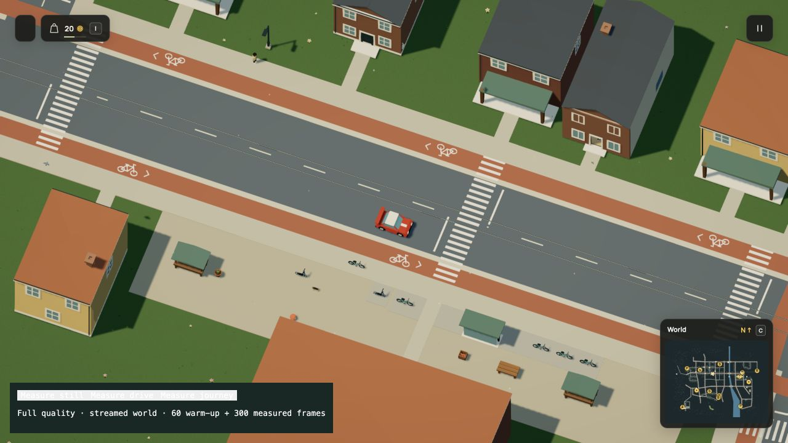

# Give the browser time during navigation checks

Baseline: `ddddd6bf1629ea29f7afa41d119fdecd2eda2675`. The previous goal turn
shipped paid customer visits and made progress. This pass addresses a measured
startup stall; the larger living-world quest remains active.

## Change and retained behavior

The receiving client previously validated the complete repair/journey packet in
one synchronous call. It now uses the loader's existing cooperative build loop:
public nodes yield in batches of 32, indoor support and directed-edge checks per
node. The synchronous fixture entry point drains the same generator. All checks
still run, and coverage/topology install only after the complete packet passes.
Abandoning validation or rejecting a late packet leaves previous caches intact.

Indoor membership now reads declared grounds without rebuilding repair coverage.
That avoids repeating the worker's target/verge survey. Any missing graph
fallback still builds the original complete work area. Received coverage retains
its separate contact, category, order and bounds validation.

No Dream vocabulary, authored world, physical rule, save schema, migration,
geometry, animation, camera, visual setting or streaming policy changed.
The world remains r119 / simulation 60, fingerprint
`f84a4ee5fe7dbf90e27e888506c57fb5b6715fe8715f680b95f0680470af73b1`.

## Controlled Node diagnostic

`benchmark.mjs` builds the real worker packet, then primes it in two fresh Vite
SSR host contexts. Before uses the exact baseline `repair.ts` from Git; after
uses the current cooperative validator with the loader's 12 ms scheduling budget.
Both prime contacts and pedestrian navigation first. Module loading, worker
compilation and packet cloning are outside the measured validation interval.

| Receiving navigation validation | Before | After |
| --- | ---: | ---: |
| Active time | 986.36 ms | 595.87 ms |
| Wall time including cooperative waits | 986.37 ms | 654.65 ms |
| Maximum active slice | 986.36 ms | 13.61 ms |

This is one controlled pair on Node 26.8.1, macOS arm64, Apple M3 Ultra. It is
not a browser frame-time or weaker-laptop result. The installed 26 graphs,
64,775 aggregate nodes and 253,460 aggregate directed links compare exactly,
including coverage and order. These are totals across separate bounded graphs,
not increased per-graph limits. The complete current packet deep-equals the
pre-edit packet, including all 77 populated historical fingerprints.
[Raw diagnostic and source hashes](diagnostic.json).

Run from the repository root:

```sh
node docs/evidence/cooperative-navigation/benchmark.mjs > /tmp/navigation-checks.json
```

The optional packet argument accepts a pre-edit V8 packet for the complete
deep comparison. The recorded run used
`.npm-cache/startup-preparation/after.bin`, produced before source edits by
the existing startup-preparation benchmark. It is ignored generated data.

## Quiet native browser starts

Two starts per version used the same local Vite origin and
`?profile&test-driving=town` in the Codex in-app browser, warm dependency/network
and driver caches, 1280×720 CSS viewport, 1920×1080 drawing buffer and DPR 1.5.
No tests, builds or diagnostic processes ran concurrently with these starts.
Other desktop activity was not isolated. These are not cold-network, Chrome or
less-powerful-laptop measurements, and two samples do not establish broad confidence.

| Native metric | Before A | Before B | After A | After B |
| --- | ---: | ---: | ---: | ---: |
| Worker preparation | 15,994.9 ms | 16,161.5 ms | 16,015.5 ms | 16,173.4 ms |
| Complete first draw | 23,764.5 ms | 23,645.4 ms | 23,582.4 ms | 23,723.3 ms |
| Maximum 50 ms-heartbeat gap | 1,797.1 ms | 1,480.8 ms | 240.8 ms | 250.8 ms |
| First-draw CPU/submission | 145.6 ms | 158.9 ms | 149.3 ms | 143.8 ms |

The observed improvement is a smaller main-thread startup gap. Complete loading
still takes about 23.6 seconds here; this does not establish a loading-duration
or driving-FPS gain. Individual meshes, uploads and other startup stages can
still block, including the remaining roughly quarter-second gaps.

All four screenshots are byte-identical. Settled before-A/after-A views retain
165,032,964 tracked geometry-buffer bytes, 2,186 geometries, 12,674 unique buffers,
1,478,852 unique triangles and identical 35-chunk membership. Those are constructed
buffers, not total browser memory or VRAM. Before B was sampled before four
prefetch chunks finished; its counters are not used as a settled-memory comparison.
[Comparison assertions](comparison.json).

The after-only native drive completed 60 warm-up and 300 measured frames through
the real controller with zero streaming holds. The minimap opened afterward.
[Live report](native-drive.json). This is a functional check, not a paired FPS claim.



## Verification and limits

The 32 selected checks cover startup/error ownership, malformed packets, atomic
coverage/topology, cancellation/late rejection, supported upstairs paths, live
contacts and the city's exact short routes. Final follow-up checks reran the two
affected repair/upstairs files after a type correction. The production build
passes, including TypeScript, with the existing large-bundle warning.

Documentation verification passed 55 site/highlighting/instruction-size checks
and 47 local-link checks. The other 147 example/compiler checks in that file
were intentionally filtered out because their sources and vocabulary are unchanged.
The published documentation build passes. Raw test/build logs are retained here.

README, rendering, world-system backlog, media provenance and agent instructions
were reviewed and updated. The Dream reference/model contract/examples remain
accurate because no language feature changed. Existing HD/GIF/still sets retain
the same visual/control inputs; motion was not regenerated for this scheduling
change. Native startup stills provide the current retention evidence.

The full suite was not repeated: this pass changes bootstrap scheduling and
removes redundant derived work, with an exact complete-packet comparison and
focused behavior checks. Compiler/physics/save transition semantics are unchanged;
CI retains the complete suite. No provider call, deployment, independent review,
general performance guarantee or resolution of the unreproduced deployed Chrome
minimap report is claimed.
