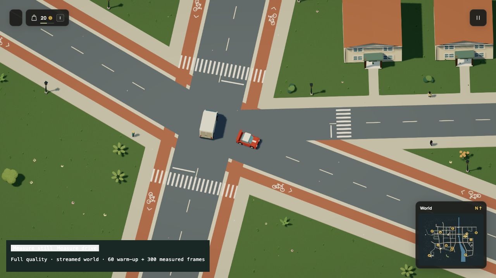
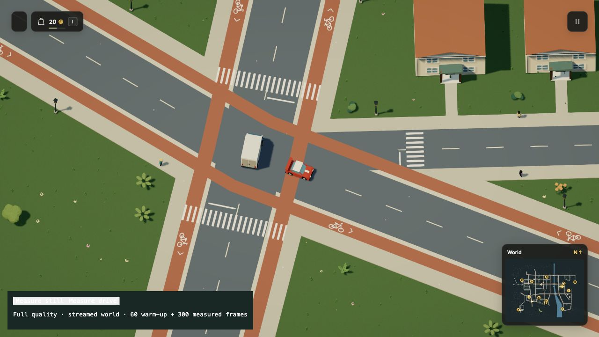

# Cycle surfaces through junctions

2026-10-19. Mock city r71. Self-review by the implementing agent.

The dedicated cycle footprint yielded to every carriageway. That left orange
bands ending abruptly at intersections, even when the same facility continued
on the other side. The first new renderer regression fails on commit `552dc94`
at `[800,434]`: accepted pavement exists, but the cycle surface has no hit.

| Previous surface | Connected junction |
| --- | --- |
|  |  |

These native browser views share the same camera and frozen scene time. The
before server pins the previous renderer and minimap to full commit
`552dc941c227514f5ee73cae5485ebad810f4b2f`; both use the same current world and
the dev-only terrace review pose. The clean [product view](../../media/cycle-junction.jpg)
and [ordinary driving view](driven.jpg) use the current game, with saves disabled.
The latter includes a camera rotation and forward driving. No console warning
or error appeared in that native session.

## Shared derived surface

`streetCycleSurface` connects facilities only at declared junctions. Through
lanes retain their ribbon. An ending street extends its bands only as far as a
connected cycle street's riding envelope, inside a bounded crossing-arm area.
Where no cycle facility continues, the approach ends without an isolated far-side
cap. Nearby roads without the shared centerline remain exclusions. The surface
is unioned once before render chunks clip it. Dedicated physical footprints,
glyph fitting, reserved ground, walking paths and collision masks stay unchanged.

Separators, centerlines and stop bars clear the connected color. Zebras remain
visible above it. The minimap and published SVG use this same helper; the SVG
draws cycle paint after carriageways. Legacy circuit and rendered timber-deck
exclusions survive. No new DSL field, model-generated code, actor or physics body
is introduced. The reference and model packet explain the derived policy; the
generated field contract retains its existing vocabulary.

The shallow hospital/terrace fork retains its wide physical layout. Colored
continuity does not implement signal priority or cyclist routing, and these
checks do not certify every road, marking or urban placement in the city.

## Verification

The renderer regression covers all four cycle crossings. Other tests cover
T-junctions, terminating facilities, reversed street direction, duplicate
declarations, successive junctions, a nearby unconnected road, wide lanes,
white-paint/separator overlap, both sides of a streamed chunk boundary and the
continuous hospital ribbon. A returning cycle street also joins its two ends
instead of losing its corner to the two inner caps. The native review preset has a clear live-world
start and leaves normal starts untouched.

```sh
npm test -- --maxWorkers=2 --testTimeout=60000
npm run build
npm run docs:build
npm run -s dream -- check docs/examples/cycle-junctions.dream
node docs/evidence/cycle-crossings/check.mjs
node --expose-gc scripts/profile-world-acceptance.mjs 552dc94 docs/evidence/cycle-crossings/acceptance.json
```

The [complete acceptance comparison](acceptance.json) retains the exact Scene,
all current and historical fingerprints, contacts, navigation, repairs, old
interior/verge data, placements, bounds, mask and 2,761 terrain samples. Format 16
/ simulation 29 remains current. There are still 1,769 objects and 181 ambient
members. The source hash is
`1d19ee0a8684bfb081d4e896b3cf33e1f5146001509263768260f9f09ef897d9`;
the accepted fingerprint is
`5297667c16ec9218ef46e6cbf82cfdffe826220f92572f16d85f88ef5c8c2c53`.
The comparison's explicit-GC heap checkpoints retain two worlds and do not
establish memory savings.

The [complete street mesh check](geometry.json) counts 2,698,787 → 2,716,659
triangles and 204,283,354 → 205,648,890 geometry-buffer bytes. Both have 2,003
meshes. These are complete Node street meshes, not the streamed browser's total
memory or VRAM. The [matched native view](render-after.json) retains 203 draws,
with 612,594 → 614,417 rendered triangles, a 0.30% increase. On the local M3 Ultra
with 96 GiB, mean GPU time was 1.568 → 1.529 ms and frame intervals stayed near
16.67 ms. These single runs overlap other checks; they do not establish a speed
improvement or performance on weaker laptops. The initial implementation created
unnecessary splits; the final implementation cuts openings in the road exclusions
instead of rebuilding the full lane at every junction.

README, urban-world, rendering, world-systems, the Dream reference, model packet,
repository guidance and media notes are reviewed and updated. The runnable
example uses shared junction anchors. The city map and junction still are
refreshed, alongside the adjacent hospital approach and driving, boost and
vehicle-switching GIF/HD/still sets.
Older focused activity recordings retain their recorded mechanics and historical
background paint; they are not evidence of this new junction surface. Existing
asset sheets remain accurate because no model, material, physical placement or
animation changes here. Walking-contact recordings remain the animation reference.

The frozen final source passes 1,432 tests across 121 files with two workers and
60-second test deadlines (293.75 seconds locally), including all nine focused
cycle-surface cases. The production/type check, runnable example and 44-page docs
build pass. The existing large-bundle advisory remains. No timeout, fatal-error
policy, visual setting or simulation budget was relaxed. GIF and HD outputs
fully decode; all 660 native source frames and matching stills are recorded in
[the media manifest](media.json). No provider integration or save migration is
part of this change. [Tested source hashes](tested-source.json).
