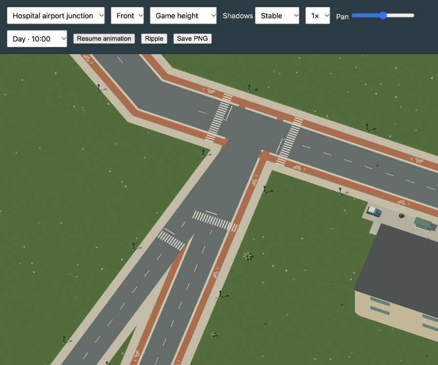
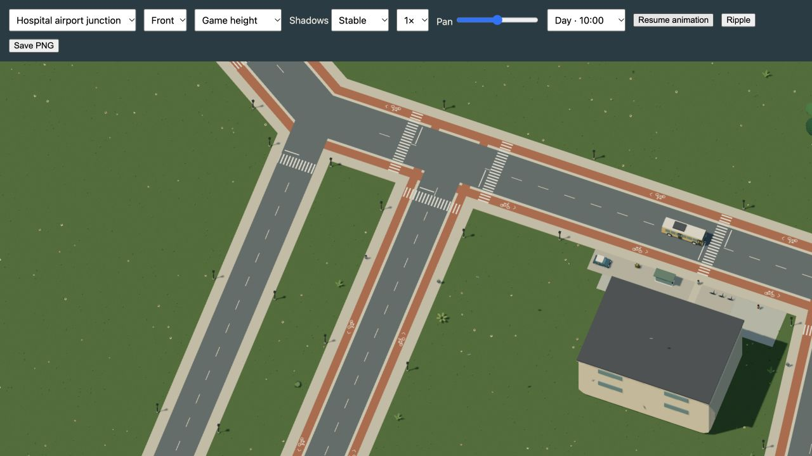

# Give the airport road its own junction

The previous airport connector met hospital street at thirteen degrees. Their
carriageways left a long triangular cycle strip between them, while separate
arm crossings made the merge harder to read. The r70 Dream layout brings the
airport road to South avenue at `[3000,6500]`, 300 units west of the hospital
junction. The two approaches now have a clear block between them. The airport
shuttle follows the revised carriageway, and its lamps follow that road.

| Previous acute merge | Separate approaches |
| --- | --- |
|  |  |

These are native browser renders. Their viewport sizes differ; they are visual
checks, not a pixel comparison or a performance measurement. The opposite view
and nighttime view were also inspected: [back](back.png), [night](night.png).
The product still crops the native canvas without resynthesis. The published
city map is regenerated from the accepted scene.

## Check the accepted geometry

```sh
node docs/evidence/cycle-junctions/audit.mjs
npm test -- --maxWorkers=2 --testTimeout=60000 tests/airport-junction.test.ts tests/junction-save.test.ts tests/spacing-save.test.ts
```

The [coverage report](road-coverage.json) checks all 32 streets: 255,868 projected
carriageway triangles cover all 68,385 sampled points. Samples follow each segment
at five-unit intervals, along its center and eleven units inside either edge.
This does not establish topmost paint correctness, streamed seams, turn clearance
or complete visual correctness. The audit still identifies a 25-degree fork at
hospital street / South terrace. That fork and the other cycle-corner details
remain work to finish, rather than a claimed clean audit of the whole city.

The focused checks cover the clear block between the two approaches, the shared
crossing on their short connecting avenue, full bus-route carriageway support,
and single painted zebra coverage. No renderer, physics, population or asset
budget was raised. The newly clear layout admits seven static furnishings and
two walking residents, for 1,769 placements and 181 ambient members.

## Keep the saved world

Format 16 / simulation 28 registers the exact r69 projection. The old approach,
route, crossing set and changed placements are retained as host compatibility
data. All old object IDs survive. The checked migration retains ledgers, work,
stock, ownership, damage, parked vehicles, matches, NPC memory and clocks. It
rebases derived pedestrian portals and obsolete work paths; the two new walkers
start at the saved tick. An airport-bus passenger stays aboard its revised route
at the same simulation time. Unsafe active poses retain the existing clearance
recovery. The previous slot is kept after a successful new write.

All 28 pinned historical backups migrate through their existing registered
stages. Native saved progress is compared field by field, apart from derived
portal indices and new members. Save/reload and the next fixed simulation step
remain deterministic. The airport passenger case is checked separately.

The native browser review drove the hospital approach from `[3300,7000]` through
the junction. On the separate local origin `127.0.0.1:5220`, the normal backup UI
previewed and restored the released simulation-27 backup, then saved and reloaded
it. The bench seat, two personal coins and Station supplies ownership with three
company coins survived. [Preview](backup-preview.png),
[reloaded state](native-reloaded.png), [read-only diagnostics](native-reloaded.json).
The console had no warnings or errors. Production progress was not imported or
replaced. Review work on the player's existing port remained separate.

The accepted source hash is
`9866be976ef67c029cfc0e6169c80643c25906cbbf01d311722f856a69ac0e9e`;
its simulation-28 fingerprint is
`dc6d2c4b9ab4648a7ff99d47a20e60792c1d940e299e90bbe6fa047fb4e4b66f`.

README, river-city, persistence, rendering, media and repository guidance were
reviewed and updated. The city plan and new junction still are refreshed. Existing
activity and transport clips do not traverse the changed approach, so their local
views remain accurate. There is no new vocabulary or animation in this change;
existing runnable Dream examples remain applicable. This is a self-review.

The final tree passes 1,381 tests across 112 files with two workers and the
unchanged 60-second deadline (276.58 seconds locally). Production/type checks
and the 43-page documentation build pass. The existing large-bundle advisory
remains. Historical park/spacing tests explicitly use the released r69 projection;
current-world tests check the newly admitted population and lamps. The separate
retired-sidewalk regression retains a saved walker's history and a moved lamp's
damage while recovering the obsolete position. No timeout, fatal-error policy,
render detail or simulation budget was relaxed.
