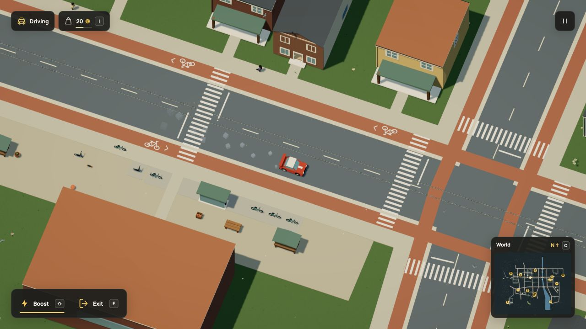

# Reuse fitted foundations during startup

Native baseline: `af57479`. The live r100 Dream world and simulation version 44
stay unchanged. The larger living-world goal remains active; this removes one
measured preparation cost before further resident and interior work.

## What changes

Worker preparation used to survey the same foundations again for historical save
projections. It now borrows an existing fit only when the immutable object and
terrain references match and the source is at its authored XY. Floor bindings,
ordinary props, changed terrain and independently authored objects are excluded.
An existing target fit is retained. Moving-position invalidation stays local to
its original scene. The placement algorithm, support samples and physics rules
are unchanged; this is host preparation, not a Dream or saved field.

## Exact data check

The [benchmark](benchmark.mjs) runs the complete worker through Vite SSR. Baseline
mode disables only the foundation-priming call. It still accepts the world,
checks every migration fingerprint and constructs every original packet field.
The [verifier](verify.mjs) compares the complete decoded packets and the ordered
preparation results. All 56 populated historical fingerprints, the current hash,
contacts, pedestrian/repair navigation, foot support, stream bounds and accepted
scene match. Three additional optional historical slots remain undefined.

The V8 round trip retains undefined fields, Maps, non-finite numbers and negative
zero. Its raw binary encodings differ by four bytes in this run. Raw VM bytes are
therefore retained as diagnostics, rather than treated as canonical world data.
The decoded structures and ordered Map results compare exactly. Only the measured
`compileMs` field is excluded from the packet comparison.

| Node worker preparation | Baseline | Reuse |
| --- | ---: | ---: |
| Complete preparation | 16,018.3 ms | 14,364.1 ms |
| Packet preparation after fingerprints | 8,835.3 ms | 7,154.3 ms |

These are one paired diagnostic run on Node 26.8.1, macOS arm64, Apple M3 Ultra.
They include measured-call instrumentation, but no real Web Worker transfer,
renderer or browser draw. Serialization/comparison occurs after the timed worker
preparation. [Baseline](node-before.json), [reuse](node-after.json) and
[comparison result](packet-check.txt) retain the source fingerprints and results.
The byte counts describe V8 comparison files, not browser heap or transfer size.

Run from the repository root:

```sh
node docs/evidence/foundation-reuse/benchmark.mjs baseline > /tmp/foundation-before.json
node docs/evidence/foundation-reuse/benchmark.mjs after > /tmp/foundation-after.json
node docs/evidence/foundation-reuse/verify.mjs /tmp/foundation-before.json /tmp/foundation-after.json
```

The benchmark writes its full comparison snapshots under ignored
`.npm-cache/foundation-reuse/`. Recreate those snapshots before running the
verifier on a fresh checkout.

## Native browser measurements

Three quiet starts per version used the same `?test-driving=town` route in the
Codex in-app browser, with the Vite dependency cache warm. No project tests, motion
exports or Node benchmarks ran concurrently. Other host activity was not isolated.
No window resize was requested. Only the after runs recorded viewport dimensions:
1280×720 CSS and 1920×1080 drawing buffers. This is not a pixel comparison or a
controlled cold-network benchmark.

| Native startup | Before median | After median |
| --- | ---: | ---: |
| Worker preparation | 13,299.7 ms | 11,915.5 ms |
| Complete loader | 17,937.9 ms | 16,309.8 ms |
| First draw alone | 137.6 ms | 136.1 ms |

Worker preparation was about 10.4% shorter and the observed complete loader about
9.1% shorter in these local samples. Full ranges and every phase/heartbeat sample
remain in [before](browser-before.json) and [after](browser-after.json).
The main-thread preparation gaps remain; this does not establish improved frame
rate, input latency, total memory or lower-powered-laptop performance.

Native W input still drove the car after loading. The view retains all 1784
objects and 256 birds; browser warnings/errors were empty. The isolated review
route does not write the normal player save. [Observed drive](after-drive.json).



## Verification and media

All 47 focused checks passed across `foundation-reuse`, `foundation-reuse-world`,
`object-placement`, `floors`, `startup` and `save`. They cover identity/terrain
boundaries, moving caches, exact historical contacts/graphs, underside fitting,
upper floors, worker failures and saved control domains. The production build
passes with the existing large-bundle advisory. [Tests](tests.json),
[focused log](focused.txt), [build](build.txt). The final two documentation suites
passed all 198 checks, including the published-site build, links and downloads.
[Documentation checks](docs-checks.txt).

README, the rendering guide, world-systems backlog and cache invariants are
updated. Existing screenshots, GIFs and videos remain accurate: no render asset,
shader, control, resolution setting or accepted geometry changed. No new motion
export was needed. The full suite was not repeated for this behavior-preserving
worker-cache change; CI and the merge/release gate retain it.

Ordinary props and changed support contexts still compute fresh placements.
World acceptance and first-neighborhood construction remain significant costs.
This does not add a new activity or complete the broader living-world goal.
