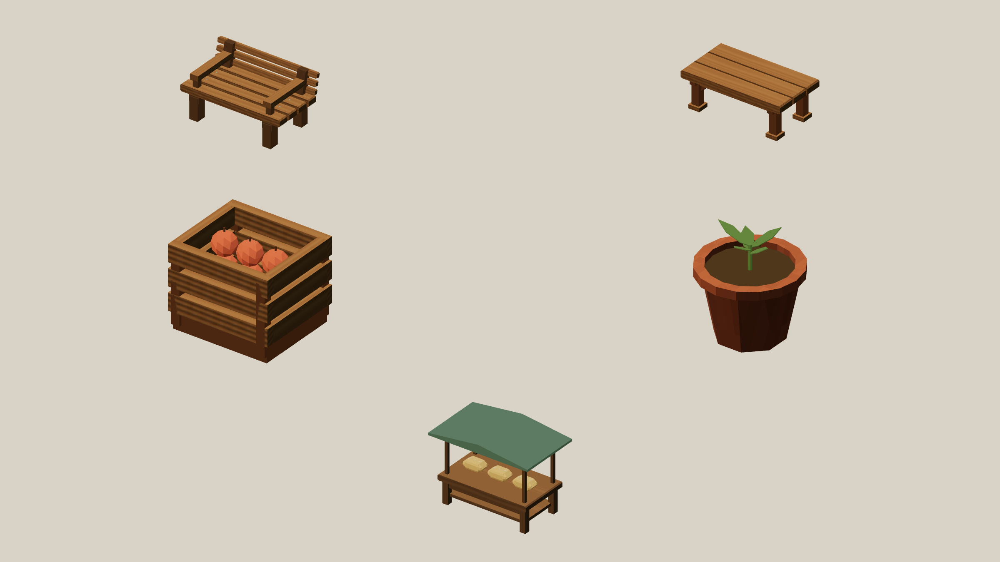

# Furniture construction

2026-10-19. Mock world r78. Self-reviewed geometry, simulation and native browser
output. This is one family in the continuing whole-library pass.

## Scope and construction

Five templates cover all eighteen live placements: ten slatted benches, three
breakaway tables, two produce crates, one terracotta planter and two produce
stalls. Their part counts are 31, 23, 32, 21 and 28. Existing Dream components,
beams, profiles and fragments express the new construction without new vocabulary.
The [complete example](../../examples/furniture-construction.dream) compiles to
exactly the five live definitions, before the world applies its voxel policy.

The [r77 baseline](baseline-front.png) was captured from `faf27fd` before source
changes. Matching [front](after-front.png), [right](after-right.png),
[back](after-back.png) and [left](after-left.png) exports inspect the replacements.
Native exports retain 2400 × 1620 pixels. The original three other angles are
retained beside them. These are rendered Dream geometry, not concept images.

The attachment check caught an unsupported middle table board. Raising its
crossrail to meet the underside fixed the actual join. A first planter draft had
small protruding base corners; wall-aligned octagonal quarter panels removed them.
The final tests check all five part graphs, actual contacting fruit surfaces,
closed clay shell seams, an open lip with visible soil, supported seat positions
and the table's middle board after voxel reconstruction.

The table was 1.26 metres tall. Its top and collision cap now agree at about
78 cm. Its width, floor, placement and horizontal collision radius remain fixed.
Other bodies, measured frames, seat positions, shared break rules and furnishing
reservations retain their released values. The complete pedestrian graph has
identical nodes and starting indices. Only the three table contact tops change.
No actor, rig, fragment or population cap is raised.

## Saves and playable behavior

The registered projection reproduces the exact r77 fingerprint from the immutable
five-template/eighteen-placement snapshot. The worker sends the matching prior
contacts before priming navigation. All earlier stages first remove this revision.
Save format 17 and simulation 32 stay unchanged.

The 46-backup historical matrix retains every saved field and visual clock. It includes
occupied vehicles, cargo, active work, growing trees, repaired benches, shared
meals and active destruction. A separate old table save retains seven moving
fragment identities and poses. An occupied bench remains occupied; a walker on
the old taller table settles onto its lower cap through normal fixed steps.
Public and isolated review prefixes preserve their original slots independently.
[Source and matrix manifest](manifest.json).

The native browser restored the existing fleet-review save. Its downloaded
[migrated packet](native-migrated.json) exactly matches the old r77 state and
visual time. Forward input reached the existing collision boundary; reversing
moved the truck about 15 metres. The [driven](native-driven.json) and
[reloaded](native-reloaded.json) packets match exactly, retaining the same truck,
20 coins and two sealed bread units. The [asserted comparison](native-check.json)
and [pause screen](native-save.png) retain that evidence. No public player slot
was used by these reviews.

The native destruction review shows the rebuilt bench, table, crate and planter
releasing 7, 7, 8 and 6 pieces. Screenshots retain the
[table](broken-table.png), [crate](broken-crate.png) and
[planter](broken-planter.png). The seating recording uses real purchase, walking,
sitting, eating and standing transitions. The repair recording destroys and
restores the crate through the existing finite worker, material and pay rules.
The final native gameplay and destruction reviews reported no warnings or errors.

Saved fragment state is preserved; subsequent trajectories can change because
the reconstructed parts have new extents. The produce and stall loaves remain
visual props, without new harvesting or stock rules. The stall is still solid
and not destructible. General interiors and arbitrary furniture interaction
remain separate work.

## Checks and documentation

- Full suite: 1,558 tests in 139 files passed, 494.51 seconds, two workers and the
  existing 60-second test timeout.
- Focused construction, migration, historical botany and media boundary checks:
  15 tests passed. Updated model-packet and documentation checks: 133 passed.
- `npm run build` passed typechecking and production bundling. Vite retains its
  existing large-bundle advisory.
- The complete furniture example passed the compiler: five assemblies, 135 parts,
  zero joints, no world or provider calls.
- `npm run docs:build` built all 44 documentation pages. The native browser
  inspected the new section and its [Minimum Effort layout](docs.png).
- Both project skills validated. `git diff --check` passed.

README and the construction, asset, object, proportions, persistence, impact,
model and media guides are updated. The command contract, language reference and
highlighter were reviewed; vocabulary is unchanged. The complete atlas and
public-space sheet are refreshed. The map's coordinates and horizontal envelopes
are unchanged. Other family close-ups retain their original, unchanged objects.
Older commerce footage records its historical furniture; refreshed seating and
repair footage show the replacements.

The frame manifest records 240 furniture, 210 driving, 480 seating, 840 repair
and 120 destruction PNGs, each actually rendered at 30 frames per simulation
second. Each GIF and HD video is encoded from that sequence, with a matching
poster. No frame interpolation or performance claim follows from these offline
exports. Identical rendered frames are retained during still intervals; the
manifest distinguishes file counts from unique pixel hashes.

Thirty of 109 loaded exports have completed this construction pass. The other
79, separate engine rigs/infrastructure and optional examples remain on the list.

## Live rendering sample

The built-in profiler ran after tests and encoders finished, in the in-app browser
on Apple M3 Ultra / 96 GiB, macOS 26.7.1. Each scenario uses 60 warm-up frames and
300 measured frames at a 1920 × 1080 render buffer, pixel ratio 1.5, with the
existing quality and streaming settings.

| Sample | Mean RAF interval | Mean CPU prepare/submit | CPU p95 | Mean GPU |
| --- | ---: | ---: | ---: | ---: |
| [Still](profile-still.json) | 16.668 ms | 3.019 ms | 3.600 ms | 1.354 ms |
| [Short drive](profile-drive.json) | 16.667 ms | 3.841 ms | 4.900 ms | 1.481 ms |

Each GPU result has 299 completed query samples. The final
[residency report](profile-residency.json) counts 150,083,154 bytes of unique
resident geometry and instance buffers. That is neither total browser memory nor
VRAM. The short drive prefetched 30 chunks, had no pending work at the end and
did not travel far enough to evict a chunk. Existing streaming/disposal tests
still pass. This is a short sample on this machine, without a matched previous
build or a less powerful laptop; it does not establish a speedup or performance
on other hardware. Startup overlapped the final media work and is not reported
as a benchmark here.
